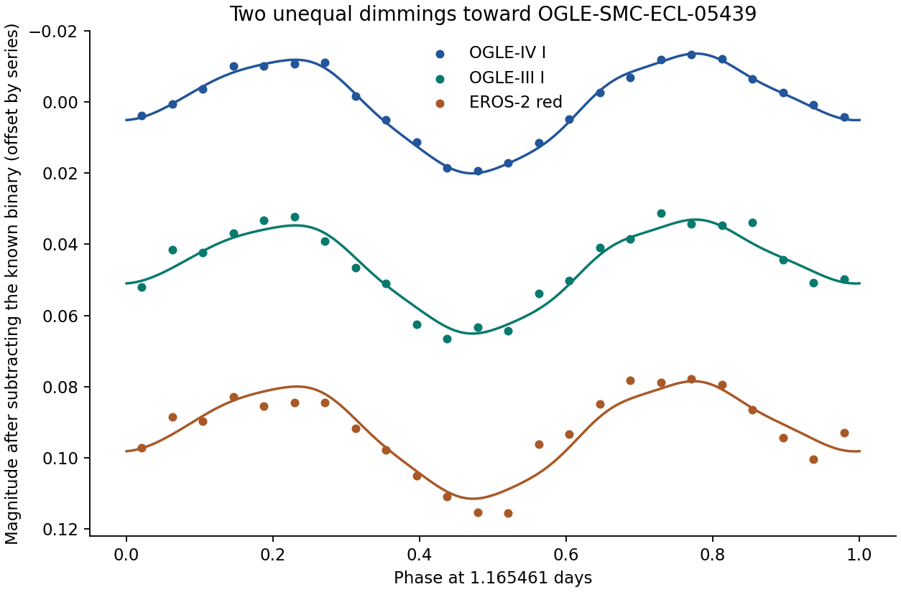

# Two unequal dimmings at a second period toward OGLE-SMC-ECL-05439

The known 1.451131-day eclipsing binary OGLE-SMC-ECL-05439 has a second optical waveform with a **1.165461-day full period**. In OGLE-IV the two minima dim by **0.03364 and 0.01870 mag** relative to the secondary waveform's brightest phase. The deeper and shallower minima alternate. Independent EROS-2 and DECam photometry recover that alternation when given only the periods, phases and shape derived from OGLE-IV. The waveform makes this a candidate sightline for a second binary. Contact eclipses, ellipsoidal modulation, rotational variability and a projected variable remain physically distinct explanations.



## Independent test of the full period

The earlier Open-Space population table recorded the strongest sinusoidal residual at 0.582732 d. We inspected stars with prominent unflagged residuals in that exploratory screen, including 01844, 01947, 02360, 03848 and 05439. We asked whether successive cycles differed consistently enough to reject identical repetitions at half the proposed full period. OGLE-IV I supplied the fitting data. OGLE-III had already informed the original screen. EROS-2 and DELVE/DECam supplied the independent follow-up observations for 05439. Selection was retrospective. No population-level false-alarm probability or survey completeness is inferred.

The joint training fit has a baseline, nine Fourier harmonics of the catalog binary and eight of the secondary waveform. We refined both frequencies around their screening estimates. The peaks in the secondary magnitude profile lie at phases 0.4716 and 0.9952 relative to HJD 2459000.0. Even harmonics repeat every half period. Odd harmonics reverse sign after half a period and encode the alternating-depth contrast. For each comparison light curve we fixed these two secondary templates and independently measured their amplitudes. The unit scale reproduces the OGLE-IV I profile. Ground-survey fits allow a separate 9-harmonic waveform for the known 1.45-day orbit. Reported conditional standard errors group residuals by integer HJD. The EROS bands share epochs. [Original candidate table](../smc-01293/data/population.csv.gz) · [Complete fit results](results.json)

| Observing series | Measurements | Repeating component scale ± SE | Alternating component scale ± SE |
| --- | ---: | ---: | ---: |
| OGLE-IV I, training | 2,351 | 1.00 ± 0.02 | 1.00 ± 0.04 |
| OGLE-IV V | 75 | 0.90 ± 0.12 | 0.87 ± 0.15 |
| OGLE-III I | 617 | 0.96 ± 0.05 | 0.94 ± 0.08 |
| OGLE-III V | 87 | 0.76 ± 0.13 | 1.06 ± 0.18 |
| EROS-2 red | 527 | 1.02 ± 0.07 | 0.89 ± 0.10 |
| EROS-2 blue | 573 | 0.96 ± 0.07 | 0.83 ± 0.12 |
| DECam gri, catalog zero points | 154 | 1.08 ± 0.18 | 1.24 ± 0.26 |
| DECam gri, local comparison stars | 154 | 1.32 ± 0.17 | 1.55 ± 0.25 |

The EROS-2 source sm0044k13901 is 0.36 arcsec from the OGLE position. The two peripheral EROS sources within 5 arcseconds have noisy alternating-component scales consistent with zero within two SE. DECam source 0175m722.46872 is 0.011 arcsec from the input coordinates (J2000 01:08:52.76, −72:18:37.4). We used 154 distinct unforced exposures with formal errors below 0.12 mag on 41 nights and an added error floor of 0.008 mag. The DECam fit uses separate filter zero points plus a common scale for each of the known binary, repeating component and alternating component. The known-binary amplitude scale is 0.98 ± 0.03. As a separate reduction of the same exposures, we subtract the median filter-relative offset of at least three of five comparison stars per exposure. This gives alternating scale 1.55 ± 0.25. Exposure durations match 94 of the 154 exposures to earlier released DELVE metadata. The remaining 60 use exposure start times in the approximate heliocentric correction. This uncertainty is small compared with either period. [DECam output](decam.json)

## Source and discovery status

Gaia DR3 4687462130748913280 has G = 16.278 and a published single eclipsing period. VSX returns 1.45083 d, and MeerLICHT reported 0.7256 d, approximately half the known orbit. OGLE-III cross-identifiers include SMC113.1.31623, SMC_SC11_117310 and MACHO 206.17173.42. In the OGLE-IV position/period catalog, the nearest other cataloged eclipsing or ellipsoidal entry is over 41 arcseconds away. Gaia and DELVE both resolve a separate source 2.69 arcseconds away. DELVE measures r = 20.31 for this source and 16.60 for the target. If all its light entered the same aperture, its complete disappearance could produce about 0.035 mag of dimming, comparable to the deeper signal. The OGLE-IV depth is in the I band and the dilution bound in r, so this is an illustrative bound, not a blend exclusion. The 2.69-arcsecond neighbor itself has 106 usable unforced DECam measurements on 30 nights. Its repeating and alternating scales are −0.38 ± 0.44 and −1.21 ± 0.80. A same-phase deep oscillation of that neighbor, which would need nearly complete flux loss to contaminate the brighter source at this level, is disfavored by that measurement. Crowded-field deblending and unresolved companions remain possible. The TESS or OGLE aperture cannot establish the number of bound stars.

We checked the target's ten SIMBAD bibliography entries, VSX, the 2013 OGLE-III list of 15 double-eclipsing candidates, the March 2025 OGLE-IV SMC remarks, the four SMC systems identified by Zasche et al. (2024) and the eight additional SMC systems named by Kolář et al. (2025). None of those explicitly lists 05439 as a candidate with a 1.16546-day waveform. The full machine-readable supplement to the Kolář compilation was unavailable in this run. A prior report under a different name remains possible. The half-period peak in this repository predates the alternating-depth result. [OGLE-III catalogue](https://www.astrouw.edu.pl/ogle/ogle3/OIII-CVS/smc/ecl/pap.pdf) · [2025 OGLE catalogue](https://doi.org/10.32023/0001-5237/74.4.1) · [Zasche et al.](https://doi.org/10.1051/0004-6361/202450400) · [Kolář et al.](https://doi.org/10.1093/mnras/staf364) · [MeerLICHT catalogue](https://vizier.cds.unistra.fr/viz-bin/VizieR?-source=J/A%2bA/672/A69)

High-resolution time-series imaging at both predicted minima could tie the alternating light to the target or its neighbors. Time-series spectra that show velocities at both photometric periods would distinguish two binary orbits from a single binary plus a surface variation. Demonstrating physical association requires additional evidence such as correlated outer-orbit radial velocities or anti-correlated eclipse-timing variations.

## Reproduce

Run from this directory with Python, NumPy, SciPy and Matplotlib. The analysis works offline using the frozen observations. Digest and provenance records identify the original source bytes. [Inputs](sources.json)

```sh
OPENBLAS_NUM_THREADS=1 python replay.py > replay-result.json
OPENBLAS_NUM_THREADS=1 python decam.py > decam-result.json
OPENBLAS_NUM_THREADS=1 python figure.py
sha256sum -c SHA256SUMS
```

Observational credit belongs to the OGLE project, EROS-2, DELVE, the DECam observers, Gaia/DPAC, MeerLICHT and their data providers. The scripts and analysis were prepared with AI assistance.
