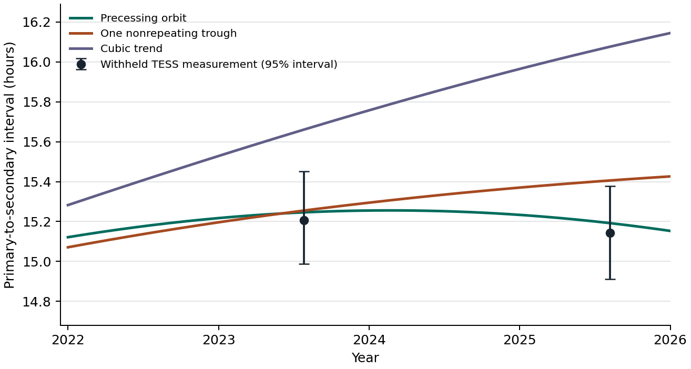

# Evidence for the changing eclipse interval of OGLE-SMC-ECL-06090

The known binary is at ICRS RA 21.06275°, Dec −73.32594444°. It is also OGLE-SMC-ECL-6090 and Gaia DR3 4686449235706841984. The finding concerns the changing elapsed time from the primary dimming to the next secondary dimming during its 1.1696719-day orbit. The extended TESS and ultraviolet results use different photons from the original OGLE screen. The orbit model, literature search and comparison population were examined retrospectively. [Research note](../../docs/SMC_06090_ECLIPSE_TIMING.md) · [Three-page report](orbit-test.pdf)

| Stage | Measurements and provenance | Scientific check |
| --- | --- | --- |
| Original target selection and reversal | [Six-epoch OGLE fits, observing counts, source URLs and hashes](ogle/measurements.json), [Gaia timing](ogle/gaia-validation/validation.json), [prior-work search](context/prior-work.md) | The upstream depth screen had 5,213 eligible stars, 2,275 with opposite signs and five passing the exploratory amplitude cut. The reported 2.21-hour OGLE-IV increase is an elapsed-time difference between multiyear folded profiles. [Cadence simulation](ogle/cadence.json) · [same-chip controls](ogle/detector_controls.json) |
| TESS and contamination tests | [Sector and pixel receipts](tess/tess_inputs.json), [TESS timings](tess/tess_timing.json), [image localization](tess/independent_checks.json), [DELVE and other ground photometry](ground/README.md) | TESS measured 14.43 h in 2018–2019 and 15.14 h in 2025. The late sample covered 51 usable cycles. TESS blends nearby stars. DELVE measured both eclipses at the resolved target. [Changing-shape fits](morphology/morphology.json) · [two-binary alternative](blend/README.md) |
| Swift and XMM-Newton | [Swift exposure measurements](external/swift-photometry.csv), [sky/exposure hashes](external/swift-receipts.json), [fits](external/swift-motion.json), [XMM target/control measurements and archive IDs](external/xmm.json) | Swift measured a 50-minute increase across two multiyear groups (95% interval 2–116 min). Three 2026 observations missed both cores. One long XMM UVM2 integration covered primary eclipse. [Reductions, passbands and period convention](external/README.md) |
| Joint and physical models | [Seven timing laws and withheld-epoch scores](joint/fits.json), [sampling experiments](joint/uncertainty-summary.json), [disk-overlap geometry](physical/README.md), [TESS eclipse widths](widths/README.md) | The pre-2022 orbit solution predicted the 2023 and 2025 intervals within 2.4 and 3.0 minutes. A nonrepeating change also fits much of the record. The fitted 28.25-year precession cycle depends on the model. [Withheld Swift comparison](context/uv_prediction.json) |
| Population and observing tests | [All 2,704 star/epoch measurements](population/epoch_measurements.csv), [eligibility](population/design.md), [comparison counts](population/results.json), [17 observing pairs in UTC](observing/windows.csv) | Four of 441 comparison binaries had opposite changes at least as large in both eras. For October 17–18, 2027 the two strongest physical/empirical alternatives differ by about 28 minutes. [Observing assumptions](observing/README.md) · [Unreleased DECam footprints](decam2025/README.md) |



## Verify and replay

From the repository root, run the following with Python 3.12, NumPy, SciPy, Astropy, pyerfa and Matplotlib installed. The checksum command needs only the standard GNU tools. Individual analysis scripts write results alongside their inputs; use a clean working copy for a rerun.

```sh
cd results/smc-06090
sha256sum -c SHA256SUMS
export OPENBLAS_NUM_THREADS=1
python context/uv_prediction.py
python external/swift_fit.py
python physical/geometry.py --run main
python joint/joint.py
```

The first scientific replay scores the optical timing curves against all accepted Swift exposures while refitting ultraviolet amplitudes and yearly baselines. The 3.5-arcsecond aperture with fixed optical centers gives χ² 277.05 for the precessing orbit, 276.44 for the nonrepeating model and 303.36 for constant spacing. The next two scripts recover the measured ultraviolet depths and refit the two-star eclipse geometry. The last fits the joint models and the chronological holdout. The full 1,200 synthetic fits and their random-seed schedule can be regenerated with `python joint/uncertainty.py --draws 300 --workers 3`. Their compact summary is checked in. [Joint-model definitions and full replay](joint/README.md)

The original six OGLE fits replay with `(cd ogle && python timing.py && python cadence.py && python chip.py && python period_check.py)`. This fetches the original catalog, reads the existing pinned upstream screen, and checks the discovery inputs. `python tess/tess_timing.py` uses the distributed per-orbit flux sums. For a pixel-level replay, start with `python tess/fetch.py` and follow the [TESS reduction](tess/README.md). The XMM archive reader uses `python external/fetch_xmm.py && python external/xmm.py`. For Swift sky/exposure images and the two population archives, use the [ultraviolet](external/README.md) and [population](population/README.md) retrieval commands. Some retrievals require hundreds of MB; the full images reside with the source observatories.

Time conventions are explicit in each method. OGLE uses heliocentric Julian days; OGLE-III lists HJD−2450000. The OGLE ephemeris for folding is HJD 2460000.0369. Gaia times are converted from BJD(TCB). The TESS reduction applies an approximate 70-second translation, common to both eclipse phases within each sector. The joint fit uses each optical observation once and one relative spacing per TESS date group. Alternate reductions of the same exposures are sensitivity checks.

The project selection used upstream revision `5f8bc79e188ff1940d87a59e43fe2e96a9083059`. The observational data were collected and calibrated by OGLE, ESA/Gaia/DPAC, NASA TESS and STScI/MAST, the Neil Gehrels Swift Observatory and S-CUBED/pointed-observation teams, ESA XMM-Newton and the Optical Monitor survey, DELVE/DECam and the other surveys credited in the ground data notes. Archive data remain subject to their original credit and use terms. [OGLE-III](https://www.astrouw.edu.pl/ogle/ogle3/OIII-CVS/smc/ecl/) · [OGLE-IV](https://www.astrouw.edu.pl/ogle/ogle4/OCVS/smc/ecl/) · [TESScut](https://mast.stsci.edu/tesscut/) · [Swift/HEASARC](https://heasarc.gsfc.nasa.gov/W3Browse/swift/swiftmastr.html) · [XMM-Newton OM](https://heasarc.gsfc.nasa.gov/W3Browse/xmm-newton/xmmomsuss.html)
