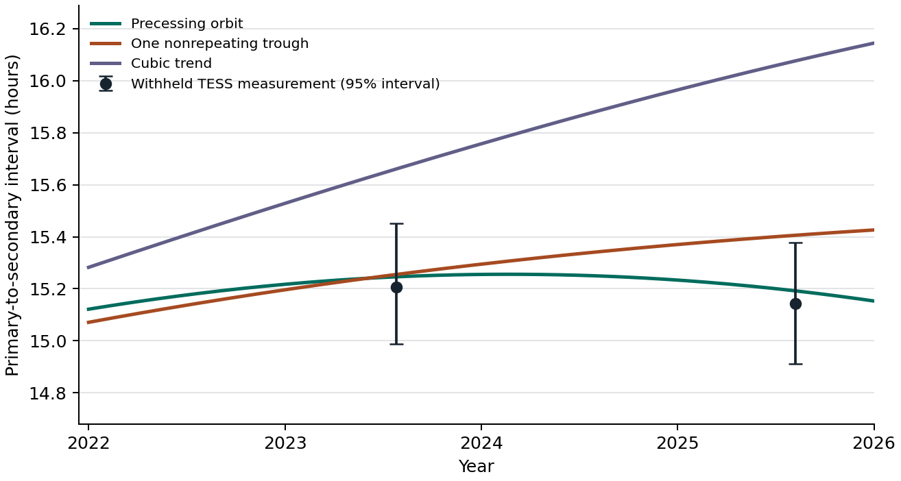

# Testing an advancing orbit against a single nonrecurring change

OGLE-SMC-ECL-06090 shows an eclipse-interval reversal. This analysis asks whether models fitted only to observations before 2022 predict both subsequent TESS timings and the final 96 OGLE measurements. All these comparisons are retrospective. The result was explored and the candidate was selected in earlier work.



## What happened after the cutoff

| Timing model fitted before 2022 | TESS 2023 prediction (h) | TESS 2025 prediction (h) | Error magnitude in 2025 | Late OGLE prediction loss |
| --- | ---: | ---: | ---: | ---: |
| Uniformly advancing edge-on eccentric orbit | 15.246 | 15.192 | 3.0 min | 133.44 |
| Single Gaussian trough returning to a plateau | 15.255 | 15.406 | 15.8 min | 135.91 |
| Sinusoid with free mean | 14.956 | 14.737 | 24.3 min | 140.34 |
| Cubic polynomial | 15.661 | 16.076 | 56.0 min | 202.85 |
| TESS measurement | 15.206 | 15.142 | | |

Training included the 1,252 usable OGLE I measurements before January 1, 2022, the 43 Gaia G transits, and the 2018–19 and 2020 TESS groups. Testing withheld every OGLE, Gaia and TESS measurement on or after that date. This leaves 96 OGLE I magnitudes plus two TESS estimates, based on 38 and 51 covered cycles, for testing. The fully fitted joint Kepler model has a precession period of 28.25 years and edge-on eccentricity 0.0672. A block bootstrap conditioned on that model gives central 95% intervals of 27.59–28.87 years and 0.0645–0.0696. Using wider TESS eclipse profiles gave 28.21 years; using a different extraction gave 27.98 years. The OGLE-I-only fit reproduced the previous 28.32 years. Eclipse widths, inclination and spectroscopy do not independently establish eccentricity here.

A nonrepeating one-trough trajectory is a serious rival. The sum of losses on the late OGLE and TESS test data is 133.73 for the advancing orbit, 140.83 for the one-time trough, 156.06 for the free-mean sinusoid and 277.23 for the cubic. Among 300 simulations of the fitted nonrepeating trough, 102 gave the advancing orbit at least its observed 7.11-unit chronological advantage over that trough. Among 300 simulations of the fitted cubic, one gave it at least its observed 143.50-unit advantage over the cubic. These counts characterize this experiment with its assumed shapes, errors, cadence, nuisance parameters, competitors and cutoff. They do not give probabilities of the physical hypotheses. The fully fitted joint losses are 1447.66 for the advancing orbit, 1450.38 for the one-time trough, 1445.40 for the free-mean sinusoid and 1455.81 for the cubic.

## Observable consequences

| Epoch | Advancing orbit, hours | One trough, hours | Difference |
| --- | ---: | ---: | ---: |
| July 1, 2027 | 14.918 (14.844–14.991) | 15.320 (15.182–15.487) | 24 min |
| July 1, 2028 | 14.716 (14.627–14.802) | 15.335 (15.191–15.513) | 37 min |
| July 1, 2030 | 14.223 (14.110–14.338) | 15.351 (15.200–15.537) | 68 min |

The ranges are percentiles of the fitted curve under the respective generating model. They exclude noise in a new measurement, uncertainty about which physical model applies, and possible cross-survey systematics. The July 2027 full-data free-mean sinusoid and cubic forecasts are 14.762 and 15.054 hours. Forecasts use the full joint record through September 2025 and agree within a few minutes across the TESS extraction variants for the Kepler and single-trough fits.

## Fitting and data

- **Optical.** All 637 OGLE-III and 711 OGLE-IV I magnitudes with finite values and errors in (0,0.10] mag and all 43 good Gaia DR3 G transits enter individually. A 0.012-mag error floor is added in quadrature. Gaia BJD(TCB) is converted to HJD(UTC). In each survey/band, the model freely fits the baseline and each eclipse's depth and Gaussian width. The eclipse centers share a zero point, a linear period correction, and one common interval history. No OGLE folded timing or Gaia catalog solutions enter the objective.
- **TESS.** The four disjoint measurements use the archived 3×3-aperture orbital sums and counts with the original covered-orbit cut. Disjoint groups have 65, 37, 38 and 51 accepted cycles. Each fit uses phase bins, free eclipse centers and depths, fixed width 0.025 orbital cycles, plus a harmonic baseline on the folded flux. Each TESS uncertainty is the standard deviation of 600 sector-stratified bootstrap fits. Consecutive cycles are resampled in blocks up to three, with no block spanning unobserved orbits. A model predicts the group spacing by averaging its instantaneous spacing over the actual retained cycle dates. This approximates the group timing response when eclipse depth or noise changes by sector. TESS constrains relative eclipse separations and shares OGLE's 1.1696719-day folding ephemeris. Its photons and timing fit are independent. Other TESS apertures, the alternate reduction, and the TESS catalog repeat no data in the primary fit.
- **Timing models.** The edge-on model evaluates the mean anomaly corresponding to each conjunction in a uniformly precessing elliptical orbit. Its geometry parameters are cycle length, eccentricity and periapse orientation at HJD 2456000. Numerically equivalent angle branches are allowed. Alternative separations have constant through cubic polynomial forms, or a sinusoid with free mean. The one-time trough is an explicitly nonperiodic phenomenological null, with a constant plateau minus one Gaussian in time of freely fitted amplitude, midpoint and width. Its two eclipse phases move in opposite directions about the common clock. Periodic geometry searches use multiple starting periods, 3–160 yr on the full data, with final bounds of 2.5–200 yr. Periods and eccentricity have the meaning assigned by the chosen light-curve geometry.
- **Statistics.** The joint objective adds twice the soft-L1 loss on standardized optical measurements (scale 1.8) and the sum of squared bootstrap-standardized TESS separation residuals. Thus loss is a predictive score. Additional runs replace TESS with a free-width fit or independent sky-subtracted extraction, or add 0.008 cycle in quadrature to each TESS uncertainty. Extractor changes reuse the main extraction's block errors and times, as a sensitivity check only. The simulation reruns full and chronological fits for four generating models and 300 seeds per generator. Optical residuals receive a common random sign within each 30-day block within each survey. TESS measurements receive random centered offsets drawn from sector-stratified TESS orbit-block bootstraps. Simulations initialize the optimizers on the observed selected branches. TESS timestamps already use public calibrated full-frame images. Models exclude relativistic, dynamical and evolving stellar-surface or eclipse-shape effects outside their parameterizations.
- **Inputs.** OGLE, ESA/Gaia/DPAC, and NASA TESS/STScI MAST supplied the observations. The inputs directory includes the original optical files, TESS orbital sums, and archive URLs/hash receipts that link the reduced TESS arrays to their original pixel data. Original optical data are available from [OGLE-III](https://www.astrouw.edu.pl/ogle/ogle3/OIII-CVS/smc/ecl/phot/I/OGLE-SMC-ECL-6090.dat), [OGLE-IV](https://www.astrouw.edu.pl/ogle/ogle4/OCVS/smc/ecl/phot/I/OGLE-SMC-ECL-06090.dat), and [Gaia](https://gea.esac.esa.int/archive/). TESS archive access uses [Brasseur et al. TESScut](https://mast.stsci.edu/tesscut/). The [pixel-reduction code and archive replay instructions](../tess/README.md) are included here. The orbit code is a reanalysis of public observations. This folder contains everything required for the timing-level analysis.

## Replay

Use Python 3.12 with NumPy, SciPy, pyerfa and matplotlib. With the files in this folder as delivered:

```sh
export OPENBLAS_NUM_THREADS=1
python measure_tess.py
python joint.py
python uncertainty.py --draws 300 --workers 3
MPLBACKEND=Agg python figure.py
```

fits.json reports each training loss, coefficients and predictions. Some per-group residual fields always compare predictions with the main measured TESS value, including for sensitivity runs on other reductions. uncertainty-summary.json records simulation counts, quantiles, and rival-model tests. Running uncertainty.py recreates uncertainty.json with all 1,200 draws. tess_measurements.json preserves orbit epochs, standard errors and the separation bootstrap samples. The [checksum manifest](../SHA256SUMS) covers all distributed data, scripts and figures.
