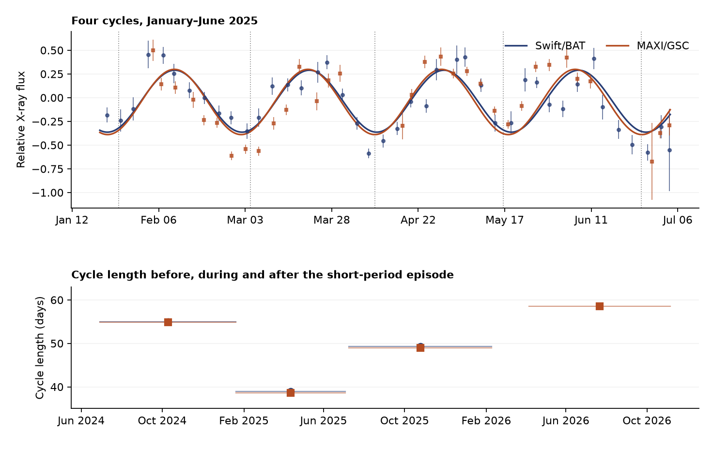

# Four short X-ray brightness cycles in SMC X-1

Swift recorded five consecutive broad minima between January 25 and June 25, 2025. The intervals were **38, 36, 37 and 40 days**. Four cycles took 151 days, about 69 days fewer than four at the preceding 55-day rate. An independent fit to MAXI measured a 38.6-day cycle. The modulation subsequently lengthened to about 49 days in both instruments and to 58.5 days in MAXI in 2026. These are measurements of the recurring bright and faint states of this known neutron-star binary.

| Observing window (MJD, upper bound exclusive) | Swift/BAT, 15–50 keV | MAXI/GSC, 2–20 keV | Days observed, Swift / MAXI |
| --- | ---: | ---: | ---: |
| 60490–60695, preceding interval | 55.0 d | 54.8 d | 170 / 178 |
| 60695–60860, short cycles | 38.9 d | 38.6 d | 152 / 116 |
| 60865–61080, subsequent interval | 49.4 d | 49.0 d | 173 / 157 |
| 61136–61349, April–November 2026 | Insufficient coverage | 58.5 d | 34 / 187 |



The upper panel shows four-day weighted averages, with each instrument centered on its median and scaled by its own 10th-to-90th percentile range. Lines show separate sinusoidal fits. Dotted lines mark the five Swift minima. The lower panel shows the duration of the windows used for the fits. The horizontal spans indicate dates, and the values describe a changing clock.

## What was known

Mihara reported shortening to about 45 days in September 2023 and an early turn-on in May 2024. Hu et al. measured a 47-day cycle ending January 29, 2025 (MJD 60704.5), and displayed monitoring through MJD 60730 in their spin analysis. The beginning of our sequence overlaps that paper. The four-cycle measurement, its historical rank under the stated cuts, and the subsequent recovery are the additions. A much earlier study identified four excursions through 2022. These dates and studies leave open whether the 2025 episode merits a separate numbered excursion. [MAXI notice](https://maxi.riken.jp/news/en/MAXI_News_s5.html) · [NinjaSat campaign, Sections 3.1 and 3.4](https://arxiv.org/html/2511.05016v1) · [MOOSE monitoring through MJD 59810](https://doi.org/10.1093/mnras/stad384)

Niwano et al. studied optical and X-ray modulation through TESS Sector 68. A separate 2026 spectroscopy study used observations through 2022. Searches on November 14, 2026 covered web-indexed arXiv, journal articles, ATels, and MAXI notices, including “SMC X-1 excursion 2025 2026”, “SMC X-1 38 days”, “SMC X-1 60700 60800”, and Japanese terms for superorbital shortening. We found the earlier observations above. Priority remains open to unindexed material. [Optical study](https://doi.org/10.1093/pasj/psag069) · [Spectroscopy](https://doi.org/10.1093/mnras/stag168)

## Cycle timing and competing explanations

We inspected monitoring products for SMC X-1, Her X-1, LMC X-4, EXO 2030+375 and 4U 1820–30 while choosing a question. SMC X-1 and the reported windows were selected after inspection. The fitted periods use native daily averages, inverse-variance weights, a free offset and a single sinusoid. We searched 24–76 days in 0.25-day steps and refined the best grid interval. The independent minimum count uses a three-day Gaussian smoothing width, inverse-variance normalization across missing days, minimum separation of 29 days and minimum prominence of 0.0023 count cm⁻² s⁻¹ for BAT. The cycle count is particularly useful because the shape changes and the individual periods differ.

- **Historical comparison.** Across 6,899 eligible Swift days beginning in 2005, we ranked four consecutive intervals between five detected minima. Each minimum needed a real measurement within five days. Each run needed consecutive minima no more than 75 days apart and no observation gap longer than 12 days. The 2025 sequence ranked first of 112 eligible overlapping runs. The next nonoverlapping sequence averaged 41.75 days in 2014–2015. Two- and four-day smoothing put the 2025 sequence first as well. Five- and six-day kernels merge a shallow minimum and miss the complete run. This rank depends on detectability, the filters and the sampling. The full list of eligible runs is in the results.
- **Sampling and aliases.** Swift observed all five trough dates with a maximum three-day gap during the short window. MAXI independently fits 38.6 days but has gaps up to 17 days, and three smoothed trough dates fall 5–7 days from an actual sample. Omitting one of four time blocks pushes one MAXI fit to 63 days. The corresponding Swift tests span 38.2–40.2 days. Shifting both edges of the short window by up to ten days gives 38.5–38.9 days in Swift and 38.1–38.6 in MAXI. A two-harmonic fit to eclipse-excised Swift pointings can prefer a doubled period at the upper grid boundary. Daily photometry and individual troughs resolve the repeated bright/faint cycle.
- **The 3.89-day binary eclipse.** We used the NinjaSat orbital ephemeris to remove pointings within 0.17 orbital cycles of mid-eclipse, then averaged the remaining measurements by day. A fundamental search on these data gives 38.5 days in Swift and 38.7 in MAXI. Holding the Swift daily waveform's period and phase fixed and fitting only a scale and offset lowers MAXI's out-of-eclipse weighted RMS from 0.05411 to 0.03639 photons cm⁻² s⁻¹. In the eclipse core (within 0.055 cycles) the RMS is 0.02525 before and 0.02522 after. This phase test ties the modulation to the eclipsing source and disfavors a varying neighbor or common background as the dominant signal. The two reductions of each mission share photons.
- **A third telescope gave an inconclusive result.** Fermi/GBM Earth-occultation data include 26 four-day bins in the short window. Their best free period is 26.1 days. The Swift waveform reduces the 12–25 keV weighted RMS only from 45.98 to 45.73 mCrab. We count Swift and MAXI as the two supporting instruments. Fermi GBM Earth occultation results provided by the Fermi GBM Earth occultation Guest Investigation teams at NASA/MSFC and LSU. The team labels the product preliminary and flags 50–55-day sampling artifacts. [Fermi/GBM monitoring notes](https://gammaray.nsstc.nasa.gov/gbm/science/earth_occ.html)
- **A second sky position.** Applying the same window and fundamental search to LMC X-4 yields 30.0 days in Swift and 30.4 days in MAXI during the short interval. The publicly measured cycle of this independent binary is about 30 days. [LMC X-4 timing study](https://doi.org/10.3847/1538-4357/ae4691)

The two missions measure the duration of the apparent brightness cycle. A changing disk shape can move the trough, even if the underlying precession rate changes less. A direct measurement of disk orientation or phase-resolved polarimetry could distinguish these explanations. We assign no population false-alarm probability or exact physical precession period.

## A dated test

Using MAXI data ending November 3, 2026 (last retained sample MJD 61347.5), the full late window predicts the next broad flux minimum at MJD 61363.95, approximately November 20. Starting the fit later and allowing a second harmonic moves the forecast as late as November 23. These are model predictions with the same data cutoff. A new well-covered trough outside November 16–29 would miss our deliberately wider observing window for a continuing 58–60-day rhythm. SMC X-1 has already demonstrated that it can change that rhythm.

## Inputs and replay

The compact CSV contains the eligible daily rates and their published errors, the four-day 12–25 keV GBM points at their bin midpoints, and phase-selected daily aggregates from individual Swift pointings and MAXI orbit bins. Time is Modified Julian Date. BAT daily labels are placed at day center. For the broad orbital phase cut we approximate Swift MET as days since MJD 51910, ignoring second-scale clock corrections. MAXI times are ISS bin centers. Neither approximation affects a timing measurement on this scale. We require finite rates, positive errors below four times the median valid error of that product, and good Swift flags. Negative rates are retained. Each product's full SHA-256 digest, row counts, cutoff and source URL are in the manifest. The linked monitoring streams can acquire new data or revised values. [Pinned inputs](data/measurements.csv) · [Source manifest](data/sources.json) · [All fits, failures and ranks](measurements.json)

From this directory, with Python, NumPy and SciPy installed, run the first two commands for an offline numerical replay. Matplotlib is needed only for the figure. To request new mission files or rebuild from saved originals, use the extraction commands with a separate output directory.

```sh
python replay.py --output /tmp/smc-x1-replay.json
diff measurements.json /tmp/smc-x1-replay.json
python plot.py
python extract.py --output /tmp/smc-x1-new-download
python extract.py --raw-dir /path/to/originals --output /tmp/smc-x1-from-originals
```

Swift/BAT transient-monitor measurements are provided by the Swift/BAT team. MAXI data are provided by RIKEN, JAXA and the MAXI team. The signal directions are J0117−734 (SMC X-1) and J0532−663 (LMC X-4). [Swift/BAT monitor documentation](https://swift.gsfc.nasa.gov/results/transients/Transient_synopsis.html) · [MAXI data columns and time system](https://maxi.riken.jp/top/lc_readme.txt)
