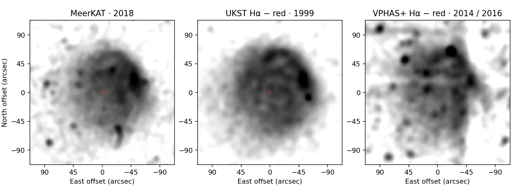

# SMGPS G276.229+00.419 matches the known optical nebula PHR J0942−5220

Anderson et al. list G276.229+00.419 as a class II supernova-remnant candidate with a 90 arcsec radius. The MeerKAT image traces the same asymmetric nebula as PHR J0942−5220 (PNG 276.2+00.4, Bran 273), previously classified by MASH as a likely planetary nebula. Its optical size is 165 × 150 arcsec, and the published Galactic centers differ by 3.76 arcsec. The new identification connects the radio candidate to this known nebula. This match argues against treating it as an independent confirmed supernova remnant when counting candidates, although a superposed component is not excluded. [Anderson et al., Table A.4](https://doi.org/10.1051/0004-6361/202451038) · [Parker et al., MASH and Fig. 8](https://doi.org/10.1111/j.1365-2966.2006.10950.x)

**Interpretation boundary.** The physical cross-identification of the radio shell with the known optical nebula is **stronger than the inference about its emission mechanism**. A matching shell and consistent one-frequency thermal-flux prediction do not establish that all the radio emission is free–free emission or rule out a composite object. The adopted extinction comes from a *proposed* central star; if a different star belongs to the nebula, its reddening and the predicted thermal radio flux could change substantially. The background-sensitive 843 MHz Molonglo image **cannot give a reliable spectral slope or spectral index**. The thermal explanation remains plausible but conditional, not a measured classification.



| Independent image | Observation | Correlation with MeerKAT inside 96 arcsec | After removing the median in concentric annuli |
| --- | --- | ---: | ---: |
| AAO/UKST SuperCOSMOS Hα and short-red plates | Released MASH cutouts 1102 | 0.927 | 0.733 |
| ESO VPHAS+ Hα and broadband r | Three narrowband exposures on 2014 March 23 and four continuum exposures from 2014 and 2016 | 0.798 | 0.455 |

These are Spearman rank correlations on a fixed sky grid, with no fitted translation or rotation. Subtracting the annular medians tests the *shape* of the emission after removing its radial brightness profile. In 72 rotations at five-degree intervals, the native orientation ranks second for SuperCOSMOS and third for VPHAS+. The control medians are 0.048 and 0.041. Adjacent rotations and interpolated pixels are correlated. These ranks are descriptive controls. The precise correspondence is strongest in the native UKST plate comparison. Stellar subtraction residuals, optical seeing, interferometer response and detector gaps limit the agreement.

## Does the ionized nebula supply enough radio flux?

The 90 arcsec radio aperture measures **21.17 mJy at approximately 1.3 GHz**, using the survey's 8 arcsec restoring beam and a 120–150 arcsec background annulus. Varying the aperture and sky annulus gives 20.61–23.01 mJy. The published Hα flux, log₁₀ F = −11.58 ± 0.09 (erg cm⁻² s⁻¹), and reddening for the proposed central star, E(B−V) = 0.75 ± 0.14, predict **18.72 mJy** of optically thin thermal radio emission. The 12.72–27.55 mJy interval propagates those two uncertainties with the gas temperature fixed at 10,000 K. With this reddening, photoionized gas can account for most or all of the measured radio continuum. The extinction estimate assumes the selected optical star belongs to the nebula. A later Gaia study proposes a different central-star candidate, about 27 arcsec away from the MASH candidate, so the uncertainty in the star identification falls outside the quoted interval. Flux calibration, the adopted temperature and helium fraction, and missing interferometric large-scale flux add systematics. [Radio flux model](https://doi.org/10.1111/j.1365-2966.2004.08113.x) · [SMGPS restoring beam](https://doi.org/10.1093/mnras/stae1166) · [Gaia central-star candidates](https://doi.org/10.1051/0004-6361/202141916)

A beam-matched second-frequency test is inconclusive. The same 90 arcsec aperture at 843 MHz gives 7.93 mJy in the Molonglo Galactic Plane Survey, compared with 18.41 mJy for MeerKAT smoothed to the Molonglo beam. Changing which octant supplies the local Molonglo background gives −12.51 to +21.74 mJy. A 109.6 mJy/beam source lies 211 arcsec away. This control cannot establish a reliable spectral index or radio spectral slope, so the apparent two-frequency flux ratio should not be interpreted as one. The flux agreement above is a one-frequency consistency check, not proof of a thermal emission mechanism.

## Optical classification and competing explanations

The MASH source record lists a candidate central star, enhanced northwestern emission and a planetary-nebula-like spectrum with [O III] much stronger than Hβ and [N II] about half Hα. The primary MASH paper illustrates the central-star candidate in this specific object. Its classification flag is **L** (likely). Frew et al. subsequently give an integrated Hα flux and an angular size and reddening for the nebula. The optical diagnosis uses the line description published by MASH. We recovered the archive index entries for three spectra but could not retrieve the FITS flux arrays for a new line-ratio measurement. [MASH source record](https://vizier.cfa.harvard.edu/viz-bin/VizieR-5?-source=V%2F127A%2Fmash1&recno=101) · [Frew et al. integrated fluxes](https://doi.org/10.1093/mnras/sts393) · [Frew et al. sizes and reddenings](https://doi.org/10.1093/mnras/stv1516)

The field could contain unrelated compact radio emission. A second shell superposed on this nebula would have to reproduce the same asymmetric extended structure in two optical surveys. A resolved, flux-scale-matched negative radio spectral index, strong shell polarization, or broad shock-dominated optical lines across the matched bright rim would motivate revisiting the remnant interpretation.

## Selection and overlap

An exploratory crossmatch of the SMGPS object table with SIMBAD identifications suggested this object. We then compared **all 236 distinct advertised candidate centers** (237 rows, one repetition) with MASH-I and MASH-II using the named source tables. Of 1,238 optical rows, 1,235 have both coordinates and axes. Requiring a center separation below 0.2 radio radii and an optical geometric-mean diameter between 0.6 and 1.5 times the radio diameter leaves this one pair. Translating all candidate longitudes by each of 96 offsets between −5° and +5° in 0.1° steps, excluding offsets below 0.3° in absolute value, yields zero pairs. These size and position cuts were chosen after inspecting the target. The independent image comparisons and the prior optical spectrum carry the interpretation. The catalog search is limited to these two MASH releases.

## Reproduce

Run from this directory with Python, Astropy, NumPy, SciPy and Matplotlib.

```sh
python fetch.py
python screen.py
python images.py
python radio_photometry.py
python molonglo_control.py
```

The survey-native WCS headers determine placement. The plate cutouts have explicit TAN/CD solutions plus legacy DSS cards; the code selects the explicit cutout solution. Images are sampled on a 1.5 arcsec grid centered at ICRS 145.505°, −52.345°. In each optical survey the outskirts set the continuum scale. A common rank filter reduces stellar cores, and optical smoothing approximates the 8 arcsec radio beam. The Hα filters also transmit some [N II]. The displayed stretches are independent of the correlation calculations. See `image-inputs.csv` for IDs, URLs and SHA-256 conventions and `rotation-controls.csv` for all 144 comparisons.

On 2026-11-15 we searched the source paper and public literature by the exact candidate name, the PN name with and without a space, PNG 276.2+00.4 and Bran 273, paired with MeerKAT, remnant, Anderson and reclassification. The original source classifications predate this comparison. We found no prior explicit link between these two catalog entries in the material reviewed. This is a bounded literature search.

Data acknowledgments: SARAO/MeerKAT SMGPS, AAO/UKST SuperCOSMOS Hα Survey, MASH, VizieR/CDS, and VPHAS+ observations made with ESO telescopes at La Silla Paranal Observatory (programme 177.D-3023). [SARAO image release](https://doi.org/10.48479/0n8c-5q84) · [VPHAS+ data](https://doi.org/10.18727/archive/65)
