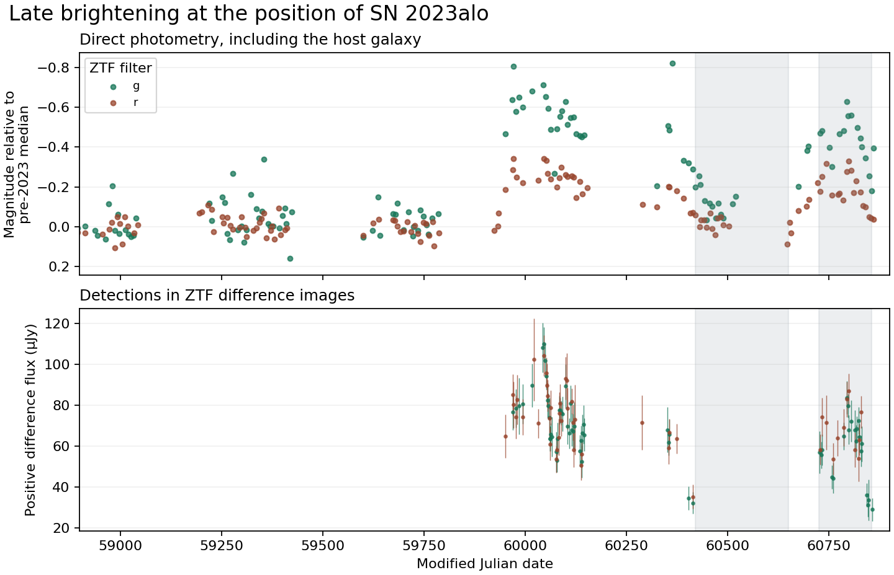

# A second optical brightening at the position of SN 2023alo

About two years after the 2023 optical maximum of this spectroscopically classified Type IIn supernova (z = 0.105), ZTF recorded a second bright interval. The unresolved optical source brightened **0.324 mag in g and 0.163 mag in r** between the 2024 low state and the 2025 observing season. Positive difference-flux detections recur on 20 nights in g and 12 nights in r in the late window. Their brightest measurements reach g = 19.094 and r = 19.052, with the late g measurement within 0.30 mag of the 2023 g maximum. These are difference magnitudes, while the table below includes the host galaxy. The second brightening is observationally supported. Its physical association with the original supernova remains a candidate. [TNS spectrum and discovery reports](https://www.wis-tns.org/object/2023alo) · [ZTF Bright Transient Survey](https://sites.astro.caltech.edu/ztf/bts/explorer.php?f=s&subsample=all&ztflist=ZTF23aaabzea)

The upper panel shows seven-day medians. The shaded intervals are the low and late windows used for the comparison. The lower panel shows only ZTF alerts that passed the cuts below. A gap in alerts carries no flux measurement.

| Filter | Pre-2023 baseline | Initial bright interval | 2024 low interval | 2025 bright interval | Late minus low |
| --- | ---: | ---: | ---: | ---: | ---: |
| g | 18.780 | 18.220 | 18.681 (26 nights) | 18.357 (27 nights) | −0.324 |
| r | 17.832 | 17.591 | 17.826 (26 nights) | 17.663 (30 nights) | −0.163 |

## Checks on the photometry

We used ZTF catalog photometry with zero quality flags and reported uncertainties below 0.15 mag. Nightly medians give each night equal weight. The four windows in MJD are 58100–59850 (pre), 59900–60190 (first), 60420–60650 (low), and 60725–60855 (late). They were selected after inspecting the data. The same detector, quadrant, filter and object identifier are required across the comparisons. Field controls had to lie within 0.015° of the target and within 2.5 mag of its baseline magnitude, with coverage on at least 55% of sampled target nights and at least five measurements in every window. Their late-minus-low median changes span −0.008 to +0.023 mag in g (four controls), and −0.032 to +0.017 mag in r (six controls). All control IDs and changes are in [measurements.json](measurements.json).

Resampling weekly medians gives central 95% intervals of −0.408 to −0.239 mag in g and −0.243 to −0.125 mag in r. These are within-season diagnostics that omit the exploratory selection. A second measurement using the ZTF difference pipeline requires a positive difference image and real/bogus score >0.55. The static reference ID in each filter is unchanged throughout the three observed seasons. Direct and difference photometry use the same ZTF exposures.

## Localization and source ambiguity

Pan-STARRS DR2 locates the extended galaxy at (215.70419414°, −13.27518666°). Gaia DR3 6300335462633830528 is within 0.004″ of that position and classified as a galaxy by its combined classifier. Gaia reports no parallax or proper motion for the two-parameter solution. The median of one difference centroid per night lies 0.28″ from the Pan-STARRS centroid in 2023 (44 nights), and 0.40″ away in 2025 (23 nights). The median east/north positions differ by approximately (+0.14″, −0.07″). A night-bootstrap central interval for the separation is 0.06–0.25″. Individual filters have consistent directions and larger uncertainties. This statistical interval omits cross-season astrometric systematics. The 2025 signal lies farther east of the measured galaxy center, and subarcsecond blending leaves both nuclear activity and a distinct transient within the host viable. No second-episode spectrum establishes a mechanism.

AllWISE gives W1−W2 = 0.448 ± 0.043 mag, with clean catalog flags. No SDSS DR18 or DESI DR1 fiber spectrum was returned in our local position checks. These tests leave a weak or host-diluted active nucleus viable. Sky Patrol V2 source 661431284908 has just two usable observations in the 2025 window, both late in the window, measuring −0.047 ± 0.150 and 0.195 ± 0.063 mJy. Its temporal coverage cannot confirm the 2025 bright interval. TNS records an ATLAS detection in February 2023 and a BlackGEM detection (q = 19.58) in April 2024. We found no independent-survey 2025 peak measurement in those reports. [Pan-STARRS DR2](https://catalogs.mast.stsci.edu/docs/panstarrs.html) · [AllWISE](https://irsa.ipac.caltech.edu/Missions/wise.html) · [Sky Patrol V2](https://asas-sn.github.io/skypatrol/) · [BlackGEM/ATLAS reports](https://www.wis-tns.org/object/2023alo)

## Scope and reproduction

An exploratory scan obtained ZTF Bright Transient Survey objects with 2023–25 IAU designations and classifications containing IIn, Ibn, or TDE (141 catalog rows). We inspected ZTF difference-alert groups at least 200 d from the listed peak, spanning at least three nights and both bands with no gap over 30 d inside a group. SN 2023alo stood out for the strength and timing of its later bright interval. This is a deliberately selected candidate, with no survey-wide significance or rate claim. Exact-name searches for SN 2023alo, ZTF23aaabzea, ATLAS23bqf and the BlackGEM identifier located the existing classification and 2024 report. They did not locate an explicit published analysis of the 2025 brightening. The archive and broker measurements were already public.

Run `python analyze.py` from this directory with NumPy, pandas, and PyArrow. Run `python plot.py` with Matplotlib to regenerate the figure. [provenance.json](provenance.json) records URLs, input digests and extraction parameters. ZTF field and alert files are gzip-compressed original responses. The complete single-source Sky Patrol table is frozen because its input catalog is being revised. Results are deterministic.
