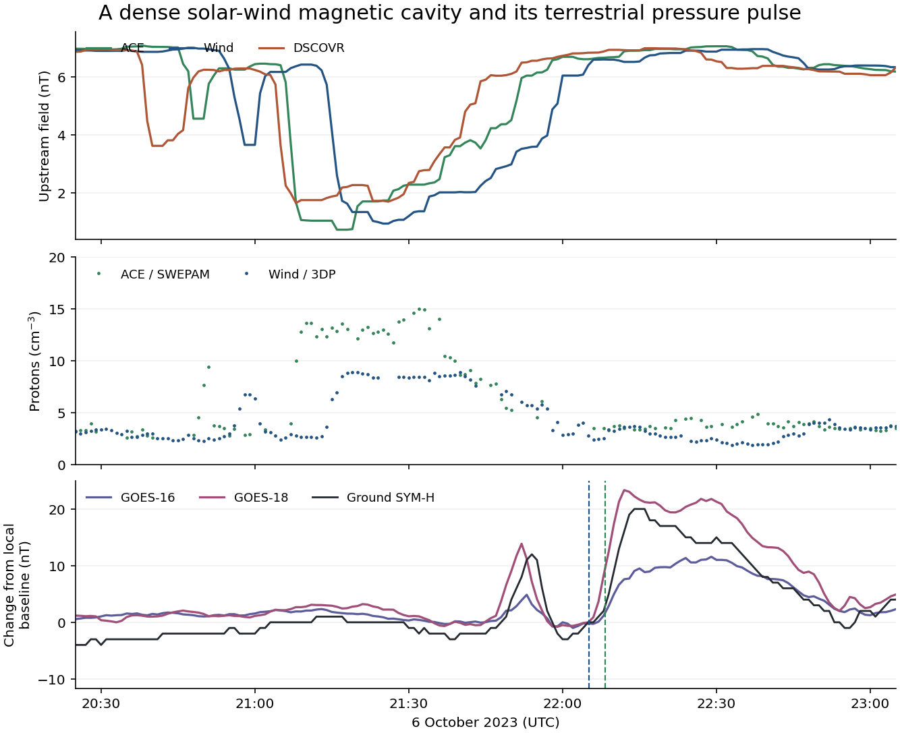

# A solar-wind magnetic cavity and a pressure pulse at Earth on 6 October 2023

On 6 October 2023, three spacecraft near the Sun–Earth L1 point recorded a 31–36 minute magnetic-field depression inside a previously cataloged interplanetary coronal mass ejection (ICME). Proton density rose as the field fell. The resulting pulse in solar-wind ram pressure reached Earth's vicinity at the time predicted from the upstream crossings. Two independent geostationary satellites observed increased field strength, and ground magnetometers recorded a 20 nT increase in SYM-H. All times below are UTC.

## Upstream measurements

| Spacecraft | Minutes below half ambient field | Ambient field | Five-minute minimum | Field reduction | Median proton density, flanks → cavity | Proton-only ram pressure, flanks → cavity |
|---|---|---:|---:|---:|---:|---:|
| DSCOVR | 21:06–21:36 (31) | 6.85 nT | 1.65 nT | 76% | — | — |
| ACE | 21:08–21:38 (31) | 6.95 nT | 0.73 nT | 89% | 3.57 → 13.05 cm⁻³ | 0.92 → 3.19 nPa |
| Wind | 21:16–21:51 (36) | 6.88 nT | 0.94 nT | 86% | 2.99 → 8.45 cm⁻³ | 0.81 → 2.21 nPa |

ACE and DSCOVR sampled the pulse across a 484,060 km baseline transverse to the Sun–Earth line. The full three-dimensional separation of this pair was 487,637 km. The ACE and Wind core flow speeds of 382 and 395 km/s imply convection lengths of 0.71 and 0.85 million km along the flow. These are path-length estimates under steady convection. Crossing times at three locations allow multiple front orientations, shapes and evolutionary histories.

At ACE and Wind median flow speed decreased by 2.0% and 2.4%, respectively. The rise in proton ram pressure by factors of 3.47 and 2.72 therefore comes from the density enhancement. Absolute densities differ between ACE/SWEPAM and Wind/3DP. Wind's onboard ion moment calibration has a documented density offset, so each ratio uses the same instrument for its numerator and denominator. [Wind project data management plan](https://wind.nasa.gov/docs/Wind_PDMP.pdf)

## Magnetospheric and ground response

Taking the two measured upstream leading edges and dividing their GSE X distances to 15 Earth radii by their respective median core speeds gives bow-shock arrival estimates of **22:05:07 from Wind** and **22:08:20 from ACE**. Both calculations assume radial motion. The assumed bow-shock distance, measured speeds and one-minute sampling make these approximate to minutes. The bow-shock-shifted OMNI product drops below 3.5 nT at 22:06 in the 22:00–22:35 main-pulse window. OMNI uses upstream spacecraft measurements and serves as a timing cross-check.

| Independent Earth measurement | Longitude | Pre-arrival median | Peak in 30 min after Wind's predicted arrival | Rise | Peak time |
|---|---:|---:|---:|---:|---:|
| GOES-18 total field | 137.0° W | 108.20 nT | 131.53 nT | 23.33 nT | 22:12 |
| Ground SYM-H | Global index | −15 nT | +5 nT | 20 nT | 22:14 |
| GOES-16 total field | 75.2° W | 98.30 nT | 109.86 nT | 11.57 nT | 22:29 |

Both GOES series have good NOAA summary quality flags throughout the comparison window. Their individual data-quality bitmasks carry the valid arcjet correction bit. The upstream-transit calculation uses the main half-field crossing. Its agreement with the larger terrestrial pulse supports a density-driven compression interpretation. Different local times can affect the amplitudes at the two GOES locations. These measurements do not isolate a unique magnetospheric current system.

### The precursor reached Earth first

A second, weaker density enhancement and field depression preceded the main crossing. It gives a check on the sequence of arrivals. Within the 32 to 8 minutes before the main leading edge, the scalar field reached 3.62 nT at DSCOVR (20:40), 4.55 nT at ACE (20:48) and 3.65 nT at Wind (20:58). Near those minima, ACE and Wind density peaked at 9.41 and 6.74 cm⁻³. The transit delays already calculated for the main pulse place the precursor minima at **21:47 from Wind and 21:48 from ACE**. A smaller geostationary field peak followed at 21:52 on GOES-18, at 21:53 on GOES-16, and the ground SYM-H peak at 21:54. All three then receded before the main response. This inspection of the precursor is retrospective. The two ordered pulses support the proposed connection across the upstream, geostationary, and ground measurements.

## Selection and controls

An exploratory screen used eight-day archive chunks starting from May through December 2023, covering through 3 January 2024 with the final chunk. It calculated the magnitude of five-minute averaged RTN vectors separately at Wind and STEREO-A. It selected intervals below 45% of a centered 24-hour median and below 4 nT, joined interruptions up to two bins and retained intervals lasting at least 25 minutes with minima below 2 nT. Among 34 intervals at each spacecraft, six pairs met the −4 to +10 hour lag window. The heuristic divided the shorter duration in minutes by 0.05 plus the larger of the two minimum/background ratios (rounded to two decimals). The top two pairs both pointed to the same Wind event on 6 October. This search explored multiple phenomena and parameter choices. Its ranking establishes neither a false-alarm probability nor an occurrence rate. The full pair list is in [screen_pairs.csv](screen_pairs.csv).

Rapidly changing field direction can produce artificial dips in averaged vectors. All three quoted L1 depths use the instrument's **scalar field magnitude**, reduced to one-minute medians and then a centered five-minute median. The denominators use 20:00–20:39 and 22:21–23:00. The core is the continuous interval surrounding the minimum below one-half the ambient field, with both endpoint minutes included. Varying the smoothing from 3 to 7 minutes and the boundary from 40% to 60% gives durations of 29–40 min at ACE, 31–42 min at Wind and 26–36 min at DSCOVR. Field reductions remain 89–90%, 86–88% and 75–76%, respectively.

ACE, DSCOVR, plasma measurements, ground indices and GOES magnetometers were outside the original search. STEREO-A recorded two distinct depressions a few hours earlier. Their identification with the L1 event is ambiguous. All quoted geometry uses the three L1 positions. The ground and GOES comparisons use the median over the 15 minutes preceding Wind's calculated arrival. The plasma flank medians pool 15–65 minutes before the core and 15–65 minutes after it. Coverage is retained in [measurements.json](measurements.json).

## Prior work and scope of the finding

Richardson and Cane list the parent ICME from 16:00 on 6 October to 18:00 on 7 October. NASA's CME Scoreboard records a preceding arrival on 5 October and field rotations beginning near 17:00 on 6 October. Those records establish the larger event. The event-level result here is the separate half-hour density enhancement embedded in it, its transverse sampling scale, and its association with the subsequent terrestrial compression. A date-, time-, instrument- and feature-specific literature search did not identify a prior account of this measurement chain. Publication priority remains open. [Richardson–Cane catalog](https://spdf.gsfc.nasa.gov/pub/pre_generated_plots/ace/level3/icmetable2.html) · [NASA CCMC 2023 scoreboard](https://ccmc.gsfc.nasa.gov/CMESB-Earth/PreviousPredictions/2023)

Long-duration magnetic holes and pressure-pulse-driven compressions have precedents. The data here do not determine whether this cavity arose from a current sheet, a mirror instability, or another process, or whether the electron and ion thermal pressures balanced the loss in magnetic pressure. [Stevens and Kasper, magnetic holes at 1 au](https://doi.org/10.1029/2006JA012116) · [Chen et al., macro magnetic holes](https://doi.org/10.3847/1538-4357/ac1b2b) · [Earlier pressure-pulse case](https://doi.org/10.1029/2024JA032468)

## Replay

From this directory, `python replay.py` reads the frozen one-minute observations and emits the measurements. It requires NumPy and pandas. `python plot.py` regenerates the figure with Matplotlib. `python acquire.py` and `python acquire_goes.py` rebuild the observations from NASA CDAWeb/HAPI and NOAA NCEI, respectively. The latter also requires netCDF4. Each [NASA source](retrieval.json) and [NOAA source](goes_sources.json) has a download URL and an original-file SHA-256. The [field manifest](sources.json) retains the parameter names, units and fill values. `python screen.py --cache /path/to/cache` reruns the full exploratory search with SciPy and stores its 62 archive responses in the selected cache directory.

Data credit goes to the ACE/MAG and SWEPAM, Wind/MFI and 3DP, NOAA DSCOVR and GOES-R MAG teams, the OMNI team, and the World Data Center for Geomagnetism, Kyoto, for SYM-H. [NASA CDAWeb](https://cdaweb.gsfc.nasa.gov/) · [NOAA GOES-R MAG](https://www.ncei.noaa.gov/products/goes-r-magnetometer) · [WDC Kyoto](https://wdc.kugi.kyoto-u.ac.jp/)
