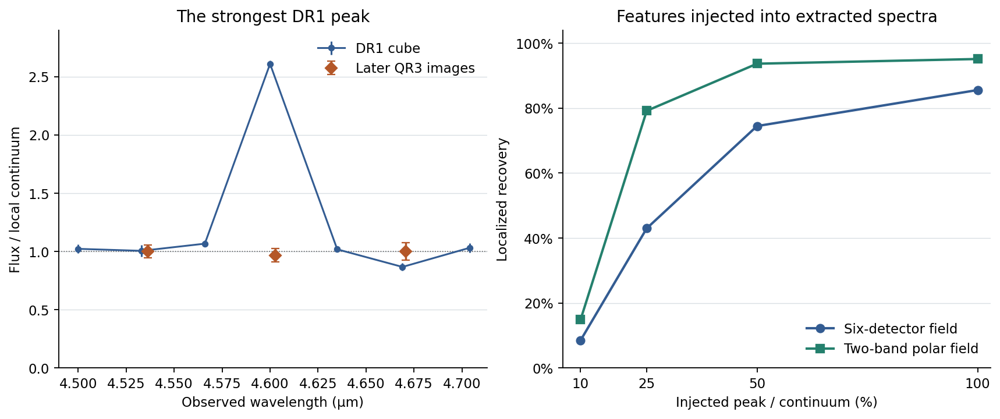

# Blind search for unclassified infrared spectra in SPHEREx DR1

**No source in this search has an independently validated spectrum of a new class.** We extracted 113 AllWISE positions from two November 2026 DR1 spectral cubes. The strongest six-detector peak, at 4.600 µm toward WISE J135745.42+295804.4, disappears in the later QR3 images. The strongest two-band trough belongs to BD+66 1073, a known K1 III calibration star whose native apertures are flagged. Numerous other coadd residuals exceed the screen threshold. Their presence and the incomplete independent coverage preclude an upper limit on the frequency of unexplained spectra.

**Left:** DR1 aperture flux divided by its local linear continuum, with blank-aperture scatter. QR3 symbols are native measurements divided by the continuum interpolated from the two flanks in QR3, with native diagnostic error bars. Each QR3 bin has one usable exposure. **Right:** fraction of injected bands recovered with the right sign within one channel, pooled over both signs and widths. Lines connect four measured contrasts.

## Fields and sensitivity

The catalog selection used 7 ≤ AllWISE W1 < 12, a 0.50° cone, membership in one named equatorial NESTED order-5 tile, and 16 pixels of edge clearance. The initial polar tile supplied only detectors 2 and 5. We retained those spectra and froze the supplemental tile before residual ranking. [Initial selection](SELECTION.md) · [Coverage amendment](COVERAGE_AMENDMENT.md) · [Extraction, quality flags and input receipts](EXTRACTION.md)

| Field | AllWISE entries in cone | Extracted | Ranked | Strict channels per source, median (range) | Sources above raw threshold | Above held-out same-channel threshold |
|---|---:|---:|---:|---:|---:|---:|
| (209.53125°, +30°), tile 2582, primary | 59 | 59 | 59 | 98 (39–100) | 52 | 16 |
| (270°, +66.56°), tile 4010, two-band supplement | 148 | 54 | 48 | 31 (17–34) | 5 | 2 |

In the polar cone, 84 entries fell outside the tile and 10 failed edge clearance. No polar spectrum met the primary three-detector criterion. The separate two-band test required measurements in both detector bands. Full-spectrum quality, spectral gaps and valid sidebands determine what could be screened for each target. [Primary eligibility](wide/full/eligibility.csv) · [Polar eligibility](nep_two_band/eligibility.csv)

| Injected peak as fraction of fitted continuum | Six-detector field | Two-band polar field |
|---|---:|---:|
| 10% | 190 / 2,236 (8.5%) | 82 / 552 (14.9%) |
| 25% | 961 / 2,236 (43.0%) | 437 / 552 (79.2%) |
| 50% | 1,665 / 2,236 (74.5%) | 517 / 552 (93.7%) |
| 100% | 1,913 / 2,236 (85.6%) | 525 / 552 (95.1%) |

The 11,152 trials added emission or absorption to real extracted spectra before refitting, using widths of one or three channels. A success required the strongest feature to clear the heuristic score of five at the right location and sign. Coincident successes in the unmodified spectrum received no credit. These trials measure recovery at eligible channel centers. They reuse sources across strengths and signs and omit catalog selection, pixel-level extraction losses, confirmation in another visit and discovery completeness. [Six-detector recovery by width and sign](wide/full/recovery_by_shape.csv) · [Two-band recovery](nep_two_band/recovery_by_shape.csv) · [Algorithm and replay commands](analysis_method.md)

## What drove the rankings

- **4.600 µm at WISE J135745.42+295804.4.** The central DR1 channel measures 16.44 mJy, with 6.72 and 6.41 mJy in the adjacent channels. The independent local-continuum extraction gives a 161% excess in a 19″ aperture and 118% at 13″. One 12.9″ coadd pixel contains 87% of the positive residual light inside 32″; the residual centroid is 9.6″ from the continuum centroid. The pixel carries only the informational SOURCE bit and NHITS = 14. In QR3, the core lies 3.2% below its own flank-interpolated continuum. This rejects a persistent feature of the coadd amplitude under these sampled conditions. The exact origin of the one-pixel excess remains open. [Coadd localization](wide/spatial_localization.csv) · [Native exposures and hashes](visits/wide/J135745.42+295804.4.csv)
- **1.346 µm toward BD+66 1073.** WISE J180309.59+662811.5 ranked first in both polar tests of spectral shape and localized structure. Its coadd J-band flux proxy is 9.1% of its associated 2MASS J flux, compared with 95.9% at the field median. The core has 8 hits against 46 in the annulus. Every one of 36 checked native apertures failed pixel quality. The star appears in AKARI's calibration program, for which Tanabe et al. list its K1 III classification. Its independent identity and missing core flux explain why the coadd cannot support a new spectral class. [Native quality record](visits/nep/J180309.59+662811.5.csv) · [Tanabe et al., Table 2](https://doi.org/10.1093/pasj/60.sp2.S375) · [AKARI analysis](https://doi.org/10.1093/mnras/stu1472)
- **1.446 and 1.284 µm at the next two primary positions.** At J135641.67+301025.8 the aperture includes both BD+30 2464 components, captures only 7.2% of the 2MASS J flux proxy, and fails quality in all 17 native cutouts. At J135722.25+294153.7, SIMBAD identifies a spectroscopic binary, three additional AllWISE sources lie inside 19″, and all 14 native apertures show OVERFLOW and BLOOM. Its 1.284 µm trough also overlaps ordinary hydrogen Paschen β. Wavelength coincidence is insufficient to assign the trough. [Catalog associations](wide/catalogs/matches.csv) · [Aperture and neighbor diagnostics](wide/coadd_checks.csv) · [Paschen series](https://about.ifa.hawaii.edu/ukirt/calibration-and-standards/spectroscopic-calibration/astronomical-and-calibration-lines/recombination-lines-of-atomic-hydrogen/pachen-series/)
- **Continuum and redshift outliers.** The six-detector source with the most unusual shape relative to its nearest spectral peers is a cataloged Seyfert 1 at z = 0.114. A SWIRE AGN template describes its continuum. UGC 8856 NED01 was fit at z = 0.0310622. Neither source shows a threshold crossing at the other source's strongest observed wavelength. The reciprocal predictions at a common rest wavelength land outside the matched filter's usable centers in the other spectrum. Two galaxies cannot establish a redshift trend. [Primary ranks](wide/full/ranks.csv) · [Redshift comparison](wide/full/redshift_check.csv) · [NED counterparts, including alternative associations](wide/catalogs/ned_matches.csv)

## Completed checks

- Both full FITS cubes were reconstructed by byte ranges and hashed. Each retained spectrum has channel edges, strict and relaxed masks, aperture coverage, local blank scatter, and central NHITS. The fixed-channel repeat counts, multiple apertures/sky annuli, WISE/Gaia neighbours, extended bright-star search, and 2MASS comparison are recorded per ranked source. NHITS counts contributing pixels. Only the native observation records establish distinct exposures. [Input SHA-256](input_hashes.csv) · [Polar coadd checks](coadd_checks.csv) · [Primary coadd checks](wide/coadd_checks.csv)
- Fitted stellar atmosphere models conditioned on Gaia temperature where available, 25 SWIRE galaxy/AGN templates, warm-dust continua, and signed hydrogen, PAH, molecular and ice profiles. A separate three-nearest-peer shape ranking used measured fluxes alone. The same-channel check compared each source with other sources at the same observed wavelength and width. At the leading 4.600 µm filter, three of 43 peers also had positive scores of at least three. [Model definitions](analyze.py) · [Field comparisons](wide/full/peer_channel_check.csv) · [Polar comparisons](nep_two_band/peer_channel_check.csv)
- Compared continuum shapes against 15 independently observed IRTF/SpeX stellar spectra from F through T types and giants. Telluric intervals and incomplete template coverage were omitted. At least eight common channels were available in 54 primary and 48 polar extractions. These fits check broadband consistency and do not independently reobserve any of the targets. SIMBAD matches use a 3″ radius and retain competing associations. Literature receipts contain 177 object–reference links in the off-pole field and nine in the polar field for the screened shortlist. Missing identifications and title searches are insufficient for a priority claim. [IRTF input hashes](templates/spex_inputs.json) · [IRTF spectral library](https://doi.org/10.26131/IRSA634) · [Primary references](wide/catalogs/references.csv) · [Polar references](catalogs/references.csv)

## Limits and pending validation

No discovery-level case has passed independent validation. The primary peak filters require complete same-detector sidebands. Across the primary sample, testable centers occur only at 0.828–1.001, 1.224–1.481, 1.818–2.139, 2.794–3.383, 3.970–4.257 and 4.566–4.843 µm; individual sources can have additional gaps. The full shape ranking uses other measured channels, but has no separate completeness calibration for broad, unfamiliar continua. Spectral template coverage is finite, and the cube combines different times and detector locations. Rapid variability, faint blends, residual ghosts, persistence, zodiacal residuals, and point-source response errors can remain in individual positions. A nondetection in a later visit cannot exclude a transient during a constituent exposure.

The two fields and bright W1 selection give no all-sky rarity bound. Additional independently sampled bandpasses, unflagged point-source photometry and higher resolution spectra would be needed for any candidate that still demands an astrophysical interpretation. The repository discovery-log criterion has not been met.

The SPHEREx mission is a joint JPL/Caltech project funded by NASA. We used IRSA's [DR1 all-sky cube](https://doi.org/10.26131/IRSA679), [DR1 images](https://doi.org/10.26131/IRSA678) and [QR3 images](https://irsa.ipac.caltech.edu/data/SPHEREx/docs/overview_qr3.html). The [release overview](https://irsa.ipac.caltech.edu/data/SPHEREx/docs/overview_dr1.html) and [Explanatory Supplement §§2.5, 3.4, 4.3.1](https://irsa.ipac.caltech.edu/data/SPHEREx/docs/SPHEREx_Expsupp.pdf) describe the cube, its mask semantics, and the science wavelength calibration.
