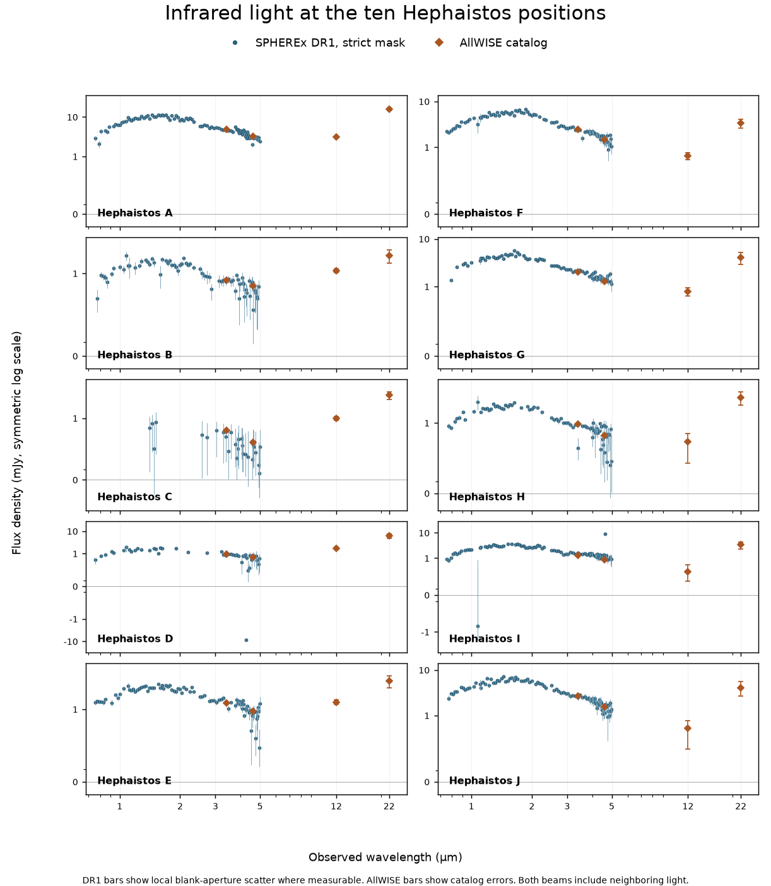
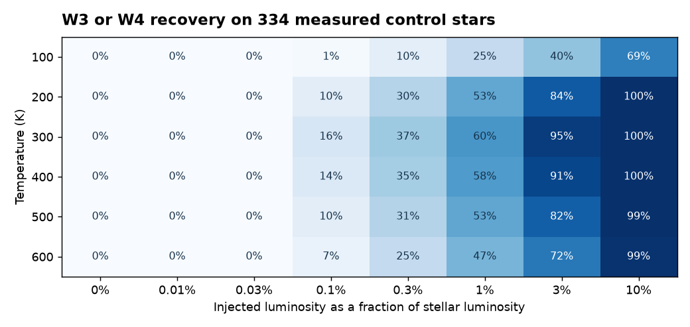

# SPHEREx DR1 and stellar waste-heat candidates

**No star in this study has a validated infrared excess requiring an artificial source.** In a 12.565 deg² high-latitude field, **0/404** nearby stars met the W3/W4 excess criteria. A separate search on the central DR1 tile found **0/55** qualifying 4.42–4.90 µm excesses among stars with usable matched comparisons. The samples overlap; removing secure and possible blends leaves **0/397** and **0/54**, respectively. A featureless thermal continuum alone cannot distinguish circumstellar dust from waste heat.

## Published targets

JWST/MIRI imaging and spectroscopy identify the sources of the long-wavelength excess in Hephaistos D and E as galaxies projected within about 1 arcsec of the stars. The galaxy at D has redshift 0.922 and an obscured-AGN-like spectrum. E has redshift 0.410 and a dusty starburst spectrum. Both fields look substantially stellar near 5 µm. High-resolution radio imaging identifies an AGN off the star at G. Its presence makes WISE confusion a strong explanation, although radio imaging does not decompose the infrared flux. B and C have strong evidence of contamination. A has a suggestive radio association and F has marginal evidence. The weaker additional targets H and J have marginal evidence of contamination, while I lacks a convincing interloper in the published archival inspection. None of the latter cases establishes an intrinsic stellar excess. [Original list](https://doi.org/10.1093/mnras/stae1186) · [Optical follow-up and H–J](https://arxiv.org/abs/2607.25701) · [Archival astrometry and imaging](https://arxiv.org/abs/2607.03619) · [Radio interferometry at G](https://academic.oup.com/mnrasl/article/538/1/L56/7954734) · [Resolved JWST spectroscopy](https://arxiv.org/abs/2607.09460)

We extracted DR1 aperture spectra for all ten Hephaistos positions and all 53 Contardo–Hogg objects, with two Gaia-matched comparisons per published target and two pilot field stars. The initial 47-position extraction and its independent replay retain their own tables. The 48 additional literature stars and their 96 comparisons have a separate [full-sample reduction](fgk_spectra/README.md). Individual channels have unequal coverage and reliability. For candidate E the strict aperture is 0.43 mJy above a local continuum at observed 3.293 µm, in a single channel. Its background galaxy's 3.29 µm PAH band is expected near **4.64 µm**. There the blended aperture contrast is +0.30 mJy with local blank scatter 0.15 mJy. Including outlier-flagged contributing pixels gives +0.25 mJy with 0.30 mJy scatter. This does not identify PAH. Stellar CO, stellar water absorption, isolated bad channels, neighboring light and diffuse background all affect the other feature tests. [Channel spectra](spectra/channel_spectra.csv) · [Feature and blank-aperture measurements](spectra/feature_tests.csv) · [Continuum measurements](spectra/continuum.csv)

The reported central temperatures for the original seven are 100–275 K. A 275 K blackbody emits 0.678% of its bolometric luminosity between 0.75 and 5 µm. For A's published 138 K model, the fraction is 0.000142%. These are model leverage calculations. They explain why even a well-measured photosphere at 3–5 µm is compatible with a large W3/W4 excess from another source. [Temperature inputs and integral](wise/thermal_leverage.py) · [Results including temperature uncertainties](wise/thermal_leverage.csv)



The Legacy Survey DR10 and unWISE images show how differently the same stars appear at optical and infrared resolution. C lies in a crowded optical field. Gaia lists three additional sources within 15 arcsec of C (7.37, 11.65 and 12.07 arcsec) and one 11.55 arcsec from I. At the remaining eight positions Gaia lists just the target within this radius. The galaxies at D and E illustrate what this neighbor test misses. In the native AllWISE images the 12 µm centroid offsets at B, C and G are 3.06, 3.28 and 5.54 arcsec, respectively. Their 3.4 µm offsets are all below 0.14 arcsec. [All ten fields, the 30 fits and their local controls](imaging/README.md). [Twenty optical and unWISE cutouts](imaging/optical_unwise.jpg) · [Gaia neighborhood table](imaging/gaia_neighborhood.csv) · [Image receipts](imaging/viewer_queries.json)

## WISE photometry and final-year variability

For A–J the median absolute difference between CatWISE and corrected unWISE magnitudes was 0.015 mag in W1 and 0.014 mag in W2. These are separate reductions of overlapping exposures. CatWISE resolves a second catalog source 4.33 arcsec from B's propagated stellar position. Even a close W1/W2 match cannot localize the emission in W3/W4. [Catalog photometry and neighborhood counts](wise/catalog_photometry.csv) · [Raw inputs](wise/archive_inputs.zip) · [40 query receipts](wise/queries.json)

The final NEOWISE release supplied 173 single-exposure rows inside the ten 12 arcsec neighborhoods. Only A had two visits with at least three accepted detections per band. Its changes over 161 days were **+0.007 ± 0.025 mag in W1** and **+0.006 ± 0.072 mag in W2**, including visit-difference calibration floors of 0.02 and 0.06 mag. The other nine had one qualifying visit each. W1/W2 monitoring does not measure variability of the longer-wavelength component. [Per-visit medians](wise/visits.csv) · [Variability tests](wise/variability.csv) · [NEOWISE calibration](https://irsa.ipac.caltech.edu/data/WISE/docs/release/NEOWISE/expsup/sec2_2.html)

A constant-flux test within each visit found excess W1 scatter at C (χ² = 77.25 for 37 degrees of freedom, corrected p = 0.00257 across 22 tests). Four pairs of exposures taken about 11 seconds apart each differ by 0.30–0.31 mag. W2 is consistent with constant flux. The 3.75 arcsec neighbor and the behavior of those paired exposures prevent assigning this variability to the star. In an independent archive replay three NEOWISE responses arrived in a different row order. All ten returned the same exposure rows. [Intravisit tests, calibration sensitivity and source-confusion caveats](wise/README.md)

ZTF DR24 returned qualifying r-band light curves for eight targets. Seven had no sampled night at least 0.2 mag fainter than baseline. In D, two exposures 39 seconds apart on MJD 58745 show a localized flux deficit. Relative to six comparison stars, 6-pixel apertures give 0.203 and 0.337 mag of fading in those two frames. The catalog PSF fits give greater depths and unusually large residuals and centroid shifts. Seven recovered science-image/mask pairs, including both event exposures, support a deficit in the images while leaving its stellar origin unconfirmed. The already-resolved galaxy accounts for D's mid-infrared excess. B and C returned zero ZTF r-band rows. [Optical measurements and attribution limits](optical/README.md) · [Per-exposure image apertures](optical/d_aperture_summary.csv) · [Raw light curves](optical/lightcurve_inputs.zip)

## Blind controls and measured sensitivity

The preselected field is a 2° circular cap centered on ICRS (180°, +30°). There were 596 Gaia DR3 stars with parallax ≥3.333 mas, parallax S/N ≥10, G <17 and BP−RP between 0.5 and 3.5. The main-sequence proxy and Gaia quality requirements removed 115, 19 lacked an AllWISE match, five had nonunique matches, and 53 failed W1 or morphology quality. Of the remaining 404, all had usable signed W3 photometry and peer models and 324 also had usable W4. There were 205 W3 detections at ≥5σ and zero W4 detections at ≥5σ. For each band the trigger required a ≥5σ measurement, a ≥5σ excess above the matched photosphere, and ≥0.25 mag of excess. [Frozen criteria](blind/selection.md) · [Every Gaia disposition](blind/screen.csv)

| Injected blackbody | Recovered at 1% of stellar luminosity | Recovered at 10% |
| --- | ---: | ---: |
| 100 K | 84/334 (25.1%) | 232/334 (69.5%) |
| 300 K | 202/334 (60.5%) | 334/334 (100%) |
| 600 K | 157/334 (47.0%) | 330/334 (98.8%) |

These injections add one physically normalized blackbody to each real control's measured fluxes. The star's W1 flux fixes the common normalization across bands. A preliminary calculation normalized W3 and W4 separately to their empirical peer medians. The common-W1 calculation above supersedes it. Catalog inclusion, image blending, noise realizations and quality flags are held fixed. The experiment measures recovery after those cuts. The field and the injection sample cannot support a Galaxy-wide occurrence constraint. [All temperatures and luminosities](blind/injections.csv) · [Control identities](blind/injection_controls.csv)

Whole-cohort catalog vetting identified one confirmed binary and six other WISE positions with possible contaminating neighbors. **0/397** WISE-tested stars remain above the excess threshold after excluding all seven, and **0/54** overlap-sample DR1 stars after excluding one ambiguous position. No target matched the Konkoly optical young-star compilation or either the prime or reserved Cotten–Song infrared-excess list. SIMBAD lacked an exact Gaia identifier for 316 of the 404 stars. [Catalogs, secure and ambiguous exclusions, and raw responses](blind/classifications.md)

The fixed central-tile cohort included 58 field stars with W1 <12. Fifty-six yielded sufficient photometry and local sky. Fifty-five had at least four comparison stars. Zero passed the 25% and 5σ red-continuum excess thresholds, either with the strict mask or when including pipeline outliers. The observable compares 4.42–4.90 µm against 1.51–1.72 µm, so it is sensitive to warmer excesses and to stellar molecular structure. At 1% of stellar luminosity the strict DR1 screen recovered **0/43 (0%)**, **0/43 (0%)** and **25/43 (58%)** additions at 100, 300 and 600 K. These measured recoveries, together with weak W4 depth, set the scope of the null: this pilot is insensitive to 100–300 K excesses at the 1% luminosity level in these controls. At 10% the corresponding recoveries were 0/43, 22/43 and 43/43. These controls are a separate subset, and their recoveries cannot be added to WISE's. [Blind spectral protocol and limitations](blind/README.md) · [DR1 injection grid](blind/dr1_injections.csv)



## Independent published list

We included the 53 FGK stars of Contardo & Hogg. CatWISE corroborates a W1 and W2 excess of more than 0.10 mag against the authors' respective photospheric predictions in all 53, with median excesses of 0.208 and 0.346 mag. CatWISE and unWISE share input exposures. Only two have inverse-parallax distances within 300 pc. Both have published natural counterparts, the optically dipping debris-disk system TIC 43488669 and extreme debris-disk system TYC 5940-1510-1. [FGK sample](https://doi.org/10.3847/1538-3881/ad6b90) · [Dipper](https://doi.org/10.3847/1538-4365/abbc17) · [Extreme debris disk](https://doi.org/10.3847/1538-4357/abdc26)

One red aperture provides a check against a real astrophysical excess. Gaia DR3 **3183786280737192704**, the dipper TIC 43488669, has a strict DR1 red-to-H flux-density ratio of **0.289 ± 0.005**, compared with 0.189 ± 0.005 and 0.162 ± 0.006 for two clean comparison stars. These uncertainties describe local sky scatter. The published disk interpretation and observed dips explain why it fails the requested quiet-star selection. [Spectra, control quality, and source identities](spectra/README.md) · [Literature review and astrometric checks](literature/README.md)

Among all 53 FGK stars, five are redder than both W1/W2-qualified Gaia comparison stars by at least three combined local-sky scatters in each of two DR1 flag masks. Thirteen fall below the threshold, and 35 have insufficient qualifying comparisons or strict-mask coverage. Two of the five have published 100–600 K fits. Both are outside the blind distance limit. Their W3 measurements have 0.030 mag catalog errors.

| Confirmed red continuum | Published temperature | Distance | W1/W2 excess color temperature | W2/W3 excess color temperature | Measured W3 / W1–W2 prediction |
| --- | ---: | ---: | ---: | ---: | ---: |
| Gaia DR3 3017430205815280384 | 550 K | 708 pc | 814 K | 428 K | 5.07 |
| Gaia DR3 6359523376149191936 | 530 K | 529 pc | 609 K | 487 K | 1.88 |

The central comparison uses AllWISE and the authors' predicted stellar W1/W2 fluxes, with a 5500 K photosphere extrapolated from W1 to W3/W4. For the first star the 12 µm flux remains at least 2.4 times the single-temperature prediction across the stated ±0.10 mag stellar-model grid. The second star's corresponding range spans unity. Both have one final-year NEOWISE visit in each band, and neither has a source listed by SIMBAD within 15 arcsec. FGK18 has 93 ZTF r measurements with no ≥0.20 mag faint night. The southern FGK31 has no ZTF r measurements. Independent SkyMapper DR4 measurements show no 0.20 mag fading on the eight retained observing nights for FGK18 or the twelve for FGK31. FGK31 has gaps exceeding 1,000 days. Its 12 µm centroid lies 0.665 arcsec from Gaia and the field contains Gaia sources 7.78 and 13.98 arcsec away. FGK18's W3 centroid is 0.132 arcsec from Gaia. These measurements leave multi-temperature dust and unresolved blends viable. [SkyMapper nights and limits](warm_fgk/skymapper/README.md) · [WISE images and neighbor checks](fgk_spectra/scenes/fields.png). [All 53 spectral dispositions](fgk_spectra/all_53.csv) · [Four-band color test and sensitivity](warm_fgk/WISE_colors.md) · [Optical and SIMBAD receipts](warm_fgk/README.md)

A source-by-source [literature disposition ledger](literature/fgk_dispositions.md) records the ten Hephaistos and 53 Contardo–Hogg follow-ups, their established natural explanations, and the distinction between measured spectral redness and physical attribution.

## Pending validation and scope

The source spectrum of a subarcsecond interloper is inseparable from the M dwarf in a 19 arcsec DR1 aperture. Candidate-level dust or companion exclusion requires source-resolved mid-infrared photometry or spectroscopy, independent epochs and a photospheric model with quantified systematics. A low RUWE does not exclude all companions. SPHEREx DR1 combines scans into a single coadded spectrum at each position: this is **not a test of independent SPHEREx visits or infrared temporal stability**. The two unresolved 708 pc and 529 pc warm FGK sightlines each have one qualifying final-year NEOWISE visit per band. A sparse optical time series cannot exclude permanent dimming or dips between visits. No population rate or artificial-source claim follows from this study.

## Data and reproduction

The initial 47-position DR1 extraction was repeated from 16 independent FITS downloads. The channel spectra, feature tests, continuum checks and coverage tables reproduced byte for byte. The full FGK extension records 48 additional FITS receipts and 14,688 channel rows. The two extractions include 191 positions in total. [Initial cube receipts](spectra/cube_receipts) · [Full FGK reduction](fgk_spectra/README.md) · [Blind cohort, catalog and spectral replay](blind/README.md)

The DR1 spectral all-sky cube combines surveys 1 and 2. [IRSA DR1 product and acknowledgments](https://irsa.ipac.caltech.edu/data/SPHEREx/docs/overview_dr1.html) · [Cube DOI](https://doi.org/10.26131/IRSA679)

`wise/fetch.py` requires an explicit `--output` campaign directory; cached response/receipt pairs must match the requested URL, query, byte count, and SHA-256. Partial, corrupt, or changed-query pairs and preserved errors stop the request; use a separate new campaign for changed inputs. A zero-row successful response remains a valid receipt.

For a new D: campaign, fetch the frozen response pairs and write derived tables to a separate new directory:

```powershell
python results/spherex-waste-heat/wise/fetch.py --output D:/Open-Space/campaigns/spherex-wise-20261117/archive
python results/spherex-waste-heat/wise/measure.py --archive D:/Open-Space/campaigns/spherex-wise-20261117/archive --output D:/Open-Space/campaigns/spherex-wise-20261117/derived
```

The NEOWISE single-exposure request is restricted to MJD 60291–60524; it is not a full 2010–2024 motion baseline.

The deposited `wise/archive_inputs.zip` now contains **40 HTTP 200 receipts**, with recorded URLs, queries, row counts, byte sizes and SHA-256 digests. They were independently checked against the response bytes. For an offline replay no legacy-status override is needed:

```powershell
Expand-Archive results/spherex-waste-heat/wise/archive_inputs.zip D:/Open-Space/campaigns/spherex-wise-verified/archive
python results/spherex-waste-heat/wise/measure.py --archive D:/Open-Space/campaigns/spherex-wise-verified/archive --output D:/Open-Space/campaigns/spherex-wise-verified/derived
```

A zero-row response is only accepted as an empty result if its request and recorded HTTP 200 status match. If another dataset lacks a status, the explicit legacy flag can make a historical comparison but cannot establish successful query completion.
