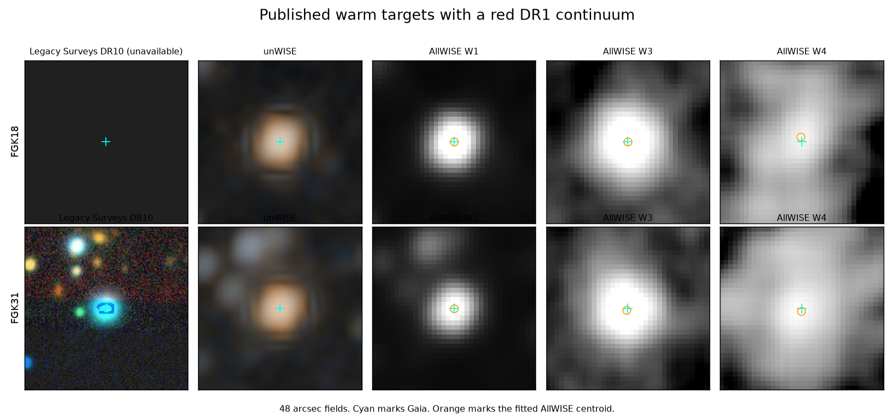

# SPHEREx spectra of the complete Contardo & Hogg sample

SPHEREx DR1 reproduces a red 4.4–4.9 µm continuum relative to two comparison stars for **5 of the 53 published FGK candidates** under both aperture masks. Thirteen fields fall below the comparison threshold and 35 cannot be classified with this test. The two red fields with published 100–600 K blackbody fits lie at about 708 and 529 pc. The infrared excesses in these apertures have no unique physical attribution. [Full 53-star measurements](all_53.csv) · [Published SED fits](https://doi.org/10.3847/1538-3881/ad6b90)

| Gaia DR3 source ID | Field | Inverse-parallax distance (pc) | Published T (K) | Strict continuum ratio | Excess in ratio above the redder comparison |
|---|---|---:|---:|---:|---:|
| 3183786280737192704 | FGK4 | 255 | 815 | 0.289 | 0.100 |
| 3017430205815280384 | FGK18 | 708 | 550 | 0.360 | 0.172 |
| 6809873615078147456 | FGK30 | 1,379 | 1,050 | 0.456 | 0.252 |
| 6359523376149191936 | FGK31 | 529 | 530 | 0.355 | 0.179 |
| 6877999557398569600 | FGK36 | 936 | 1,065 | 0.425 | 0.275 |

All 53 candidate apertures yielded 99 or 100 populated channels out of 102 with OUTLIER permitted. Between 13 and 100 channels per star passed the stricter flag mask. Of 106 Gaia-matched comparisons, 83 pass the W1/W2 color and quality cuts. Seven additionally pass W3. Twenty-one targets lack two W1/W2-qualified controls. Another 14 have two such controls but lack sufficient valid spectral coverage in the target or a comparison. Of 16 targets with published temperatures in the 100–600 K interval, two pass the comparison, two fall below threshold and twelve are indeterminate. These are counts for a list preselected on excess, with no occurrence-rate interpretation.

## Two warm fields

- **FGK18.** The 550 K fit has published fractional luminosity 0.04. The strict observed-frame 3.293 µm contrast is −0.304 mJy on a 3.850 mJy continuum (−7.9%). One comparison has −8.2% in the same window. The other three target feature contrasts are within one local sky scatter of the blank median. The authors list a Gaia variability flag. The final-year NEOWISE selection gives one visit in each band (nine exposures), which cannot measure a change between visits.
- **FGK31.** The 530 K fit has published fractional luminosity 0.06. The strict one-channel 3.293 µm contrast is +0.492 mJy on 3.947 mJy, with local sky scatter 0.098 mJy. A comparison gives +0.270 mJy on 3.573 mJy. Thus the fractional contrasts differ by 0.049, comparable to their combined sky-only scatter of approximately 0.053 when continuum errors are omitted. The broad 3.0 µm depression is also present in that comparison. The aperture data do not identify PAH emission or solid water. The final-year NEOWISE selection gives one visit per band (12 exposures).

Both fields have one CatWISE source within 12 arcsec, low Gaia RUWE (1.084 and 1.072), and high-significance AllWISE W3 photometry. AllWISE W4 is lower quality, particularly for FGK18 (quality C, signal-to-noise 2–3) versus FGK31 (quality B, 3–10). An infrared source below catalog resolution or circumstellar dust could still produce the measured colors. The spectra measure the sum of light within a 19 arcsec radius. [Channel spectra](channel_spectra.csv) · [Feature windows and blank statistics](feature_tests.csv) · [Catalog photometry](../literature/fgk_baseline.csv) · [CatWISE neighborhoods](../literature/fgk_catwise_comparison.csv) · [Final-year NEOWISE coverage](../literature/fgk_neo_coverage.csv)

## Image checks of the two warm fields

| Field | W3 offset from Gaia | W3 offset from W1 | W4 offset from Gaia | W4 injected-source 90th percentile |
|---|---:|---:|---:|---:|
| FGK18 | 0.132″ | 0.241″ | 1.534″ | 1.929″ |
| FGK31 | 0.665″ | 0.594″ | 0.864″ | 1.940″ |

FGK18 has no second Gaia DR3 source within 20″. The Legacy Surveys DR10 cutout returned a blank image and the DSS2 fallback timed out, leaving optical morphology untested. FGK31 has a structured optical field. Two fainter Gaia sources lie inside the 19″ SPHEREx aperture, at 7.781″ and 13.980″, with G = 20.16 and 19.74 versus 14.64 for the target. Its W3 peak lies 0.371″ east and 0.552″ south of the propagated target position. This subarcsecond shift warrants retaining confusion as an explanation. Neither imaged neighbor can be assigned the infrared excess from these data. [Gaia neighborhood](scenes/gaia_neighbors.csv) · [Optical and unWISE cutout receipts](scenes/viewer_queries.json)

The W3 offsets from Gaia exceed the 90th percentile of 24 same-brightness test-source placements (0.080″ and 0.079″). Those placements measure local background effects only. Absolute astrometric registration, the approximate PSF and unresolved blends limit interpretation. W4 has larger placement scatter than its observed offsets in both fields. The fitted centroids alone do not establish which object emits at 12 or 22 µm. [Native WISE fits](scenes/centroids.csv) · [Image hashes and archive locations](scenes/wise_queries.json)

## Reproduction and limits

The additional reduction covers the 48 published Gaia IDs outside the five already measured in `../spectra/`. The first five and their control stars keep their original labels. FGK6 through FGK53 follow the publication order after removing those five. The stars were selected in the literature on W1/W2 excess and span distances beyond the blind 300 pc volume. [Contardo & Hogg 2024](https://arxiv.org/abs/2403.18941)

The same forced 19 arcsec aperture, 36–60 arcsec sky annulus, strict and OUTLIER-inclusive masks, matched-color comparison selection, and observer-frame diagnostics are used throughout. Each additional star can have up to two nearby same-tile Gaia comparisons. Published excess candidates are excluded as comparisons. The AllWISE checks separately identify comparisons with photospheric W1/W2 colors and comparisons additionally verified in W3. A W3 nondetection leaves the longer-wavelength color unconstrained. [DR1 spectral all-sky cube](https://doi.org/10.26131/IRSA679)

Run `python run.py select`, `python run.py extract --cache /path/to/cache`, `python run.py controls` and `python run.py summarize`. The final stage uses the committed original five-target results alongside these additional measurements. The extension contains 14,688 channel rows for 48 targets and 96 controls, plus 48 full-FITS SHA-256 receipts covering 15,403,668,480 bytes. Each independent FITS and catalog acquisition records a digest and its archive location. The signed negative fluxes and masked channels remain in the spectra.

`all_53.csv` records the 4.42–4.90 µm to 1.51–1.72 µm continuum ratio, the empirical sky scatter, the matched controls available in each mask, and the published temperatures. The preregistered descriptive flag requires a ratio above both W1/W2-quality control stars by at least three combined local sky scatters in **each** flag mask. Sources lacking two usable comparisons in either mask are explicitly undetermined. Off-aperture scatter omits stellar-template mismatch, source photon noise, wavelength-dependent aperture losses and angular confusion. A red continuum is sufficient for that descriptive flag. Identifying warm waste heat would require independent discrimination from dusty material, a companion and a superposed background source.
