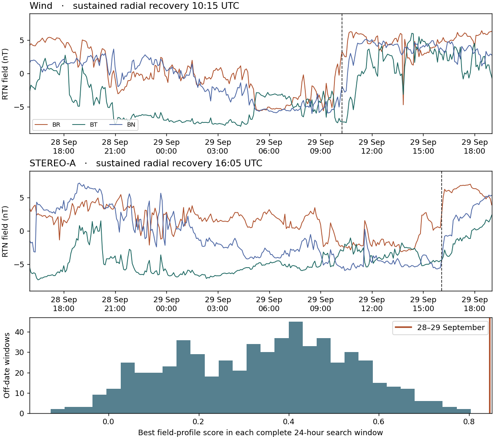

# A 28–29 September 2023 magnetic structure reached the inner spacecraft last

Wind measured a 12 h 50 min magnetic obstacle beginning on 28 September at 20:56 UTC. We identify a candidate counterpart in STEREO-A magnetometer data. The spacecraft were 3.80° apart as seen from the Sun. Despite STEREO-A being 0.0321 AU closer to the Sun, the sustained outward turn of the field near the rear appeared **5 h 50 min later at STEREO-A**. A simple radial translation at the measured plasma speed would instead have placed that feature at STEREO-A 3 h 19 min earlier, a difference of **9 h 09 min**.



| Measurement | Wind | STEREO-A |
|---|---:|---:|
| Heliocentric distance, 29 September at 12:00 TDB | 0.99336 AU | 0.96122 AU |
| Median proton speed during the encounter | 416 km/s | 391 km/s |
| Sustained radial-field recovery on 29 September, UTC | 10:15 | 16:05 |

**What is new.** The existing Wind observation is HELIO4CAST ICMECAT v2.3 event `ICME_Wind_MOESTL_20230928_01`. The adjacent STEREO-A entries in that archive start on 24 September and 18 October. Its LineupCAT v3.0 contains no 28–29 September pair. The NASA LASSOS STEREO archive brackets our interval with 21 September and 3 October events. Table 1 of Weiler et al. (2026) includes the distinct 24 September pair and jumps to 20 October. Agarwal & Mishra (2025) studied the 24–26 September cloud. We found no report in these sources of the later STEREO-A counterpart or this timing reversal. The archives and targeted literature check cannot establish worldwide priority. [ICMECAT](https://helioforecast.space/icmecat) · [LineupCAT](https://helioforecast.space/lineups) · [LASSOS archive](https://science.gsfc.nasa.gov/lassos/assets/catalogs/ICMEcatalog_STEREO_web.json?v=1.0) · [Weiler et al.](https://doi.org/10.1029/2026SW005033) · [Agarwal & Mishra](https://arxiv.org/abs/2502.18919)

## How the counterpart was identified

The Wind template comprises 78 ten-minute median field vectors in radial, tangential and normal (RTN) coordinates from 20:50 UTC on 28 September through 09:40 on 29 September, the bins containing the catalogue boundaries. We compared it with measured STEREO-A fields, using every ten-minute start in a 24-hour window around the Wind start and seven common duration factors from 0.8 to 1.4. We used a straight-line resampling of all three components with their measured polarities and relative amplitudes.

The shape metric is the cosine between flattened field profiles after subtracting each component’s temporal mean. The direction metric averages the signed dot product between unit vectors at matched phases. The score gives equal weight to both. The best start was **22:10 UTC on 28 September**, with duration factor **1.3**, shape correlation **0.789** and direction cosine **0.904**. This time aligns the profiles. The physical leading edge at STEREO-A is less distinct.

We repeated the full start-time and duration optimization in 601 other complete, disjoint 24-hour start-time blocks from November 2022 through June 2024. None reached the event score of 0.846. The runner-up was 0.804, 113 days earlier. Comparisons can share magnetic data across block boundaries. The event was selected during an exploratory screen of July and September 2023 following a wider search for spacecraft conjunctions. The rank measures specificity **for this selected template**. It does not give the false-discovery probability for the whole investigation.

## Independent measurements and interpretation

The rear recovery is defined separately from the template match. We use the first five-minute median in a continuous half hour with radial field above +2 nT during the visible recovery, searched at 08:00–13:00 UTC at Wind/ACE and 15:00–18:00 at STEREO-A. ACE independently crossed that threshold at **10:00 UTC**, using minus its sunward GSE X component as a near-Earth radial proxy. The common 14:00–18:00 search at STEREO-A with thresholds from 1 to 4 nT gives delays of **4 h 45 min to 5 h 50 min** relative to Wind. Marker times have five-minute bin resolution. The ICMECAT Wind end at 09:46 precedes completion of the extended magnetic rotation.

STEREO-A’s merged MAG/PLASTIC product yields median plasma beta 0.49 and proton temperature 36,250 K across its matched-start-to-recovery interval. The rotating field, magnetic-pressure dominance, agreement at ACE and Wind, and the off-date tests support a common extended magnetic structure. Median plasma speeds give a radial passage time of 3.31 hours for the JPL separation. The Sun-centred angular separation corresponds to about 0.065 AU of transverse separation at these radii. Different cuts through an oblique, distorted or evolving boundary can reverse the order. These records do not distinguish those geometries. A different co-moving solar-wind structure remains possible. A coronal launch, flux-rope topology or operational forecast skill would require additional evidence.

## Reproduce

Run from this directory with Python 3.10+, NumPy and pandas. The offline analysis loads the bundled inputs. Adding Matplotlib enables the figure.

```sh
python replay.py
python replay.py --plot field_profiles.png
(cd data && sha256sum -c SHA256SUMS)
```

For a fresh reduction from the upstream missions, run `python build_inputs.py`. The optional `--cache DIRECTORY` retains downloads. UTC-labelled input bins are left-closed, left-labelled medians. The separate Horizons calendar column is TDB. Horizons provides geometric Sun-centred ecliptic positions at a common epoch. At these distances a ~minute timescale offset has negligible effect on the radial lead comparison. Reprocessing by a data provider can change upstream bytes. [CDAWeb HAPI](https://cdaweb.gsfc.nasa.gov/hapi/) · [JPL Horizons API](https://ssd-api.jpl.nasa.gov/doc/horizons.html)

| Bundled measurement | Source |
|---|---|
| STEREO-A RTN fields, 20 consecutive months | NASA CDAWeb `STA_L2_MAGPLASMA_1M`, `BFIELDRTN` |
| STEREO-A field magnitude and proton plasma | Same merged product, `BTOTAL,Np,Vp,Tp,Beta` |
| Wind RTN fields and proton plasma | `WI_K1-RTN_MFI` / `BRTN` and `WI_H1_SWE` / `Proton_V_nonlin,Proton_W_nonlin,Proton_Np_nonlin` |
| ACE GSE vector field | `AC_H0_MFI` / `BGSEc` |
| Spacecraft positions | JPL Horizons targets −8 (Wind) and −234 (STEREO-A), origin Sun, 29 September 2023 |

Credits go to the STEREO IMPACT/MAG and PLASTIC teams, Wind MFI and SWE, ACE MAG, NASA SPDF/CDAWeb, NASA/JPL Horizons, and the HELIO4CAST and NASA LASSOS catalogue teams. HELIO4CAST requests contact about possible co-authorship if catalogue results are prepared for peer-reviewed publication. [HELIO4CAST catalogue and original references](https://helioforecast.space/icmecat)
