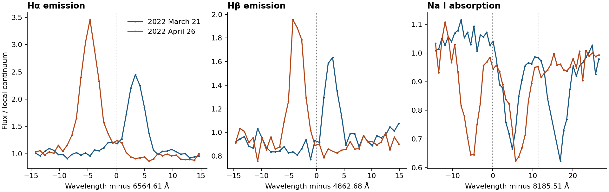

# A compact white-dwarf binary in the resolved quadruple around STSP J153415.59+363616.8

Two DESI visits show that the cool star in STSP J153415.59+363616.8 changed its line-of-sight velocity by **−367 ± 5 km/s** between 2022 March 21 and April 26. Hydrogen emission moved with it. The spectra show broad hydrogen absorption in the blue and molecular bands in the red, characteristic of a white dwarf plus a cool dwarf. The variable is one of four comoving Gaia sources that Shariat, El-Badry & Naoz cataloged as a resolved quadruple. The spectroscopy supports a **candidate hierarchical quintuple** in which one point of light contains the short-period pair. The outer binding and the accretion state remain open. [Resolved-quadruple catalog](https://github.com/cheyanneshariat/gaia_triples/blob/2c26a29f9106a5072b80f65f287325c5cd7359fe/Data/resolved_quads_500pc.csv) · [VSX identification](https://vsx.aavso.org/index.php?view=detail.top&oid=10875716) · [DESI public exposure products](data/desi-products.json)

## The spectroscopic detection

DESI used two separate exposures, fibers 2894 and 4662, on different spectrograph petals. The exposure times were 555 and 576 seconds. Their fiber centers landed 0.06 and 0.04 arcsec from the Gaia DR3 catalog position. The nearest resolved star lies 3.25 arcsec away. The DESI fiber diameter is about 1.5 arcsec and the exposure headers give seeing of 1.09 and 1.84 arcsec. These values leave some scope for neighbor light in the wings. The ZTF amplitudes below independently localize the modulation. [Fiber records](data/visits.csv) · [DESI instrument](https://doi.org/10.3847/1538-3881/ac882b)

| Tracer | March 21, km/s | April 26, km/s | April minus March, km/s |
| --- | ---: | ---: | ---: |
| Hα emission | +158.0 ± 2.9 | −211.6 ± 2.4 | −369.6 ± 3.8 |
| Hβ emission | +163.8 ± 5.8 | −217.9 ± 5.2 | −381.7 ± 7.8 |
| Hγ emission | +209.8 ± 14.6 | −225.2 ± 5.4 | −434.9 ± 15.5 |
| Na I absorption doublet | +170.8 ± 3.3 | −196.1 ± 3.5 | −366.9 ± 4.8 |

The primary measurement uses the sodium doublet of the cool photosphere. The emission and absorption estimates use separate wavelength regions and the same two exposures. We fit a Gaussian for each transition plus a local linear continuum, retaining positive inverse variance and zero masks. The two Na I lines share a velocity and width with free individual depths. The DESI wavelength grid includes the barycentric correction. Rest wavelengths and the treatment of the blended red Na component affect absolute velocities. The errors come from the local fit covariance, inflated for excess residual scatter. They omit template mismatch. [Analysis and line definitions](analyze.py) · [DESI wavelength convention](https://desidatamodel.readthedocs.io/en/stable/DESI_SPECTRO_REDUX/SPECPROD/exposures/NIGHT/EXPID/frame-CAMERA-EXPID.html)

Across six local fits using widths of 12, 17 and 22 Å beyond the rest lines and linear or quadratic continua, Δv ranges from −368.1 to −366.8 km/s for sodium and from −370.2 to −368.9 km/s for Hα. Hγ shows greater model dependence and a larger change than the other lines. In the Hα region the stellar peaks above local baseline were 77.6 and 127.0 in DESI flux units. The corresponding 95th percentiles among the 14 usable sky fibers on each petal were 1.55 and 2.00. All 28 sky peaks were smaller than the corresponding stellar peak. The sodium doublet independently changes direction in absorption. [All fits and controls](result.json)

## How the period constrains the orbit

Lin, Zhang & Ning's VSX entry gives a period of 0.252027 days, HJD epoch 2458733.686, a CV classification, and a note identifying the 3.2-arcsec southern visual companion. We obtain ZTF r-band semiamplitudes of **0.0686 mag at the variable, 0.0016 mag at the southern companion and 0.0010 mag at the outer pair**, using the published clock and an offset per ZTF object ID. The target's g and i semiamplitudes are 0.0423 and 0.0377 mag. This is a spatial control on the known variability using the same survey as the VSX discovery. The outer pair is unresolved by ZTF. [VSX record](data/vsx.json) · [ZTF input rows](data/ztf.csv.gz)

The March and April DESI exposure midpoints fall at phases 0.315 and 0.734 relative to that ephemeris. The r-band fitted faintest phase is 0.000. The redward and blueward velocities are consistent with a circular orbit observed near opposite quadratures if the cool star's dark side faces us at photometric minimum. The two spectra predate the VSX entry and our comparison is retrospective. The two phases alone cannot determine an orbital period or establish an irradiation geometry.

Any velocity curve that visits both sodium measurements has a nominal half-range of at least **183.4 km/s**. If the published photometric period is the circular orbital period, the phase spacing of 0.41876 cycles makes the minimum sinusoidal semiamplitude **189.6 km/s**, using (K\ge |\Delta v|/[2|\sin(\pi\Delta\phi)|]). If these absorption centroids follow the cool star's center of mass, (PK^3/(2\pi G)) then gives a minimum nominal spectroscopic mass function of **0.178 solar masses**. These bounds use central measurements. The interval is not a confidence bound. Phase-dependent line formation on an irradiated, rotating star can change the center of light. Additional velocities through both conjunctions and quadratures would measure the orbital curve, systemic velocity and any departure from the assumed phasing.

## Which part of the hierarchy is new?

The exact ID crossmatch between all 1,312 Gaia WD+MS entries in the repository's frozen list and all four columns of Shariat et al.'s 3,175 resolved-quadruple catalog rows has **one match**, Gaia DR3 1375395351637562240. The WD+MS catalog flagged this source for possible companion contamination and gave no orbital period. The quadruple-catalog row labeled the corresponding point source MS. The previously cataloged quartet is arranged in two sky pairs. Their projected separations at the variable’s inverse parallax are **757 au and 170 au**, with **18,548 au** between the variable and the brighter member of the distant pair. These are projected distances between named components. They do not provide the full outer orbits. The fifth star is inferred from spectroscopy of the variable member of this quartet. [Shariat et al.](https://doi.org/10.1088/1538-3873/adfb30) · [Rebassa-Mansergas et al.](https://doi.org/10.1051/0004-6361/202554700) · [Four stars and uncertainties](data/quad.csv)

The DESI Redrock coadd classifies this target as K. The separate DESI Milky Way Survey coadd row reports an adopted +666.8 km/s with RVS_WARN=8. Those single-template, coadded results cannot represent both measured velocities. An exact Gaia ID search in Swan et al.'s 63,968-row DESI DR1 white-dwarf table returned no row. Inight et al.'s 1,028-row DESI CV table has no Gaia-ID match and its nearest source is 0.58° away. A 15-arcsec search of Hou et al.'s DESI CVs (VizieR table 3), the SDSS DR9–12 WD+MS catalog, and SDSS DR19/20 Valis returned no source. The nearest June 2026 Multiple Star Catalog component is about 0.87° away. Searches of the object name, Gaia ID and nearby-coordinate aliases, and of Shariat et al.'s CV triple paper, located no report tying the measured sodium swing to the five-star architecture. Catalog selection and indexing limit these checks. Priority remains open. [DESI WD catalog](https://zenodo.org/records/23453342) · [DESI CV catalog](https://cdsarc.cds.unistra.fr/viz-bin/cat/J/ApJS/282/26) · [DESI stellar-pipeline row](data/mws-coadd.csv) · [Inight et al. DESI CV catalog](https://doi.org/10.1093/mnras/stag2061) · [CVs in triples](https://arxiv.org/abs/2501.14025) · [Catalog query record](data/catalog-provenance.json)

The new measurement establishes rapid spectroscopic motion in the object classified as a CV. Narrow emission that moves with sodium can arise on a heated or active cool star. Confirming mass transfer, measuring white-dwarf motion, and testing the widest association with individual systemic velocities require additional evidence.

## Reproduce

With Python 3, NumPy and SciPy, run `python analyze.py` from this directory for the numerical results. `python figure.py` uses Matplotlib. `python extract.py CACHE_DIR` uses Astropy to fetch and verify six full DESI camera files, then rebuilds the compact spectra, sky windows, visit metadata and exposure midpoint HJDs. Each target spectrum includes the full archived wavelength, flux, inverse variance and mask arrays. The ZTF CSV retains every returned row of the selected columns, including rejected measurements. The catalog record gives the three original ZTF cone requests and SHA-256 digests of their uncompressed responses. `sha256sum -c SHA256SUMS` checks the release.

The exploratory search covered both members of the repository's previously frozen WD+MS companion pairs at declination above −31° and Gaia G fainter than 12. It retrieved 115 distinct position cones and inspected periodograms and close field sources. A separate 1,910-row ZTF series at the previously featured CD−27 2812 faint source yielded different dominant g and r periods. That check did not establish a common clock there. The exact catalog crossmatch above gives a reproducible selection for the spectroscopy result. The two-band exploration has no survey-level significance attached to it.

DESI is a US Department of Energy Office of Science project operated by Lawrence Berkeley National Laboratory with support from partner agencies and institutions. This analysis used observations from DESI, the Zwicky Transient Facility, the ESA Gaia mission and DPAC, and the AAVSO International Variable Star Index. [DESI DR1](https://data.desi.lbl.gov/doc/releases/dr1/) · [ZTF processing and archive](https://doi.org/10.1088/1538-3873/aae8ac) · [Gaia DR3](https://doi.org/10.1051/0004-6361/202243940)
