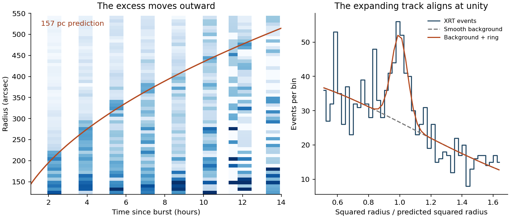

# An expanding soft X-ray ring candidate around GRB 180728A

Swift XRT recorded a soft X-ray excess moving outward from the position of GRB 180728A on 28 July 2018. Its expansion corresponds to a Galactic dust layer at **about 158 pc**. The first three observing intervals independently select 163 pc and the later intervals select 156 pc. In eight intervals with complete radial extraction coverage, **414 photons** fell on the predicted track. The two equal-area adjacent annuli predict 275.5 photons and a template made from later images of the same sky predicts 315.3. The signal appears around the burst in all eight angular sectors.



The left panel uses area-normalized radial profiles with each displayed column independently scaled and widened for visibility. The right panel shows raw counts in equal-width bins of squared radius divided by the prediction. A smooth continuum plus a Gaussian in that coordinate fits a layer distance of 157.5 pc. The Gaussian width includes the instrumental PSF and any intrinsic spread in dust distance.

## Measurements and falsification tests

The origin is RA 253.5649583°, Dec −54.0445000° (J2000), and the time origin is 2018-07-28 17:29:00 UTC. For a short flash beyond the Galaxy, the small-angle light-travel relation gives the estimated distance in parsecs as 826.6 times elapsed seconds divided by angular radius squared in arcsec. The 157.3 pc prediction passes 209, 272 and 323 arcsec at 2.32, 3.92 and 5.50 hours. The adjacent-band contrast is positive in each of these three snapshots. [Ring geometry and previously published GRB sample](https://academic.oup.com/mnras/article/526/2/2605/7284396)

| Test | Result |
|---|---|
| Narrow exploratory distance window | 419 events on the feature, 744 in two sidebands with 18/7 the log-distance width. This is the original search statistic. |
| Equal-area photon counts, 0.7–3 keV | Inner / on / outer = 331 / **414** / 220, using only times when all three apertures fit inside the 50–550 arcsec extraction. The expected 275.5 assumes locally linear surface brightness in squared radius. |
| Split by observation order | Even snapshots give 166 / **211** / 114, odd snapshots 165 / **203** / 106. Separate full distance scans select 163.3 and 156.1 pc. |
| Late images of the same sky | 2,040 soft photons from 20 later snapshots sample the field after the predicted annuli move past 550 arcsec. Conditioning on each early snapshot's three-band total predicts 315.3 events. Every fully covered early snapshot exceeds its individual prediction. Pointing and the afterglow can evolve. |
| Displaced centers | Under common radial containment, the local likelihood score falls from 5.84 at the burst to **at most 1.34** at 16 centers displaced by 40 arcsec. This is a descriptive score. |
| Hard-energy comparison | 3.01–7 keV gives 59 / **58** / 48 in the three fully contained bands. |
| Independent distance-map check | G-Tomo's 10 pc resolution optical map rises from 0.00048 mag/pc at 100 pc to 0.00246 at 155 pc, with a broad maximum of 0.00387 at **180 pc**. This supports nearby foreground material and leaves a 22 pc difference from the X-ray peak. |

The search protocol preceded the field selection. The energy and outer-field predictions were committed after selecting the 157.3 pc track and before examining events beyond 550 arcsec. In the **550–850 arcsec holdout**, 267 soft photons are on-track against 248.7 expected from footprint-weighted sidebands. This does **not** corroborate the echo. The corresponding hard band gives 59 against 32.1. Inner-field 0.50–0.69 keV gives 64 against 53.0. These tests limit the finding to an inner-field candidate. The per-GTI footprint uses a fitted sky-to-detector relation, bad pixels and five time nodes over each GTI. It omits detailed vignetting and diffuse stray-light modeling, important near the chip edge. The fitted mapping has an RMS residual of 1.55–3.64 arcsec. [Frozen outer-field test](../../protocols/grb-180728a-outer-holdout.md) · [Counts by GTI and energy](annuli.csv)

## Search population and alternatives

The Swift GRB table supplied 1,365 rows with a parseable XRT position, UTC time and numeric trigger. Rank the BAT 15–150 keV fluence divided by the larger of 0.05 and the absolute sine of Galactic latitude. This favors bright flashes near the Galactic plane. Select the top 120 and eligible literature controls, giving **124 fields**. Search suffixes 000–005 of the listed target IDs. 123 fields had at least one PC event product, and 122 had qualifying events in the radial/time/energy extraction. The frozen census covers 522 PC event files and 276,653 soft photons. It excludes bursts with missing positions, nonnumeric identifiers, other target IDs and later sequences. The table's BAT trigger is unusually late for the known control GRB 221009A, for which we used the 13:16:59 UTC Fermi epoch. [Frozen selection](sample.csv) · [All event file names and SHA-256 hashes](event-files.csv) · [All screen outcomes](screen.csv)

The initial search scanned log-distance bins of width 0.025 with seven on bins and two nine-bin sidebands, separated by one bin. It recovered the published features toward 050724, 061019 and 221009A. The largest score for 050713A was unrelated to its reported XMM feature. Several other high scores concentrated on fixed sources, appeared in the hard band, or depended on the aperture edge. GRB 241030A has a bright field source near 525 arcsec. GRB 210807C ranked highly in the cross-check but its frozen follow-up found zero event files in suffixes 006–030. [Frozen later-visit test](../../protocols/grb-210807c-heldout.md)

After inspecting selected fields we reranked **all 124** using the weakest result among four position-angle quadrants and two alternating snapshot partitions, scanning only fully contained rings. GRB 180728A ranked **third**, behind the published rings of 221009A and 050724, and ahead of the published 061019 ring. This ranking was designed after seeing the data. None of the quoted scores is a survey-wide false-alarm probability. A structured soft background, time-dependent detector response and selection across distances and fields remain material alternatives. An independent exposure-map forward model or another telescope's early imaging would test them. [Reranking](coherence.csv)

## Provenance and replay

The photon-counting files are UKSSDC reprocessed Swift/XRT products. We use grades 0–12, convert each file's TT reference epoch, and use its sky WCS. The screen spans 200 seconds to five days, with 50–550 arcsec and 0.7–3 keV. Data were accessed 2026-11-15 UTC. The live NASA summary HTML had SHA-256 a3b827c22d8c425f0cbd3cc0fe7c6dfc0f88dbf5f8bf5e4ec8478fc903dcc893. Each archived event input used for the finding has its own receipt. This work made use of data supplied by the UK Swift Science Data Centre at the University of Leicester. [NASA full GRB table](https://swift.gsfc.nasa.gov/archive/grb_table/fullview/) · [UKSSDC burst field](https://www.swift.ac.uk/xrt_curves/00850471/) · [EXPLORE extinction cube](https://doi.org/10.5281/zenodo.10405177)

Run from this directory with Python, NumPy, SciPy, Astropy and Matplotlib. Install lxml only for rebuilding the sample from the live NASA HTML. The full search uses approximately 39 MB of compressed archived events. To replay only the featured field add `--name 180728A` on the first command and omit the all-field coherence scan. The PNG and CSVs are already available for offline inspection.

```sh
python search.py --cache xrt-cache --output screen-replay.csv --save-photons photons
python validate.py photons/180728A.npy 157.3
python profile.py --cache xrt-cache --out replay
python coherence.py photons coherence-replay.csv
python figure.py photons/180728A.npy echo-replay.png
curl -fL 'https://zenodo.org/records/10405177/files/explore_cube_density_values_010pc_v2.fits?download=1' -o extinction.fits
python dustmap.py extinction.fits dust-replay.csv
```

On 2026-11-15 UTC we searched the burst name with “dust scattering”, “halo”, “expanding ring”, “echo” and “Swift”, checked the seven-burst halo census and the burst-specific literature. We found no prior report of this expansion. The source and the underlying Swift observations are public. The recent burst paper addresses the prompt emission, afterglow and SN 2018fip. Separate reduction and a wider bibliographic check are warranted before a priority claim. [Rossi et al.](https://doi.org/10.1051/0004-6361/202557667) · [Published GRB halo census](https://academic.oup.com/mnras/article/526/2/2605/7284396)
