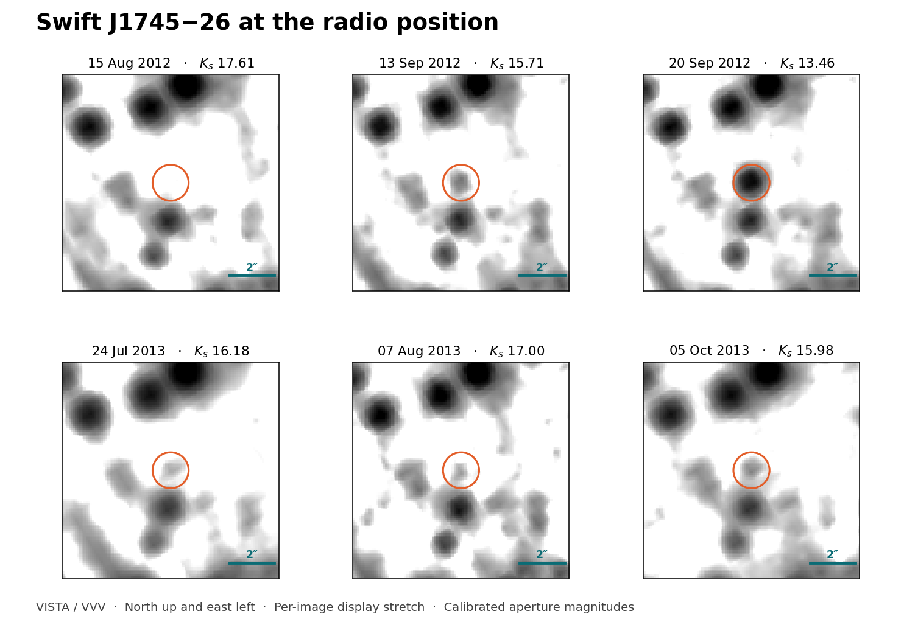

# Infrared emission before the Swift J1745−26 trigger and during its late decline

Two VISTA images recorded the known black-hole candidate Swift J1745−26 at **Kₛ = 15.77 ± 0.08 mag on 2012 September 13**, 3.339 days before the first Swift/BAT trigger. The two centroids lie 0.082″ and 0.069″ from the Very Large Array position. The OGLE team had already discovered an optical precursor that night. Their I ≈ 18.9 measurement followed the infrared exposures by about 1.8 hours, giving an observed, nearly contemporaneous **I − Kₛ ≈ 3.1 mag**. Interstellar extinction and any evolution within those hours affect the physical interpretation. [OGLE discovery report](https://www.astronomerstelegram.org/?read=4921) · [VLA astrometry and BAT trigger](https://doi.org/10.1093/mnras/stt2125)

A second result concerns the decline. VISTA measured **Kₛ = 16.02 ± 0.07 on 2013 July 24, 16.75 ± 0.15 on August 7, and 15.97 ± 0.06 on October 5**. The October return to brightness occurred 384 days after the trigger, months after the published optical and hard-X-ray rebrightening around MJD 56380–56440. July and October each have measurements on additional nights at comparable levels. The BAT daily monitor shows no significant positive flux when stacked over either infrared bright interval. Residual blending could contribute to the faint-state flux. These sparse epochs leave the number and duration of intervening episodes undetermined. [Published X-ray and optical decline](https://doi.org/10.1093/mnras/stu1851) · [Swift/BAT daily monitor](https://swift.gsfc.nasa.gov/results/transients/weak/SwiftJ1745.1-2624/)

## What was measured

VIRAC2 source **13284310018508** is the closest catalog source to the radio position at 17h45m10.849s, −26°24′12.60″. The catalogue's mean position is 0.12″ from the radio position, and the next entry is about 1.7″ away. A targeted inspection of five known black-hole candidates also considered 4U 1630−47, H 1743−322, IGR J17091−3624 and GRS 1739−278. This source was followed up because VISTA covered the alert boundary. The comparison is exploratory. Source discovery, the optical precursor, the original infrared counterpart identification and the known X-ray outburst belong to the observing teams. [GROND counterpart](https://www.mpe.mpg.de/~arau/transients/swiftJ1745-2624.html) · [2012–2013 optical and infrared study, including a separate 2019 VIRCAM limit](https://arxiv.org/abs/2003.04647) · [VIRAC2](https://doi.org/10.1093/mnras/stae279)

| UTC date | VIRAC2 Kₛ, mag | Fixed-position aperture Kₛ, mag |
|---|---|---|
| 2012 Aug 15 | 17.29 ± 0.23 | 17.61 |
| 2012 Sep 13 | 15.70 ± 0.10, 15.90 ± 0.12 | 15.71, 15.89 |
| 2012 Sep 20 | 13.44 ± 0.02, 13.51 ± 0.02 | 13.46, 13.46 |
| 2013 Jul 24 | 15.98 ± 0.10, 16.06 ± 0.09 | 16.18, 16.09 |
| 2013 Aug 7 | 16.68 ± 0.20, 16.85 ± 0.23 | 17.00, 17.22 |
| 2013 Oct 5 | 15.83 ± 0.09, 16.13 ± 0.09 | 15.98, 16.38 |
| 2014 Aug 3 | 17.27 ± 0.31 | 17.63 |

The two September 13 frames were taken 37 seconds apart. Their inverse-variance weighted uncertainty uses the quoted photometric errors and excludes shared calibration uncertainty. Relative to the one noisier August 2012 detection the target brightened by 1.49 mag using the median of the paired September measurements, a factor of 3.96 in flux. Of 16 other stars with mean Kₛ from 14 to 18 within the queried six-arcsecond field and usable measurements on both dates, the largest absolute change was 0.67 mag. Published 2019 imaging set a quiescent limit of Kₛ > 18.2. [2019 quiescent limit](https://arxiv.org/abs/2003.04647)

Fixed-position aperture photometry on the twelve ESO archive images in the table gives a second reduction of the same photons. The code registers the local WCS translation against ten comparison stars selected by brightness, isolation and catalog stability. It places a 1.7-pixel-radius aperture on the radio position, measures the local median sky between 3.5 and 5 pixels, and obtains the zero point from comparison-star Kₛ magnitudes. The 2013 October and August measurements differ by about 0.93 mag in median aperture magnitude, compared with 0.79 mag in the weighted PSF photometry. Changing seeing, spatially unresolved light and the scatter between October exposures limit the accuracy of an individual measurement. The direct images and independent filter detections support source variability, while the physical cause of renewed activity remains open.

| Swift/BAT daily bins (MJD, inclusive) | Good days | 15–50 keV rate (counts cm⁻² s⁻¹) |
|---|---:|---:|
| 56183–56185, infrared detection through day before trigger | 3 | −0.000067 ± 0.000655 |
| 56186, trigger day | 1 | +0.049043 ± 0.001989 |
| 56497–56506, July/August 2013 | 10 | −0.000675 ± 0.000345 |
| 56570–56583, October 2013 | 14 | −0.000468 ± 0.000293 |

The BAT average uses unflagged daily bins and inverse total-error-variance weighting. It constrains a persistent hard-X-ray counterpart on those days. Unobserved intervals and softer X-rays remain unconstrained. OGLE reported HJD 2456183.623. Removing the 53.5-second heliocentric correction for this direction at Las Campanas puts that measurement approximately 1.81 hours after the mean VISTA epoch. A different timescale convention at the one-minute level would have little effect on this comparison. The delay to the public trigger is measured directly from UTC times. It does not measure a physical propagation lag within the binary.

## Reproduction and primary data

From this directory, `python verify.py` reproduces the photometry, positional offsets, control ranking and monitor summaries using the included numerical data. With NumPy and Astropy installed, `python verify.py --images /tmp/swift-j1745-vista` downloads the twelve small ESO SODA cutouts and reproduces all twelve fixed-position magnitudes. The script also compares the original cutout byte hashes and checks photometry to 0.003 mag. Header changes during server-side regeneration can change a file hash. The measured pixels and their calibrated magnitudes provide a separate check.

- `field.csv` contains 89 VIRAC2 source records, all entries in a 0.0028-degree cone about 266.29520833°, −26.40350000°. `photometry.csv` includes the 45 target Kₛ detections and all returned Kₛ measurements of sources within 6″ of that center on MJD 56154, 56183 and 56190. Quality selections are applied in the verifier. The other epochs in the table are all target measurements. The source catalogue, light curves and observing metadata are the ESO tables `VVVX_VIRAC_V2_SOURCES`, `VVVX_VIRAC_V2_LC` and `VVVX_VIRAC_V2_OBS`. The CSV header names match the requested archive columns. [ESO TAP catalogues](https://archive.eso.org/tap_cat) · [VIRAC2 data release](https://www.eso.org/sci/publications/announcements/sciann17684.html)
- `exposures.csv` preserves the 45 observation identifiers, original VIRCAM filenames, observing block, tile, dates and seeing. `images.csv` gives the ESO processed-image IDs, cutout URLs, original SHA-256 digests and aperture magnitudes. ESO/VISTA and the VVV/VVVX teams acquired and reduced the images. The figure uses a separate stretch in each panel. The orange circle is fixed on the radio position.
- `bat.csv` preserves the full set of returned daily bins in MJD ranges 56174–56196 and 56485–56586 inclusive, including negative rates. The original daily product identified its generation date as 2026 October 21. Credit the NASA/GSFC Swift/BAT team and the transient monitor work of Krimm et al. [Original monitor data](https://swift.gsfc.nasa.gov/results/transients/weak/SwiftJ1745.1-2624.lc.txt) · [Instrument and discovery study](https://doi.org/10.1088/0067-0049/209/1/14)

The source is a previously identified black-hole candidate. This investigation adds a time-resolved infrared measurement of its early rise and a later interval of infrared variability. The object itself and its published optical discovery retain their original attribution.
