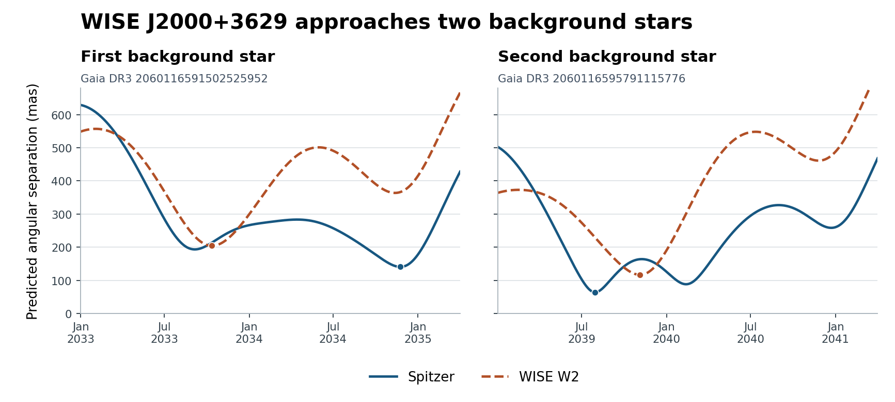

# Two background stars on the path of the T8 dwarf WISE J2000+3629

Spitzer astrometry of WISE J200050.19+362950.1 and Gaia DR3 source motions predict two close passages. Both have multiple annual-parallax minima. A mass measurement would require detecting the change in the background star’s position during a passage and separating it from parallax, proper motion and blending. No lensing measurement or new mass is reported here.

| Background Gaia DR3 source | G | Earth-view minimum from 25 Spitzer epochs | Other close minimum | Centroid shift for 0.03 / 0.05 M☉ | Source quality |
| --- | ---: | --- | --- | ---: | --- |
| 2060116591502525952 | 19.06 | 2034 Nov 23, 141 mas | 2033 Sep 4, 193 mas | 0.23 / 0.38 mas | RUWE 1.05, 27 visibility periods |
| 2060116595791115776 | 20.15 | 2039 Jul 30, 64 mas | 2040 Feb 12, 88 mas | 0.50 / 0.83 mas | RUWE 2.07, 22 visibility periods, parallax −3.93 ± 0.76 mas |

The first source gives the more credible prediction. The second offers a potentially larger shift, with a poor Gaia fit and a measurable Pan-STARRS position discrepancy. The foreground parallax is about 133 mas, so alternate seasonal minima can exchange order after a small change in proper motion. The dates in the table locate local minima of one fit. They are unsuitable as observing deadlines. Independent WISE measurements place the brighter star’s closest encounter in October 2033 at 180–263 mas, outside the formal Spitzer/Gaia interval. For the fainter star, the WISE fits span 62–216 mas in late 2039. The two passages persist across these fits, while their precise dates and deflections depend on the astrometry. [WISE measurements and sensitivity fits](wise-check/README.md)

*Spitzer and WISE select different closest passages for the first star. The second star passes close to the dwarf in both fits, with a different predicted separation. [Reproduce the figure](plot_encounters.py)*

## Measurements behind the forecast

- **Lens.** Kirkpatrick et al. (2021) give 25 Spitzer 4.5 µm positions, spacecraft barycentric coordinates and astrometric uncertainties for this object. They report 25 Spitzer epochs, zero WISE epochs and 88 Gaia DR2 reference stars. Our five-parameter fit returns a parallax of 133.74 ± 2.23 mas and proper motion in east and north of +5.99 ± 0.95 and +372.87 ± 0.95 mas/yr. The reported 2021 solution is 133.4, +6.1 and +372.8 in the same units. Fitting the first 18 epochs through MJD 57999 predicts the seven later positions with axis RMS errors of 8.9 and 6.5 mas. This tests the ability to extrapolate through the measured Spitzer baseline. The uncertainty over two further decades also depends on the model for the lens motion. [Published epoch astrometry and fit](https://vizier.cfa.harvard.edu/viz-bin/VizieR?-source=J/ApJS/253/7) · [Kirkpatrick et al.](https://arxiv.org/abs/2011.11616)
- **Historical solution.** Propagating the earlier Spitzer solution moves the first minimum to September 2033 at 140 mas and the second to December 2039 at 6 mas. Its 20 Spitzer epochs overlap the later data and its astrometric calibration differs. The difference makes the size of the potential 2039 signal particularly uncertain. [Kirkpatrick et al. (2019), Table 4](https://vizier.cfa.harvard.edu/viz-bin/VizieR?-source=J/ApJS/240/19)
- **Background images.** In a 1.8 arcsec cone around each Gaia target, Pan-STARRS DR2 returns one mean object. The marked objects have 79 and 35 individual detections. We required `psfQfPerfect > 0.85` and positive astrometric errors, then took medians per MJD day. There are 32 and 17 usable nights from 2009 to 2014. Median radial offsets from Gaia trajectories are 29 and 64 mas, respectively. For the second source the median east offset is −50 mas. Both axes of both night-based Theil–Sen residual proper-motion fits include zero within their nominal 95% intervals. The broad intervals leave substantial extrapolation uncertainty. [Pan-STARRS catalog service](https://catalogs.mast.stsci.edu/docs/panstarrs.html)

## Search and physics

The parent table is the Kirkpatrick et al. 20 pc census, with 4,407 rows. We selected entries with an epoch, a blank Gaia designation and an optical or near-IR spectral type starting with L, T or Y. This yields 237 lens entries. We queried the Gaia DR3 catalog at their predicted J2044 barycentric positions with radius `30 yr × lens proper motion + 15 arcsec`. There are 1,680 unique Gaia rows and 1,690 lens/source combinations after reconstructing overlapping circles with a 5 mas rounding margin. The selection can miss uncataloged background sources, extreme source motions, and lenses whose catalog names or spectral types fail these cuts. [NASA/IPAC census and data notes](https://exoplanetarchive.ipac.caltech.edu/docs/20pcCensus.html) · [Gaia Archive](https://gea.esac.esa.int/archive/)

We propagated each pair from J2026.87 to J2063.00 on a three-day grid using proper motions, parallaxes, a common local tangent plane and ERFA's Earth barycentric ephemeris. Missing source motions default to zero for triage. Negative source parallaxes are clipped at zero. Eleven pairs reach a nominal centroid displacement of 0.1 mas at the fiducial mass of 0.05 M☉. `screen.csv` preserves all eleven, including the binary Luhman 16, for which a single-body model is inadequate. The two source-specific forecasts here were chosen as a repeated-lens case. Other rows have varying astrometric provenance and received no equivalent follow-up.

The detailed forecasts use a half-day grid and the Spitzer covariance derived from the reported epoch errors, without scaling those errors down for the low fitted residuals. For a dark point lens, the unresolved source-image centroid shift is `s × θE² / (s² + 2 θE²)`, with angular separation `s` in mas and `θE² = 8.144 × M/M☉ × (πlens − πsource)` in mas². At each sampled time the observer is at Earth's center. Flux from the lens or unresolved neighbors dilutes the measured shift. Individual observer ephemerides and an instrument-specific blending and noise model would be needed to predict achievable mass precision. The dark point-mass and rectilinear barycentric motion models do not include companions or unknown accelerations.

Ten thousand reproducibly seeded draws per model propagate the five-dimensional Spitzer covariance and the Gaia position/parallax/motion submatrix. Formal 5th–95th percentiles of minimum separation are **111–167 mas** and **14–107 mas**. At 0.05 M☉ the corresponding maximum-shift intervals are **0.32–0.49 mas** and **0.50–2.52 mas**. Negative source-parallax draws are set to zero as a distant-source sensitivity convention. Additional runs triple the Gaia source errors and separately retain the original signed parallax or set it to 2 mas. All are conditional tests. Source photocenter acceleration, color-dependent centroid systematics and inter-survey frame offsets can exceed the formal errors. Angular sizes, source brightness, and solar elongations at the nominal minima (81° and 124°) also affect the choice of instrument and epoch.

The additional T8.5 dwarf WISEA J0615+1526 gives a 43 mas nominal encounter in July 2040. All 16 W2-only coadd detections at that position carry a diffraction-spike flag, leaving the Spitzer prediction without a precise independent test. [Secondary candidate and unsuccessful validation](wise-j0615/README.md)

For the T9 dwarf WISEPC J131106.24+012252.4, the original catalogue position predicts a 47 mas passage in September 2038. Anchoring the same proper motion and parallax to VISTA J-band images from 2014 and 2016 moves it to 285 and 304 mas. The 2016 image gives an unflagged detection at J = 18.88 ± 0.04. We drop the 47 mas forecast because its small separation depends on the choice of position. [Target measurements, 39 Gaia frame stars per epoch and archive receipts](t9-check/vista_check.json)

## What was already known

Cushing et al. (2014) identified this T8 dwarf and proposed microlensing as a way to weigh it. They lacked its parallax and proper motion and estimated an event rate for a hypothetical dwarf. Luberto et al. searched ultracool lenses with Legacy Survey sources through 2032. The Heidelberg Gaia EDR3 predicted-event catalogue returns no rows for either background source or a lens within 0.02° of the T8 dwarf's position. Its Gaia-selected foreground sample naturally misses many optically faint T dwarfs. Searches using the dwarf name, the two Gaia source IDs and the candidate years found no matching published forecasts. A 120 arcsec search also returned zero rows in the PPMXL and Gaia DR2 event lists and in the published Bramich, Bramich & Nielsen and Mustill lists. [Prior-catalogue queries and responses](prior_catalogues.json) [Cushing et al.](https://doi.org/10.1088/0004-6256/147/5/113) · [Luberto et al.](https://arxiv.org/abs/2210.14414) · [Klüter et al. event table](https://dc.g-vo.org/__system__/dc_tables/show/tableinfo/plc3.data)

## Reproduction

`forecast.py` reads the local CSV files and writes `screen.csv` and `forecast.json`. Run `python -m pip install numpy scipy pandas pyerfa` in an environment of your choice, then `python forecast.py` in this folder. `archives.json` records the census URL and hash, the 30 field queries, the full-covariance query, Spitzer table selection, Pan-STARRS endpoints and identifiers, and the published-event catalogue query. The derivative files retain original Gaia source IDs as decimal strings. Spitzer coordinates are in degrees, uncertainties in arcseconds and spacecraft coordinates in km. Gaia positions are in degrees at J2016.0, astrometric angles and uncertainties in mas, and proper motions in mas/yr with the east component including cos(dec). The JSON preserves underlying precision to make reruns auditable.
