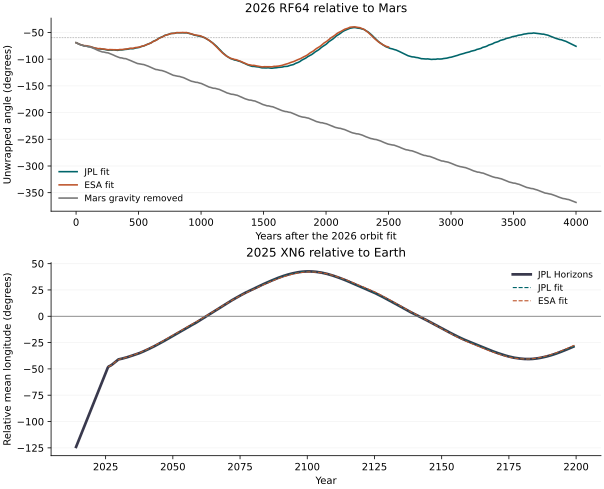

# A Mars Trojan candidate and a possible temporary quasi-satellite of Earth

**2026 RF64 is a candidate trailing Mars Trojan.** Its nominal orbit makes repeated swings behind Mars for 4,000 simulated years forward and backward. A second orbit fit from ESA also produces this behavior. Setting Mars's mass to zero breaks the confinement. Pan-STARRS discovered the asteroid in September 2026. The proposed discovery here is its dynamical relationship with Mars. The 33-day observation arc leaves uncertainty about how long the relationship lasts. [Discovery circular](https://minorplanetcenter.net/mpec/K26/K26S37.html) · [JPL solution 5](https://ssd.jpl.nasa.gov/tools/sbdb_lookup.html#/?sstr=2026%20RF64)

**2025 XN6 is a candidate for a temporary Earth quasi-satellite episode.** In the JPL solution its orbital longitude previously ran through all directions relative to Earth. After the December 2025 encounter the relative motion slows and reverses. The JPL Horizons trajectory crosses Earth's mean longitude in 2062, reaches +42.65° around 2100, then crosses back in 2141. This is an asteroid orbiting the Sun. New astrometry at its December 2026 return would test the eight-day discovery arc that underlies the forecast. [Discovery circular](https://minorplanetcenter.net/mpec/K25/K25Y18.html) · [JPL solution 3](https://ssd.jpl.nasa.gov/tools/sbdb_lookup.html#/?sstr=2025%20XN6)



## How the candidates were selected

On November 14, 2026, we searched three bands in JPL's Small-Body Database. We retained objects with heliocentric elements at JD 2461200.5 TDB, reported semimajor-axis uncertainty at most 0.003 AU, and inclination at most 55°. Screen entries include their frozen orbital elements and the angle range of every eligible object. We propagated the best-fit orbits for 300 years with the eight planetary system barycenters and a four-day MERCURIUS step, then inspected relative-longitude histories and checked promising objects against the literature. This was an exploratory search. The fraction of candidates selected has no population interpretation. [Full screen](screen.csv) · [Query parameters and input hashes](sources.json)

| Planet | Semimajor-axis interval (AU) | Archive rows | Eligible orbits |
| --- | --- | ---: | ---: |
| Venus | 0.710–0.735 | 85 | 73 |
| Earth | 0.985–1.015 | 486 | 427 |
| Mars | 1.513–1.536 | 632 | 405 |

We use the heliocentric, J2000-ecliptic angle φ = λ(object) − λ(planet), where λ is mean anomaly plus longitude of ascending node plus argument of perihelion. The screen recovered Eureka and Kamoʻoalewa as controls. The Mars Trojan Eureka's relative longitude spanned about 5° over the 300-year screen, and the Earth's quasi-satellite Kamoʻoalewa stayed near 0°. Other objects crossed several full circles. Published results also account for the Venus pair 2022 BL5 and 2022 CD. These recoveries check the angle convention and selection. [MPC co-orbital tutorial](https://docs.minorplanetcenter.net/tutorials/notebooks/mpc_tutorial_orbit_earth_coorbitals/) · [Catalog of planetary co-orbitals](https://doi.org/10.1007/s10569-024-10234-y)

## 2026 RF64 and Mars

JPL used 20 astrometric observations from September 3 to October 6, 2026. The orbit is inclined by approximately 7.4° and has eccentricity about 0.27. Its period alone would give a weak test for resonance. With Mars present, the nominal relative longitude repeatedly reverses direction over a range of −123.6° to −38.6° across the combined 8,000-year interval. The forward-only span is 76.2°. In an otherwise comparable forward integration in which Mars follows the other planets but exerts no gravity, the relative longitude drifts through 299.0° over 4,000 years. This counterfactual directly tests whether Mars maintains the observed phase relationship. [Frozen dynamical inputs](orbits.json) · [Integration and counterfactual](replay.py)

| Fit and interval from the solution epoch | Random orbits staying strictly behind Mars (−180° < φ < 0°) |
| --- | ---: |
| JPL, +2,000 years | 62/64 |
| JPL, −2,000 years | 63/64 |
| JPL, same draws throughout −2,000 to +2,000 years | 61/64 |
| JPL, same draws throughout −4,000 to +4,000 years | 37/64 |
| ESA, +2,000 years and −2,000 years | 24/24 in each direction |

The nominal orbits also stay behind Mars over these intervals. A direct IAS15 integration recovers the multiple turning points. Some covariance samples leave the trailing region. Very long-term stability, physical composition and membership in the Eureka collisional family remain undetermined. The strongest competing explanation is a temporary tadpole episode within a more complicated co-orbital history. A new opposition would constrain the semimajor axis and allow this test with a much smaller error region.

## 2025 XN6 and Earth

JPL used 21 observations from December 15–23, 2025. The fitted orbit has eccentricity about 0.40 and inclination about 3°. The nominal backwards integration spans 661° in unwrapped relative longitude over 120 years. Horizons and the nominal direct integration both predict reversals following the 2025 encounter. Planetary encounters amplify the uncertainty enough that some sampled orbits leave the quasi-satellite region much earlier. [Horizons longitudes at 120-day intervals](horizons.csv)

As a reproducible diagnostic, count an orbit if it stays inside ±90° from the fit epoch through the last sample in 2149 and crosses zero at least twice. The criterion tests an oscillation on both sides of Earth. It is a finite-interval diagnostic and its threshold was chosen after inspection. **82/128 JPL samples and 53/64 ESA samples** pass. A less restrictive test of confinement alone gives 89/128 and 58/64. Each ensemble uses the complete covariance of its fit. Both fits draw on the same discovery astrometry. These fractions measure sensitivity to the fits and models.

**A dated observational test.** Near December 15, 2026 at 00:00 UTC, JPL predicts a geocentric position near RA 120.46°, Dec +17.52°, visual magnitude 22.5 and solar elongation 143.6°. The tabulated formal three-sigma RA and Dec components are about 2.77° and 0.59°. Recovery requires an observatory-specific ephemeris and a search area appropriate to the updated uncertainty and rapid apparent motion. A second arc can support or overturn the predicted transition. [Daily recovery predictions and errors](recovery.csv)

## Dynamics, prior work and replay

The detailed models resolve the Moon, include the Sun and all eight planets, and treat each asteroid sample as massless. JPL orbital elements and their correlated six-dimensional uncertainties are used at their covariance epoch. ESA Aegis publishes a separate Keplerian fit and covariance at the midpoint of the observed arc. We carry the massive bodies from the JPL epoch to the ESA epoch before drawing from that fit. Inputs are in AU and days. The ESA epoch uses TT and the sub-two-millisecond TT–TDB difference is ignored. REBOUND uses Newtonian point masses here. Relativity, minor-planet perturbers and thermal forces can affect detailed predictions, especially beyond encounters. Horizons supplies a separate numerical check of the JPL nominal orbit through 2198 and uses its own force model. Its Earth reference is the Earth–Moon barycenter. Our resolved validation uses Earth's center. [JPL SBDB](https://ssd-api.jpl.nasa.gov/doc/sbdb.html) · [ESA Aegis data access](https://neo.ssa.esa.int/en/computer-access) · [Horizons](https://ssd.jpl.nasa.gov/horizons/manual.html) · [REBOUND](https://rebound.readthedocs.io/)

The November 14, 2026 literature check searched each designation and the discovery aliases P22pRjQ and P22j28E with Mars Trojan, Earth quasi-satellite and co-orbital terms. We inspected the discovery circulars, Pan & Gallardo's dynamical catalog, the published Mars Trojan census and the October 2026 characterization of Earth's 2025 PN7. We found no publication assigning either proposed dynamical state to these two objects. Unindexed reports, private analyses and survey-internal classifications remain possible. The small-body designations and their discovery credit predate this analysis. [Co-orbital catalog](https://doi.org/10.1007/s10569-024-10234-y) · [Mars Trojan census](https://doi.org/10.1051/0004-6361/202553804) · [Earth quasi-satellite comparison](https://arxiv.org/abs/2610.17981)

Run from this directory. The files include every fit and covariance needed for offline replay. Each integration prints the nominal range and the sample counts. The figure uses the actual trajectories produced by the listed models. The discovery screen uses annual sampling and the detailed integrations use the finer output intervals specified in the script. Chaotic exits at long horizons can depend on floating-point implementation.

```sh
python -m pip install numpy rebound==4.4.11
python screen.py
python replay.py all --save /tmp/coorbital-trajectories
python -m pip install matplotlib
python plot.py /tmp/coorbital-trajectories relative-longitude.svg
```
