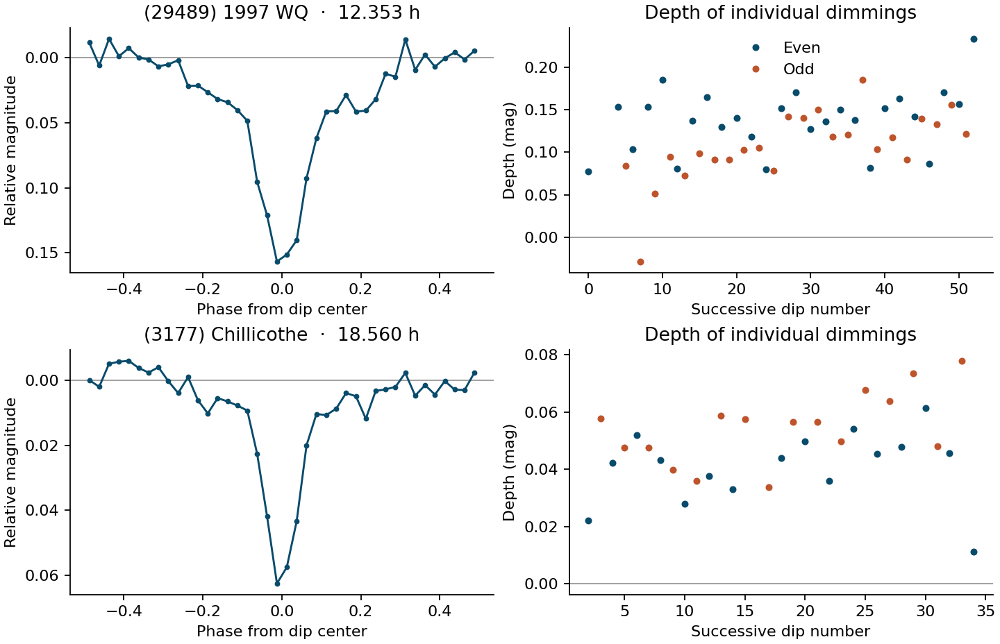

# Repeated dimmings in two main-belt asteroids

During a 27-day TESS visit in 2018, **(29489) 1997 WQ dimmed in 49 of 50 measurable cycles** at a spacing of **12.3533 hours**, alongside its 3.1679-hour spin. Its median dimming was **0.128 mag**, or an 11.1% loss of light. A separate team’s extraction of the same exposures recovers 32 of 33 dips at the fixed ephemeris. The signal survives modeling the first 28 spin harmonics. An unresolved eclipsing companion is a candidate explanation. The separate extraction does not reproduce the even–odd depth ordering, leaving the hypothesized 24.71-hour orbit uncertain. [Second extraction](second_extraction/)

**(3177) Chillicothe dimmed in all 32 measurable cycles** at 18.5599-hour intervals. Its 0.0477-mag median depth falls to 0.0180 mag in a 28-harmonic fit to its primary rotation. The fourteenth spin harmonic can appear close to the dimming frequency when sampled at TESS’s 30-minute cadence. **Chillicothe’s dips may be a cadence alias of the fourteenth spin harmonic**, making the companion interpretation substantially less secure for that asteroid. [Spin and cadence tests](alias_checks/)

**Neither asteroid has a confirmed moon.** Four later TESS visits **did not reproduce a persistent dimming clock** at the 2018 periods in the held-out tests. This is a failure to confirm persistence, not proof against a companion: the viewing and illumination geometry changed between apparitions. Each test measured the early part of its visit to fix the phase before scoring the later images. In 452 held-out measurements of 1997 WQ, 9 of 19 cycles dimmed at the registered phase, with a median depth of −0.0054 mag. Chillicothe dimmed in 7 of 17 cycles in a 593-measurement test, with a median depth of −0.0030 mag. The scoring procedure recovered 0.050-mag dimmings injected into the extracted flux for both tests. A second later visit to each asteroid gave 3 of 5 dimmer cycles in WQ and 4 of 8 in Chillicothe. The WQ five-cycle estimate is too imprecise to discriminate the 2018 depth from zero. [Later visits, image data and replay](pixel_holdout/)

| Discovery-sector measurement | (29489) 1997 WQ | (3177) Chillicothe |
|---|---:|---:|
| Fitted primary spin period | 3.1679 h | 3.5472 h |
| Mean spacing from the fitted repeating box | 12.3533 h | 18.5599 h |
| Individual cycles dimmer inside the predicted window | 49 of 50 | 32 of 32 |
| Median event depth [95% event-bootstrap interval] | 0.128 [0.106, 0.141] mag | 0.048 [0.043, 0.054] mag |
| Median fractional flux loss | 11.1% | 4.3% |
| Width of the fitted box | 2.01 h | 2.32 h |
| Adjacent even–odd pairs with the same depth ordering | 20 of 24 even deeper | 12 of 15 odd deeper |
| First-half ephemeris tested on second-half data | 24 of 27 dimmer | 17 of 17 dimmer |
| Median depth in that second-half test | 0.056 mag | 0.058 mag |
| Same-detector comparison objects | 101 | 14 |
| Largest comparison-object median depth at this ephemeris | 0.040 mag | 0.010 mag |
| Separate extraction of the same images, frozen ephemeris | 32 of 33 dimmer, 0.115 mag median | 22 of 23 dimmer, 0.043 mag median |

The fitted first centers in the original observer-frame dates are JD 2458382.47410 and JD 2458382.74199. The phase and box width describe where the data grow faint. The 30-minute exposure cadence limits the accuracy of contact times and individual depths. The scatter among cycles includes changing geometry, spin-model error, noise and background contamination.



## How the objects emerged

Pál et al. released a 9,912-object TESS asteroid catalog and reported rotation periods including 3.16796 h for 1997 WQ and 3.54738 h for Chillicothe. We searched for a second signal in every numbered object meeting the coverage and spin cuts. The two candidates were ranks **1 and 5**. Ranks **2, 3 and 4** were previously established binary asteroids. The full list of 67 ranked objects includes other modulations that have not been individually validated. [Survey paper](https://doi.org/10.3847/1538-4365/ab64f0) · [Archive](https://archive.konkoly.hu/pub/tssys/dr1/) · [All ranks](screen.csv) · [Coverage](coverage.json)

The analysis began with 8,183 numbered entries having at least 280 catalog measurements. Filtering flagged or high-uncertainty measurements retained 4,277 with at least 260 initial usable samples. The five-day baseline and 0.5–11 cycles/day primary-frequency cuts left 3,443. For each object the screen removed the distance law, a quadratic time trend and a six-harmonic spin model. It searched 0.48–4 cycles/day, required at least seven cycles across the baseline and excluded neighborhoods of spin harmonics, selected subharmonics and cadence aliases. The ranking uses residual sine amplitude divided by robust scatter times the square root of half the sample size. The cuts include amplitude, phase agreement and minimum amplitude in both time halves. The ranking score measures selection strength and does not provide a calibrated false-alarm probability. [Search implementation](screen.py)

After ranking, a positive-magnitude box search measured event centers, durations and depths. It used an independent, robustly refitted spin model, a local period window around each screen peak and five candidate durations. Every reported individual event has at least two in-window and four off-event cadences in the same cycle. We measure the difference of the two medians. The 95% intervals resample whole covered cycles at the fitted ephemeris and quantify sampling variability of the median. They do not account for choosing the period and width. [Measurements](measurements.csv) · [Individual events](events.csv) · [Folded data](fold.csv) · [Measurement code](measure.py)

## Checks on the interpretation

**Known asteroid companions.** The same procedure returned repeated dips in (2037) Tripaxeptalis, (1830) Pogson and (1803) Zwicky, twice per published mutual orbit. Doubling the measured spacings gives 26.262, 24.233 and 28.434 h, respectively. The published orbital periods are approximately 26.25, 24.24 and 28.46 h. Zwicky and Pogson provide particularly close precedents for a rapid asymmetric spin curve with unrelated narrow, alternating dips. Polakis and Stephens previously used TESS data to identify mutual events in other asteroids. [Tripaxeptalis observations and orbit](https://www.johnstonsarchive.net/astro/astmoons/am-02037.html) · [Pogson discovery](https://ui.adsabs.harvard.edu/abs/2007CBET..957....1H/abstract) · [Zwicky discovery](https://mpbulletin.org/index.php?selectedIssue=48-3&selectedYear=2021) · [Earlier TESS asteroid search](https://mpbulletin.org/issues/MPB_49-2.pdf)

**Alternation.** For both targets we subtract the odd-cycle depth from the immediately preceding even-cycle depth and keep only complete pairs, with cycle zero at the first reported center. For 1997 WQ, 20/24 differences are positive with median +0.030 mag (pair-bootstrap 95% interval +0.009 to +0.038). For Chillicothe, 3/15 differences are positive with median −0.014 mag (−0.025 to −0.005). The intervals condition on the selected ephemeris and resample the measured pairs. The difference in sign depends on the choice of cycle zero. The persistence of the difference motivates a period twice the event spacing. [Pair measurements](parity.csv) · [Calculation](parity.py)

**Spin shape and sampling.** The simple spin subtraction in the blind search ends at the sixth harmonic. For 1997 WQ, the nearest folded frequency among harmonics 1–32 misses the observed frequency by 0.489 cycles/day, about 13 times the sector’s frequency resolution. Extending and reoptimizing the spin model through harmonics 14 and 28 gives event depths of 0.125 and 0.126 mag, respectively. Asymmetric illumination of a rigid body rotating at one fixed frequency normally repeats at that frequency and its harmonics. These fits disfavor that mechanism in 1997 WQ. More complex rotation and target-specific photometric contamination remain possible.

For Chillicothe, the fourteenth spin harmonic folds from approximately 94.72 cycles/day to 1.279 cycles/day, compared with the observed 1.293 cycles/day. The separation of 0.015 cycles/day is smaller than the sector resolution of 0.037 cycles/day. Across spin models with 6, 14 and 28 harmonics, the median predicted-event depth falls from 0.048 to 0.026 to 0.018 mag, with 32/32, 31/32 and 30/32 positive cycles. A flexible model can absorb a real second clock near an alias as well as a spin signal. The remaining depth cannot resolve those alternatives. [Alias and detector tests](alias_checks/)

**Predictive timing within 2018.** We fitted the period, phase and duration on the first time half and evaluated those predictions on the second half without adjusting them. The secondary-period search neighborhood and target selection used the whole sector, and the nuisance spin model also used that sector. This measures temporal consistency and is not an independent discovery trial. [Training and test measurements](time_split.csv)

**Shared observing conditions.** We used every comparison within 1.5 TESS magnitudes on sector 3, camera 1, CCD 3 with at least 300 catalog cadences, at least 70% temporal overlap and at least 12 measurable events at the *target's* phase. No comparison reached the target median depth. The asteroids crossed different regions of the detector, so this control constrains common timing artifacts more directly than local background crossings. [Every detector control](detector_controls.csv)

**Separate reduction of the same exposures.** McNeill et al. used a separate aperture-photometry pipeline. With the original discovery-sector ephemerides fixed, their measurements reproduce both event trains at depths close to those found by Pál’s pipeline. A time-only alignment of the two timestamp conventions gives the same conclusion. They have 12 and 8 complete even–odd pairs, of which 6 and 5 have the even dip deeper. Their data strengthen the recurrence measurement and leave the proposed two-event orbit uncertain. [Independent extraction, inputs and results](second_extraction/)

**Independent observations.** Independent ground observations of 1997 WQ within the 2018 TESS interval recover 0.38 ± 0.26 times the TESS dip amplitude at its fixed phase (49 magnitudes over nine nights). The larger window extending 14 days to either side gives 0.55 ± 0.27 (111 magnitudes over 21 nights). We also tested later TESS visits through both MPC magnitudes and newly extracted spacecraft pixels. The data give no secure repeat across apparitions. The viewing geometry changed substantially between visits, and the orbital pole is unknown. [External photometry](external_checks/) · [Held-out image tests](pixel_holdout/)

**Prior reports.** We searched both provisional designations, numbered names and identifiers alongside “binary”, “satellite”, “mutual events” and “lightcurve”. Neither target appeared under its number in Johnston’s combined companion list or its additional-reports table checked 2026-11-15. Those searches establish the scope of the novelty check. They cannot establish priority against every unpublished observation. [Combined catalog](https://www.johnstonsarchive.net/astro/asteroidmoonsall.html) · [Additional reports](https://www.johnstonsarchive.net/astro/asteroidmoonsq.html)

## Reproduce the measurements

Python 3.12, NumPy 2.3.5 and SciPy 1.17.0 were used for the tables. Matplotlib 3.10.8 produced the figure. From this directory, the five target and positive-control light curves and their original release metadata rows are sufficient to replay the numerical measurements.

```sh
unzip -q target-inputs.zip -d input
OPENBLAS_NUM_THREADS=1 python measure.py input reproduced
```

To replay all selection and comparison steps, download the complete release and check its SHA-256 hashes before analysis. The archive contains the original 9,912 light curves. The two hashes plus the five focused input hashes are in the manifest. The five-row metadata excerpt in the ZIP is an exact subset of the full release file.

```sh
mkdir -p full
curl -fL https://archive.konkoly.hu/pub/tssys/dr1/release.merge -o full/release.merge
curl -fL https://archive.konkoly.hu/pub/tssys/dr1/lightcurves_spectra.tar.gz -o full/lightcurves_spectra.tar.gz
tar -xzf full/lightcurves_spectra.tar.gz -C full --wildcards '*.lc'
(cd full && sha256sum -c ../sources.sha256)
OPENBLAS_NUM_THREADS=1 python screen.py full replay
OPENBLAS_NUM_THREADS=1 python measure.py full replay --detector-controls
```

The full screen and detailed follow-up are deterministic except for ordinary floating-point differences across platforms. Event bootstrap intervals use a fixed seed. Run `python parity.py` and `python plot.py` beside the reported CSVs to regenerate the pair statistics and figure. [Focused input data](target-inputs.zip) · [Input checksums](sources.sha256)
