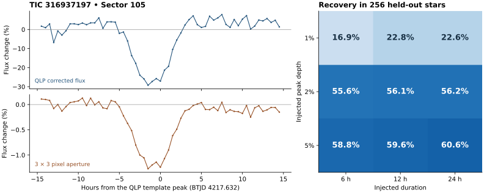

# No validated deep aperiodic occultation in a 384-star TESS Sector 105 search

The strongest apparent isolated stellar eclipse recurs. TIC 316937197 showed a **17.2% fitted QLP depth**, but a separate 3 × 3 pixel extraction gave **0.71%** at the same time and template. Archival TESS visits show eclipses **18.767 days** apart. The blended source of the eclipse remains unresolved. No event was validated as a new member of the requested class. This is a **one-sector** result, not a comprehensive Cycles 6–8 survey; it **weakly constrains rare, multi-day Boyajian-like events**.

The sample covers one sector observed between June 13 and July 11, 2026. Sector 105 was the newest verifiable QLP target roster among 107, 106 and 105. We selected 384 distinct TICs, ranks 1–384 by SHA-256 of each unpadded decimal TIC ID in the 399,217-star roster. The 384 stars span Tmag 6.15–14.99, and 252 are brighter than Tmag 13. There was no magnitude cut. Ranks 1–128 were a raw-photometry pilot. Ranks 129–384 formed a separate confirmation sample whose detector was frozen before opening those light curves. [Selection](SELECTION.md) · [Pilot protocol](PROTOCOL.md) · [Confirmation protocol](CONFIRMATION.md) · [Availability receipts](availability.json) · [Mission sector dates](https://tess.mit.edu/observations/sector-105/)

| Sample | Stars measured | Wall-clock star-days | Screen triggers | Stars triggered | Individual injections |
| --- | ---: | ---: | ---: | ---: | ---: |
| Raw-aperture pilot | 128 | 3,554.1 | 34 | 14 | 9,216 |
| Corrected-flux confirmation | 256 | 7,108.1 | 65 | 39 | 18,432 |

## How many events could the search detect?



The left panels use separate vertical scales and show 30-minute medians relative to the local out-of-event flux 12–36 hours from the fitted peak. Each heat-map cell includes the effects of gaps and flagged cadences because injection times span the entire sector.

In the confirmation sample a 2%-deep, 12-hour triangular event was recovered **1,149 times in 2,048 trials (56.1%)**. Injections sampled the entire observing span, including gaps. Effective exposure was **3,987.9 star-days**. Counting all 65 triggers as possible cases gives a **pointwise one-sided 95% upper limit of 0.02195 events per star-day** (8.02 per star-year). This is a conservative ceiling for the specified apparent signal in published DET_FLUX. It allows common rates and offers little constraint on a rare Boyajian-like population.

| Apparent peak depth | 6 h recovered | 12 h recovered | 24 h recovered | 12 h upper limit per star-day |
| --- | ---: | ---: | ---: | ---: |
| 1% | 16.9% | 22.8% | 22.6% | 0.05901 |
| 2% | 55.6% | 56.1% | 56.2% | 0.02195 |
| 5% | 58.8% | 59.6% | 60.6% | 0.02059 |

Each confirmation cell has 2,048 trials. Ingress occupies 20% or 80% of the event with equal probability. Event-plus-shoulder windows must be fully covered on a 30-minute grid. Single-event injections act on delivered flux, so they omit any loss before QLP produced that flux. We used a lower confidence bound for the effective exposure and an upper Poisson count bound. Both bounds are one-sided at 97.5%, with joint coverage at least 95% under independent, homogeneous rare event arrivals for each template population. The count includes recognized binaries and artifacts, so the calculation does not need an assumed efficiency for their human adjudication. No zero-count upper bound was inferred after vetting. Quality and minimum-coverage cuts left 2,546.6 and 5,135.6 star-days in usable half-hour bins in the pilot and confirmation samples. Requiring fully covered shoulders further reduces sensitivity. The 1% cells sit directly on the detector amplitude threshold. Multi-day, irregular-depth, flat-bottomed, heavily diluted or pre-detrending dips require different calibrations. [Pilot grid](report.json) · [Confirmation grid](confirmation/report.json)

## What produced the strongest signals?

- **TIC 316937197, CD−54 9621.** The Sector 105 peak near BTJD 4217.63 is real in the pixels but much shallower there. The 3 × 3 fit gives 0.71%, with a positive-deficit centroid 0.27 pixel from the TIC position. These are a fixed-template amplitude and a descriptive position. Four successive minima span Sectors 103–105 at BTJD 4161.287, 4180.051, 4198.801 and about 4217.57. Eleven earlier matched-template peaks back to Sector 1 in 2018 fall within 0.072 day of the trial 18.7668-day clock over 154 cycles. A fit to 13 eclipse timings gives **18.76705 days** over 2,890.11 days, with an RMS timing residual of 0.00655 day (9.4 minutes). Historical amplitudes vary with the product and aperture. QLP adopted the TGLC extraction method beginning in Sector 94. Gaia resolves another star about 1.56 arcsec from the TIC position, well inside one TESS pixel. The 63-arcsecond VSX query returned no variable-star entry; Gaia DR3 assigns neither an ECL variability class nor a non-single-star solution to the brighter position (phot_variable_flag = NOT_AVAILABLE). SIMBAD labels it as a star, not an EB. This is a finite catalog nonmatch, not evidence that the source is novel. Catalog identity and the photometric period do not identify which star eclipses. ASAS-SN recorded no single 5% dip in 2,694 selected archival measurements. Its coverage ended about a year before the Sector 105 event. AllWISE W1−W2 is −0.039 ± 0.031 mag, and the W4 entry is an upper limit. These bands leave cold debris unconstrained. The Gaia FLAME model gives an age of 11.8 Gyr with a reported interval of 10.6–13.0 Gyr.
- **TIC 116658378** provides a positive control. Six detections include deep primary eclipses and shallower secondaries. Four primary epochs have a spacing near 7.71 days. Independent pixel fits recover 7–13% for the four primaries, with their deficit centroids near the stellar position. SIMBAD and VSX identify an eclipsing binary there. The measured clock differs from the retrieved VSX period, which we keep as a catalog discrepancy.
- **TIC 2027133756, π² Gru B.** The largest confirmation template in corrected flux gave 18.4%. The pixel fit gives 0.18%, and 13 of 84 off-event control windows were as deep. A Gaia source about 5 arcsec away is over five G magnitudes brighter. The corrected QLP light curve alone cannot establish an intrinsic 18% eclipse.
- **TIC 257556370.** A positive pulse in the raw pilot produced two apparent dips. Capping the 46 high cadences in the pulse removed both triggers. The QLP and small-aperture products show a brightening near BTJD 4209.30. The cataloged rotational variability of this star provides context. The sign of the pulse explains both dip detections.
- **TIC 441246218.** A 2.2% confirmation fit at BTJD 4208.34 had a 2.5% pixel-aperture counterpart. The small and large QLP fits differed (0.9% and 6.5%). Two comparison stars 2.98 and 3.26 arcmin away gave 17% and 39% fits at the same epoch. The pixel result alone cannot assign the deficit to the target. The event remains included in the rate numerator.

## Completed checks

Quality-zero data only entered either detector. We fitted local linear baselines, measured the response in different QLP apertures, checked recurrence, examined the background and detector peers, and retrieved separate 9 × 9 full-frame cutouts for each of the 53 triggered stars. Each cutout supplied a target-centered 3 × 3 extraction, a per-cadence perimeter sky estimate, a difference image, a descriptive centroid and off-event fits. The independent extraction uses the same telescope and photons. The six nearest QLP targets outside 2 arcmin were requested for each triggered target. The sector data release describes momentum dumps at downlinks and scattered light in the camera fields. Residual background structure is visible in quality-zero data. [Sector 105 data release](https://archive.stsci.edu/missions/tess/doc/tess_drn/tess_sector_105_drn143_v01.pdf)

Only **11 of the 65** confirmation triggers reproduced a fitted depth of at least 1% in the 3 × 3 extraction. Six are the repeating eclipses in TIC 116658378. The other five occur on four stars. TICs 341404310 (two epochs), 409856949 and 441246218 have comparison stars with contemporaneous structure. The TIC 79750598 deficit centroid is 1.8 pixels from the target and coincides with a large sky excursion. In the pilot, three of 34 pixel fits reached 1%. Two flank the positive pulse on TIC 257556370. The third, on TIC 316788283, has a 1.7-pixel offset, a raw-flux/background correlation of 0.92 and a corrected-flux fit of about 0.06%. These checks establish why the fits fall short of a deep, localized asymmetric occultation. A diluted signal can still produce a smaller pixel depth. The 1% pixel comparison is descriptive and does not enter the rate calculation. [All 99 event assessments](dispositions.csv) · [Pilot pixels](pixels.json) · [Confirmation pixels](confirmation/pixels.json) · [Local comparison stars](confirmation/neighbors.json) · [Independent archive replay](https://github.com/dovvnloading/Open-Space/actions/runs/44025331610)

For 36 of the 39 triggered confirmation stars we retrieved at least one earlier QLP visit, 75 verified products in total. We checked up to three earlier visits in Cycles 6–8 for each position with available coverage, then expanded the TIC 316937197 check back to 2018. A source can show no repeat within a short visit and still be periodic. [Earlier visit hashes and outcomes](confirmation/earlier-visit-receipts.json.gz) · [Full eclipse timing fit and FITS hashes](confirmation/lead-history.json) · [Prior eclipse epochs](confirmation/lead-history-summary.json)

All 53 positions returned zero public ZTF light-curve measurements in the queried sector window. ASAS-SN supplied 45 historical light curves, all ending before the TESS events. Other queries returned service errors, unmatched positions or an ambiguous pair. Gaia science photometry ended before this sector. The anonymous ATLAS forced-photometry queue required authentication. These results leave the ground-based epochs unconfirmed. The follow-up also queried Gaia DR3 neighbors, variability and NSS flags, VSX, SIMBAD and AllWISE. Catalog nonmatches provide limited evidence about prior identification. The original ground-survey requests are summarized by cohort, including unmatched positions and archive errors. The pilot catalog response bodies below come from an independent repeat of all 56 queries. The confirmation catalog file contains the original 156 responses. [Pilot catalog receipts](pilot-catalog-replay.jsonl.gz) · [Pilot YSO cross-match](pilot-kyso-receipt.json) · [Confirmation catalog matches](confirmation/catalogs.csv) · [Catalog query receipts](confirmation/catalog-receipts.jsonl.gz) · [Ground-survey coverage and failures](survey-epochs-summary.json) · [ASAS-SN historical measurements](confirmation/TIC316937197-asas-summary.json)

## Pending and unresolved

**Pending newer sectors:** MAST returned HTTP 404 for both `s0107.csv` and `s0106.csv` QLP target rosters when checked on 2026-11-17 at 05:18:55 UTC. Recheck these releases and extend the search after data become available; 404 is not an observational null. [HTTP status and response-body SHA-256 receipts](availability.json)\n\n**Unresolved eclipsing source:** Which star eclipses in the TIC 316937197 blend remains open. Its Villanova TIC lookup, the published TESS eclipsing-binary catalog within 63 arcsec, and the ExoFOP/TOI checks yielded no identification of the measured clock. Those finite searches cannot establish priority. Source-resolved eclipse photometry would distinguish the close pair. The survey also lacks independent ground photometry at the Sector 105 event times and intrinsic-flux sensitivity before QLP processing. The count-based upper limits retain every trigger. [Eclipsing-binary and ExoFOP receipts](confirmation/TIC316937197-eb-prior.json) · [Age, aliases and prior reports](confirmation/TIC316937197-prior.json)

## Reproduce the two searches

Use Python 3.12, NumPy, SciPy and Astropy. Run from this directory. The fetcher verifies the roster, ranked membership and original FITS byte hashes, then writes a manifest. The pilot originally used lossless NumPy projections of those FITS columns. The replay reads the original FITS. The two containers have different checksums and contain identical measured columns. The confirmation runner streams the original FITS and emits their hashes.

```sh
python acquire.py work/pilot --sample sample.json --products products.csv
python scan.py --manifest work/pilot/scan_manifest.csv --out work/pilot-scan
python confirm.py --pilot-sample sample.json --out work/confirmation
python holdvet.py --products confirmation/products.csv --triggers confirmation/triggers.csv --out work/holdout-vet.csv
python pixels.py confirmation/triggers.csv work/pixels.json
python neighbors.py confirmation/triggers.csv sample.json work/neighbors.json
python lead_history.py --out work/lead-history.json
python check_earlier.py confirmation/earlier-visit-receipts.json.gz
python plot.py work/sector105.svg
python catalog_vetting.py products.csv triggers.csv work/pilot-catalogs
```

The separate `referee.py` script recalculates every injected recovery, the weighted exposure and upper confidence bound from the deposited per-trial CSVs; it also checks the sample, receipt hashes, measured depths, catalog matches and the 13-point eclipse timing fit. [Independent audit source](referee.py) · [Audit workflow](../../.github/workflows/tess-asymmetric-dips-referee.yml)\n\nThe archived broad- and small-aperture eclipse profiles use the same telescope exposures. A separate runner reproduced the 13-timing clock and the measured figure. Another repeated all four catalog queries for each of the 14 pilot targets. [Eclipse replay](https://github.com/dovvnloading/Open-Space/actions/runs/44025958452) · [Pilot catalog replay](https://github.com/dovvnloading/Open-Space/actions/runs/44026291835)

All raw screening hits and injection outcomes are retained in the per-sample CSVs, compressed injection tables and JSON reports. The published QLP inputs are provided by the MIT TESS Science Office via MAST. TESS is funded by NASA. [QLP archive and release history](https://archive.stsci.edu/hlsp/qlp) · [QLP data DOI](https://doi.org/10.17909/t9-r086-e880) · [TESSCut](https://mast.stsci.edu/tesscut/)
