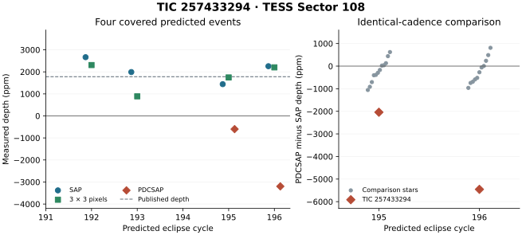

# A TESS transit-like signal changes sign between two flux products

TIC 257433294 is a flaring M dwarf with a previously reported 5.3454404-day transit-like signal. In the new two-minute Sector 108 observations, four events dimmed the central 3 × 3 pixels by an average of **1,787 ± 323 parts per million (ppm)**. The previously published depth was 1,779 ppm. Two events had adequate coverage in both the simple-aperture photometry (SAP) and the presearch data conditioning product (PDCSAP). On exactly those cadences, SAP recorded dips of **1,441 and 2,256 ppm**. PDCSAP yielded apparent brightenings of **599 and 3,198 ppm**. Throughout this report, a positive depth denotes dimming. The uncertainties are between-event standard errors.



## How the target was found

The external [candidate catalog](https://github.com/eumemic/exoplanets/tree/e2eee928fd621f75c1621f6b4206d34bb222ae59) lists transit times and durations derived from earlier observations. We intersected its full frozen ephemeris table (740 rows, 725 distinct stars) with the [MAST Sector 108 two-minute manifest](https://archive.stsci.edu/missions/tess/download_scripts/sector/tesscurl_sector_108_lc.sh) (10,798 distinct targets). Exactly five entries qualified. The mission observed this field from September 7 through October 5, 2026. The MAST S3 Sector 108 short-cadence products became available in November. The catalog already identified these five signals. The measurements below are from a new observing sector. [MIT sector page](https://tess.mit.edu/observations/sector-108/)

The [screening protocol](PROTOCOL.md) fixed the periods, epochs, durations, local baselines and coverage rules before measuring the five flux series. For each predicted event, we interpolated between median baselines on either side and measured a trimmed mean depth over the central 80% of its predicted duration. We averaged events with equal weight. The control grid used the same extraction away from the predicted phase. Overlapping phase windows, time correlations, five screened signals and heterogeneous coverage preclude reading these ranks as independent-trial false-alarm probabilities.

| TIC | Published depth (ppm) | Sector 108 PDCSAP (ppm) | Covered / opportunities | SAP (ppm) | Off-phase averages as deep / tested |
| --- | ---: | ---: | ---: | ---: | ---: |
| 1441057 | 1,750 | 1,573 ± 488 | 7 / 13 | 1,593 ± 401 | 0 / 145 |
| 72668830 | 262 | 170 ± 124 | 6 / 14 | 185 ± 118 | 8 / 109 |
| 117798466 | 1,027 | 296 (one event) | 1 / 2 | −70 ± 414 | 35 / 122 |
| 257433294 | 1,779 | −1,898 ± 1,299 | 2 / 6 | 2,088 ± 256 | 152 / 178 |
| 317134140 | 151 | 200 ± 62 | 25 / 44 | 158 ± 53 | 0 / 89 |

The short-period signals at TIC 1441057 and TIC 317134140 both appeared in each time half, with matching signs in SAP and PDCSAP. A narrower baseline reduced the TIC 1441057 depth to 990 ± 665 ppm and preserved the TIC 317134140 depth at 192 ± 61 ppm. The other two stars yielded weak or sparsely covered measurements. All outcomes, missed opportunities and off-phase comparisons are in `results.csv`, `events.csv` and `phase_controls.csv`.

## What causes the discrepancy for TIC 257433294?

| Cycle | Predicted midpoint (BJD−2457000) | SAP (ppm) | PDCSAP (ppm) | 3 × 3 pixels (ppm) |
| ---: | ---: | ---: | ---: | ---: |
| 192 | 4296.48770 | 2,665 | Insufficient coverage | 2,309 |
| 193 | 4301.83314 | 1,991 | Insufficient coverage | 889 |
| 195 | 4312.52402 | 1,441 | −599 | 1,747 |
| 196 | 4317.86946 | 2,256 | −3,198 | 2,203 |

- **Missing cadences.** Restricting both flux products to identical quality-zero, finite cadences still gave opposite signs on cycles 195 and 196. These two events are in the second half of the sector. Both products lacked sufficient coverage on cycles 191 and 194.
- **Aperture sensitivity.** Summing the calibrated target pixels in the SPOC aperture reproduced the four-event SAP mean to within 1 ppm. The single nearest pixel gave 2,419 ± 597 ppm. All four dips persisted in both that pixel and the centered 3 × 3 aperture. These extractions share photons. The outer 3–5-pixel annulus had a noisy mean of −10,025 ± 12,974 ppm. Its small background-subtracted baseline makes fractional changes especially unstable. These tests leave unresolved blends and instrumental effects possible.
- **Other visits.** Applying the same estimator to the four earlier available SPOC two-minute light curves (sectors 4, 105, 106 and 107) gave positive mean depths in both products in every sector. Their respective PDCSAP means were 1,670, 1,788, 1,916 and 2,621 ppm. The earlier epochs contributed to the published candidate, so they provide product comparisons. Sector 108 is the new time holdout.
- **Other stars on the detector.** We selected the 12 nearest distinct Sector 108 two-minute targets in a 4-degree field with catalog T magnitudes 10–15. All were on camera 2, CCD 1, between 0.70 and 2.54 degrees from the target. At the same predicted times, the control-star PDCSAP-minus-SAP depth differences ranged from −1,055 to +623 ppm (cycle 195, 12 stars) and −963 to +811 ppm (cycle 196, 11 stars). The target changed by −2,041 and −5,454 ppm. The controls argue against a uniform detector-wide change. They sample different apertures and stellar variability. Their separations exceed the size of the target cutout.

The reproducible anomaly is the product-dependent light-curve measurement during one visit. The source of the dips and the mechanism behind the product difference remain open. The upstream [pixel review](https://github.com/eumemic/exoplanets/blob/e2eee928fd621f75c1621f6b4206d34bb222ae59/candidates/TIC257433294_P5.345/followup.json) lists a potentially capable neighboring star 33.9 arcseconds away. Spatially resolved in-transit observations can test attribution, and comparing the pipeline correction basis vectors with the event windows can test the processing origin. A catalog and literature search located the prior candidate report. Publication priority for the Sector 108 comparison is unverified.

## Later full-frame images

We queried TESSCut for all five stars in sectors 108 and 109. We summed the central 3 × 3 pixels of each 9 × 9 cutout and subtracted the per-cadence median of the dimmer half of the perimeter pixels. A second extraction used the four pixels closest to the catalog coordinate. Both used the fixed event and coverage rules above. Only TIC 317134140 and TIC 117798466 had Sector 109 cutouts at the time of retrieval. The 200-second full-frame images and the two-minute light curves for the same sector share the telescope and observing epochs.

| TIC | Sector 108 FFI, 3 × 3 depth (ppm) | Sector 109 FFI, 3 × 3 depth (ppm) |
| --- | ---: | ---: |
| 1441057 | 1,899 ± 399 (12 events) | Outside available footprint |
| 72668830 | 198 ± 103 (9 events) | Outside available footprint |
| 117798466 | −149 ± 124 (2 events) | −173 ± 196 (2 events) |
| 257433294 | 1,888 ± 633 (5 events) | Outside available footprint |
| 317134140 | 159 ± 38 (43 events) | 55 ± 64 (44 events) |

For TIC 257433294, **all five covered full-frame events dimmed**. For TIC 317134140, the Sector 108 depth exceeded all 89 off-phase stacks, while 11 of 89 were as deep in Sector 109. The cross-sector difference was about 1.4 combined event standard errors. The later data give weak support for this particular signal and permit a constant depth. For TIC 117798466 the two consecutive sectors showed little evidence of the predicted 1,027 ppm dip; only two event windows exist per sector. The individual events and numerical input hashes are in the `ffi108_*` and `ffi109_*` tables and receipts. [TESSCut service](https://mast.stsci.edu/tesscut/) · [Sector 109 observation dates](https://tess.mit.edu/observations/sector-109/)

## Reproduce

Use a checkout of this directory, Python, NumPy and Astropy. Matplotlib is only required to regenerate the figure. The original measurements used NumPy 2.5.4 and Astropy 8.0.2. The fetcher verifies the pinned catalog, target manifest and FITS files against `input_hashes.json`. The external files under `fits/` and the full target lists are downloaded on demand. The input scientific products are publicly distributed by MAST. The comparison-star positions and magnitudes come from TIC 8.2 as served by VizieR (IV/39/tic82). The detector receipt retains the selected comparison stars and source files.

```sh
python fetch.py
python measure.py
python followup.py
python detector_controls.py
python ffi_photometry.py --sector 108
python ffi_photometry.py --sector 109
python plot.py
```

The follow-up and detector scripts save every included and missed event. Their tests were chosen after the initial five-target screen. The frozen screen and subsequent follow-up are distinguished in the accompanying files. Data credit belongs to NASA, the TESS mission and the Science Processing Operations Center. The candidate ephemerides and original detections belong to the authors of the cited external catalog. [TESS data-product documentation](https://outerspace.stsci.edu/spaces/TESS/pages/14563420/2.0%2B-%2BData%2BProduct%2BOverview)
