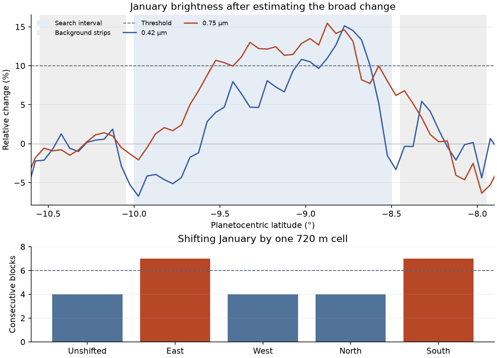

# Arsia Mons dawn-strip test is sensitive to image alignment

**Null result.** The 18 January 2026 Mars Odyssey strip was brighter than a visit to the same terrain on 6 November 2025. After estimating the broad change from adjacent terrain, median increases across the search strip were **5.87%** at 0.42 µm and **10.53%** at 0.75 µm. Both bands crossed the threshold together over **four** consecutive latitude blocks. The frozen test required six. An eastward or southward shift of the January image by one 720 m cell extended the run to **seven** blocks, so the threshold crossing depends on alignment. The comparison supplies no reliable onset date for the morning cloud. [Protocol](PROTOCOL.md) · [Numerical results](summary.json) · [October 2026 release](https://pds-geosciences.wustl.edu/missions/odyssey/themis.html)

## What the images cover

The two THEMIS footprints overlap west of the published Arsia Mons Elongated Cloud (AMEC) head. The catalog places their image-center local times at 06:51:21.6 in November and 06:49:26.4 in January. They span solar longitudes **167.050°** and **209.025°**, both earlier than the main season documented in the literature. None of the six new strips from the original Arsia box crosses 237°E between 8.5°S and 10°S. The February 8 strip partly overlaps the expected eastern part of the head. This experiment uses the shared westward ground only. Morning THEMIS and afternoon MARCI sample different parts of the documented daily cloud cycle. [Catalog footprints and times](catalog-metadata.json) · [AMEC observations](https://doi.org/10.1029/2020JE006517)

The two archived single-band albedo products select 0.749 µm and 0.654 µm, respectively. Both corresponding projected EQR cubes contain the 0.42 and 0.75 µm bands used here. We checked the PDS4 XML and embedded ISIS header for each cube. They agree on recording layout, the selected wavelength centers and mapping. The geographic extent check is a consistency check of the archive coordinates. It leaves pointing offsets between visits possible. Projection and framelet filtering can modify calibrated values. [November albedo label](https://static.mars.asu.edu/pds/ODTGEO_v2/data/odtva2_0096/va59xxalb/VA5997004ALB.xml) · [January albedo label](https://static.mars.asu.edu/pds/ODTGEO_v2/data/odtva2_0097/va68xxalb/VA6883007ALB.xml) · [EQR receipts](sources.json) · [Map checks](native-geometry.json)

## Two-band comparison

The primary grid contains **3,890** valid common cells, **2,069** in the search interval. The median increases in that interval were **69.33%** and **55.57%** before estimating the relative background from the two neighboring latitude intervals. The shorter above-threshold run persists across the unshifted linear and constant backgrounds and the alternate grid scales. One-cell shifts also change the common footprint. They test sensitivity to alignment and have no assigned probability. [Primary results and shift controls](summary.json)



The adjacent September–December comparison gave no qualifying sequence at the primary grid scale. Its coarsest-scale northern background had too few common cells to run the test. Planting a prescribed 40 km bright patch at the center of the primary strip made the screen pass even at 5% excess. This is a sensitivity check for a particular shape on the measured background, where the unshifted images already produced four qualifying blocks. It gives no general completeness estimate for real clouds.

## Native brightness check

The calibrated RDR detector arrays also show a broad January increase. Central detector-plane medians were **64.34%** and **49.74%** higher in the same two bands before projection. These detector-plane cuts cover different footprints. A simple calculation using each scene's central solar incidence, a flat Lambertian surface and the inverse-square change in sunlight gives **32.10%** brightening. The calculation omits terrain slopes, aerosols, surface scattering and changing solar azimuth. The residual increases admit atmospheric, surface and instrument explanations. Removing the broad change with neighboring latitudes can also attenuate an extended atmospheric signal. [Native check design](NATIVE_CHECK.md) · [Native radiance results](native-rdr-summary.json) · [THEMIS VIS calibration](https://doi.org/10.1029/2005JE002568)

Prior work has established the seasonal cloud and proposed a microphysical explanation. The current test covers a narrow early-season overlap and a localized brightness criterion. Interpretation as a cloud would need an independent morning image or physically calibrated photometry on better registered terrain. [2026 modeling study](https://doi.org/10.1038/s41561-026-02089-9)

## Reproduce

The native EQR decoder uses NumPy. Put the four cubes and their XML labels from [sources.json](sources.json) in one directory, then run [decode.py](decode.py) with the data directory and output paths for the compact maps and geometry. It checks the exact size and SHA-256 of each input. The [native detector-plane diagnostic](native_rdr.py) can be run separately with the two RDRs and their labels from [native-rdr-sources.json](native-rdr-sources.json). Larger source files were kept on D. The independent native replay reproduced the EQR maps, geometry and results byte for byte.

Run the offline analysis from this directory with NumPy and Matplotlib.

```sh
python analyze.py --output summary.json
python plot.py --output arsia-profile.png
```
