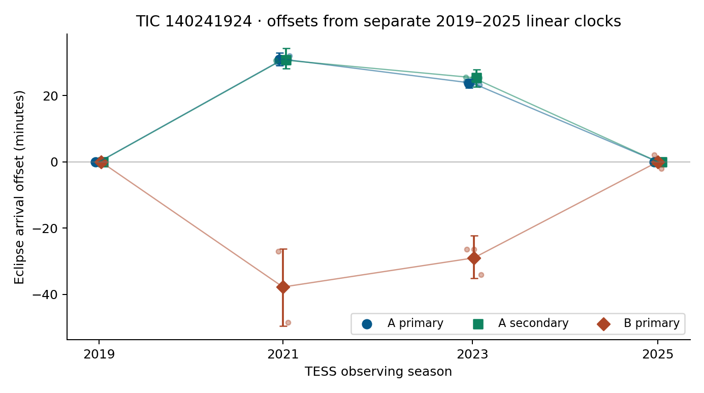

# The two eclipsing binaries in TIC 140241924 have opposing timing variations

TESS measured **one binary eclipsing about 42 minutes earlier and the other about 51 minutes later** in 2025 than separate constant-period ephemerides fitted to 2019, 2021 and 2023 predicted. Both the primary and secondary eclipse of the 1.8035-day binary moved earlier. The 4.3829-day binary’s primary moved later. The opposing changes amount to a **92.5-minute separation between the two primary timing residuals**. Images made by subtracting in-eclipse from out-of-eclipse observations place all three signals within 2.85 arcseconds of the same Gaia source across the eight usable visits.

Kostov et al. identified TIC 140241924 (TGV-108, Gaia DR3 5322590658834050176) as a doubly eclipsing quadruple candidate. They reported blended eclipses and depth differences between sectors. Their target row includes observations through sector 63. We find object-specific evidence of opposing eclipse timing variations after adding sectors 88 and 89. This is consistent with two binaries orbiting each other. The data have four distinct observing seasons and do not determine an outer period or a unique physical mechanism. [Discovery catalog](https://doi.org/10.1093/mnras/stad2947) · [Original target notes](data/kostov-targets.tsv) · [Published ephemerides](data/kostov-bincomp.tsv)



## Two tests of a constant period

An endpoint-based test gives each clock the period required to align its 2019 and 2025 observations. The two interior seasons then supply two independent time coordinates at which a constant-period model can fail. A separate chronological test fits a straight line with two coefficients to the first three seasonal epochs and evaluates the fourth. This is a retrospective exclusion of the last season. Selection and analysis followed inspection of the data. The two tests use the same observations and their residuals are correlated.

| Clock | Accepted eclipses | 2021 offset from endpoint line | 2023 offset from endpoint line | 2025 offset from first-three-season line |
| --- | ---: | ---: | ---: | ---: |
| A primary | 105 | +31.0 min | +23.7 min | −41.7 min [−43.9, −39.2] |
| A secondary | 95 | +30.7 min | +25.4 min | −43.9 min [−47.4, −40.0] |
| B primary | 25 | −37.8 min | −29.0 min | +50.8 min [+41.3, +60.6] |

Positive values mean a late eclipse. Intervals in square brackets are conditional 95% resampling ranges. We resample visits within seasons, then contiguous blocks of three accepted timings within each chosen visit, including their dates. Year 2019 has one usable visit and only two accepted eclipses of B. A clock error specific to that visit is outside the bootstrap. With four epochs and two fitted linear coefficients each clock has two residual degrees of freedom. A frequency search for an outer orbit would be underconstrained. [All 225 baseline events plus extraction variants](events.csv.gz) · [Individual visits](visits.csv) · [Seasonal timing offsets](seasons.csv) · [Resampling and extraction controls](curvature.csv)

The 2025 offsets for A primary span −42.0 to −40.4 minutes across four reductions. A secondary spans −44.6 to −40.7 minutes and B primary spans +49.8 to +52.5 minutes. Two independent constant periods can change the zero and slope of each residual series. They cannot remove these curvature measurements. The minima of binary A move together, which disfavors pure apsidal motion in A. A common telescope timestamp error would shift all clocks in the same direction. Stellar activity, time-variable blending and chance superposition of eclipsing sources within the localization region remain alternatives. Independent timing and spectroscopy that resolves both binary systemic velocities can test mutual orbital motion.

## Which star loses the light?

A nearby star 14.70 arcseconds away has matching Gaia parallax and proper motion. Hunt & Reffert assign **both objects to the open cluster UBC 247** with membership probability 1.0. Their shared motion alone gives insufficient evidence for a fifth gravitationally bound star. Each TESS sector supplies a different realization of crowding and the telescope point-spread function. For each clock we construct a median of local difference images from individual eclipses after excluding events of the other binary. The median east/north offsets across visits are (+0.70, +0.06) arcseconds for A primary, (+0.85, +0.21) for A secondary and (+0.71, +0.71) for B primary. The cluster neighbor is 13.88 arcseconds west and 4.83 arcseconds south. These local centroids address the specific resolved-neighbor alternative. TESS pixels span about 21 arcseconds and an unresolved alignment can survive this check. [Per-sector positions and aperture sensitivity](positions.csv) · [Gaia astrometry](data/gaia-pair.csv) · [Cluster memberships](data/cluster.tsv)

Gaia’s independent G-band series contains 40 accepted epochs. Its four largest dimmings, 0.21–0.28 magnitudes, land within 0.034 cycle of A’s catalog primary epoch. A further 0.12-magnitude event falls within 0.012 cycle of A’s secondary. No accepted observation lies within 0.01 cycle of B’s catalog epoch. Gaia thus supports A’s source association but supplies no independent measurement of the opposing timing curves. [Gaia measurements](data/gaia-epochs.tsv) · [Phases and flux changes](gaia-check.csv)

ASAS-SN supplied 1,415 independent measurements. Fitting the 938 clean epochs in the TESS baseline recovered both eclipse periods in blended ground light. Allowing each binary its own epoch and period gives Huber losses of 1157.33 with linear clocks and 1155.78 with the TESS timing curves. Removing a camera or an observing-year block can reverse that slight preference. The 2025 timing offsets are measured with TESS. [ASAS-SN data, models and omission checks](ground/README.md)

## Selection, prior coverage and replay

We inspected this object during a Gaia companion search around 250 previously reported TESS quadruple candidates. The cluster neighbor prompted the localization check. Timing was exploratory and the calculations do not measure a population false-alarm rate. Searches for the TIC, TGV and Gaia identifiers with “timing,” “ETV,” “quadruple” and “UBC 247,” together with the original catalog’s target-specific notes, did not turn up an earlier report of these opposite timing changes at this object. Catalog aliases, unindexed material and unpublished work can affect priority. [SIMBAD aliases](data/aliases.csv) · [TESS source catalog](data/kostov-targets.tsv)

Run the following commands from this directory with Python 3.12, NumPy, SciPy, pandas, Astropy and Matplotlib.

```sh
sha256sum -c SHA256SUMS
python fit_time.py
python curvature.py
python gaia.py
python figure.py
# Optional full pixel replay, including image localization
python extract.py
python localization.py
```

The data directory contains frozen aperture counts and target-corrected BJD/TDB times for every one of the eleven TESS visits. Three visits have a median net 3 × 3 aperture flux below 7 electrons per second, versus 260–560 in the eight usable visits. The threshold of 100 separates these groups. The extraction includes quality-zero finite rows, local background subtraction, target WCS and JPL spacecraft vector interpolation. We fit a local sloping baseline and an exposure-integrated Gaussian profile after masking the other eclipses. Sector-wide folds set initial guesses for the phase windows. Center fits allow independent shifts of ±108 minutes around those starts. Both central-pixel and 3 × 3 extractions and both ±0.13- and ±0.17-day fit windows are included. Fitted depths below 2%, incomplete coverage of the core or wings, and solutions at the search boundary are excluded. Sector medians receive equal weight within each season and early seasons receive equal weight when fitting a period. [Coverage ledger](coverage.csv) · [Original FITS URLs, array hashes and Horizons requests](sources.json)

Observational credit belongs to NASA TESS and MAST, ESA/Gaia/DPAC, NASA/JPL Horizons, CDS/VizieR, SIMBAD, Hunt & Reffert and the TESS/Goddard/VSG catalog team.
