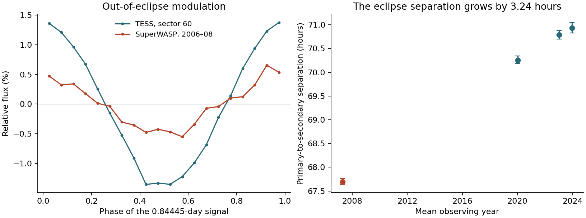

# A 20.27-hour modulation and a 3.24-hour eclipse-spacing change in TIC 196989952

SuperWASP and TESS both record a roughly 20.27-hour modulation outside the eclipses of the 7.281-day binary TIC 196989952 (TYC 2931-2795-1). The interval between the broad primary and narrow secondary eclipse also grew from **2.8207 days** in the 2006–08 SuperWASP archive to **2.9555 days** in TESS sector 73. This is a **3.24-hour** change across a 16.7-year difference in mean observing epoch.

The binary and its TESS-era apsidal precession were published by Thornton et al. Their Table 1 reports excess precession, with a planetary-mass perturber permitted among other explanations. The historical eclipse spacing and the frequencies below are separate measurements. Neither measures a companion mass. Searches under the TIC, TYC, Gaia and 2MASS identifiers on 15 November 2026 located the published TESS precession analysis and no earlier report of these particular cross-survey measurements. [Published precession analysis](https://doi.org/10.1093/mnras/stag515)



## The additional clock

We inspected 36 systems from Table 1 of the precession study for structured variability outside eclipse. TIC 196989952 showed percent-level variation at frequencies distinct from orbital harmonics. We searched its three available TESS QLP sectors between 0.4 and 4 cycles/day, excluded both eclipses, and simultaneously refitted the two strongest successively selected frequencies. The data support 1.18420 and 1.43300 cycles/day, or about 20.27 and 16.75 hours. The joint TESS semiamplitudes are 1.40% and 0.43% of the aperture flux. Both are present in every sector. The adopted orbital frequency is 0.13734 cycles/day. The peaks are at 8.62 and 10.43 times that frequency. The last digits specify the tested frequency grid and do not imply continuous phase coherence across survey gaps.

| TESS sector | 20.27-hour semiamplitude | 16.75-hour semiamplitude |
| --- | ---: | ---: |
| 20 | 1.01% | 0.38% |
| 60 | 1.45% | 0.40% |
| 73 | 1.39% | 0.48% |

The independent SuperWASP archive yielded 6,173 usable out-of-eclipse measurements on 107 observing nights. Tested at the frequencies fixed by TESS, the two sinusoids explain 8.7% of their variance. We randomized the sign of each night's residual vector while preserving its sampling and within-night correlations. None of 30,000 randomizations reached the observed joint statistic, including when we fitted an independent zero point for every night. The first frequency individually passed both variants (Monte Carlo p = 0.000033 and 0.0019). The second passed with nightly zero points (p = 0.00080), but the test with one common zero point gave p = 0.138. The first signal therefore has stronger cross-survey support. The strongest free SuperWASP peak is 1.18105 cycles/day, with neighboring seasonal aliases. The archives do not determine a unique long-baseline cycle count.

Gaia DR3 resolves the bright binary counterpart from its nearest bright neighbor. Its aperture contains the eclipses and has a fixed-frequency joint p = 0.00995 in a sign test preserving the 16 observing-day groups. Averaging the closely spaced measurements into one point per day gives p = 0.112. Removing each day's mean gives p = 0.273. Those tests limit what the 39 retained Gaia transits can establish about which star pulsates. A nearby source at about 17 arcsec is 2.40 G magnitudes fainter and lies within the survey aperture. Multiplicity, the nonharmonic frequencies and the catalog temperature of 7,684 K make stellar pulsation an interpretation worth testing. The light curves alone cannot assign a pulsating component or exclude a blended variable. The figure aligns the two survey maxima independently.

## The changing eclipse separation

| Archive | Spacing (days) | Middle 68% of block resamples (days) |
| --- | ---: | ---: |
| SuperWASP, 2006–08 | 2.82066 | 2.81828–2.82331 |
| TESS sector 20 | 2.92736 | 2.92426–2.93091 |
| TESS sector 60 | 2.94966 | 2.94581–2.95316 |
| TESS sector 73 | 2.95551 | 2.95098–2.96036 |

Within each observing group we fit a symmetric generalized Gaussian, local slope and baseline to each eclipse family and difference the fitted midpoints. The spacing within a binary orbit largely cancels a common timing zero point and does not require assigning an integer cycle count across the 12-year gap. SuperWASP uses its published heliocentric time stamps and TESS uses barycentric time stamps. The heliocentric–barycentric offset changes negligibly over one orbit compared with the hour-scale result. The intervals resample complete nights for SuperWASP and orbital cycles for TESS. Individual sectors contain only a few eclipses. The intervals describe sensitivity to those observations and omit possible eclipse-profile systematics. Pulsation and evolving eclipse shape add timing uncertainty.

## Reproduction

The compressed input tables contain all selected original quality-zero TESS flux measurements, all SuperWASP rows, and the Gaia DR3 transit fields needed for the tests. The public product URLs and original response hashes are in [inputs.json](inputs.json). VizieR's response includes a request timestamp, so refetching that endpoint can change its raw-response hash. The target identity and bright nearby Gaia sources are recorded in [field_snapshot.csv](field_snapshot.csv).

From this directory run the commands below using Python with numpy, scipy, pandas, astropy and matplotlib. The first command is optional when using the archived inputs.

```sh
python fetch.py
OPENBLAS_NUM_THREADS=1 python analyze.py
OPENBLAS_NUM_THREADS=1 python validate_early.py
python figure.py
```

[QLP archive](https://archive.stsci.edu/hlsp/qlp) · [SuperWASP archive](https://wasp.cerit-sc.cz/) · [Gaia DR3 epoch photometry](https://vizier.cds.unistra.fr/viz-bin/VizieR?-source=I/355/epphot) · [TIC v8 catalog](https://doi.org/10.3847/1538-3881/ab3467)
