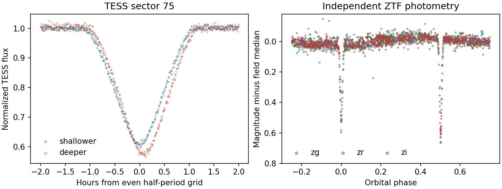

# A 3.166-day eclipsing binary at TIC 252468415 challenges the proposed white-dwarf pair

TIC 252468415 (Gaia DR3 827111612020422528, 2MASS J10014290+5105340) shows two deep stellar eclipses every **3.1663180 days**. The shallower eclipse removes 37–38% of the TESS aperture light and the deeper removes 41%. Both recur in 2020, 2022, and 2024, with an independent ground-based detection in ZTF. The deeper eclipse falls **4.83 minutes after half an orbit** measured from the shallower eclipse. The timing and depth differences resolve the apparent 1.583-day repetition.

The target matters because Nayak et al. fitted its ultraviolet-to-infrared light with a 3,100 K, 0.650-solar-radius star and an 8,000 K white dwarf of radius 0.00552 solar radii and model mass 1.20 solar masses. In that geometry, the putative white dwarf crossing a uniform stellar disc could remove at most **0.0072%** of the large star's light. Limb darkening changes this estimate by a factor of order unity. Even the shallower measured eclipse is thousands of times deeper. Occulting a luminous compact star could produce one deep minimum, but the pair of deep minima requires two luminous, extended eclipsing components. The observations favor a stellar eclipsing binary in this candidate's light. A distinct white dwarf in a hierarchical or unresolved system remains possible. The photometric fit alone cannot supply a dynamical mass or identify a third body. [Nayak et al. catalogue, table 2](https://vizier.cfa.harvard.edu/viz-bin/VizieR-5?-source=J/A%2bA/709/A114/table2&GaiaDR3=827111612020422528)

## Measurements

| TESS sector | Cadence | Individual eclipses fitted | Shallower depth | Deeper depth | Delay past half an orbit | Timing residual RMS about local trend |
|---|---:|---:|---:|---:|---:|---:|
| 21 | 30 min | 16 | 37.0% | 41.4% | 4.96 min | 0.16 min |
| 48 | 10 min | 13 | 38.3% | 40.6% | 4.39 min | 0.27 min |
| 75 | 200 s | 12 | 37.8% | 41.3% | 5.11 min | 0.13 min |

The shallower minima follow BJD(TDB) 2459001.17001 + 3.16631804 × E. The unweighted common-period fit has a formal period uncertainty of 0.00000019 d under independent timing residuals. Changes in morphology, integration time, and extraction can affect that uncertainty. For a mildly eccentric, nearly edge-on orbit the displacement corresponds to |e cos ω| ≈ 0.00166. Surface-brightness asymmetries and light-travel time can also shift photometric minima. The data measure a displacement directly. The two stellar masses, ages, and orbital eccentricity require additional information.

**Source identification.** ZTF contributes 2,221 distinct exposures passing the quality and magnitude-error cuts. The eclipses appear in the resolved light of the source. The Gaia field within 60 arcseconds contains just two other entries. Their G magnitudes are 19.86 and 20.18, at 19.93 and 30.73 arcseconds from the G = 14.08 target. TESS median out-of-eclipse minus in-eclipse image centroids fall 0.22, 0.04, and 0.04 pixel from the catalog position in sectors 21, 48, and 75. A companion unresolved by Gaia or ZTF remains spatially indistinguishable. [Gaia field rows](gaia-field.csv) · [IRSA ZTF light-curve service](https://irsa.ipac.caltech.edu/docs/program_interface/ztf_lightcurve_api.html)

**Search and timing.** The original search downloaded ZTF light curves for the 237 well-fitted candidates in Nayak et al. table 2 with −26° < declination and 13 < G < 19.3. It also screened a separate 47-source SDSS double-white-dwarf candidate sample. Fields and filters were centered on their individual median magnitudes. For targets with at least four distinct dim nights, trial frequencies derived from pairs of deep measurements were checked for repeated phase alignment. This target's 1.58315-day spacing came from the ground data. TESS provided a second instrument, a period-doubling test, and an independent position check. A 3×3-pixel aperture, 7×7 cutout edge-background subtraction, and running 0.4-day median supplied the TESS flux. Each observed eclipse was fitted with a symmetric compact profile, numerically integrated over each cadence. A global time fit allows separate minima and a common period. Sector-by-sector estimates independently fit a local linear trend. ZTF timestamps are heliocentric and are used for phase and localization, while the timing ephemeris uses TESS TDB alone.

## Prior observations

| Source checked | Target record |
|---|---|
| ATLAS variable-star survey | Candidate-variable table entry ATO J150.4282+51.0926. Its published Lomb–Scargle peak is 0.602233 d. The Fourier period field is empty. [ATLAS row](https://vizier.cfa.harvard.edu/viz-bin/VizieR-5?-source=J/AJ/156/241/table4&ATOID=J150.4282%2b51.0926) |
| TESS Ten Thousand Catalog | TIC 252468415 occurs in table 2, the roughly 900,000 unvalidated targets. The identifier is absent from both vetted EB tables 3 and 4. [All three table results](https://vizier.cfa.harvard.edu/viz-bin/asu-tsv?-source=J/ApJS/279/50&TIC=252468415) |
| Villanova TESS EBs, Chen et al. ZTF variables, Gaia DR3 eclipsing binaries, VSX | No EB entry at the TIC ID or within 10 arcseconds in the coordinate searches on 2026-11-15. [Villanova](https://tessebs.villanova.edu/252468415) · [Chen catalogue](https://vizier.cfa.harvard.edu/viz-bin/asu-tsv?-source=J/ApJS/249/18&-c=150.42824%2051.09266&-c.rs=10) · [Gaia EB](https://vizier.cfa.harvard.edu/viz-bin/asu-tsv?-source=I/358/veb&-c=150.42824%2051.09266&-c.rs=10) · [VSX](https://vizier.cfa.harvard.edu/viz-bin/asu-tsv?-source=B/vsx/vsx&-c=150.42824%2051.09266&-c.rs=10) |
| Liu et al. 2026, TESS eclipsing binary catalogue | TIC 252468415 is absent from the authors' machine-readable table 2. [Published table](https://content.cld.iop.org/journals/0067-0049/285/1/5/revision1/apjsae6eeet2_mrt.txt) |

The previous variability flag and the original white-dwarf candidate classification are public. This search found no earlier matched characterization of the alternating eclipses, orbital period, or phase displacement in the records checked. A catalog search cannot establish universal priority.

## Reproduction

Run `python measure.py /path/to/cache` with NumPy, SciPy, Astropy and Matplotlib. It downloads the three TESSCut products and one IRSA cone light curve, then writes [individual timings](eclipse-times.csv), [measurement details](measurements.json) and the phase plot. The ZTF API adds observations with successive releases, and TESSCut can regenerate its ZIP container. [Input file checksums](inputs.sha256) describe the copies analyzed here. [MAST TESSCut documentation](https://mast.stsci.edu/tesscut/)
