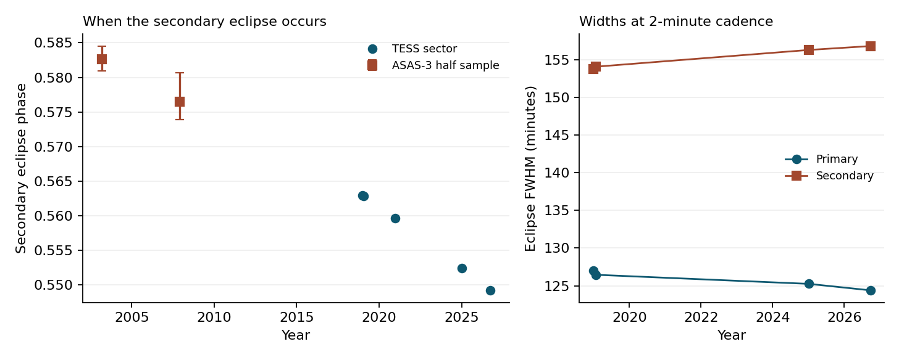

# The secondary eclipse of TIC 35481236 is moving

In this known 1.84343-day eccentric binary, the secondary eclipse arrived **36.46 minutes earlier within the orbit** in September 2026 than it did in December 2018. Both times are measured relative to the immediately preceding and following primary eclipses. Across the same span, the primary eclipse narrowed by 2.62 minutes and the secondary widened by 3.08 minutes at identical two-minute cadence. Observatory data from 2000–2009 place the secondary eclipse even later in the orbit.

**Disposition.** The changing timing is directly measured. Apsidal advance, rotation of the eccentric orbit within its plane, explains the direction of both timing and duration changes. The published orbital solution translates the TESS separation change into approximately **1.67 degrees per year**. The measured arc covers 7.74 years. The inferred rate depends appreciably on eccentricity. A constant rate, its physical drivers, and a full apsidal cycle have yet to be established.



## Direct measurements

For each complete primary–secondary–primary sequence, define phase as the elapsed interval from the first primary to the secondary divided by the interval between the two primaries. This measures the position of the secondary within that orbit independently of the accumulated orbital ephemeris. Common timing shifts from light travel time or a clock offset largely cancel. The fitted local continuum includes a slope. Both eclipses are deep, about 30 percent in TESS light.

| TESS sector | Median date of sequences | Product | Complete sequences | Median secondary phase | Scatter in equivalent minutes |
|---|---|---|---:|---:|---:|
| 6 | 2018-12-27 | SPOC two-minute | 10 | 0.562966 | 0.21 |
| 7 | 2019-01-20 | SPOC two-minute | 10 | 0.562875 | 0.10 |
| 33 | 2020-12-27 | QLP ten-minute | 2 | 0.559610 | 0.22 |
| 87 | 2025-01-05 | SPOC two-minute | 9 | 0.552444 | 0.16 |
| 108 | 2026-09-24 | SPOC two-minute | 4 | 0.549231 | 0.24 |

Scatter is the within-sector sample standard deviation of the measured phases multiplied by the nominal period. Adjacent sequences can share a primary eclipse. The scatter describes repeatability and does not include method-dependent systematics. The complete-event and data-gap requirements exclude partially sampled eclipses.

- **Out-of-screen epoch.** The discovery screen ended at sector 104. A straight line through the observed sector 6 and 87 phases extrapolates to 0.549442 at the sector 108 median date, within 0.56 minutes of its measured value. Keeping the 2018 phase fixed misses by 36.46 minutes. This retrospective extrapolation checks an independent observing epoch. No timestamped advance forecast was issued.
- **Two timing methods.** Per-event symmetric profile fits give the 36.46-minute change. Medians of ingress and egress bisectors at four fractional depths give 36.46 minutes. The bisectors share local depth and continuum estimates with the profile fit. Repeating the fits on uncorrected SPOC simple-aperture flux gives 36.57 minutes. QLP full-frame photometry independently recovers the progression through sector 87 from the same telescope.
- **Shape.** The median primary FWHM changes from 127.03 to 124.40 minutes, and the secondary from 153.71 to 156.80 minutes. An increasing positive projection of eccentricity along the line of sight increases the primary conjunction speed and decreases the secondary conjunction speed. The changing widths supply a consistency check from the light-curve shapes. Pulsations are known in this star, so width and timing uncertainties include possible shape-dependent bias.
- **Independent telescope.** ASAS-3 field F0656-16_256 supplies 630 grade A/B measurements on 627 nights, from November 2000 to December 2009. Jointly folding these sparse measurements on the catalog period and fitting the two eclipse centers separately gives phase **0.58059** (night-bootstrap interval 0.57906–0.58205). The early and late halves give 0.58263 and 0.57650. These are time-averaged ground estimates. The all-sample interval resamples observing nights conditional on the profile and fixed period. It does not capture all changes across the nine-year window.
- **Source position.** In separately processed TESS sectors 87 and 108, the median difference images of both eclipse types center within 0.11–0.16 TESS pixel of the target WCS prediction (approximately 2.3–3.3 arcsec). Both eclipse types have centroid positions within 0.01 pixel of each other in each sector. The brightest of 33 Gaia DR3 neighbors within 50 arcsec is 5.12 G magnitudes fainter, and all 33 combined have 3.25 percent of the target's G flux. Gaia and TESS have different bandpasses. Subpixel companions remain unresolved. Gaia source 2946311659129414144 is itself a double-lined binary.

## Orbit and interpretation

Liakos (2025), Tables 2 and 3, gives eccentricity 0.13 ± 0.01, inclination 84.20 ± 0.08 degrees, early argument of periastron 42 ± 1 degrees, and masses 1.51 and 1.59 solar masses. Using the positive-sine branch of that orbit, the minimum projected separations give arguments of 40.95 and 53.91 degrees at the two endpoint phases. The central finite-baseline rate is 1.675 degrees/year. Varying the assumed eccentricity from 0.12 to 0.14 gives 1.98 to 1.47 degrees/year. This is a sensitivity range. A full uncertainty would require a joint fit to photometry, velocities, and their covariance. Assuming the central rate stayed constant through a revolution gives about 215 years.

For the published masses and nominal period, the leading-order general-relativistic advance is 0.155 degrees/year. A positive additional contribution is consistent with tidal and rotational distortion in two close stars. Timing alone does not separate those effects from a tertiary contribution or secular changes in eccentricity. No companion is inferred here.

## Search history and prior work

The parent sample is Table 2 of Justesen & Albrecht (2021), 748 southern TESS binaries. We screened 43 systems satisfying 0.02 < catalog |e cos ω| < 0.6, secondary depth > 0.02, period < 7 days, and TESS magnitude < 13.5. For each target we attempted the first, middle, penultimate and last projected sectors through 104, removing duplicates. Of 151 star–sector attempts, 149 returned timing fits, one lacked a product and one lacked an acceptable fit. [All candidates and outcomes](screen.csv)

Target choice was exploratory. We reviewed large shifts for well-recovered deep eclipses and searched candidate aliases for known apsidal motion. For example, GG Lup, PT Vel and V539 Ara already have published apsidal analyses. Initial folded-profile fits can return spurious large shifts when an ephemeris has drifted or a phase minimum is poorly identified. The per-orbit timing, further sector and unrelated ground survey test this particular source. The screen gives no survey-wide false-alarm probability or completeness.

The target is also ASAS J064753−1642.9, TYC 5949-2585-1 and 2MASS J06475256−1642563. The ASAS eccentric-binary survey listed its eccentricity and period; Justesen & Albrecht tabulated early eclipse timings and an eccentric model. Liakos fitted the TESS sector 6/7 light curves, published times of minima, and identified pulsation of the secondary. Liakos reported an apsidal solution for a different member of the four-object study, V577 Oph. The 2026 Gaia–TESS precession search restricted its sample to periods longer than three days. Literature searches under the TIC, ASAS, TYC and Gaia IDs did not locate an earlier rate for this binary. The new observable here is the multi-epoch change between the eclipses. The eccentricity, binarity, pulsation and many early minima have prior publications.

- [Shivvers et al. 2014, ASAS eccentric binaries, Table 2](https://academic.oup.com/mnras/article/441/1/343/980800)
- [Justesen & Albrecht 2021, initial survey and ephemerides](https://vizier.cfa.harvard.edu/viz-bin/VizieR?-source=J/ApJ/912/123)
- [Liakos 2025, double-lined orbit and pulsations](https://arxiv.org/abs/2506.14395)
- [2026 TESS apsidal survey, Section 2.1](https://doi.org/10.1093/mnras/stag515)
- [TESS SPOC data processing](https://heasarc.gsfc.nasa.gov/docs/tess/data_pipeline.html) and [MIT QLP](https://tess.mit.edu/qlp/)
- [Gaia DR3 cone with 50-arcsec radius](https://vizier.cfa.harvard.edu/viz-bin/asu-tsv?-source=I%2F355%2Fgaiadr3&-c=101.96902+-16.71568&-c.rs=50&-out=Source%2CRA_ICRS%2CDE_ICRS%2CGmag%2CBP-RP&-out.max=1000&-sort=Gmag). The returned [neighbor table](gaia-neighbors.tsv) preserves the positions and colors.

## Reproduction

Run from this directory with Python 3, NumPy, SciPy and Astropy. The manifest pins the original binary and ground file bytes. MAST houses the archived sectors and pixel files. The replay downloads about 105 MB, verifies SHA-256 values and writes its derived tables to a separate directory. Run the optional survey replay with tess-point 0.9.5.post1 for the original spacecraft-pointing list. The figure requires Matplotlib.

```bash
python reproduce.py --cache archive-cache --output replay
python screen.py --cache screen-cache --output screen-replay.csv
python make_figure.py
```

[Source manifest](sources.csv) · [Individual eclipse fits](eclipses.csv) · [Bracketing triplets](triplets.csv) · [Sector statistics](sectors.csv) · [Ground fits](ground.csv) · [Difference-image centroids](localization.csv) · [Orbital conversion](orbit.json)
