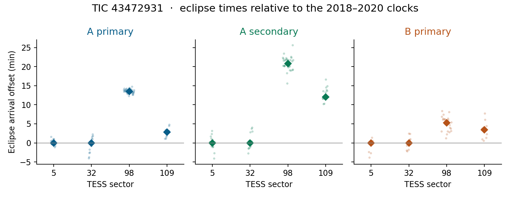

# Both eclipses of binary A in TIC 43472931 shifted earlier

TIC 43472931 (TGV-162) contains two previously reported eclipsing binaries. From TESS sector 98 in late 2025 to sector 109 in October 2026, **the primary eclipse of binary A advanced by 10.7 minutes and its secondary by 8.8 minutes**, relative to the rates measured in sectors 5 and 32 (2018 and 2020). Binary B’s primary shift was smaller and sensitive to extraction choices. Ground-based ZTF photometry separates the bright source from its 5.87-arcsecond neighbor and recovers both eclipse periods on the bright source.

Kostov et al. published both eclipsing clocks, noted their heavy blending and identified the potentially comoving neighbor, TIC 43472933. The June 2026 Multiple Star Catalog includes both binaries and two wider components in system 04587−1045. The observation reported here concerns subsequent eclipse arrival times. The search targeted this object after a search for wide companions to known multiply eclipsing systems. These are exploratory, single-target measurements. [Kostov et al. 2024](https://doi.org/10.1093/mnras/stad2947) · [Original target notes](data/kostov-system.tsv) · [Published eclipse parameters](data/kostov-binaries.tsv) · [Multiple Star Catalog](https://astro.ulb.ac.be/msc/) · [System rows](data/msc-system.txt)



## A timing change seen in both minima

For each of three eclipse types, we constructed an early linear ephemeris from the medians of sectors 5 and 32. We then measured how the residual against that ephemeris changed between sectors 98 and 109, about 315 days apart. A negative change means that the eclipses accumulated less delay, or arrived progressively earlier, relative to the early period. The primary of A was 13.5 minutes late in sector 98 and 2.8 minutes late in sector 109. Both values use the same early ephemeris.

| Clock | Reported period | Events across four visits | Change, sector 98 to 109 | 95% three-event block interval | Range across two apertures and two fit windows |
| --- | ---: | ---: | ---: | ---: | ---: |
| A primary | 1.36134 d | 76 | −10.67 min | −11.61 to −9.18 min | −10.85 to −10.50 min |
| A secondary | 1.36134 d | 76 | −8.77 min | −10.09 to −6.73 min | −10.08 to −8.09 min |
| B primary | 1.4851 d | 51 | −1.82 min | −3.85 to 0.00 min | −2.27 to −0.42 min |

The intervals resample contiguous runs of three included eclipse timings within each visit. They omit systematic error shared by a whole sector and uncertainty from choosing this system after exploration. The four extraction choices use the same photons. The same-sign shift of A's two minima favors a change in its common clock over a simple change in primary–secondary separation. Spot-related waveform changes, blends, light-travel time and dynamical timing changes remain possible. Four visits do not determine a unique orbit or demonstrate binding between the two close binaries. Multi-season timing of both clocks and velocities for the individual components would distinguish these possibilities. [All event timings](timings.csv.gz) · [Visit medians](visits.csv) · [Extraction controls](changes.csv)

## Ground localization

ZTF provides separate point-spread-function photometry for the bright source and its neighbor in g, r and i. Of 1,779 source measurements, 1,605 have zero catalog flags. In r, median epoch positions are within 0.04 and 0.10 arcseconds of the corresponding Gaia positions. We used the published periods and eclipse windows, masking overlaps with the other clock. The bright source is 0.245 mag fainter during the central part of A’s primary eclipse and 0.066 mag fainter during B’s, compared with out-of-eclipse nights. The corresponding g values are 0.287 and 0.059 mag. In r the neighbor supplies only 1.90% of the combined flux. Even its total disappearance could not account for the observed r-band dips of approximately 20% and 5.9% measured on the bright source. The network’s spatial resolution still allows an unresolved source inside the bright image. Both the known wide association and the two eclipsing signals predate this analysis. [Resolved ZTF measurements](data/ztf.csv.gz) · [Night-based contrasts and split-time checks](depths.csv) · [Astrometric and photometric checks](photometry.csv) · [Wide-pair entry](data/elbadry.tsv)

## Reproduce

Run the commands below in this directory with Python 3.12, NumPy, SciPy, pandas and Matplotlib. The scripts first use the frozen aperture counts, barycentric timestamps and ZTF measurements. Astropy is needed only for redownloading the MAST cutouts and reconstructing counts and timestamps.

```sh
sha256sum -c SHA256SUMS
python timing.py
python analyze.py
python figure.py
# Optional replay from the four original TESSCut pixel cubes
python extract.py
python timing.py
```

Each TESS extraction uses cadences with quality zero and finite flux throughout the cutout. The fifteenth percentile across its 49 pixels estimates the local background. Two extractions use the central pixel and the surrounding 3 × 3 box centered on the WCS target, respectively. Each aperture is divided by its own 0.9-day running median. We reverse the camera-center timing correction, interpolate JPL Horizons spacecraft vectors and apply the target-direction barycentric correction. The target correction differs from the stored timestamps by a median of +12, +13, +13 and −24 seconds for the four visits.

A local exposure-integrated Gaussian with fixed width, a free depth and a sloping baseline estimates each eclipse center. Gaussian widths span 0.016–0.017 of the orbital cycle. The routine masks cadences within 0.064 phase of another clock's predicted eclipse. Each fit requires the eclipse center and both wings to be sampled, and a fitted depth above 3.5%. Changing the timing window half-width from 0.13 to 0.10 days tests sensitivity to the baseline. The calculation uses trial periods of 1.361339 and 1.485117 days to label cycles and center local windows. Any constant clock offset and linear drift cancel in the reported difference of late and early rates. The B value was refined in exploratory folds, and its faint secondary is unconstrained. The ZTF analysis uses the independently published 1.4851-day period and the 1.361339-day TESS Ten Thousand period. Its native HJD and the TESS BJD reference differ by roughly a minute, small compared with the broad ground-based phase masks.

Separate searches on TIC 43472931, TIC 43472933, TGV-162, UCAC4 397-007055, 2MASS J04584367−1045208 and the individual Gaia IDs, the SIMBAD references, the Kostov catalog and the June 2026 Multiple Star Catalog yielded the existing multiplicity claims. We located no earlier measurement using the two recent TESS visits. Unindexed observations and reports could affect priority. Credit goes to NASA TESS, MAST, NASA/JPL Horizons, ZTF and its contributing observatories, IPAC/IRSA, Gaia/DPAC, CDS/VizieR, SIMBAD and the catalog teams. [Source manifest](sources.json) · [TESS Ten Thousand Catalog](data/ten-thousand.tsv) · [ZTF archive](https://irsa.ipac.caltech.edu/Missions/ztf.html)
