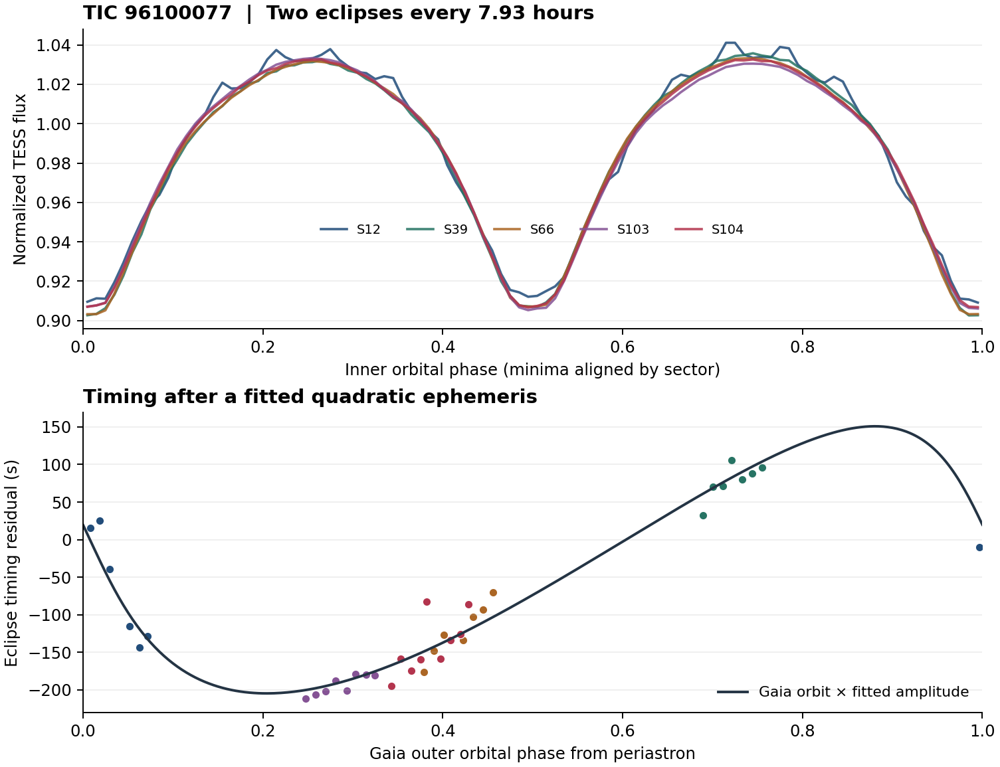

# A compact triple-star candidate at TIC 96100077

TIC 96100077 (TYC 8351-1727-1, Gaia DR3 5946882743944130304) is an eclipsing system at ICRS 264.526816°, −49.349215°. ASAS already cataloged the 7.93-hour binary as ASAS J173806-4920.9. Gaia published both an eclipse model and a 272.72 ± 0.76 day combined astrometric and single-lined spectroscopic orbit for the same source. We propose that these are the inner and outer orbits of a compact hierarchical triple. Five TESS visits localize the dimming and provide an independent test of whether the eclipse clock moves on Gaia's longer orbit. The data support a candidate. The physical association and publication priority remain open. [Gaia eclipsing binaries](https://doi.org/10.1051/0004-6361/202245330) · [Gaia non-single stars](https://doi.org/10.1051/0004-6361/202243782)

**Archival validation, November 2026.** KELT-South, ASAS-3 and ASAS-SN favor the eclipse shifts predicted from TESS and Gaia. The Gaia flags show that the spectroscopic data alone yielded no significant outer period. The proposed physical association still requires velocities for the individual stars. [Validation analysis and data](validation/README.md)



## Selection

The Gaia DR3 query joined the variability and orbital tables by exact source ID. It required an Orbital or AstroSpectroSB1 solution, an outer-to-photometric period ratio above ten and an eclipse-model ranking above 0.4. It returned 475 unique stars. The 403-entry Czavalinga et al. triple catalog supplies positive controls. Our mask recovered 181 of those entries, including five with combined astrometric and spectroscopic solutions. All 475 input rows and the full reference catalog are frozen here. [ADQL](screen.adql) · [Czavalinga et al.](https://doi.org/10.1051/0004-6361/202245300)

Among the remaining 294 sources, 15 had a combined solution. We inspected the first four by decreasing Gaia eclipse-model ranking and prioritized the first for full follow-up. In an exploratory quick look at two early sectors each, HD 34124 showed a repeated modulation, BD+20 3582 showed an eclipse in one measurable cutout, and UCAC4 248-157307 had insufficient supporting evidence. The latter three do not receive new-system designations here. The ranking favors bright systems with good published models. It supplies neither an occurrence rate nor a survey-level false-alarm probability. [Full combined-solution ranking](outputs/ranked-combined-solutions.csv)

## Two orbital timescales at one position

Gaia's inner photometric period is 0.3304072 ± 0.0000012 days. The outer solution's eccentricity is 0.5741 ± 0.0278, based on 404 good along-scan observations and 16 accepted primary radial velocities. Its orbital parallax is 2.3128 ± 0.0216 mas, or about 432 pc by direct inversion. The outer period is 825 times longer than the photometric period. These are previously released Gaia measurements. [Orbit row](data/gaia-orbit.csv) · [Eclipse model](data/gaia-model.csv)

We extracted 9 × 9 TESS full-frame cutouts for all six visits in the footprint. In sectors 12, 39, 66, 103 and 104, the 3 × 3 target aperture dimmed by 11.7–12.0% relative to quadrature. Median per-orbit difference images place the missing light 1.1–5.2 arcseconds from the Gaia position in these visits, compared with a roughly 21-arcsecond TESS pixel. These simple centroids include point-spread-function and spacecraft pointing systematics. Sector 93 had median net target flux of −0.13 electrons per second, compared with 6,768–7,920 in the usable visits. We exclude that cutout from all eclipse and timing measurements. [Sector ledger](outputs/sectors.csv) · [TESSCut](https://mast.stsci.edu/tesscut/)

Within the queried 75-arcsecond Gaia field the closest resolved neighbor is 4.59 arcseconds away and nearly ten G magnitudes fainter. Even the brightest resolved neighbor, at 52.78 arcseconds, is 3.96 G magnitudes fainter. If both objects had the same color, its complete disappearance would produce at most a 2.5% blended dip. The bound is approximate because Gaia G and TESS have different spectral responses. The 12% signal also occurs in Gaia's own source photometry. An unresolved alignment remains possible. [Gaia field](data/neighbors.tsv) · [Gaia source epochs](data/gaia-epoch.csv)

## Do the eclipse times follow the Gaia orbit?

The primary and secondary eclipses act as clocks. A third star would move the close pair toward and away from us, shifting both eclipses in the same direction. We used Gaia's period, eccentricity, time of periastron and radial Thiele–Innes coefficients C and H to predict the changing light path of the RV primary. The eclipse clock has a fitted scale against that curve. A negative scale is compatible with the eclipsing pair moving opposite the component dominating the published radial velocities. The scale also depends on component masses and spectral blending. [Gaia definitions and units](https://gea.esac.esa.int/archive/documentation/GDR3/Gaia_archive/chap_datamodel/sec_dm_non--single_stars_tables/ssec_dm_nss_two_body_orbit.html)

In 38 qualifying three-day windows, we measured the phase of the second orbital harmonic and fitted each eclipse minimum separately. Each window spans at least 1.5 days, includes at least 24 valid cadences and samples all 12 phase bins. Sector 12's 30-minute integrations smooth the eclipse shape. Later observations have 10-minute or 200-second integrations. Independent sector photometry and imperfect waveform stability limit precision. The orbit was fixed before this comparison. The timing estimators and baseline alternatives were explored on these data. [All windows, including exclusions](outputs/timings.csv)

| Eclipse ephemeris | RMS without Gaia term | RMS with Gaia term | Fitted scale | Other phase shifts as good / 99 |
| --- | ---: | ---: | ---: | ---: |
| One constant period across visits | 82.0 s | 70.4 s | −0.48 | 41 |
| Period allowed to drift linearly (quadratic ephemeris) | 67.9 s | 21.3 s | −0.80 | 7 |
| Common linear slope and a separate epoch per sector | 38.5 s | 19.7 s | −0.96 | 7 |

The in-visit scales for the primary and secondary clocks separately are −1.01 and −1.05. Omitting one sector at a time gives −1.16 to −0.94 for the common in-visit scale. Allowing a separate epoch per sector discards the timing information across years. A quadratic ephemeris uses that information but adds flexibility. The 99 shifted-orbit controls are correlated and sample a single target at just five visits. These comparisons do not establish a unique 273-day timing solution. Spot modulation in the short-period binary, secular period change, or a separate unresolved binary could account for some of the timing structure. [Fit coefficients and omissions](outputs/timing-fits.json) · [Phase controls](outputs/outer-phase-controls.csv)

TESSCut timestamps include the light-travel correction to the detector center. For each cadence we subtract that correction, interpolate the JPL Horizons spacecraft position relative to the Solar System barycenter, and project it onto the target direction. The Gaia photometric and orbital epochs use TCB, converted to the TESS TDB scale. This reduction also avoids the published QLP timestamp issue affecting sectors 103 and 104. [Mission timing convention](https://outerspace.stsci.edu/spaces/TESS/pages/14563420/2.0%2B-%2BData%2BProduct%2BOverview) · [QLP release notes](https://archive.stsci.edu/hlsp/qlp) · [JPL Horizons](https://ssd.jpl.nasa.gov/horizons/)

The mission's separate TESS-SPOC reduction provides a check on 15 windows in sectors 12 and 39. Its native target timestamps agree with our reconstructed timestamps to about a millisecond in median. Fitting the Gaia curve lowers the two-sector timing residual from 55.6 to 18.9 seconds with a common linear ephemeris. These are the same exposures processed using another aperture and pipeline. Two isolated visits offer little independent constraint on outer orbital phase. [SPOC products and replay](spoc-check/README.md)

## Prior coverage and a decisive observation

On 2026-11-14 we checked the exact Gaia ID against Czavalinga et al., Andrew et al. and Bashi & Tokovinin, and queried the June 2026 Multiple Star Catalog by coordinates. No match appeared in those checks. VizieR's VSX record gives the 0.330413-day ASAS eclipse period. SIMBAD returns the Gaia variability and multiplicity papers. We also queried the Kostov et al. TESS Ten Thousand Catalog by TIC ID and searched the Gaia, TIC, Tycho, 2MASS and ASAS identifiers with “triple,” “binary,” “companion” and “timing.” We located no prior explicit proposal linking these two orbits for this source. Unindexed work, alternative identifiers and unnamed entries in other catalogs make priority uncertain. [SIMBAD references](data/refs.csv) · [VSX](data/gaia-ebviz.tsv) · [MSC query and result](data/msc26.json) · [Additional catalog queries](data/additional-catalogs.json)

A discriminating test is high-resolution spectroscopy over several inner cycles at multiple phases of the 273-day orbit. Look for a line system tracing the rapid binary and measure whether its systemic velocity changes opposite the line system tracing Gaia's long orbit. The published C and H imply a projected semimajor axis of 0.537 au and a long-orbit velocity semi-amplitude of about 26 km/s for Gaia's RV primary. Repeated spectroscopy can assign the orbit to an actual set of lines. New eclipse timings bracketing periastron would test the sign reversal on fresh data. The nominal next two periastra from the published ephemeris fall in mid-November 2026 and mid-August 2027, with accumulated timing uncertainty of roughly two weeks. Large, phase-inconsistent velocities or a resolved unrelated eclipsing source would weaken the proposed hierarchy.

## Reproduce

The frozen inputs and output tables permit offline replay of the population ranking, timing fits and figure. To re-extract all pixel photometry and regenerate the 38 clock measurements, add the optional fetch and extraction commands. The FITS URLs, original byte hashes, scientific-array hashes and spacecraft-vector receipts are in the manifest. TESSCut may regenerate its file creation timestamp. The downloader verifies the numerical arrays and WCS used here. The tables contain observations and derived measurements. The code and interpretation are agent-authored. The initial checkout was Open-Space revision de35cab. [Input manifest](sources.json)

```sh
python fetch.py
python screen.py
python measure.py
python figure.py

# Full observational replay
python fetch.py --pixels
python extract.py
python measure.py
python figure.py
```

Run with Python 3.12, NumPy, pandas, SciPy, Astropy and Matplotlib. Observational credit belongs to ESA/Gaia/DPAC, NASA's TESS mission and SPOC, MAST, JPL Horizons, ASAS, AAVSO, SIMBAD, VizieR/CDS and the authors of the comparison catalogs.
