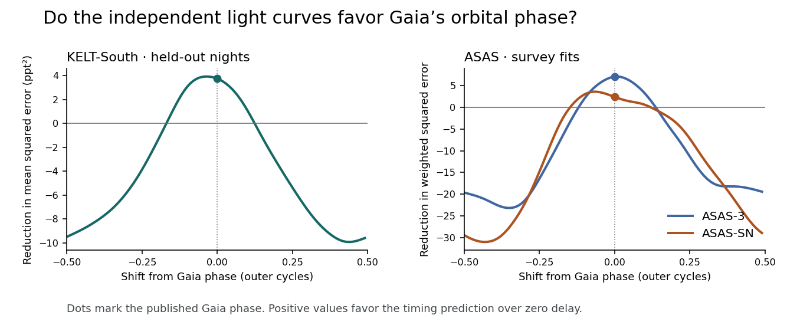

# Independent timing validation of TIC 96100077

Three ground surveys favor a specific prediction for TIC 96100077. Its known 7.93-hour eclipses shift in the opposite direction to the radial motion predicted for the star tracing Gaia’s 272.72-day orbit. The strongest test uses 6,028 KELT-South measurements acquired before the first TESS observations. ASAS-3 and ASAS-SN extend the timing comparison across 18 observing years. These results strengthen the proposed hierarchical triple. Component-resolved spectroscopy remains the outstanding physical test. [Component velocity test and SkyMapper localization](../velocity-test/README.md) · [Original investigation](../README.md) · [Original ASAS variable catalog](https://www.astrouw.edu.pl/asas/data/Vars.E)

## What the new observations test

An orbiting eclipsing pair acts like a clock. Its eclipses arrive later when the pair is farther from Earth and earlier when it is closer. We held Gaia’s outer orbital shape, period and phase fixed and tested the sign and amplitude inferred previously from TESS. For a TESS scale of −0.802 the expected swing from earliest to latest is about **5.9 minutes**. The reference value −1 would mean equal and opposite displacements for the binary clock and Gaia's RV tracer.

| Observation | Result |
| --- | --- |
| KELT-South, 2013–2018 | The fixed prediction improves held-out nights. With a quadratic inner ephemeris the fitted scale is −0.851 (21-day cluster 95% interval −1.220 to −0.483). The fixed sign predicts five of six withheld observing years better than zero delay. The opposite sign increases the night prediction error. A clock-convention check gives −0.959. Much of the gain comes from 2016–2017, and the six-year block interval on the average improvement includes zero. [KELT exposures, controls and replay](kelt/README.md) |
| ASAS-3 and ASAS-SN, 2001–2009 and 2016–2024 | 819 and 937 usable measurements give scales −0.689 and −0.479. The combined scale is −0.574, and only 3 of 99 shifted outer phases fit as well at the fixed amplitude. The best phase is 5.5 days from the published prediction. The frozen waveform beats the tested yearly, half-yearly and lunar-month alternatives even after optimizing their phase. [Ground data, controls and replay](../ground-check/README.md) |
| TESS, 2019–2026 | With each of four seasons withheld, a quadratic ephemeris gives 496 s RMS and adding Gaia gives 135 s. A constant-period baseline gives 172 s and adding Gaia worsens it to 266 s. Other phases and periods can beat the nominal fit. The test on these previously inspected data is retrospective. [Season predictions and Gaia covariance](tess/README.md) |
| Gaia DR3 and public spectroscopy | The joint orbit implies a velocity semiamplitude of 26.15 km/s, with a formal 16th–84th percentile range of 23.62–28.98 km/s. Its astrometric and RV orientations agree to about 0.8° modulo 180°. The spectroscopic search alone found no significant period, and a trend or stochastic spectroscopic solution entered the combination. The archive checks yielded no independent set of velocities assigning the long orbit to a stellar component. [Source data, spectra, flags and derived parameters](spectroscopy/README.md) |

The ground-based measurements use independent photons, but all three comparisons share the selected target and the same Gaia prediction. KELT’s raw and detrended data also overlap. We report individual survey results and model sensitivities without multiplying probabilities. Starspots and evolving eclipse shapes can shift the apparent clock. An unresolved alignment could place an eclipsing pair near a separate source with its own orbit. The agreement in clock sign and phase across instruments makes that explanation more demanding. Neither photometry nor the existing velocity summaries assign the spectral lines to individual stars.

We rechecked all six archived TESSCut footprints. The sector 93 cutout lies entirely within physical columns 2–10, with the target at column 6.0. The illuminated part of the chip begins at column 45. The other five visits place the target on active pixels. This resolves why the cataloged sector added no photometry. Run `python footprint.py` after the original dossier’s pixel download. To regenerate the survey figure run `python figure.py`. [Footprint ledger](footprint.csv) · [TESS detector documentation](https://archive.stsci.edu/hlsp/tica)

## How to settle the association

High-resolution spectra across several 7.93-hour cycles would identify the fast-moving binary lines. Repeating those measurements at distinct phases of the 272.72-day orbit would test whether the binary’s centre-of-mass velocity reverses in step with the separately traced star. For the fixed TESS amplitude and published Gaia orbit, the expected semiamplitudes are about **21 km/s for the pair and 26 km/s for the other star**, in antiphase. These values assume light travel time dominates the clock shifts. A different long-period phase or an accurately constant binary systemic velocity would challenge that interpretation. The propagated Gaia covariance places the following periastron near August 14, 2027, with a central 95% window from July 24 to September 4. [Periastron windows](tess/outputs/periastra.csv)

ESA schedules Gaia DR4 for December 2, 2026. If this target has released per-epoch velocities, match the new source by position and identifiers, separate epochs later than the DR3 observing interval, and compare their signed velocities to the frozen orbit before refitting. Independent ground spectra would still be needed if the new data contain only one blended set of lines. The known short-period binary dates to the original ASAS catalog, and the long orbit was already published by Gaia. The contribution here is a tested link between those two orbits. Discovery priority for that association remains open. [ESA release schedule](https://www.esa.int/articles/news-media/esa-s-highlights-for-2026)
