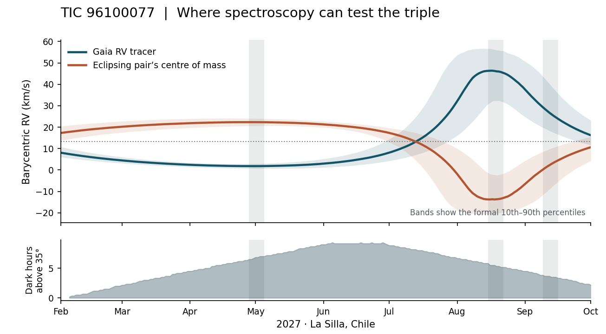

# A velocity test for the proposed TIC 96100077 triple

**Status on 14 November 2026: candidate awaiting component velocities.** The new SkyMapper analysis recovers the known eclipse modulation in a 2-arcsecond-diameter aperture. This narrows the source of the dimming. The inferred position of the variable light is −0.28 ± 0.38 arcsec east and −0.31 ± 0.42 arcsec north of the bright photocentre. Both coordinates are consistent with zero. A bound triple with the proposed orbit would subtend only a few milliarcseconds. The available public spectra have yet to assign the long orbit to identifiable stellar lines. [SkyMapper measurements](../skymapper/README.md) · [Additional spectroscopy searches](archives/README.md) · [Previous survey timing evidence](../validation/README.md)

The strongest physical prediction is two opposite velocity changes. A star moving on Gaia’s 272.72-day orbit should shift redward between the early and late parts of the 2027 observing season. If the eclipses are delayed by the changing light path across that same orbit, the close pair’s centre of mass should shift blueward. These predictions were fixed before obtaining any component velocity. The example times below were selected for Chilean visibility and the rapidly orbiting stars’ expected maximum line separation.

| Example visit (UTC) | Inner phase | Gaia tracer, km/s | Pair centre of mass, km/s |
| --- | ---: | ---: | ---: |
| 2 May 2027, 03:40 | 0.75 | +1.8 [+0.6, +3.0] | +22.3 [+20.6, +24.0] |
| 19 August 2027, 00:40 | 0.26 | +46.1 [+32.4, +55.9] | −13.7 [−20.2, −2.4] |

Values are medians and 10th–90th percentiles from 4,096 joint realizations of the DR3 orbital covariance. Velocities use the Solar System barycentre and positive values indicate recession. Differencing the same orbital realization at both visits gives a **+44.4 km/s** tracer change (central 95% **+23.1 to +58.6**) and **−35.6 km/s** for the pair (**−47.0 to −18.5**). The pair intervals hold the original TESS signed scale fixed at −0.80164. They omit model error, uncertainties in the timing amplitude, line blending and instrument calibration. Holding the same Gaia draws and adopting the pooled ASAS scale −0.574 instead gives a median pair change of −25.5 km/s. [Paired forecast](paired-predictions.csv) · [Prior orbit and source flags](../validation/spectroscopy/README.md)



## Obtaining the discriminating measurement

A high-resolution spectrograph capable of separating the variable, possibly weak lines of the 7.93-hour pair from the outer tracer could make this measurement. FEROS at La Silla illustrates the required type of instrument, with resolving power about 48,000 and optical coverage of about 350–920 nm. The published site coordinates were used for geometric planning. Telescope allocation, instrument availability, exposure S/N and weather remain open. [FEROS characteristics](https://www.eso.org/sci/facilities/lasilla/instruments/feros/overview.html) · [Site coordinates](https://www.eso.org/sci/facilities/lasilla/telescopes/national/2p2.html)

- **Obtain both inner quadratures at each outer epoch.** Example exposure midpoints on May 2 are 03:40 and 07:40 UTC. On August 19 they are 00:40 and 04:30 UTC. The predicted phases are close to 0.25 and 0.75. Repeat on adjacent nights and include intermediate phases to distinguish crossing lines and constrain the inner orbit. Use a fresh eclipse light curve to update inner phase before observing. Individual visits spanning about ten minutes cover 2% of the inner orbit. Determine exposure length from S/N and measured line smearing.
- **Extract velocities from consistently identified lines.** Retain the barycentric time, barycentric velocity convention, wavelength solution, line profiles, cross-correlation peaks, uncertainties and blend flags. Track which spectra belong to each rapid component through their phase reversal. A broadening-function or template-disentangling fit can retain faint companions and reveal ambiguous peaks. Evaluate wavelength orders separately. A stable tertiary may have much narrower lines than the rapid pair.
- **Compare both sides of the orbit.** With inner component velocities A and B and an inner mass ratio q = M_B/M_A, the pair’s systemic velocity is (A + qB)/(1 + q). An arithmetic average assumes equal masses. A third consistently identified line system tests the other side. Confirm that the inner components exhibit the short photometric period and the same phase relationship on repeat nights. At high precision a full joint spectral/orbital fit should account for correlated velocity errors, zero points and changing blends.
- **Report failures in physical terms.** A constant pair velocity measured accurately across a period when the third tracer shows the predicted positive swing would challenge the timing interpretation. A single set of lines following Gaia tests only the long orbit. Undetected faint lines leave the hierarchy unresolved unless injection into the actual spectra establishes adequate recovery.

The UTC windows are based on 10-minute samples with the Sun below −18° and target above 35° in vacuum. We searched 365 nights starting November 14, 2026. Candidate seven-night blocks require at least two usable hours on each night and at least two nights for each inner quadrature. The two main blocks maximize robust contrast by selecting the lowest upper and highest lower deciles of the tracer velocity relative to the systemic velocity. The seven Chilean evenings begin **April 28 and August 15**, respectively. A third week beginning September 9 samples the return from the maximum, but the formal 95% interval on the August-to-September change spans both signs. Each listed window admits exposure midpoints within 0.06 inner cycles of quadrature. Earth rotation predictions and the extrapolated inner clock limit the accuracy of precise times. Lunar sky brightness and exposure overheads require an actual observing setup. [Quadrature opportunities](quadrature-windows.csv) · [Nightly geometry](nightly-visibility.csv)

## Public Gaia test

ESA schedules Gaia DR4 for December 2, 2026. The pre-release source list and the public archive supplied no new epoch velocities for this target on November 14. The first practical archival check is to match the source across releases, retrieve any available velocity records and score only visits later than the DR3 observing interval against the frozen DR3 curve. The separate single-lined, double-lined and spectral products answer different questions. DR4's final public schema, source coverage and quality will determine which tests are possible. [Retrieval and scoring protocol](gaia.md) · [Pre-release query receipt](gaia-access-2026-11-14.json) · [ESA release schedule](https://www.esa.int/articles/news-media/esa-s-highlights-for-2026)

## Reproduce or score a component series

The input orbit, signed timing scale and 38 TESS timing windows come from revision 4562404828e5ad4a897b93b1262133444c003629. Python, NumPy, SciPy, pandas, Astropy and Matplotlib are used. From this directory run the following.

```sh
OPENBLAS_NUM_THREADS=1 python observing.py
python figure.py
python -m unittest test_components test_gaia_holdout
python gaia_holdout.py gaia-access-2026-11-14.json --clock barycentric
```

For real line-matched data, run `python components.py matched.csv`. Required columns are `exposure_id,jd_tcb,rv_a,err_a,rv_b,err_b,rv_c,err_c`. Each row is one exposure with contemporaneous A/B/C measurements in km/s on a common, calibrated instrumental system. Supply full barycentric JD(TCB) for the exposure midpoint. The scorer profiles the unknown positive mass ratio and a constant offset within each tested hypothesis. It reports constant, predicted, reversed-sign and free-amplitude fits for each velocity system and their residual chi-square. It assumes independent Gaussian line errors. A boundary mass ratio gives all the weight to one component, which leaves the binary’s systemic motion unidentified. Check the rank, phase coverage, and the sensitivity to line labels and covariance. The constructed-velocity controls in the tests check the software and run separately from the observational evidence.

The predictions differentiate the published line-of-sight displacement of Gaia’s RV tracer with respect to time. A regression test independently checks the sign and units against the numerical derivative of the eclipse-timing code. [Outer-orbit calculation](orbit.py) · [Component comparison](components.py)
