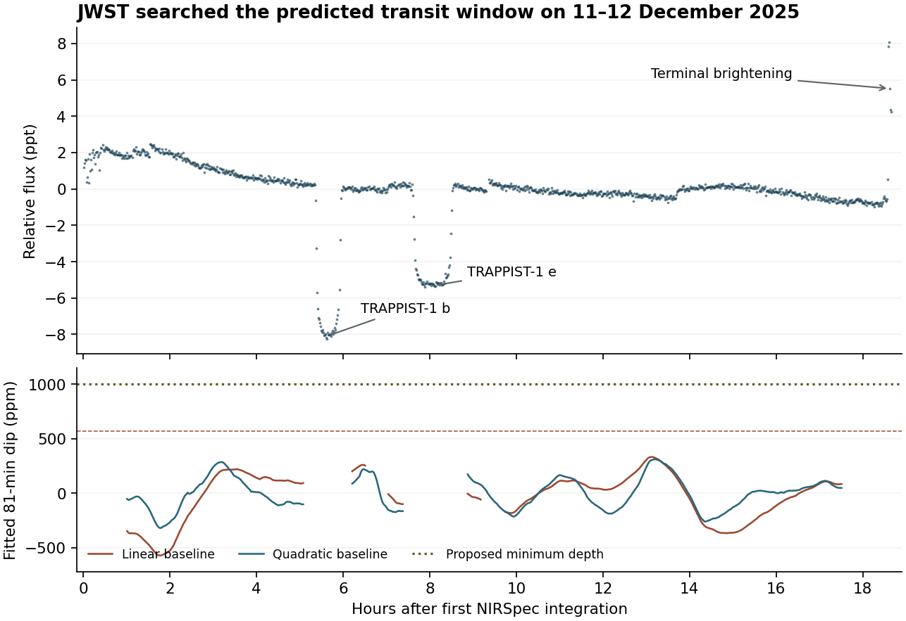

# The December 2025 TRAPPIST-1 eighth-planet transit window

JWST recorded **48,634 NIRSpec/PRISM integrations** in the dedicated follow-up of a proposed 28.7-day outer planet. After masking the known b/e transits and an end-of-visit brightening, the deepest additional 81-minute dip measures **333 ppm**. An identically filtered upward fluctuation reaches 572 ppm. Injecting 1,000 ppm transits, the shallow end of the proposal's range, gives recovery at **370 of 393 supported trial times (94.1%)** and **428 of 559 times (76.6%)** across the entire visit. At 1,500 ppm these counts rise to **393/393** and **458/559**. The result constrains the proposed deep photometric event across a specified part of the timing window. A dynamical companion could transit at another time, produce a shallower signal, or miss the star from Earth's line of sight.



## The prediction and the observation

Agol and colleagues' [JWST DDT 12492 proposal, pp. 2–3](https://www.stsci.edu/jwst/phase2-public/12492.pdf) reported three possible timing solutions. The team favored a 28.7-day orbit near the 3:2 resonance with h and expected a transit lasting 1.35 hours, with depth 0.1–2 percent. Their observing description anticipated roughly 1–2 parts per thousand. They requested a scheduling window starting 2025-12-11 08:34:15 UTC and ending 2025-12-12 09:34:15 UTC, designed to capture at least half the transit at three sigma. The proposal gives no numerical distribution of transit midpoints. Its scheduling bounds and our uniformly spaced test times cannot be used as a probability distribution for the planet.

The actual integration midpoints run from **2025-12-11 09:38:43.96 UTC to 2025-12-12 04:18:14.69 UTC**, or **BJD(TDB) 2461020.90233106–2461021.67969177**. The elapsed span is 18 h 39 min 31 s. One interval between integrations lasts 173.5 s; the median spacing is 1.3775 s. This is the pipeline's NRS1 broad-band white-light record. The original UTC and barycentric times use MJD-sized numbers in the ECSV. Adding 2,400,000.5 to the latter recovers BJD(TDB). [MAST science product](https://mast.stsci.edu/api/v0.1/Download/file?uri=mast:JWST/product/jw12492-o001_t001_nirspec_clear-prism-s1600a1-sub512_whtlt.ecsv) · [Pipeline product definition](https://jwst-pipeline.readthedocs.io/en/stable/jwst/data_products/science_products.html)

## What the visit could detect

Independent tests use linear and quadratic local stellar/instrumental baselines. Depths are fractions of the normalized broad-band flux. Each injected event has an 81-minute first-to-last-contact duration and 11.34-minute ingress and egress. Both fits search for slightly steeper ingress and egress of 8.1 minutes. A recovery requires the largest dip in the *whole* scan to exceed the threshold and its center to fall within 15 minutes of the injection. Overlapping windows reuse the same measured noise. These are deterministic sensitivity fractions for this visit. They carry no binomial significance or posterior interpretation.

| Injected depth | Linear, all 559 centers | Linear, 393 supported | Quadratic, all 559 centers | Both baselines, all 559 |
| ---: | ---: | ---: | ---: | ---: |
| 200 ppm | 0 | 0 | 5 | 0 |
| 500 ppm | 166 | 155 | 208 | 118 |
| 750 ppm | 331 | 289 | 425 | 324 |
| 1,000 ppm | 428 | 370 | 463 | 427 |
| 1,500 ppm | 458 | 393 | 464 | 458 |
| 2,000 ppm | 460 | 393 | 464 | 460 |

We used a two-minute search grid and injected at the odd minutes between grid points. An eligible center requires an entire nominal transit in the visit, at least 60% of its weighted signal outside masks, and 20 measured one-minute baseline bins on each flank. The 393 supported injection positions lie within 1.1 minutes of an eligible search center. Recovery can occasionally extend to adjacent unsupported centers under the 15-minute tolerance. The five supported linear-baseline search intervals in BJD(TDB) are 2461020.94434–2461021.11378, 2461021.16101–2461021.17351, 2461021.19573–2461021.20962, 2461021.27212–2461021.28462 and 2461021.30823–2461021.63184. The individual grid positions and recoveries are in [scan.csv](scan.csv) and [injections.csv](injections.csv).

The depth filter fits a trapezoid and the baseline simultaneously. Each local slope fit extends 80 minutes beyond each contact; the quadratic sensitivity fit uses 100 minutes. We take medians in one-minute bins with at least ten integrations and weight each bin by its integration count, capped at 44. We mask the Agol b and e forecast midpoints using their nominal half-durations plus eight minutes to cover known timing errors. We mask the final eight minutes due to a brightening that peaks about 8,000 ppm above the visit median. With the terminal brightening included, the linear fit produces a 928 ppm apparent dip centered an hour earlier because the bright last bins pull up its fitted baseline. Mask lengths of 6, 8, 12 and 20 minutes all return the same deepest 333 ppm dip. The 60- and 105-minute duration checks give deepest dips of 362 and 305 ppm. [Sensitivity fits](sensitivity.csv)

The detection threshold is the larger of 500 ppm and the deepest inverted-flux event: 572 ppm with the linear model and 500 ppm with the quadratic model. This single-visit noise control does not provide a survey-wide false-alarm probability or a formal shape-independent upper bound. The quadratic scan's largest dimming measures 311 ppm. Full grid recovery includes local structure, transit blending, data gaps, edge effects and the brightening because injections are multiplied into the measured binned photometry before all fitted baselines. The search and injection templates are symmetric and do not span every grazing geometry or wavelength-dependent signal.

### Physical transit shapes and original-cadence recovery

A separate injection set uses occultations of a quadratic limb-darkened stellar disk, integrated over 512 annuli. For first-to-last contact lasting 81 minutes, limb coefficients 0.25 and 0.18, and peak depth 1,000 ppm, the linear search recovers **371/393 supported centers at impact parameter 0**, **368/393 at 0.7**, and **322/393 at 0.95**. The corresponding full-visit counts are 428, 425 and 375 of 559. At 1,500 ppm all three geometries reach 393/393 supported centers. Each shape is scaled to the stated peak depth. These tests quantify the cost of a less box-like chord and do not assign a probability to its geometry. [Shape sensitivity](shape_checks.csv)

We also injected 1,000 ppm trapezoids into the original 1.38-second integrations at every thirteenth trial location (43 centers), then independently recomputed the median bins and all fits. All 43 detection classifications agreed with the binned-injection analysis. The largest change in fitted peak depth was 2.21 ppm. [Original-cadence checks](full_cadence_checks.csv)

## Prior observations and attribution

Gillon et al. already reported a roughly two-hour, 200 ppm dip near JD 2460272.26 in **a different MIRI observation**, with an ambiguous origin. Our analysis recovers none of the 200 ppm injections with the primary model. This NIRSpec visit leaves a signal of that size unresolved. The earlier event and the 28.7-day timing solution do not establish a single ephemeris. [Gillon et al., methods and Extended Data](https://arxiv.org/html/2509.02128v1)

Searches of primary papers, the program record and indexed follow-ups through 2026-11-15 for “12492”, “TRAPPIST-1 i”, the December date, “28.7”, and photometric non-detection found the team's original dynamical prediction and the earlier MIRI analysis. We found no prior public recovery map for this December NIRSpec visit. This project's contribution is the dated sensitivity map. The team proposed the planet and obtained the data. [DDT program listing](https://www.stsci.edu/jwst/science-execution/approved-programs/directors-discretionary-time)

## Reproduce

From this directory, run the following commands with Python and NumPy. The committed one-minute photometry is sufficient for the primary analysis. The optional preparation step retrieves the original MAST science product. Supplying a local ECSV path also works. The source ECSV SHA-256 is `680d2884bac5b45876f1f8d244db06034e26b7b1808abba6ecae6d32a17a22e4`.

```sh
python prepare.py
OPENBLAS_NUM_THREADS=1 python analyze.py
OPENBLAS_NUM_THREADS=1 python shape_checks.py
```

[One-minute flux and timestamps](one_minute.csv) · [Scan and injection summary](summary.json) · [Independent known-planet timing checks](timing/README.md)

For the original-cadence check supply the source ECSV as the sole argument to `shape_checks.py`.
