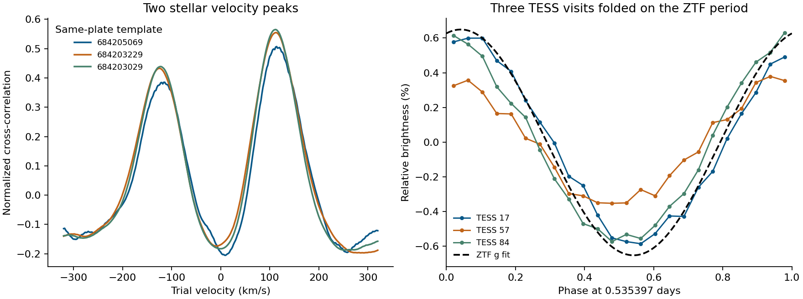

# Two visible stars and a 12.85-hour clock in a dormant black-hole candidate

TYC 2290-902-1 (Gaia DR3 363580870076290816, TIC 259010246) has two systems of stellar absorption lines separated by **220–236 km/s** in an archival LAMOST observation. At the star's position, independent ZTF and TESS photometry recover a **0.53539-day** brightness cycle. A close pair of luminous stars offers a direct explanation for the large Gaia velocity scatter. If tidal distortion produces two brightness maxima per orbit, the implied orbital period is **1.07078 days**. Spectroscopy at multiple orbital phases can test that interpretation.



## What was already known

Müller-Horn et al. modeled the Gaia astrometric and radial-velocity scatter under a dark-companion assumption. Their v2 catalog gives this star a median companion mass of 10.32 solar masses (16th–84th percentiles 6.14–17.37), a median period of 33.0 days (20.4–53.4), and a model-conditional probability of 0.99988 for a companion above three solar masses. Gaia reports a 222.61 km/s robust radial-velocity range and RUWE 2.44. Kovalev et al. had already identified its LAMOST spectrum as a double-lined binary candidate. The advance here is the test of the two catalog interpretations against measured line separations, a five-year photometric clock, spatially resolved ground data, and three additional spectra. [Müller-Horn et al.](https://doi.org/10.1051/0004-6361/202557587) · [v2 catalog](https://doi.org/10.5281/zenodo.19181131) · [Kovalev et al.](https://doi.org/10.1093/mnras/stad3222)

We applied the published cuts `flag_quality == True` and `fit_companion_mass > 3` to both v2 tables, then joined on exact Gaia DR3 IDs. Among 279 main-sequence and 389 red-giant candidates, two appear in Kovalev's 12,426-source SB2 candidate catalog. TYC 2290-902-1 ranks 19th of 279 by inferred companion mass. The other match, red giant 4494805084838872448, has discrepant blue and red velocities in a LAMOST visit and remains ambiguous. Neither match nor any other screened candidate appears in Guo et al.'s 665-source catalog of LAMOST SB2 orbital fits. The limited spectroscopic sky coverage precludes a population contamination rate. [Complete screen](data/screen.csv) · [Guo et al. table](https://vizier.cfa.harvard.edu/viz-bin/VizieR?-source=J/ApJS/278/46)

## What the spectra show

LAMOST observed TYC 2290-902-1 with a medium-resolution fiber on 2018 October 29 (obsid 684208204). We removed the slowly varying continuum, masked flagged pixels and cross-correlated two disjoint blue-arm wavelength intervals against three high-S/N stellar spectra from that plate. We selected templates by S/N among 5000–6200 K dwarfs, independently of the target's velocities. Each pair of peaks appears in the same wavelength interval of the same fiber. Changing the template or using either half of the blue band preserves the separation. The median of six estimates is 229 km/s. Their range describes sensitivity to the template and window. [LAMOST spectrum](https://www.lamost.org/dr12/v2.0/medspectrum/view?obsid=684208204) · [Control observations](data/controls.csv)

| Wavelength range | Blueshifted peak across templates | Redshifted peak across templates | Separation |
| --- | ---: | ---: | ---: |
| 4900–5155 Å | −116 to −100 km/s | +114 to +120 km/s | 220–230 km/s |
| 5160–5300 Å | −124 to −114 km/s | +112 to +114 km/s | 228–236 km/s |

The two blue exposures 24 minutes apart also contain two peaks. With template 684203029 in 5160–5300 Å the separations are 242 and 238 km/s. The coadd and the individual exposures share photons. Across all twelve ordered template-to-template comparisons spanning the same two intervals, no secondary peak reaches correlation 0.15. The target's coadded secondary peaks range from 0.276 to 0.439. A connection between its measured stellar velocities and the Gaia scatter is plausible even though Gaia has not released individual velocities for this source.

Three LAMOST low-resolution visits give a second test. We treated the highest-S/N visit, 2024 January 11 (obsid 1189315023), as an empirical line template. In the 4800–5400 Å interval, two shifted copies fit 2015 December 21 and 2016 December 9 with separations of 199 and 215 km/s. The residual sum of squares falls by 23% and 21% versus a freely shifted, rescaled single copy. The disjoint bluer 3900–4800 Å window gives 211 and 220 km/s. These are differential line-broadening estimates. The 2024 exposure has finite line width, the instrumental resolution is about 167 km/s, and the model can absorb changes in the instrumental profile. These three spectra do not determine an orbit. [Per-window fits and controls](results.json)

## Which star carries the clock?

The largest peaks in separate 0.08–6 cycles/day searches of TESS sectors 17, 57 and 84 each lie at 0.535–0.536 days. We compressed quality-filtered QLP data into hour bins to limit the weight of high-cadence visits. The best joint frequency gives 0.535389 days, with cycle-count aliases at 0.534603 and 0.536177 days. ZTF provides positional and frequency discrimination. The target's best g-band period in a 0.52–0.55-day window is 0.535397 days. Its phase and period, fitted to 390 spatially resolved ZTF g-band epochs, predict the TESS brightness wave in each sector. The negative magnitude/flux sign is accounted for in these correlations. Periods and phases were fitted retrospectively.

| TESS sector | Accepted cadences | Hour bins | Sector peak (days) | Flux semi-amplitude at joint period | Correlation with independent ZTF waveform |
| --- | ---: | ---: | ---: | ---: | ---: |
| 17 | 685 | 366 | 0.535616 | 0.592% | 0.954 |
| 57 | 10,274 | 576 | 0.535125 | 0.329% | 0.742 |
| 84 | 9,174 | 516 | 0.535041 | 0.568% | 0.878 |

A known Gaia RS-type variable, Gaia DR3 363580874372079104, is only 16.27 arcseconds away, inside a TESS pixel. At the TESS period its main ZTF g-band series gives a 0.00066-mag semi-amplitude across 557 measurements, versus 0.00705 mag at the target. The target's main i-band series gives 0.00610 mag over 155 good epochs. The 880-measurement red series at the neighbor gives 0.00140 mag. The [complete ZTF measurements](data/ztf.csv) include the short secondary-field series. The analysis also tests the fixed TESS frequency after shuffling nightly median magnitudes within approximate observing years. None of 4,999 shuffles exceeded the target statistic in either its main g or i series (362 and 154 nights). At the neighbor, 2,364 of 4,999 exceeded the main g statistic. The null is conditional on the separate TESS selection and does not account for every possible calibration or stellar systematic. [ZTF light curve service](https://irsa.ipac.caltech.edu/docs/program_interface/ztf_lightcurve_api.html) · [TESS QLP](https://archive.stsci.edu/hlsp/qlp)

## Interpretation and follow-up

An approximately sinusoidal brightness cycle can be ellipsoidal variability, surface structure, or another source of modulation. The measured period is the photometric period. The two spectra at distinct velocities establish luminous contributions, and the two-shift low-resolution fits favor changes in the line profiles. The available spectra do not show both stars completing a full orbit. The Gaia scatter estimate cannot uniquely identify the component causing each velocity. A third body, unrelated unresolved blend, stellar rotation, or another source of the excess astrometric scatter remains possible. The data furnish no measurement of a black-hole mass in this system.

A direct test uses medium- or high-resolution spectra distributed around both 0.53539 and 1.07078 days. The close ellipsoidal-pair interpretation predicts two stellar line systems moving in antiphase with maximal separation near successive brightness maxima. Rotation or blending can violate the phase or velocity prediction. Repeated observations over months can separate systemic-velocity drift from the short orbit.

SIMBAD resolves the target as TYC 2290-902-1. Exact-ID checks of Gaia DR3's eclipsing-binary and non-single-star orbit tables returned zero rows for this star. A 50-arcsecond AAVSO VSX cone found the RS-type neighbor. Searches under its Gaia, TIC, Tycho, 2MASS and LAMOST identifiers located the previously published catalog memberships above. A catalog or literature search cannot establish priority. [SIMBAD record](https://simbad.cds.unistra.fr/simbad/sim-id?Ident=TYC+2290-902-1) · [Gaia archive](https://gea.esac.esa.int/archive/)

## Replay

Use Python 3 with NumPy, SciPy and Astropy. Matplotlib is needed only to regenerate the figure. Run these commands from this directory.

```sh
python analyze.py --write /tmp/tyc2290-results.json
diff results.json /tmp/tyc2290-results.json
python plot.py
python prepare.py --cache /tmp/tyc2290-downloads --out /tmp/tyc2290-derived
python analyze.py --data /tmp/tyc2290-derived --write /tmp/tyc2290-live.json
```

[Archive URLs and original response hashes](data/sources.json) are supplied for the 17 source products/queries. Live photometric catalogs can acquire new epochs, and query headers can include a retrieval date. The included tables preserve this run. The compressed spectrum arrays contain wavelengths and continuum-subtracted absorption values. `prepare.py` rebuilds them from FITS pixels and bitmasks. A future release can be checked scientifically by comparing the derived quantities even when metadata headers differ.

This analysis uses Gaia data from ESA and the Gaia Data Processing and Analysis Consortium, LAMOST data from the Guo Shou Jing Telescope operated by the National Astronomical Observatories of the Chinese Academy of Sciences, MIT QLP light curves from NASA's TESS mission at MAST, and ZTF public data from Palomar and NASA/IPAC IRSA. Guoshoujing Telescope (the Large Sky Area Multi-Object Fiber Spectroscopic Telescope LAMOST) is a National Major Scientific Project built by the Chinese Academy of Sciences. Funding for the project has been provided by the National Development and Reform Commission. LAMOST is operated and managed by the National Astronomical Observatories, Chinese Academy of Sciences.
