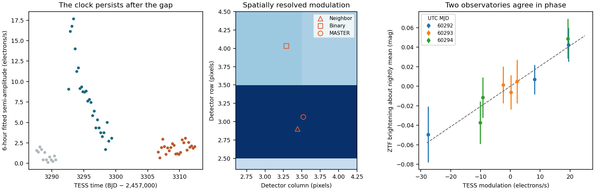

# The 79-minute modulation in the December 2023 MASTER J055845 eruption

**The December 2023 eruption of MASTER OT J055845.55+391533.4 carried a 79-minute brightness modulation that persisted into the end of the TESS visit.** The specific claim here is the attribution and persistence of the signal. A published TESS analysis reported 18.179 cycles/day in this sector but questioned whether a neighboring eclipsing binary or another star supplied the light. Independent, spatially resolved ground measurements follow the phase measured from TESS. The signal also weakens by a factor of 4.8 from December 14–21 to December 28–January 3, while its average phase at the published frequency changes by only 0.029 cycle. Individual sectors or windows cannot establish an orbital period. [Published TESS assessment](https://doi.org/10.1093/mnras/stag514) · [Kato et al. on the separate February–March 2023 superoutburst](https://arxiv.org/abs/2304.07695)



## Independent measurements

| Test | Measurement | Interpretation |
|---|---|---|
| Location of the eruption | The median of 18 bright ZTF difference-image positions from six nights falls 0.006″ from the Gaia position of MASTER at the date of the eruption. The individual positions have a median radial scatter of 0.037″. | Identifies the brightening star. The nearest other Gaia source is 3.82″ away. The very small median offset is not an astrometric accuracy estimate. |
| Location of the clock | In the early TESS window the fitted modulation centroid is 0.65″ from MASTER, 4.0″ from the closest neighbor and 20.4″ from the cataloged eclipsing binary. The two bright reference stars have detector-position biases of 0.07–0.10 pixel in row. A TESS pixel spans about 21″. | The binary is strongly disfavored. The closest neighbor demands an independent check given the spatial systematics. |
| Simultaneous ground photometry | Nine ZTF g-band difference magnitudes on three nights track the signed brightness predicted **using TESS alone**, with within-night correlation 0.960. Shuffling the three ZTF values on each night gives 3 of 216 correlations at least this positive. Removing a common linear within-night time trend gives 0.907. | Supports modulation of the resolved eruption. The permutation test assumes exchangeability within nights. Trends and the small sample limit its weight. |
| Late-time recovery | The late data give 79.39 min in a free-frequency fit, with 79.19 min early. At the published test frequency the late window retains coherent phase in 24 six-hour blocks. | The modulation survives into the final week. There are no TESS samples in part of the intervening interval. A continuous cycle count or a measured change of period does not follow. |

The earlier 2023 eruption had a published superhump period of 0.05509(2) days. In that eruption, observations after the dip failed to detect superhumps. The new December evidence bears on the origin and persistence of the modulation in a different eruption of the same system. A catalog search originally selected this target because the March 2026 Green release has a blank measured-period field. Kato et al. already argued that its superhump period disfavors an AM CVn classification. [Earlier study](https://arxiv.org/abs/2304.07695) · [Frozen catalog](https://zenodo.org/records/18842123)

## Measurement and tests

Times below are BJD TDB minus 2,457,000. Fits use Sector 73 camera pixels from MAST, finite fluxes in the 7×7 cutout and QUALITY=0 (8,152 cadences). A fixed Gaussian-weighted aperture uses the propagated Gaia position and a per-frame outer-pixel median. A six-hour block must have at least 60 good samples. In each pixel and in the aperture we fit a constant, linear and quadratic background plus sine and cosine at 18.179 cycles/day. We rotate all pixels together by the aperture phase, then fit an integrated Gaussian with a planar background to the averaged signed image. The time windows were selected after inspection; the tested frequency was independently published.

| Window | BTJD limits | Blocks | Aperture semi-amplitude (electrons/s) | Phase randomization |
|---|---|---:|---:|---:|
| Before the rise | 3287–3290.75 | 13 | 0.42 | 0.147 |
| Bright plateau | 3292.5–3299.5 | 27 | 7.76 | 1/50,001 |
| Late coverage | 3306.5–3312.5 | 24 | 1.62 | 1/50,001 |

Phase randomization rotates each observed block by a common random angle and preserves its amplitude. The resulting probabilities test coherence conditional on the frequency and windows. They do not account for the full exploratory search. The bootstrap percentile intervals in the JSON measure block-to-block scatter. The field calibrators show why they would understate the total centroid error. Fitting independent rise difference images shifts the center by up to 0.16 pixel in row relative to the early clock. The late, much fainter clock alone cannot distinguish the two closest stars. A high-speed, resolved observation during another eruption could determine whether the closest neighbor contributes.

The ZTF comparison selects positive g-band alerts with difference magnitude below 16, at least two independent exposures per UTC night, and simultaneous TESS coverage. It uses one measurement per exposure and the signed flux predicted by the local TESS sinusoid. UTC ZTF times are converted from the Palomar observing site to barycentric TDB before sampling the clock. The nine ground points corroborate a specified frequency and phase. They cannot determine a blind period. [Ground astrometry, per-exposure evidence and provenance](ground/ZTF.md)

## Screen and reproduction

The source catalog has 153 rows, 51 with no tabulated period. Thirteen of those had a catalog Gaia G magnitude brighter than 19.6. Twelve had eligible public TESS coverage in sectors 56–108. We searched 23 star-sector cutouts, using the earliest and latest eligible sector and one extra reference sector for 1eRASS J1013−2028. Of these, only MASTER showed a highest periodogram peak exceeding 100 times the periodogram median. The screen uses 18–144 cycles/day, a Nyquist cap, weighted aperture and 73-cadence running median. This is an exploratory selection, with differing sensitivity across fields. The original planned ZTF-only screen and its obtained coverage are recorded separately. [TESS search table](field-screen.csv) · [Blind-search replay](repeat_screen.py) · [Initial search design](SEARCH.md)

From this directory, with NumPy, SciPy, pandas and Astropy installed, run the commands below. MAST can generate a different FITS packaging timestamp. Acquisition verifies the arrays used in the analysis and preserves the original file hashes in the manifest.

```sh
python acquire.py
python measure.py inputs/sector73.fits ground/gaia-cone.csv
python crossband.py inputs/sector73.fits ground/ztf-alerts.json.gz
python calibrate.py inputs/sector73_field.fits ground/gaia-cone.csv
(cd ground && python ztf_replay.py)
python plot_result.py
```

Data come from NASA's TESS mission through STScI/MAST, ESA's Gaia DR3 archive and the Zwicky Transient Facility public alert stream through ALeRCE. Exact MAST requests, input digests, fitted images, sector measurements and individual phase comparisons accompany this report. Matplotlib is used only to redraw the figure. [Provenance](sources.json) · [TESS results](measurement.json) · [ZTF phase comparison](crossband.json) · [Six-hour fits](blocks.csv) · [Field controls](field-calibration.json)
