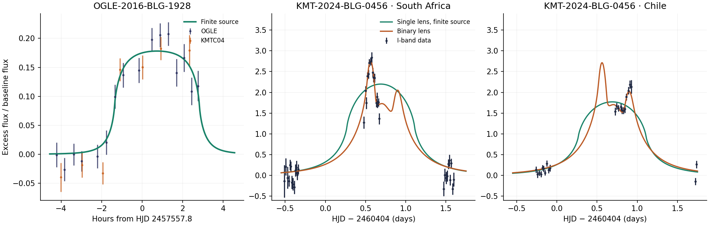

# Ultrashort bulge microlensing, 2024–2026

**No new free-floating planet, Earth-mass lens or measured angular Einstein radius emerged from this search.** KMT-2024-BLG-3326 has a real, localized brightening with an approximately two-hour single-lens solution. The light curve also admits a longer lens and a binary. Two other brightenings, KMT-2024-BLG-0824 and KMT-2024-BLG-3278, appear at three observatories and warrant follow-up as possible finite-source events. They last about eight days, and crowded-field source identification and binary alternatives remain unresolved.

**Public-data freeze: 17 November 2026.** Survey IDs can refer to the same physical event. [Per-alert fits and input hashes](tables/grid-fits.csv.gz) · [Candidate dispositions](tables/candidate-dispositions.csv) · [All flags from both calibration passes](tables/all-screening-flags.csv.gz) · [Profiled alternatives](tables/peak-comparisons.csv) · [Methods and replay commands](METHODS.md)

## Survey inventory

| Survey | 2024 | 2025 | 2026 | Numerical coverage |
|---|---:|---:|---:|---|
| KMTNet | 3,441 | 3,348 | 2,248 event pages | Released 2024–25 I-band data, with separate telescope/field streams. The 2026 index labels the season proprietary. The public roster was frozen separately. |
| OGLE-IV EWS bulge | Ancillary counterparts only | 1,500 | 929 | All 2,429 requested photometry files, with 4,339,671 measurements. |
| MOA BLG | 285 | 390 | 24 | All 699 curves. |
| PRIME BLG | 284 | 472 | 214 | All 970 infrared curves from the Roman precursor survey. |
| Gaia main alerts | 89 | 0 | 0 | All public curves within absolute Galactic longitude <10° and absolute latitude <7°. Five have fewer than six usable epochs. |

The numerical inventory has 10,976 alert IDs. Explicit same-season cross-identifications form 9,035 groups. Positional neighbors, blends, events that never triggered an alert and other unrecognized duplicates prevent interpreting that count as a number of independent lenses. UKIRT's released 2015–19 observations predate the search. The public HST THOR and Euclid bulge releases were checked for counterpart information. Euclid's short sequences are valuable for resolving blends. [Coverage by survey and season](tables/coverage.json) · [Cross-identifications](tables/official-cross-identifications.csv.gz) · [Precursor releases and receipts](other/README.md)

## What survived the checks

| Event or group | Evidence | Disposition |
|---|---|---|
| KMT-2024-BLG-3326 | A capped finite-source fit gives tE = 0.085 d and ρ = 2.61. Chile observed both sides in overlapping fields. A neighboring reference star 0.8″ away also responds, while farther comparison stars stay quiet. | Best tested binary lowers χ² by 5. A single lens with tE ≥ 0.5 d or ρ ≤ 1 costs only 1.6. The other sites missed the peak. Source identity, timescale and host status remain open. |
| KMT-2024-BLG-0456 and KMT-2025-BLG-1507 | Multiple sites confirm the brightenings. For 0456 the 2.55 h, large-source model requires 34–44 times the total baseline flux in two streams. Euclid resolves stars separated by 0.699″. | With a 1.15× total-flux ceiling and identical windows, binaries give χ² of 267 versus 449 for 0456 and 178 versus 338 for 1507. |
| Four OGLE catalog times under 0.5 d | OGLE-2025-BLG-1201 has a 1.8 h finite-source solution. It lacks a measured decay, ρ ≤ 1 costs 1.9 and the binary and exponential shapes fit better. A binary improves on the single lens by ≈285 for 0867. | 1151 has a 0.683 d gap following the rise. For 2026-0843 the best peak fit gives 3.80 d and forcing a short event costs 180. The independent all-OGLE screen also recovers one-sided and isolated-point alerts. |
| MOA-2025-BLG-0093 and 0211 | Six MOA points sample 0093 near maximum. The nearest KMT observation is 6.64 h earlier. For 0211, New Zealand and Australia independently record the event. | In 0093 a flare and a binary both fit at least as well as the finite-source lens. In 0211 a joint seven-stream fit favors the flare by Δχ² = 539–644. MOA-2025-BLG-0198 is a recurrent cataclysmic variable. |
| KMT-2024-BLG-0824 and 3278 | Two independent reductions and all three KMT sites recover these 2024 brightenings. Neither has a similarly strong two-site repeat in the tested 2016–25 data. Binned finite-source fits give (tE,ρ) of (7.90 d, 2.06) and (8.16 d, 2.58). | An expanded binary fit lowers χ² by about 23 and 2, respectively. 0824 has two similarly bright IR sources within 0.82″. Euclid resolves two VIS sources near 3278 separated by 0.640″ in six exposures. |
| OGLE-2026-BLG-0670 | The single-lens fit gives 5.13 d and ρ = 1.42. OGLE's six-day gap spans maximum. A model with tE ≤ 0.5 d costs ≈2,425. | A converged binary improves χ² by 45 on the same binned photometry and by 44 on native epochs. The preference persists as the source-flux cap varies. Euclid resolves a crowded scene. |
| KMT-2024-BLG-1516 | OGLE, KMT, MOA and PRIME record a weeks-long brightening. A KMT binary improves χ² by 2,203 in KMT data, but predicts the three independent survey curves worse by 79 in total than the KMT finite-source shape. | A Gaia long-period variable 0.074″ away varied by 0.145 mag before the event. The photometry does not distinguish a unique lensed source or an isolated lens. |

[KMT site, seeing, historical baseline and Solar System checks](kmt/README.md) · [Extended-source cases](kmt/extended/README.md) · [OGLE events and coverage](ogle/README.md) · [MOA, PRIME, Gaia, imaging and literature](other/README.md) · [Additional Euclid and HST image measurements](large-source-images.json)

## Sensitivity, physical interpretation and rate limits

The pipeline recovers the published terrestrial-mass candidate OGLE-2016-BLG-1928 from its original photometry. A continuous, uniform-brightness, unblended fit gives tE = 39.1 min and ρ = 3.21. The published values are 41.5 min and 3.39. The finite-source fit improves χ² by 42 over a point source. The literature check matches five already published 2024–26 objects, including KMT-2024-BLG-0816. On that object the primary finite-source grid gives 0.28 d, the capped grid gives exactly 0.50 d, and continuous capped fitting gives 0.451 d versus the published 0.446 d. [Positive-control light curve and fit](controls/earth-recovery.json) · [In-window control recovery](tables/known-recovery.csv) · [34-object literature roster](other/known_roster.csv)

For 0824 and 3278 the closest IR star, **if** it supplies all the lensed light, is a dwarf/subgiant and lies behind the local red-clump extinction, would give θE ≈ 0.54 and 0.33 μas at the binned single-lens geometries. These assignments require relative proper motions of only 0.025 and 0.015 mas/yr. Changing the source or the lens model changes the interpretation. The release tabulates event-rate-weighted Galactic mass and distance quantiles for each explicit hypothesis and for two published controls. None of the new positions has an identified lens or a calibrated host-contrast exclusion. [Source assumptions and sensitivity ranges](kmt/extended/angular.json) · [Conditional mass and distance calculations](tables/conditional-source-masses.csv) · [Published control posteriors](controls/conditional-masses.json)

At a fixed peak amplitude of 12 times the median formal error, the KMT experiment recovered **8/288** injected 43-minute point-source events and **23/288** finite-source events with ρ = 2. At 2.4 h it recovered **28/288** and **69/288**, respectively. Each sample used the same 24 released alert sightlines and 12 off-event dates per sightline. The separate all-OGLE cadence test found five qualifying exposures for a two-hour point lens at 1.19% of trial peak times in 2025 and 0.94% in 2026. Sampling depends on field, peak brightness, blending and source size. None of these denominators supplies the monitored star-time or blind-search completeness required for an occurrence rate or upper limit in planets per star. [All 8,640 paired trials](tables/injections.csv.gz) · [Recovery by survey and geometry](tables/injection-summary.csv) · [Per-alert observing windows](tables/cadence.csv.gz)

## Completed and pending

Completed work includes the released survey inventories and hashes, all feasible template fits, targeted continuous and binary alternatives, timing sensitivity, independent-survey and alternate-reduction checks on prioritized events, literature cross-matches, and the image and catalog measurements linked above. The external control checks the fitter against a known sub-hour finite-source event.

Pending requirements for a discovery include a unique variable-source centroid and calibrated color, a well-constrained finite-source light curve, a dedicated search for host signatures and a contrast curve tied to the identified source. Additional released photometry could settle individual cases. Publishing the 2026 KMT numerical release, measuring an all-star selection function and establishing an abundance are outside this snapshot. [Numerical methods, limits and reproduction](METHODS.md)
