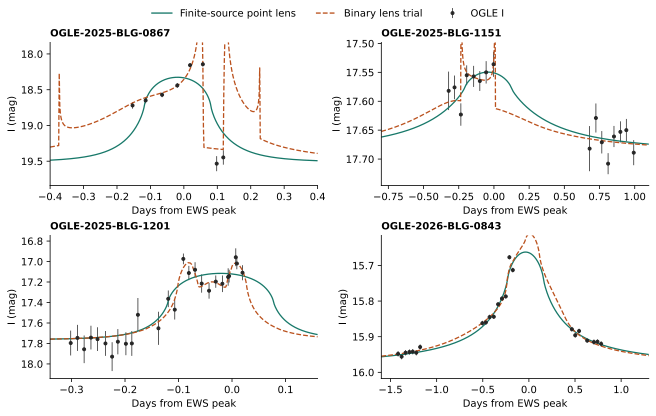

# OGLE-IV EWS • 2025–2026 bulge alerts

Four of 2,429 bulge alerts have a preliminary EWS timescale below 0.5 day. None of the four yields a robust isolated finite-source lens or an angular Einstein radius from the public OGLE data. Three illustrate how the catalog threshold can select an asymmetric transient, a one-sided low-amplitude peak, or an event with a longer timescale once blended source flux is allowed.

| OGLE event | EWS τ (days) | Independent local test | Disposition |
|---|---:|---|---|
| 2025-BLG-0867 | 0.237 | 160 points in ±15 d. Binary trial χ² 159.8, asymmetric profile 162.6, FSPL 444.4. The light curve fades by 1.39 mag in 0.041 d. | Symmetric single lens fails. KMT-2025-BLG-1213 is the independent catalog alias; its preliminary KMT timescale is 17.37 d. |
| 2025-BLG-1151 | 0.293 | Eight measurements precede the EWS peak, followed by 0.682 d without data around the peak and decline. A solution with tE < 0.5 d is within Δχ² = 0.43 of the longer FSPL minimum. Imposing ρ ≥ 1 costs 0.39. | A genuine brightening with little leverage on tE or ρ. Two Gaia sources lie within 0.44″. |
| 2025-BLG-1201 | 0.158 | The FSPL minimum has tE = 0.075 d and ρ = 1.32. Restricting ρ ≤ 1 costs Δχ² = 1.90. On the same 42 points χ² is 53.6 (FSPL), 39.4 (exponential flare pulse) and 25.2 (binary lens trial). The last epoch that night is still elevated. | Partial, structured brightening. Missing decay, unresolved source color and alternative fits prevent an isolated-planet interpretation. |
| 2026-BLG-0843 | 0.371 | 132 local measurements, 0.640 d gap across the catalog peak. A blended FSPL fit yields tE = 3.80 d. Forcing tE ≤ 0.5 d costs Δχ² = 180.4. | KMT-2026-BLG-1569 is the published alert identifier at this position. An eclipsing variable 2.97″ away is a possible contaminating neighbor. |



## Inventory and previous work

The ASCII tables in [tables.json](tables.json) contain 1,528 alerts in 2025 and 952 in 2026. Selecting IDs containing `-BLG-` yields 1,500 and 929. The alert positions occupy 174 and 152 distinct field numbers, respectively. The survey lists 208 observed fields. [catalog.csv](catalog.csv) supplies event IDs, original field/CCD, star number, coordinates, EWS peak time, impact parameter and timescale. [photometry.csv](photometry.csv) records the raw SHA-256, URL, retrieval or validation time, point count, HJD extremes, and the number of measurements around the catalog peak and in either baseline. Its median near-peak gap includes day/night gaps if they fall in the window. The two source tables were fetched on 2026-11-17 at 10:29 UTC. The server reported last modifications on 2025-11-15 14:07:37 UTC and 2026-11-04 18:47:22 UTC, respectively.

Both raw table hashes exactly match the November 15 `results/ogle-dark-lenses/sources.json` freeze. Its deposited `data/screen.csv.gz` has SHA-256 `471e675d35bc07776d8a4b4ccfc56c2976dc4a47ecc01b45d9b967ce6a68069c`. Re-filtering its existing 2,429 bulge rows gives 2,427 successful fits and two “few points” records. Its sole sub-half-day PSPL fit is 2025-BLG-1151 (0.45081 d). That pipeline seeded tE above 0.5 d, removed outliers after a parallax fit and targeted long events. The local fits here allow hour-scale seeds and retain bright peak points. No dark-lens search was repeated. The fetcher, I-band reader, flux/error conversion, PSPL magnification and conditional linear flux solve come from that project. [Earlier analysis](../../ogle-dark-lenses/README.md)

## Local fits and contaminant checks

[vet_short.py](vet_short.py) fits all valid OGLE points within a fixed ±15 d of the EWS peak in linear flux, adding a 0.004 mag error floor and rescaling once using the full outside-±30 d baseline. Source and blend flux must each be nonnegative. No peak residual clipping is applied. PSPL and uniform-disk FSPL are optimized with differential evolution and local multi-start refinement. Each restricted fit reoptimizes the other parameters. The asymmetric model has different rise and fall timescales with the PSPL shape; the flare trial has an exponential rise and decay with the decay constrained to last at least as long as the rise. The static finite-source binary search samples 0.35 ≤ s ≤ 3.5 and 0.0003 ≤ q ≤ 1. These fits test plausible competitors. They do not uniquely identify a binary, constrain an arbitrary wide host, or incorporate a source-color measurement. The underlying χ², timings, fluxes, bounds and checks are in [short-fits.json](short-fits.json). Source/blend zero points follow the earlier lens module. The plotted error bars include the fitted noise inflation.

| OGLE event | Valid epochs | Time span (yr) | Points more than 30 d before / after EWS peak | Gaia DR3 matches within 2″ | VVV DR2 matches within 2″ |
|---|---:|---:|---:|---:|---:|
| 2025-BLG-0867 | 4,558 | 8.70 | 3,913 / 310 | 1 | 1 |
| 2025-BLG-1151 | 4,564 | 8.70 | 4,210 / 89 | 2 | 1 |
| 2025-BLG-1201 | 345 | 8.31 | 278 / 15 | 2 | 2 |
| 2026-BLG-0843 | 5,046 | 9.73 | 4,862 / 8 | 2 | 1 |

No outside-±30 d observing night contains three measurements more than five scaled σ brighter than its curve's median baseline. This recurrence check loses sensitivity in gaps and to eclipses, slow variables, single flares, and infrequent dwarf-nova eruptions. Blended map V−I for the matching OGLE catalog star is 1.684, 2.776 and 1.942 for 0867, 1151 and 0843; 1201's downloaded map is empty. These unresolved baseline colors cannot establish achromatic magnification. Gaia/VVV neighbors and OGLE mean colors are positional and photometric diagnostics. A public CADC ObsCore HST/JWST image-footprint query and ESA Euclid ObsCore image-footprint query returned zero rows at all four positions. The records in [counterparts.json](counterparts.json) include exact query URLs, response hashes and returned rows. Archive coverage and catalog flags cannot replace an imaging contrast curve.

[SkyBoT queries](moving_objects.json) use Las Campanas topocentric ephemerides, a 120″ radius, no orbit-error filter, and up to three distinct epochs in the observed brightening (first, highest-significance, last). The known body 2011 WJ136 reached 4.66″ from 0867 late in its bright night; it was 117″ away during an earlier bright exposure, with V ≈ 22.2. For 1201, 1978 UD5 was 12.02″ away at one bright point and 83.15″ away at a later bright point. A nearby catalogued asteroid merits image-level checking. Centroid tracking and original difference images are pending, as are a source-color measurement, quantitative high-resolution imaging limits, and an end-to-end survey efficiency.

## Additional shared-screen flags

Applying the same five local model families to OGLE-2025-BLG-0643, OGLE-2025-BLG-1002 and OGLE-2026-BLG-0752 gives three more checks. In 0643 the FSPL fit (tE = 0.405 d, ρ = 1.14) is almost indistinguishable from tE ≥ 0.5 d (Δχ² = 0.41) or ρ ≤ 1 (Δχ² = 0.24). A binary trial improves χ² by 54.1 and the exponential pulse by 31.0 relative to FSPL. For 1002, a free-blend FSPL fit gives tE = 7.35 d; restricting tE ≤ 0.5 d costs 429.9. KMT-2025-BLG-1587 is the explicit catalog alias (KMT tE = 1.65 d). In 0752 the double-peaked apex defeats both single-lens fits. The binary trial improves χ² by about 2,058 relative to FSPL and retains sizable residuals. KMT-2026-BLG-1431 is the corresponding alert identifier. [Additional fits](additional-fits.json)

A public KMT positional DIAPL search returned nine patch/overlap series at the position of 0643. Three refer to the same source position within 0.017″. Two of these provide 54 and 56 usable I-band epochs within ±0.5 d from Chile, South Africa and Australia. Their Chilean maxima exceed the robust seasonal baseline by 13.7σ and 11.9σ, respectively. The maximum excursions at neighboring stars 1.43–1.68″ away are substantially smaller. These overlapping-field reductions and cross-site light curves strengthen the case for real variability at the source position. At the EWS coordinates of 1151 and 1201, the KMT query returned no light-curve IDs and a null search center. Further GET requests at larger radii also listed no IDs; direct independent peak coverage remains unverified for these two. [Positional KMT queries and sampled epochs](kmt-positions.json)

The 2,489 entries in [the alias table](kmt-ogle-aliases.csv) include matches explicitly named by KMT or within 2″ and 10 d of another alert peak. For the 2026 KMT inventory, only the public alert cross-identifications and independently available OGLE timescales are reported. [Archive inputs](alias-sources.json) include the 2024 EWS table for cross-identifications only. KMT-2024-BLG-1085, KMT-2024-BLG-2258, KMT-2025-BLG-1883, KMT-2025-BLG-2164, KMT-2025-BLG-3244 and KMT-2025-BLG-3272 have no same-season OGLE EWS alert within 2″; their closest EWS coordinates are 278–691″ away. MOA-2024-BLG-201 and PRIME-2025-BLG-0367 do match KMT-2024-BLG-2258 and KMT-2025-BLG-2164, respectively. [Survey-to-survey matches](../other/matches.csv)

[The complete grid audit](short-grid-audit.csv) checks PSPL and FSPL at each model's own peak over all 2,429 successful OGLE fits. Four PSPL and five FSPL grid winners have tE < 0.5 d (six distinct alerts). Besides the EWS short list, OGLE-2025-BLG-1089 is dominated by a single bright point 12.77 d from the EWS peak; I = 17.184 returns to 20.069 within 0.041 d. OGLE-2025-BLG-1425 has the highest point and three declining measurements with no rising-side points inside 0.5 d of the short grid peak. OGLE-2026-BLG-0517 has seven rising and one peak measurement with no declining-side measurement inside that window, and an FSPL-over-PSPL grid gain of only 3.26. KMT-2025-BLG-1814 and KMT-2025-BLG-2874 independently favor longer timescales for the two 2025 events (101.91 and 6.08 d). KMT-2026-BLG-0900 is the alert identifier corresponding to 0517. Independent continuous FSPL fits on the OGLE photometry alone favor 14.9 d (1425; forcing ≤0.5 d costs Δχ² = 302) and 2.35 d (0517; Δχ² = 128). [One-sided-peak fits](one-sided-fits.json)

These tests use a ±2 minute central bin to avoid counting a peak exposure twice. Fits on these public, triggered curves cannot certify completeness for the surveyed stars. [Raw-byte verification](verified-inputs.json)

Three 2024 OGLE curves provide ancillary checks on KMT flags. OGLE-2024-BLG-0519/KMT-2024-BLG-0816 is a **known finite-source FFP candidate** published by Poleski et al. The independent OGLE-only model improves on PSPL by Δχ² = 198.0 on 67 local epochs (tE = 0.476 d, ρ = 0.943); these sparse OGLE data alone also admit a binary trial with similar χ². The published work uses additional KMT photometry and discusses unresolved blended light. In OGLE-2024-BLG-0680/KMT-2024-BLG-1235, a finite-source binary trial obtains χ² = 79.7 versus 319.2 for the best single lens. OGLE-2024-BLG-0825/KMT-2024-BLG-1518 is a previously published binary brown-dwarf candidate despite the OGLE EWS timescale of only 0.183 d. [Ancillary fits](kmt-2024-alias-fits.json) · [Poleski et al. 2025](https://acta.astrouw.edu.pl/Vol75/n4/a_75_4_1.html) · [Han et al. 2025](https://mro.massey.ac.nz/server/api/core/bitstreams/760d7358-21cd-4aae-bc5d-f9b7e6e7bc38/content)

### Independently public 2026 control

Qian et al. identify KMT-2026-BLG-0357 as OGLE-2026-BLG-0156. The authors' Tables 1 and 2 give tE = 1.667 ± 0.011 d, ρ = 0.1783 ± 0.0014 and θE = 36.5 ± 3.7 μas. This known event is outside both selection cuts. Using the public OGLE curve alone (5,076 epochs, 50 within the local ±15 d window), the FSPL solution gives tE = 1.53 d, ρ = 0.185 and χ² = 28.5, versus χ² = 61.6 for PSPL. Restricting tE to at most 0.5 d costs Δχ² ≈ 2,057. The quoted angular radius comes from the paper's source characterization. The paper contains figures and model tables. The text did not identify a machine-readable follow-up-photometry release. Searches of DataCite (dataset titles) and the public Las Cumbres image archive (target footprint, March 30–April 4) returned zero records for the queries in the receipt. No KMT 2026 photometry was used. [Published paper](https://arxiv.org/abs/2611.00754) · [Public-source query record](known-2026-public-sources.json) · [Independent OGLE-only fit](known-2026-OGLE-only.json)

## Five-exposure coverage

The frozen archive comprises 4,339,671 measurements and 165,027,725 input bytes across all 2,429 curves. For each alert star, [window.py](window.py) integrates over a uniform peak time from February 1 to November 1 in its alert season. An injected noiseless signal must brighten five consecutive valid observations by at least three times their baseline flux errors (quoted magnitude errors, 0.004 mag floor, robust full-curve scatter). The union of qualifying time intervals is evaluated exactly for each model using actual archived timestamps. Each curve receives equal weight in a given year/field. The test assumes u0 = 0.5 and a uniform-brightness source. FSPL uses ρ = 1.5. Source fractions are unity except for the last column, where the source contributes 30% of baseline light. The published EWS trigger uses five consecutive difference detections, prior-season variable masking and human inspection; its actual photometric detection threshold and selection function are not calibrated by this calculation.

| Year | 2 h PSPL | 6 h PSPL | 12 h PSPL | 6 h FSPL | 6 h FSPL, blended |
|---|---:|---:|---:|---:|---:|
| 2025 | 1.19% | 5.56% | 9.72% | 7.04% | 3.27% |
| 2026 | 0.94% | 4.13% | 6.66% | 5.13% | 2.67% |

The denominator is peak time at already-alerted stars. No surveyed-star denominator, full detection pipeline, model-classification recovery, or correction for unalerted stars enters this table. [Results by field](window_by_field.csv)

## Source colors for two large-ρ models

Neither KMT-2024-BLG-1516/OGLE-2024-BLG-0859 nor KMT-2025-BLG-2688 yields an independently calibrated angular source radius. The 1516 source position coincides with a Gaia DR3 long-period variable, and the KMT event shapes admit a much better binary-lens fit. For 2688, models with ρ ≤ 1 remain competitive. These conditions prevent an angular Einstein radius or a lens-mass posterior from being inferred for either event.

We measured the local red clump in 2-arcmin VVV DR2 fields. A Gaussian clump plus an exponential background was fitted to the Ks luminosity function for 0.8 < J−Ks < 1.8; the clump color is the median within 0.22 mag of the fitted peak. For 1516 the result is Ks = 13.20, J−Ks = 1.181 (248 stars); for 2688 it is Ks = 13.20, J−Ks = 1.014 (323 stars). Repeating with 60″ and 90″ radii changes the median color by at most 0.026 and 0.007 mag, respectively. A clump intrinsic J−Ks = 0.68 gives nominal color excesses of 0.501 and 0.334 mag. A source in front of the clump can suffer less extinction. [Gonzalez et al. 2012](https://www.aanda.org/articles/aa/pdf/2012/07/aa19222-12.pdf)

The closest VVV DR2 detections are 0.104″ (1516; J = 13.012, Ks = 11.583) and 0.814″ (2688; J = 13.400, Ks = 12.382). VIRAC2 reports one source within 1.5″ of 1516 (0.055″, Ks = 11.666); at 2688 it resolves three (0.075″, Ks = 14.886; 0.862″, Ks = 12.554; 0.942″, Ks = 13.996). The brightest infrared object near 2688 is offset from the alert coordinates. An image-subtraction centroid registration would be needed to establish which star brightened. [VIRAC2 release](https://www.eso.org/sci/publications/announcements/sciann17684.html)

OGLE's baseline map for 1516 gives V = 19.189, I = 15.428 and V−I = 3.761 for star 214764. A variable neighboring source, source variability, or blended light can change either mean color or the fraction of flux in a band. The KMT Chilean V difference-flux amplitudes are formally detected relative to the tested FSPL shape (two fields: 18.8σ and 23.1σ for 1516, 5.6σ and 7.9σ for 2688). Photometry in these V files has relative counts but no calibrated V magnitude or matched reference-star V zero point. The flux-ratio tests condition on a shared event shape and independent noise; intrinsic variability, nightly correlations and a different lens model can alter them.

The table gives an illustrative angular **source radius** interval for a giant only, given three assumed fractions of the catalog Ks light. We used the Adams et al. giant-star calibration in its published color range 2.049 ≤ (V−K)₀ ≤ 3.839. Its relation is log₁₀(θ_diameter/mas) = 0.562 + 0.051(V−K)₀ − 0.2K₀. The envelope spans the observed aperture-to-aperture clump-color variation, an extra ±0.05 mag in E(J−Ks), extinction coefficients A_Ks/E(J−Ks) of 0.428–0.528, ±0.05 mag in the K magnitude and ±0.019 dex calibration scatter. The radius scales as the square root of the source fraction at fixed color. The catalog offset for 2688 and possible contamination or intrinsic variability for 1516 leave the actual fractions open, including values below 0.1. The table contains conditional sensitivities, with no probability assignment. It does not establish a physical size for a variable star outside the color or luminosity range of the calibration. [Adams et al. 2018, Table 3](https://chara.gsu.edu/files/papers/2018_Adams_MNRAS_473_3608.pdf) · [Alonso-García et al. 2017](https://arxiv.org/abs/1710.04854)

| Source hypothesis | All Ks light (μas) | Half the Ks light (μas) | One tenth of the Ks light (μas) |
|---|---:|---:|---:|
| 1516, VVV DR2 catalog flux | 11.38–16.88 | 8.05–11.94 | 3.60–5.34 |
| 2688, VVV DR2 catalog flux, 0.814″ offset | 7.66–11.23 | 5.42–7.94 | 2.42–3.55 |
| 2688, closest VIRAC2 source, 0.075″ offset | 2.42–3.54 | 1.71–2.51 | 0.76–1.12 |

The individual VIRAC2 all-light hypotheses for the other two stars near 2688 give 7.08–10.38 and 3.64–5.34 μas. The 1516 VIRAC2 all-light hypothesis gives 10.95–16.24 μas. Registration and band-dependent blending thus dominate the size uncertainty for 2688. For 1516 the intrinsic luminosity variation and lens-model ambiguity limit the interpretation despite better association.

[Source photometry, red-clump fits and conditional angular radii](source-size-cases.json) · [Reproduction script](source_size.py)

## Reproduce

From the repo root with Python, NumPy, SciPy, pyerfa, Matplotlib and VBMicrolensing 5.6.1 installed:

```sh
python results/ultrashort-bulge/ogle/freeze.py /path/to/ogle-cache --jobs 6
python results/ultrashort-bulge/ogle/vet_short.py /path/to/ogle-cache
python results/ultrashort-bulge/ogle/vet_short.py /path/to/ogle-cache --events 2025-BLG-0643 2025-BLG-1002 2026-BLG-0752 --output additional-fits.json
python results/ultrashort-bulge/ogle/vet_short.py /path/to/ogle-cache --events 2024-BLG-0519 2024-BLG-0680 2024-BLG-0825 --output kmt-2024-alias-fits.json
python results/ultrashort-bulge/ogle/vet_short.py /path/to/ogle-cache --events 2025-BLG-1425 2026-BLG-0517 --output one-sided-fits.json
python results/ultrashort-bulge/ogle/vet_short.py /path/to/ogle-cache --events 2026-BLG-0156 --output known-2026-OGLE-only.json
python results/ultrashort-bulge/ogle/kmt_positions.py /path/to/kmt-position-cache
python results/ultrashort-bulge/ogle/counterparts.py /path/to/counterpart-cache
python results/ultrashort-bulge/ogle/moving_objects.py /path/to/ogle-cache
python results/ultrashort-bulge/ogle/verify_inputs.py /path/to/ogle-cache
python results/ultrashort-bulge/ogle/screen_audit.py /path/to/ogle-cache results/ultrashort-bulge/tables/grid-fits.csv.gz
python results/ultrashort-bulge/ogle/aliases.py /path/to/ogle-cache
python results/ultrashort-bulge/ogle/source_size.py --cache /path/to/color-cache --archives /path/to/released-kmt-archives
python results/ultrashort-bulge/ogle/window.py /path/to/ogle-cache
python results/ultrashort-bulge/ogle/plot_short.py /path/to/ogle-cache
```

Public EWS photometry is preliminary. OGLE requests contact before publication using the photometry. [2025 EWS](https://ogle.astrouw.edu.pl/ogle4/ews/2025/ews.html) · [current EWS](https://ogle.astrouw.edu.pl/ogle4/ews/ews.html) · [Udalski et al. 2015](https://acta.astrouw.edu.pl/Vol65/n1/a_65_1_1.html) · [SkyBoT](https://ssp.imcce.fr/webservices/skybot/api/conesearch/)
