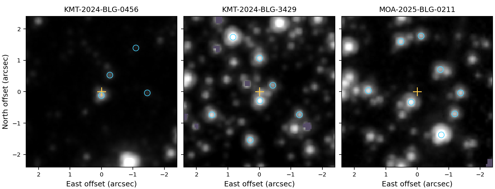

# MOA, PRIME, Gaia and precursor archives

**The 36 MOA/PRIME survey fits with positive reported Einstein times below 0.5 day do not establish 36 ultrashort lenses.** Thirty-five have published impact parameter greater than one. The remaining event, MOA-2024-BLG-111, is KMT-2024-BLG-1713. Six KMT streams give a continuous PSPL fit of 1.615 days and FSPL fit of 1.503 days. Its MOA-only PSPL fit gives 0.634 days. The published MOA-to-KMT separation of 2.097 arcsec exceeds the positional search radius, demonstrating the importance of the survey aliases. KMT also lists OGLE-2024-BLG-0926 and 0927; MOA lists 0927. A second model can still fit a high-impact-parameter light curve because, in the weak-magnification limit, its excess width depends primarily on the product of impact parameter and Einstein time. The catalog PSPL full widths at half peak excess are in `short_alert_checks.csv`.

## Completed measurements

| Survey | 2024 | 2025 | 2026 | Material frozen |
|---|---:|---:|---:|---|
| MOA BLG | 285 | 390 | 24 | Every bulge alert and its public difference-flux file, excluding non-BLG targets |
| PRIME BLG | 284 | 472 | 214 | All retrospective 2024 entries and all 2025–26 real-time BLG entries |
| Gaia main alerts, absolute Galactic longitude <10°, absolute latitude <7° | 89 | 0 | 0 | Every in-footprint 2024–26 trigger, all classes, indexed by observation date. Two light curves have just two trusted numeric magnitudes apiece. |

The six MOA/PRIME lists produced 1,669 event IDs and 18,643,970 usable measurements. Each photometry URL, upstream-byte SHA-256, retrieved time, native field, passband-bearing internal ID, time span, cadence and fitted catalog parameters are in `photometry.csv`. Telescope windows and field weather gaps can be long. The median in `fields.csv` includes only positive adjacent gaps under half a day and describes sampled alerts. The parent directory fits the common model bank on these epochs.

Gaia’s main index contains 27,076 alert rows. Science observations ended on 15 January 2025. Gaia provides G magnitudes and JD(TCB) without per-transit uncertainties. For screening, each of the 87 curves with three or more usable measurements receives a robust source-specific error estimated off the trigger and floored at 0.02 mag. Queries and observation counts are in `gaia.csv`. The ancillary GaiaX stream reports individual single-field-of-view detections by processing run and lies outside this main-alert light-curve sample.

## Selected checks on the photometry

| Event | Discriminating observation |
|---|---|
| MOA-2025-BLG-0198 | MOA labels it a CV. Independent excursions with at least three consecutive points above five robust standard deviations in one day occur in 2011 and 2016, in addition to the 2025 outburst. |
| MOA-2025-BLG-0093 | Six MOA points near maximum; an asymmetric flare lowers chi-square by 2.7 against FSPL. All five nearby KMT field-star curves miss the peak, with the closest KMT point 6.64 hours earlier. Gaia and VVV neighbours at 0.413 and 0.263 arcsec cannot identify the magnified source color. No known SkyBoT object within 120 arcsec at the observed peak; HST/JWST and Euclid Q2 footprint queries return zero. |
| MOA-2025-BLG-0211 | Both Australian KMT fields and New Zealand MOA independently detect the abrupt rise and decay. The correct cross-site match is 0.195 arcsec away. Joint seven-stream fits after DIAPL quality cuts favor a fast-rise exponential over FSPL by 539–644 in chi-square, including a sensitivity test shifting MOA clock alignment by ±0.0058 d. A raw fit retaining all records is corrupted by exceptional photometric errors, including a million-count excursion with zero DIAPL chi-square. SkyBoT returned zero known objects within 120 arcsec. Euclid Q2 has pre-event image products at this position. |
| MOA-2025-BLG-0281 / 0340 | Two detector fields, 0.235 arcsec separation and near-coincident peak. Both show variation over days. An asymmetric model improves chi-square over FSPL by 121 and 268 in separate fits. |
| MOA-2024-BLG-055 | The high-impact-parameter catalog fit returns 0.04 d; six additional seasons contain robust three-point excursions, and the continuous FSPL improvement over PSPL is only 12.3. |
| MOA-2024-BLG-109 / 260 | Distinct events: MOA 109 has official KMT-2024-BLG-1698 counterpart, catalog tE=138.06 d, and is labelled microlensing/CV by MOA. MOA 260 has an explicit KMT-2024-BLG-2600 alias with catalog tE=34.46 d. A short modeled feature is insufficient to classify either as an isolated lens. |

`official_links.csv` retains the project’s matches, including broad positional and epoch offsets. `matches.csv` provides a separate 2-arcsec spatial search against the frozen OGLE, KMT, MOA, PRIME, and Gaia main alert lists, and the signed difference of the available peak or trigger epochs. Both can include unresolved neighbours and recurrent sources. `seasonal_recurrence.csv` records, per season, the strongest consecutive triple spanning less than one day using the reported flux uncertainty and seasonal MAD in quadrature. This statistic also responds to seeing-dependent blends, changing reference images and correlated subtraction errors.

`catalog_query_receipts.csv` and `catalog_neighbours.csv` cover the 36 catalog-short MOA/PRIME alerts, four OGLE catalog-short alerts and selected additional photometric checks. External queries used 2-arcsec cones against Gaia DR3 and VVV DR2. A missing response or a truncated VizieR header is recorded as an error. `imaging_queries.csv` and `imaging_products.csv` list the actual MAST HST/JWST and IRSA Euclid Q2 footprint responses. A science, background and weight product for one dither can appear separately. Normalize by observation and validate individual pixel masks before counting independent epochs. None of these positional or imaging queries provides a host contrast curve.

## Published comparison events

The merged list contains 34 distinct objects. It includes the six Mróz et al. 2017 PSPL candidates and their Keck/EWS identifications (six Keck targets, five narrow-camera host searches), all 12 sub-day objects in the MOA nine-year Tables 3–4, the 11 KMT archive FFP entries, the earlier OGLE-2012-BLG-1323 FSPL event and four added comparison objects including the 2025/26 papers. Koshimoto et al. measured significant finite-source signals in MOA-9y-770 and MOA-9y-5919. Sumi et al. used the same underlying survey sample. Gould et al.'s four low-radius FFPs and the Ryu et al. event refer to existing rows. The two high-radius objects in the October 2026 preprint and the 2022 upper-shore brown dwarf provide comparison cases. [2017 PSPL survey](https://arxiv.org/abs/1707.07634) · [Keck follow-up](https://arxiv.org/abs/2303.04610) · [MOA event catalog](https://arxiv.org/abs/2303.08279) · [MOA mass function](https://arxiv.org/abs/2303.08280) · [Gould giant-source analysis](https://arxiv.org/abs/2204.03269) · [KMT archive](https://kmtnet.kasi.re.kr/exoKMTNet/) · [2026 comparison paper](https://arxiv.org/abs/2611.00754)

Seven survey IDs match five already-published objects by name or explicitly documented alias. These are KMT-2024-BLG-0792/Gaia24cdn, KMT-2024-BLG-0816, KMT-2024-BLG-3237, KMT-2025-BLG-2093 and KMT-2026-BLG-0357/OGLE-2026-BLG-0156. None of the other historical targets falls within 3 arcsec of the position-bearing frozen releases. The 2026 KMT roster supplies IDs for this check. The 2024 OGLE annual catalog lies outside the requested 2025–26 census, though 0516 and 0519 are known 2024 OGLE aliases. `known_roster.csv` contains published source links and parameters where extracted, `known_matches.csv` reports separations and time offsets, and `known_sources.csv` gives original-file hashes. A match at another epoch would count as a shared sightline only. Completeness is limited to the named published catalogs and retrieved new papers. For the known Saturn-mass Gaia24cdn lens, September 2026 GRAVITY follow-up reported correlated-noise 5σ main-sequence host limits of roughly 0.5 solar mass at 10 au and 0.6 solar mass at 90 au. These limits apply to that published event only. [Mróz et al. interferometric follow-up](https://arxiv.org/abs/2609.12743)

## A long finite-source alternative and a variable counterpart

KMT-2024-BLG-1516 coincides with MOA-2024-BLG-113, PRIME-2024-BLG-109 and OGLE-2024-BLG-0859. The four surveys record a weeks-long brightening. Separate full-curve fits give FSPL Einstein times of 10.67 d (OGLE), 26.88 d (MOA) and 5.04 d (PRIME) with normalized radii 2.26, 0.65 and 4.26 respectively. OGLE's fitted source flux reaches the adopted upper limit, 1.15 times its baseline. The MOA and PRIME curves supply difference flux. The event is outside the ultrashort-timescale sample.

A fixed-geometry prediction used KMT's six-stream point-source, finite-source and competing binary fits, the same ±32-day window and 0.18-day bins. Only the baseline and positive source flux were fitted to each held-out curve. The KMT binary lowers chi-square by 2,203 on KMT itself. On independent data it increases chi-square relative to KMT's FSPL shape by 49.0 (MOA) and 31.3 (OGLE), and lowers it by 1.7 (PRIME). Relative to KMT's PSPL shape, the FSPL shape lowers chi-square by 181.3 (OGLE) and 24.1 (PRIME) and increases it by 55.7 (MOA). The three bands do not validate a unique geometry. [Per-survey fits](long_fs_independent.csv) · [Held-out scores](long_fs_heldout.csv)

Gaia DR3 source 4063555424531757184 lies 0.074 arcsec from KMT-1516, with G = 17.065 and BP−RP = 3.179. The DR3 long-period variable classifier and specialist catalog flag this source; 29 pre-2024 Gaia G transits span 966.7 days with a 0.145-mag range. The specialist catalog supplies no period. VVV gives J/H/Ks = 13.012/12.052/11.583 at 0.104 arcsec. This supplies a measured variable-source or blend alternative. Establishing whether the 2024 brightening is separate microlensing requires difference-image astrometry, time-resolved source colors, variable-baseline modeling and a common fit across the four surveys. [Gaia class and statistics](long_fs_gaia.json) · [Gaia and VVV positions](long_fs_catalog_neighbours.csv) · [Previous observing seasons](long_fs_baselines.csv)

## Resolved Euclid VIS fields

The March 2025 EGBS exposures were taken after both KMT events and before the MOA event. For each target, `euclid_scene.py` validates the HTTP byte ranges and FITS headers for the containing 2048 by 2066 detector quadrant, uses its TPV astrometric solution, and extracts a 61 by 61 pixel science/quality patch. The mask preserves the documented astronomical-object and star-signal bits while excluding other flags. Positions come from local, background-subtracted peaks that recur within 0.10 arcsec across multiple exposures. The 2.3-pixel-radius apertures use a local annulus and do not correct for PSF wings or crowded neighbours. [Euclid Q2 release](https://irsa.ipac.caltech.edu/data/Euclid/docs/overview_q2.html) · [VIS flag definitions](https://euclid.esac.esa.int/msp/dpdd/v1.1/visdpd/dpcards/vis_flagmap.html)

Seven different exposures were requested per field. Six per field yielded a complete, validly located cutout. Three queries could not place an entire patch on a searched quadrant. The other 18 exposures cover different positions on the physical detectors. Their 20.1 MB of FITS header and pixel ranges are recorded in 276 receipts, including reads for discarded exposures. [Repeat-exposure separations and aperture magnitude differences](euclid_scene_pairs.csv)

| Alert | Measured scene |
|---|---|
| KMT-2024-BLG-0456 | Two peaks recur at 0.112 and 0.595 arcsec from the alert position. Their median mutual separation is 0.699 arcsec and their median aperture difference is 1.77 mag (range 1.70–2.06). |
| KMT-2024-BLG-3429 | Peaks at 0.288 and 0.470 arcsec are separated by 0.636 arcsec with aperture difference 1.55 mag (range 1.48–1.63). A third bright source at 1.073 arcsec is also present in all six exposures. |
| MOA-2025-BLG-0211 | The closest repeated peak lies 0.388 arcsec from the alert position. A second confidently repeated peak lies 1.017 arcsec from that position. Their mutual separation is 1.390 arcsec and their aperture difference is 0.63 mag. |



The cross marks the alert coordinate. Circles mark local maxima seen in at least three exposures. Purple pixels lack an accepted measurement in the registered stack. Detection lists use the native pixels, while this visualization uses a WCS-registered median and an independent asinh display stretch in each field. Cross-survey astrometric errors can exceed the scatter between Euclid exposures. The event images supply neither the centroid of the varying flux nor a mass-dependent host-detection efficiency. [Exposure and mask checks](euclid_scene_checks.csv) · [Repeated peaks](euclid_scene_sources.csv) · [Range receipts](euclid_scene_receipts.csv)

## What the precursor releases contain

| Release | Coverage and use |
|---|---|
| UKIRT WFIRST/Roman precursor | NASA Exoplanet Archive serves 100.5 million band/season light curves, 2015–19. H-band coverage in 2015 was five epochs/night; 2016 was two to three. Later H/K survey fields have tiered cadence. These curves can provide pre-event baselines; they have zero epochs during 2024–26. |
| Euclid Galactic Bulge Survey Q2 | VIS observations on 23–24 March 2025. Each of nine fields has sixteen 400-s dithered images and calibrated source catalogs, ≲10-minute cadence over about two hours per field. This is an archival imaging and source-catalog release. No new season-long per-alert curves were ingested. |
| HST THOR, GO-17776 | The 2026 early release contains source-level ACS/WFC3 photometry and astrometry for eight detector fields, with GO-17173 and Gaia cross-identifications. HAP drizzled images can be searched in MAST. The release has no separate catalog of 2024–26 ultrashort alert light curves. |
| Roman Galactic Bulge Time Domain Survey | The STScI schedule places the first high-cadence season in 2027. |
| MOA-II archive and ROME/REA DR1 | Historical resources for color, recurrence and published controls. The pre-2015 MOA release is distinct from the recent alert photometry. ROME/REA observed 2017–20; the release date is later than the observations. |

Primary release endpoints and body hashes are in `archive_receipts.csv`. This work uses ESA Gaia, DPAC and the Photometric Science Alerts Team, the MOA and PRIME collaborations, KMTNet, the VVV team, CDS/VizieR, MAST, and the Euclid Q2 archive (DOI 10.26131/IRSA661). All product links point to the supplying archive.

## Reproduce

Run these from the repository root, with NumPy, SciPy, lxml and the parent fitting dependencies installed.

```bash
python results/ultrashort-bulge/other/fetch.py
python results/ultrashort-bulge/other/gaia.py
python results/ultrashort-bulge/other/official_links.py
python results/ultrashort-bulge/other/diagnostics.py
python results/ultrashort-bulge/other/crossmatch.py --add MOA-2025-BLG-0093 MOA-2025-BLG-0301 MOA-2025-BLG-0211 PRIME-2025-BLG-0415 PRIME-2024-BLG-171
python results/ultrashort-bulge/other/imaging.py
python results/ultrashort-bulge/other/independent.py --joint
python results/ultrashort-bulge/other/precursors.py
python results/ultrashort-bulge/other/known.py
python results/ultrashort-bulge/other/long_fs.py
python results/ultrashort-bulge/other/long_fs_heldout.py
python results/ultrashort-bulge/other/long_fs_gaia.py
python results/ultrashort-bulge/other/euclid_scene.py
python results/ultrashort-bulge/other/euclid_figure.py
```

`fetch.py` retains original response hashes, cached compressed arrays, and recoverable per-event JSON records. The fourteen additional continuous lead fits in `refined_leads.csv` use the parent `refine.py`, with the event IDs in its first column, `--grid staging/screen` and separate output directory. The literature extractor requires Poppler `pdftotext`. A fresh cache may retrieve a newer survey reduction. Compare the hashes before combining runs. Some PRIME photometry contains exceptionally small formal uncertainties; the parent fitting code floors anomalous weights. MOA and KMT use survey time conventions; the joint sensitivity test covers the maximum light-time offset between JD and HJD.

## Outstanding

The archival VIS images have not been PSF fitted or registered to MOA or KMT difference-image centroids. No angular source radius, calibrated exclusion of a host, completeness-corrected rate, or mass posterior follows for the unvalidated MOA/PRIME candidates. The snapshot counts publicly alerted event streams, including duplicates and contaminants. It omits brief signals the alert algorithms missed.

This work has made use of the Quick Release 2 (Q2) data from the Euclid mission of the European Space Agency (ESA).
