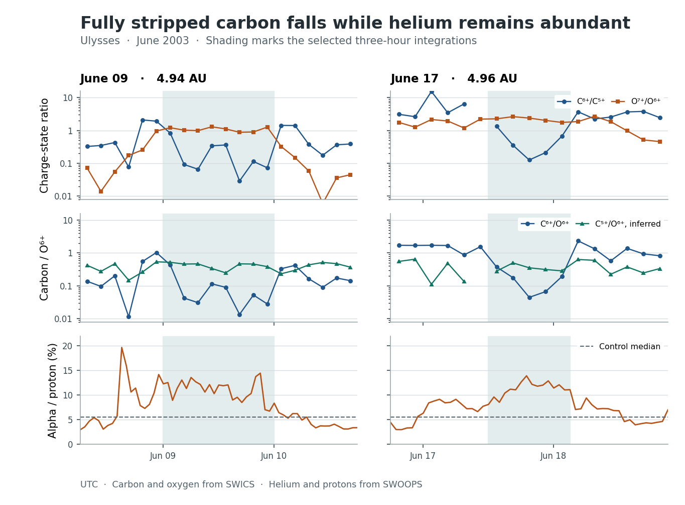

# Two catalogued helium-rich solar ejecta with selective C⁶⁺ suppression near 5 AU

Ulysses measured a sustained suppression of fully stripped carbon in two separate solar ejecta on 9 June and 17–18 June 2003. The spacecraft was at 4.94 and 4.96 AU. In both intervals oxygen and iron remained highly ionized, and a separate plasma instrument measured abundant fully stripped helium. These are the longest and second-longest intervals meeting the composition cut below across the archived 1990–2009 Ulysses/SWICS series. **Both ejecta had already been catalogued as ICMEs. The new result is the selective deficit of fully stripped carbon (C⁶⁺) relative to O⁶⁺ in those known events**, together with its duration ranking and the independent helium comparison. The observations do **not** establish depletion of total elemental carbon.

| Median or count | June 9 | June 17–18 | Other fast, high-charge June samples |
|---|---:|---:|---:|
| SWICS three-hour samples | 8 | 5 | 43 |
| C⁶⁺/C⁵⁺ | 0.103 | 0.355 | — |
| O⁷⁺/O⁶⁺ | 1.067 | 2.261 | — |
| Mean Fe charge, in elementary charges | 13.6 | 13.7 | — |
| C⁶⁺/O⁶⁺ | 0.0474 | 0.1773 | 1.698 |
| Inferred C⁵⁺/O⁶⁺ | 0.460 | 0.314 | 0.364 |
| SWOOPS alpha/proton number ratio | 11.36% | 11.44% | 5.54% |
| SWOOPS proton speed, km/s | 622 | 557 | — |

The typical C⁶⁺/O⁶⁺ in the two episodes was 36 and 9.6 times below the comparison median. Even within each enclosing ejecta, other available bins had C⁶⁺/O⁶⁺ medians of 0.442 and 1.694, respectively (4 and 16 bins). Carbon in the adjacent charge state was similar to the comparison plasma. Because helium nuclei and C⁶⁺ share the same mass-to-charge ratio, their simultaneous behavior constrains explanations that would suppress all fully stripped species equally relative to the surrounding plasma.

## Search and controls

Use one integration timestamp as the observing unit. Read all 20 annual NASA/SPDF charge-ratio files, sort by time, and exclude both records at each of 11 ambiguous repeated timestamps. Require positive carbon and oxygen ratios, positive mean Fe charge, and at least 9 instrument cycles. Of 51,097 input records, 43,224 meet those criteria after deduplication. Define the contrast as (C⁶⁺/C⁵⁺)/(O⁷⁺/O⁶⁺). Its full-sample median is 7.65. Flag contrast below 1 with O⁷⁺/O⁶⁺ above 0.15 to keep weak oxygen signals from determining the selection. A failed row or gap exceeding 4.5 hours ends a run. The 357 flagged samples form 255 runs. The first archived timestamps of the two longest runs are 2003-06-09 00:25:23 and 2003-06-17 12:12:04 UTC. The last timestamps are 21:02:13 on June 9 and 00:12:28 on June 18. Each timestamp labels an integration with nominal duration three hours.

The two lead runs also rank first and second at a contrast threshold of 0.75, including when at least 11 instrument cycles are required. At 0.5, the first still leads with seven bins and four bins survive in the second. At 0.3 each retains three bins. Thresholds are exploratory. The ranking is a count across the archived mission coverage. Solar-wind time series have serial correlation, so a binomial calculation on the number of consecutive samples would overstate significance.

The separate SWICS moments archive supplies C⁶⁺/O⁶⁺ for each selected bin. Dividing this measurement by C⁶⁺/C⁵⁺ gives the listed C⁵⁺/O⁶⁺. The two SWICS products share ion counts. For the 43 comparison bins, require the same month and instrument, O⁷⁺/O⁶⁺ ≥ 0.5, mean Fe charge ≥ 12, alpha speed ≥ 500 km/s, at least nine cycles and valid measurements for both carbon comparisons. Exclude both selected intervals. The lowest control C⁶⁺/O⁶⁺ is 0.3624. The selection uses a carbon ratio, so this comparison measures the size and charge-state specificity of the deficit. It cannot provide a blind significance test. One selected bin has a missing SWICS alpha speed. All selected bins have independent hourly plasma coverage.

The native SWICS matrix counts provide a check upstream of the abundance estimates. From 30 daily CDFs, sum all 64 energy steps in each of the nominal C⁴⁺/C⁵⁺, C⁶⁺ and O⁶⁺ matrix channels, discarding non-nominal voltage cycles and invalid steps. Group by three-hour UTC window and require at least nine valid scans with O⁶⁺ counts. The median nominal C⁶⁺/O⁶⁺ count ratios are 0.213 and 0.385 (104 and 64 scans), compared with 2.541 in the 42 usable control bins (546 scans; one further bin has zero O⁶⁺ channel counts). The C⁴⁺/C⁵⁺ channel divided by the O⁶⁺ channel yields 1.063 and 1.050 versus a control median of 1.149. The deflection cycles are nominal and the post-acceleration voltage is 22.6 kV throughout the event and control scans. Matrix channel counts precede the abundance fit but come from the same sensor. Neighboring elements spill into these channels, and channel ratios have different instrumental efficiencies from calibrated abundance ratios.

The SWOOPS plasma instrument supplies the independent alpha/proton number ratio and speed. All 24 and 15 hourly samples within the approximate integration windows provide both densities. The full June median alpha/proton ratio was 4.67% over 720 hours. HELIO4CAST ICMECAT v2.3 gives distinct magnetic-obstacle intervals enclosing the two selections, 8 June 15:00 to 10 June 01:00 and 15 June 16:00 to 18 June 08:00 UTC. A third cataloged obstacle passed between them. The archived ion products do not establish a common source or trace the material continuously out from the Sun.

## Prior work and scope

ACE/SWICS established depleted regions within near-Earth ejecta, and Solar Orbiter later measured analogous charge-ratio outliers. Ulysses magnetic-cloud studies have also used high oxygen charge states. A bounded search for these Ulysses dates, their carbon charge-state contrast and the paired outer-heliosphere observation did not locate an earlier event-specific report of this combination; it does not establish publication priority. The underlying ICMEs, the individual spacecraft measurements, and the general class of ion anomaly are already public. This analysis identifies the intervals, quantifies their exceptional duration in this archive, and measures their carbon and helium abundances against contemporaneous controls.

C⁶⁺ is measured by one composition spectrometer. A second composition instrument or a separate reduction of individual pulse-height events could test the absolute abundances and the detector response to nearby species. The spacecraft sampled different parcels and heliocentric locations. The measured helium enrichment permits comparison with models of depleted ejecta, while specific acceleration, composition-gradient and transport explanations require additional evidence.

- Event boundaries and spacecraft positions come from the [HELIO4CAST ICMECAT v2.3 release](https://doi.org/10.6084/m9.figshare.6356420.v24).
- SWICS data, instrument cycles, units and the zero-as-missing convention are documented in the [Ulysses team’s data description](https://spdf.gsfc.nasa.gov/pub/data/ulysses/plasma/swics/new_readme.txt).
- SWOOPS plasma and magnetometer observations are available from the [NASA COHOWeb Ulysses archive](https://omniweb.gsfc.nasa.gov/coho/form/ulysses.html).
- Published comparison studies include [Anatomy of Depleted Interplanetary Coronal Mass Ejections](https://doi.org/10.3847/1538-4357/834/2/147), [Solar Orbiter Heavy Ion Sensor results](https://doi.org/10.1051/0004-6361/202346304), and [Ulysses magnetic-cloud oxygen charge states](https://doi.org/10.1029/2003JA010156).

## Reproduce

Run `python replay.py` with pandas and NumPy installed. It regenerates `measurements.json`, the 13 individual `episode_samples.csv` rows, and all 255 runs in `screened_runs.csv` from compact tables. The mission table contains the timestamp, two ratios encoded losslessly as integers, iron-charge validity, and instrument-cycle count for every input row. The June tables preserve the event and control plasma, composition, matrix-count and catalog measurements used in this comparison.

Run `python replay.py --fetch /path/to/cache` with cdflib also installed to fetch the 53 original science files, verify their SHA-256 hashes and rebuild the compact tables before replay. Use `python plot.py` with matplotlib to regenerate the figure. All source URLs, byte counts and hashes are in `sources.json`.

