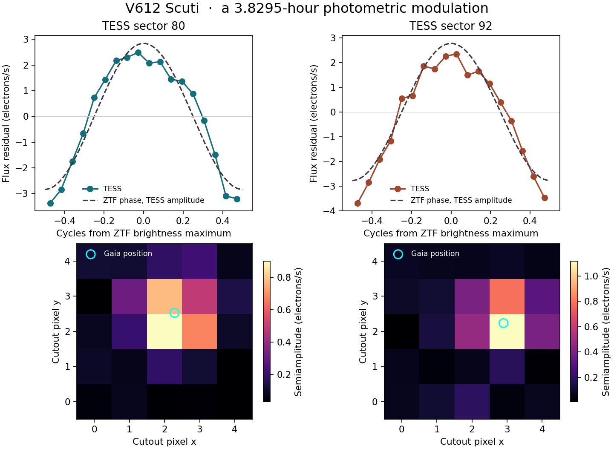

# A 3.8295-hour optical modulation at the position of V612 Scuti

The source that erupted in 2017 as ASASSN-17hx shows a coherent **0.1595620-day photometric period** during its late decline. ZTF measured the modulation over 2,363 days. A search of independent TESS photometry from each of two years recovered the same frequency as its strongest peak. The phase of maximum brightness agrees across all three data sets. A binary orbit is a plausible interpretation. A harmonic, spin modulation or another periodic source unresolved within the ground-based image remains possible.

V612 Sct has unusually massive ejecta and a debated progenitor. The new clock supplies a spectroscopic prediction for this particular system. An orbital radial-velocity signal could occur at 3.8295 hours or at 7.6590 hours if the optical waveform repeats twice per orbit. It also distinguishes this late modulation from the weeks-long rebrightenings documented during the 2017 eruption. [Mason et al. 2020](https://doi.org/10.1051/0004-6361/201937025) · [2026 spectroscopic study](https://doi.org/10.1093/mnras/stag1676)



## Measurements

| Data set | Measurements | Strongest period or frequency from its own search | Phase residual against ZTF |
|---|---:|---:|---:|
| ZTF g, early 65% | 160 | 0.15956143 d | Training sample |
| ZTF g, final 35% | 86 | 0.15956242 d | +0.0246 cycles vs. early-only prediction |
| TESS sector 80, 2024 | 7,563 | 6.26730 cycles/day | +0.0002 cycles vs. all ZTF |
| TESS sector 92, 2025 | 9,164 | 6.26588 cycles/day | +0.0073 cycles vs. all ZTF |

The joint ZTF sinusoid has semiamplitude 0.0440 mag and brightness maximum at BJD(TDB) 2459499.94733 + 0.15956200 E. Its conditional 95% interval is 0.15956039–0.15956337 d from 600 resamples of 30-day blocks within the selected peak. The baseline spans 2019–2025 while the underlying source fades by several magnitudes. Early and late semiamplitudes are 0.0353 and 0.0615 mag. The early-only period and phase predict the later residuals with Pearson r = 0.563.

TESS samples at approximately 200 s. Both free searches span 0.3–22 cycles/day. At the ZTF frequency, normalized powers are 0.0861 and 0.0685. The two adjacent daily aliases reach at most 0.00026 and 0.00046, respectively. Independently randomizing the phase of each day's complex amplitude gave zero of 10,000 trials as well aligned as observed in each sector (22 and 25 occupied days). These are conditional tests of an externally selected phase. No global false-discovery probability is assigned to the exploratory ZTF screen.

## Which star varied?

The median ZTF g centroid is at (277.9411912°, −14.3155245°), 0.054 arcsec from Gaia DR3 4104113350446549888. The next Gaia source is 2.71 arcsec from that centroid. The Gaia star is the published candidate progenitor. The wide-field nova discovery coordinates are approximately 0.6 arcsec from it. [VVVX progenitor identification](https://www.astronomerstelegram.org/?read=10552) · [Mason et al., section 7.4](https://doi.org/10.1051/0004-6361/201937025)

The phase-dependent ZTF centroid provides an additional check on blending. In a first-moment blend model, centroid variation divided by fractional flux variation estimates the displacement of the modulated source from the mean centroid. Fitting the ZTF clock and independent 150-day position offsets gives east/north displacements of −0.06/−0.17 arcsec. The marginal 95% monthly-bootstrap intervals are [−0.18,+0.07] and [−0.36,+0.06] arcsec. PSF-fit coordinates in a crowded field can depart from an ideal first moment. These intervals quantify resampling uncertainty under that model.

The g-band comparison star 5.99 arcsec away has 0.0031 mag semiamplitude and r = −0.010 at the target frequency. Two neighboring r-band catalog series have weak signals with r = 0.071 and 0.144. The TESS amplitude maxima lie in the source's aperture in both camera orientations. The ~21-arcsec TESS pixels cannot deblend the Gaia neighbors; the subarcsecond positional evidence comes from ZTF. A Pan-STARRS test on 69 pre-eruption detections gives r = 0.135 with the extrapolated clock. We cannot establish a pre-eruption period or measure a period change across eruption.

## Search and independent validation

The ZTF search examined a frozen list of 218 positions from the Schaefer nova table with missing orbital periods and a supplementary recent-nova list from Mukai. The declination cut was −32°. Some recent targets had published periods and acted as inadvertent recovery controls, including V615 Vul and U Sco. Of 218 successful cone requests, 66 had enough accepted measurements and time coverage after filtering. Candidate frequencies were ranked using the early periodogram and agreement in the later data. V612 Sct had the highest score. Several other target peaks are sampling aliases or had ambiguous associations and receive no new classifications here. The list of positions, coverage and scores is frozen in [screen.csv](data/screen.csv). [Schaefer catalog](https://doi.org/10.1093/mnras/stac2900) · [Mukai catalog](https://asd.gsfc.nasa.gov/Koji.Mukai/novae/novae.html)

For the initial screen we required at least 120 good detections, 100 days of early coverage and 90 days of late coverage. Each sufficiently populated ZTF object ID received a centered ±25-day median subtraction. A 0.06-mag error floor limited the weights of bright points. The four strongest frequencies separated by at least 0.023 cycles/day and outside the immediate sidereal harmonics entered the late-data score. This is a discovery screen in which the later ZTF measurements influenced target selection. TESS had no role in that selection. The focused ZTF replay converts HJD(UTC) to BJD(TDB), searches with eight samples per peak, and refines the best frequency in each time subset. Its early and late grids have 325,491 and 81,718 frequencies before masking.

The TESS extraction uses independent 5 × 5 cutouts, rejecting flagged or nonfinite cadences. A centered one-day median removes trends in each pixel. The two principal components of background pixels at least 2.1 pixels from the Gaia position remove common detector variations. We sum pixels within 1.15 pixels and remove six-MAD outliers. As a reduction check, an aperture light curve with only the median and its own six-MAD clipping gives phase offsets of −0.0009 and −0.0001 cycles. The sector manifests list the good-cadence counts, file checksums, aperture geometry and individual-pixel semiamplitudes. Flux sign is reversed when comparing with ZTF magnitudes.

## Prior reports and claim boundary

Searches by V612 Sct, ASASSN-17hx and Gaia DR3 4104113350446549888 combined with period, orbital, 0.159 and 3.83 did not locate a prior report of this clock through 2026-11-14. The published short-period search targeted seconds to minutes during the bright eruption. The recent spectroscopic study analyzed the flaring eruption, and Schaefer's table lists no orbital period for this object. The 3.8-hour value in Hillman's modeling paper is attributed to V1391 Cas. Literature coverage is incomplete, and historical priority remains open. [Rosenthal et al. 2018](https://doi.org/10.3847/1538-4357/aae925) · [Schaefer 2022](https://doi.org/10.1093/mnras/stac2900) · [Hillman 2022](https://academic.oup.com/mnras/article/515/1/1404/6609941) · [2026 spectroscopic study](https://doi.org/10.1093/mnras/stag1676)

## Replay

Python with NumPy, pandas, SciPy and Astropy is required. Matplotlib is needed only for the figure. Run from this directory.

```bash
sha256sum -c SHA256SUMS
python replay.py
python figure.py
```

The offline replay reads original ZTF, Gaia and Pan-STARRS catalog rows and the two per-cadence TESS reductions, then regenerates [measurements.json](measurements.json). To rebuild the TESS products from MAST use `python extract.py`. To repeat the exploratory ZTF screen against current archive data use `python screen.py /path/to/cache`. The [query manifest](data/provenance.json) and [TESS manifest](data/tess-manifest.json) give source URLs. TESSCut's FITS serialization may change when MAST regenerates a cutout; the archived FFI names and pixel grid identify the observation. [IRSA ZTF light-curve API](https://irsa.ipac.caltech.edu/docs/program_interface/ztf_lightcurve_api.html) · [TESSCut](https://mast.stsci.edu/tesscut/) · [Gaia archive](https://gea.esac.esa.int/archive/) · [Pan-STARRS catalog API](https://catalogs.mast.stsci.edu/panstarrs/)
