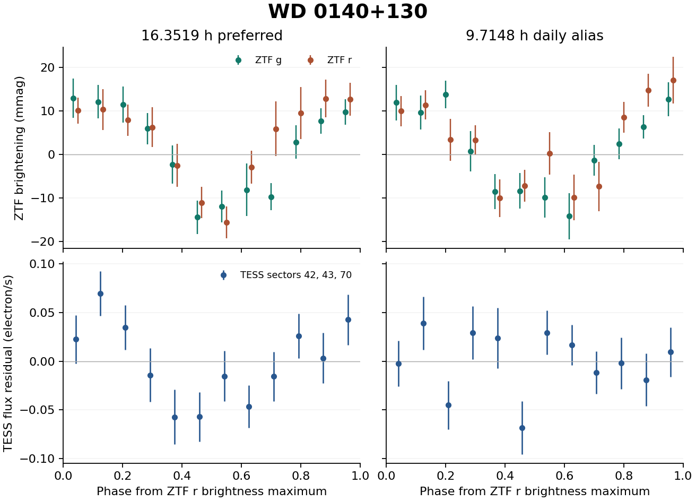

# A 16.3519-hour photometric period in the magnetic helium white dwarf WD 0140+130

Seven years of ZTF photometry favor a **16.3519-hour brightness cycle** in WD 0140+130. The independent TESS data support that ZTF-derived period and phase in sectors 43 and 70, while sector 42 is weak and its strongest projected signal is away from the target pixel. **This is a preferred photometric period, not a confirmed stellar spin or rotation period.** The space-based data distinguish the leading sampling aliases identified in the ZTF analysis, conditionally on their fitted phases; they do not by themselves determine the physical source of the variability. Lawrie reported a tentative 9.69 ± 2.68 h period from July 2011 ground-based photometry, strongly influenced by three points on one night. Ground-based sampling of a 16.3519 h cycle predicts a 9.7148 h alias at one additional cycle per sidereal day. The contribution here is a preferred photometric clock and its cross-survey test. The magnetic star and its variability were already known. [Lawrie 2013, Chapter 2 and Figure A.20](https://s3-eu-west-1.amazonaws.com/pstorage-leicester-213265548798/18273029/2013lawriekaphd.pdf)

WD 0140+130 is also SDSS J014245.37+131546.3, GALEX J014245.3+131546, WDJ014245.37+131546.38, TIC 630587658 and Gaia DR3 2587543763765699968. Gaia DR3 places it at (25.68910759°, +13.26281275°), epoch 2016.0, with G = 17.831. Independent optical spectroscopy identifies Zeeman-split helium lines. Surface rotation is a plausible interpretation. Similar regions separated by 180° could yield a spin period of 32.70 h. Photometry alone cannot establish a rotation mechanism or exclude orbital modulation. Time-resolved spectropolarimetry across 16.35 and 32.70 h could distinguish these interpretations. [Helium-rich magnetic white dwarf spectroscopy](https://academic.oup.com/mnras/article/520/4/6135/6998574) · [DESI DR1 catalog](https://doi.org/10.5281/zenodo.23453342)

## Ground-based measurement

The exploratory search considered DESI objects with unusual spectral types, including DBH, and other white dwarf samples. The initial 0.15–65 cycles/day ZTF scan used the first 65% of g/r times. An approximate Fourier ranking picked 16.35 h. The reproducible full floating-mean Lomb–Scargle calculation below ranks the 9.71 h alias slightly higher in that first interval. We carried the early alias family forward, compared it across the complete ZTF dataset, then checked TESS at the ZTF periods and phases. This target was selected after examining multiple objects. The ground tests describe a selected target and do not give a blind survey-wide false-alarm probability. The search also recovered the published 90-minute clock of the low-accretion-rate polar WDJ150218.87+023054.98, which was excluded from the novelty claim. [DESI discussion of that polar](https://arxiv.org/abs/2609.04314)

| Fit or test | 16.3519 h | 9.7148 h | 51.6156 h |
|---|---:|---:|---:|
| Full ZTF g/r improvement over a constant per band, Δχ² | 101.3 | 84.2 | 72.6 |
| ZTF g, 557 epochs | 53.4 | 49.3 | 42.2 |
| ZTF r, 768 epochs | 47.9 | 34.9 | 30.4 |
| TESS positive fixed-phase test, 73 one-day blocks | 0.000020 | 0.361 | 0.605 |

The ZTF baseline spans 2,680.88 d. The first 861 points give locally refitted Δχ² = 73.6 and 74.2 for the 16.35 and 9.71 h solutions respectively. The final 464 points give 32.0 and 20.8. Holding the early frequency, amplitudes and phases fixed gives a late-data improvement of 17.3 for the 16.35 h waveform. Resampling full-ZTF nights gives a central 95% interval of −1.83 to +36.62 in Δχ² between the two fixed fitted aliases. ZTF alone provides limited alias discrimination.

ZTF g and r semiamplitudes are 0.0137 and 0.0124 mag. The two independent band fits give 16.35170 and 16.35224 h. The formal joint curvature error at the adopted peak is 0.00022 h. It conditions on the alias and quoted weights. The separate 194 i-band points have Δχ² ≈ 3 and provide little discrimination. The 61 quality-selected Pan-STARRS measurements also lack resolving power, with five free-band sinusoids giving Δχ² ≈ 11 and 13 at the two leading periods. The reduction removes Pan-STARRS detections that its own photometry pipeline masked, including three discrepant i-band points. [ZTF archive](https://irsa.ipac.caltech.edu/Missions/ztf.html) · [Pan-STARRS flags](https://outerspace.stsci.edu/spaces/PANSTARRS/pages/298812465/PS1%2BDetection%2BFlags)

## Independent space-based alias check

TESS was tested at each ground-derived period and ZTF r phase, with the sign reversed to convert magnitude variation to flux variation. Each cutout spans 7 × 7 pixels. For each sector, the test uses the single pixel nearest the catalog position, all zero-quality-flag cadences with finite target flux, one linear trend, an intercept and the first five time components of pixels more than 2.5 pixels from the target. Five robust standard deviations define the outlier cut using the nuisance-only residual. The time-series basis, target pixel and cleaning are identical across competing periods. The tests use archive HJD mid-exposures for ZTF and archive BJD_TDB for TESS on a common numerical JD origin. Perturbing the relative clock by ±90 s changes the fixed-phase coefficient by less than 0.001 electron/s in every sector.

| TESS sector | Time range, BJD_TDB − 2457000 | Cadence | Used samples | Target 16.35 h flux coefficient, electron/s | Target 9.71 h |
|---|---|---:|---:|---:|---:|
| 42 | 2447.70–2472.88 | 600 s | 2,869 | +0.021 | +0.018 |
| 43 | 2474.17–2498.89 | 600 s | 3,008 | +0.060 | +0.014 |
| 70 | 3208.36–3233.82 | 200 s | 9,886 | +0.058 | −0.022 |

TESS sectors 43 and 70 place the highest signed amplitude at the WD's central pixel. Sector 42 shows weak support and peaks away from that pixel. Within 65 arcsec, Gaia finds a G = 20.37 source 27.53 arcsec away and a G = 15.24 source 60.14 arcsec away. The roughly 21-arcsec TESS pixels blend neighboring light. Fixed-phase tests at the pixel nearest the fainter source yield −0.028, −0.008 and −0.010 electron/s. The brighter source falls inside the cutouts for sectors 42 and 70, with −0.029 and +0.007 electron/s. These controls share the pixel detrending basis, and their signed amplitudes are descriptive.

For the combined test, a one-sided randomization flips the sign of each day's contribution to the fixed-phase flux score, after removing the nuisance basis and scaling by each sector's residual variance. This preserves within-day correlations. One of 100,000 random sign assignments equalled or exceeded the observed 16.35 h score. The plus-one estimate is 0.000020, or 0.000060 using a three-alias Bonferroni adjustment. Regrouping into two-day blocks using either starting offset gives 0.000110 and 0.000030 before adjustment. This conditional test assumes approximate block sign symmetry and independence across blocks. The chronology was exploratory. The TESS probabilities apply to these prespecified waveforms in the spacecraft data. [MAST TESSCut](https://mast.stsci.edu/tesscut/)



The figure folds TESS at the phase of maximum brightness inferred from ZTF r. The points are weighted phase-bin means. Error bars cluster residual contributions by day. The TESS binning is for display and the tests use individual cadences.

## Reproduction and source audit

From this directory run the following commands with NumPy, SciPy, Astropy and Matplotlib installed.

```sh
OPENBLAS_NUM_THREADS=1 python analyze.py > measurement.json
OPENBLAS_NUM_THREADS=1 python tess_check.py ./cutout-cache > tess.json
OPENBLAS_NUM_THREADS=1 python plot.py ./cutout-cache phase-curves.png
```

The two compressed ASCII tables contain the archive input columns used for the ZTF and Pan-STARRS tests. `reduce_inputs.py` can refresh them online. `tess_check.py` fetches the original three TESS cutouts. `tess.json` records SHA-256 checksums of the uncompressed FITS files, WCS target locations, timestamps, coefficients and all randomization outcomes. The ZTF reducer uses zero catflags, magnitude error below 0.3 mag, and measured magnitude at least 0.2 mag brighter than the limit. It subtracts each object-ID median, removes 5-MAD outliers with a 0.025 mag floor on scatter, deduplicates identical exposure/filter pairs by smallest error, and adds a 0.015 mag error floor in quadrature. All trial sinusoids have per-band offsets, sine and cosine coefficients.

An exact-name and Gaia-ID search identified Lawrie's unresolved period and the spectroscopic classifications. A 5-arcsec positional search returned no entries in the ZTF DR2 known or suspected periodic-star catalogs, AAVSO VSX, the ATLAS first variable catalog, or the Jestin et al. ZTF-vetted WD sample at query time (2026-11-15). Later catalog releases or unindexed observations could contain another measurement. [Five-table VizieR query](https://vizier.cfa.harvard.edu/viz-bin/asu-tsv?-source=J%2FApJS%2F249%2F18%2CB%2Fvsx%2CJ%2FAJ%2F156%2F241%2Ftable4%2CJ%2FA%2BA%2F712%2FA243%2Ftablea1&-c=25.68911%2013.26281&-c.rs=5) · [Gaia neighbor query](https://vizier.cfa.harvard.edu/viz-bin/asu-tsv?-source=I%2F355%2Fgaiadr3&-c=25.68911%2013.26281&-c.rs=65&-out=Source%2CRA_ICRS%2CDE_ICRS%2CGmag)

The SHA-256 digests of the decompressed evidence tables are `99b5c558bede38a35422a38201347e49e698bd0c41bbaa23e1b48a7cad2253d0` (ZTF) and `e56caf656965cf765e5166b09f0c46461a70cc4292682cc078efc36eb54d94f1` (Pan-STARRS). The table rows retain the ZTF object and exposure identifiers and Pan-STARRS object identifier.
