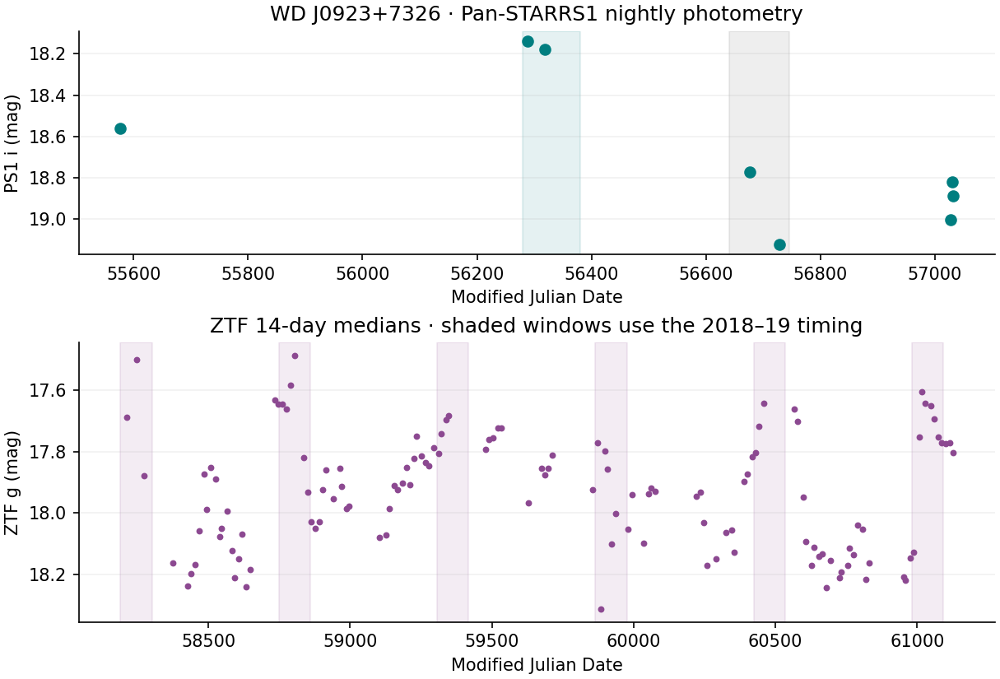

# Pan-STARRS1 resolves earlier bright states of WD J0923+7326

WD J0923+7326 (Gaia DR3 1121123185951605632) was about twice as bright in the Pan-STARRS1 (PS1) i band in December 2012 and January 2013 as in two visits in 2014. The two nearest resolved stars stayed within 0.014 mag over the same i-band comparison. A separate pair of g and r visits shows the target bright in March 2010. These measurements establish large optical changes at the white dwarf's position eight years before the first ZTF season. The 2012 visits fall nearly half a cycle from peaks predicted by the first two ZTF seasons. These earlier bright states **challenge a fixed-phase extension of the proposed recurrence**; they do **not** determine the physical cause of the variability or rule out all forms of recurrence.

Bhattacharjee et al. established this metal-polluted, transiting-debris system, found rapid dips and long-term variability, and suggested a roughly 500-day recurrence from two similar seasons. Their examination of an ATLAS brightening highlighted possible blending with two stars and a disagreement between direct and difference photometry. They set that ATLAS feature aside. Here the earlier events come from resolved PS1 exposures. Searches of the discovery paper, the current debris monitor and literature under the coordinates, source ID and object name did not locate these PS1 epoch measurements. Publication priority remains open. [Discovery paper, §§IV.1.1 and VI](https://arxiv.org/abs/2502.05502) · [ZTF monitoring data](https://janvanroestel.github.io/WD-transitingdebris-alerts/) · [PS1 DR2 archive](https://catalogs.mast.stsci.edu/panstarrs/)



## What the cameras measured

We queried 4,952 PS1 DR2 detections within 2.4 arcminutes and retained 63 good target exposures across all five bands. Each target magnitude has a local zero-point correction computed from the median residual of other stars on the same image. Each retained target exposure has at least ten comparison stars. Seeing FWHM had to be below 3 arcsec, conventional PSF signal-to-noise above 10, PSF quality fraction at least 0.90 and fit chi-square below 3. The target is PS1 object 196121409642518764. Every retained centroid lies within 0.30 arcsec of the input coordinate. The nearest persistent neighboring stars used for the blend test are 8.65 and 9.60 arcsec away.

For each band, we took the median per night and then the median across nights in each window. The faint window is MJD 56640–56745 (December 2013–March 2014). Bright windows were chosen after inspection. Magnitudes in different rows cover different nights and should not be combined into a spectrum or extinction law.

| Band | Bright window (MJD) | Bright / faint nights | Faint minus bright (mag) | Bright / faint flux | Change of 8.65″ / 9.60″ neighbors (mag) |
|---|---|---:|---:|---:|---:|
| g | 55260–55280 | 1 / 3 | 0.419 | 1.47 | −0.014 / +0.000 |
| r | 55260–55280 | 1 / 3 | 0.711 | 1.93 | −0.036 / +0.005 |
| i | 56280–56380 | 2 / 2 | 0.789 | 2.07 | −0.008 / +0.013 |
| z | 56280–56380 | 2 / 1 | 0.534 | 1.64 | −0.020 / +0.008 |

PS1 catalog aperture photometry yields 0.422, 0.709, 0.841 and 0.476 mag for the same four contrasts. The field stars of similar brightness with at least the target's number of nights had smaller absolute changes in every comparison (9, 6, 13 and 10 stars respectively). These are small local comparison sets and the epochs were selected from a screen of 20 monitored systems. Their ranks do not supply a survey-wide false-alarm probability. Measurements constrain the dates sampled. Sparse visits cannot establish uninterrupted activity between dates.

**Check on original pixels.** We retrieved all ten unflagged i-band PS1 warp cutouts for the four comparison nights, used the celestial WCS to center fixed circular apertures on the three stars, subtracted a local sky annulus and required valid pixels throughout each source aperture. Six cutouts on three nights supported direct relative photometry of all three stars. The December 2012 / January 2013 pair was brighter than 2014 January 19 by 0.691 and 0.660 mag respectively against the two neighbors at 2 arcsec aperture radius. The contrast persists at all four tested radii from 1.5 to 3 arcsec. The four March 2014 cutouts had unusable comparator pixels. Their target catalog detections enter the catalog measurement above. The independent aperture reduction and the catalog use the same photons. [PS1 image service](https://ps1images.stsci.edu/)

## A timing hypothesis with a failed cycle

The brightest eligible 14-day g-band bins during the first two ZTF episodes have median MJDs 58245.69 and 58804.02. Their 558.33-day spacing defines a retrospective template. We evaluated every subsequent covered cycle, preserving gaps, with a ±56-day window. The table gives how much brighter the median bin inside the window was than outside it in the same cycle, in magnitudes.

| Cycle | Center MJD | g | r |
|---|---:|---:|---:|
| 2 | 59362.35 | 0.122 | 0.14 |
| 3 | 59920.68 | −0.006 | −0.01 |
| 4 | 60479.01 | 0.386 | 0.28 |
| 5 | 61037.34 | 0.404 | 0.36 |

Cycle 3 fails the prediction. A separately reduced ZTF science-image catalog also recovers cycle 4 with 0.238 mag in g and 0.237 mag in r, while the nearest brighter neighbor changes by +0.004 and −0.016 mag. This release ends before the cycle 5 peak. A phase-shift diagnostic preserves the actual times, observed brightness sequence and gaps within each observed cycle. It rotates the windows independently, conditions on at least two in-window and two out-of-window bins, and compares the four-cycle mean contrast with 100,000 such draws. Conditional upper tails are 0.0081 (g) and 0.0206 (r) at ±56 days. They reach 0.0504 and 0.0385 at ±84 days. Passbands share the same events. Window widths, target and inspection histories are exploratory. These diagnostics do not establish an orbital period.

The PS1 March 2010 r visit lies 186 days from the nearest predicted center. The December 2012 i/z visit lies 277 days away, close to antiphase. Re-estimating the early anchors for bin widths of 7, 10, 14, 21 and 28 days at every integer-day origin leaves those two bright visits at least 166 and 184 days from a predicted center respectively. The specific stationary model that confines all bright states to one ±56-day interval of this ZTF-derived cycle fails to cover the observed early bright epochs. That challenges the proposed fixed-phase recurrence rather than disproving every possible recurrence or establishing why the white dwarf brightens. Debris at other orbital periods, multiple active phases, secular changes in covering fraction, and intrinsic variability remain possible. The next extrapolated center is 2027 July 9. Monitoring on both sides and outside that window could test whether the recent recurrence persists.

## Reproduce

Use Python with NumPy, pandas and Astropy. Matplotlib regenerates the optional plot. Run the following commands from this directory. The MAST and IRSA calls are live, and the monitor snapshot is commit-pinned. The SHA-256 receipts in measurement.json identify the responses used here. Reordering or a new data release may change a live archive's response bytes. The filtered target and neighbor measurements and ZTF block tables are included.

```sh
python analyze.py --cache /tmp/wdj0923-input --out .
python check_pixels.py --cache /tmp/wdj0923-input --out .
python plot.py
```

PS1 derives from the Pan-STARRS1 surveys and the public release hosted by STScI. ZTF direct light curves come from IPAC/IRSA. Forced photometry comes from the ZTF Forced Photometry Service via the van Roestel et al. monitoring snapshot. The monitor uses a fixed extraction position, which can bias smooth long-term trends. Our early-epoch measurement uses a separate telescope and the direct ZTF check uses direct-image PSF photometry. [PS1 survey](https://arxiv.org/abs/1612.05560) · [PS1 catalog access and schema](https://catalogs.mast.stsci.edu/docs/panstarrs.html) · [ZTF light-curve service](https://irsa.ipac.caltech.edu/docs/program_interface/ztf_lightcurve_api.html) · [Monitoring paper](https://arxiv.org/abs/2609.08923)
