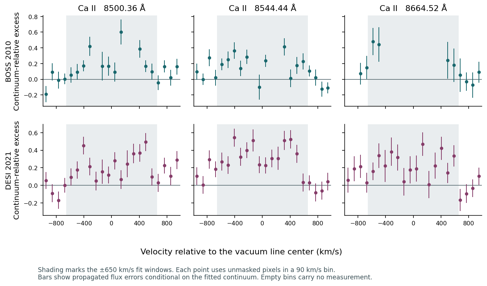

# Broad calcium emission recurs at WD J230752.92−000207.45 across 4,002 days

A 2010 BOSS spectrum of this metal-polluted white dwarf shows broad excess flux near the three expected wavelengths of the Ca II infrared triplet, but the third line has very limited unmasked coverage. DESI observed the pattern again in 2021. The summed emission equivalent widths are **27.4 ± 4.6 Å** and **29.5 ± 2.8 Å**, respectively. In the combined BOSS spectrum, the weakest of the three lines is stronger than the weakest line in any of the other 983 measurable fibers on the plate. This gives independent, eleven-year evidence for the emission underlying the published tentative circumstellar-gas candidate.

**Critical limitation:** In the 2010 BOSS reference fit, the third calcium line has **only four unmasked pixels** (positive inverse variance and survey AND mask clear), compared with 14 and 16 pixels for the other two lines. The stricter OR mask leaves **zero** pixels in that third line's ±650 km/s window; its individual detection therefore is **not robust to the strict mask**. The strongest independent historical evidence is for the first two calcium features, and the data do not establish uninterrupted emission between 2010 and 2021.

The DESI DR1 white dwarf catalogue identified the 2021 features and labeled them tentative. Its classification used a single exposure for this star. The contribution here is the historical detection, its duration baseline, and the same-plate instrumental controls. The source is Gaia DR3 2651256614304360576, also SDSS J230752.92−000207.4 and LAMOST J230752.91−000207.5. The DESI catalogue gives a helium-rich model with an effective temperature of 15,264 ± 235 K. [Catalogue paper, section 7.8.6 and Figure 35](https://arxiv.org/html/2609.04314#S7.SS8.SSS6) · [Warwick source and original exposures](https://cygnus.astro.warwick.ac.uk/phsdaj/WhiteDwarfs/J2307/WDJ230752.92-000207.45/index.html)



| UT observing date | Observation | Individual line excesses, in formal standard errors, in wavelength order | Combined statistic | Total emission EW (Å) |
|---|---|---:|---:|---:|
| 2000-09-24 | SDSS 0381-51811-0425 | 1.02, 3.28, 1.50 | 2.92 | 32.1 ± 13.5 |
| **2010-10-09** | **BOSS 4209-55478-0518** | **5.05, 6.20, 3.40** | **7.74** | **27.4 ± 4.6** |
| 2015-10-08 | LAMOST 367608207 | 1.47, 1.79, 0.04 | 1.84 | 13.5 ± 9.8 |
| **2021-09-23** | **DESI 00101427, fiber 1398** | **6.80, 10.18, 6.06** | **11.71** | **29.5 ± 2.8** |

The 2000 data give weak support. LAMOST's red signal-to-noise is low and its third line is uninformative. Both measurements are compatible with the later detections. Four widely separated visits cannot establish uninterrupted emission.

## Selection and independent test

We searched the DESI DR1 white dwarf catalogue for classifications containing Z, catalogue temperature above 10,000 K and z-arm signal-to-noise above four. All 668 target coadds yielded a score. At each triplet member, the screen used a linear continuum fit 22–50 Å either side of the line. Nine templates covered three half-widths (210, 420, 650 km/s) and centroid shifts (−120, 0, +120 km/s). The sum of the three signed excesses divided by √3 was 8.22 for this target and 4.09 for the runner-up. These maximized discovery scores are rankings. Their reference distribution includes selection over targets and templates. The catalogue bytes have SHA-256 b86d315dcee214d0fd49ecf1012f46e52306144a64da8baf079390b87403eaa5. [Full scored sample with individual product hashes](screen.csv) · [Release tables](https://cygnus.astro.warwick.ac.uk/phsdaj/WhiteDwarfs/Tables/)

For the historical comparison, the measurement uses fixed vacuum wavelengths 8500.36, 8544.44 and 8664.52 Å, zero centroid shift and 650 km/s half-width. Across 8425–8735 Å we jointly fit a quadratic continuum and three independent box-shaped line excesses using the archive inverse variances. The combined statistic fits a common line excess with the covariance of the three amplitudes. Total EW integrates each fitted amplitude across its full nominal window and divides by the fitted continuum at that wavelength. Its error propagates the continuum and amplitude covariance. These uncertainties treat contributing pixel errors as independent. Sky residuals, continuum choice, and the extrapolation over masked pixels introduce additional uncertainties. [Frozen spectral cutouts](spectra.csv.gz) · [Individual fits and alternative settings](epoch_fits.csv)

## What survives the controls

- **Same plate.** The 2010 target ranks first of 984 measurable fibers by the weakest line and second by the combined statistic. The object ahead of it in the combined statistic has negative flux excess at the third wavelength. The target reaches +7.74. All 79 blank-sky fibers range from −2.17 to +2.53. On the 2000 plate the source ranks 12th of 576 by the weakest line. Rows with insufficient coverage are excluded (16 of 1,000 BOSS fibers and 64 of 640 original SDSS fibers). These are empirical comparisons within each plate. [Fiber-level tests](plate_controls.csv.gz)
- **Individual exposures.** Each of the six BOSS red-camera integrations on the 2010 observing night has positive excess at each of the three line wavelengths. The exposure-level combined statistics range from 2.08 to 4.20. They sample the same night and share survey calibration. [Exposure measurements](boss-exposures.csv) · [Replay](boss_exposures.py)
- **Sky flags and continuum choice.** With positive inverse variance and the survey AND mask clear, BOSS retains 14, 16 and **four** pixels in the three line windows. The third line relies on its wings. Requiring the survey OR mask to be clear removes all pixels in the 650 km/s third-line window. At 800 km/s with the OR mask clear the first two lines remain positive at 3.2 and 5.3 standard errors, while the third falls to 0.8. Primary BOSS combined scores span 7.1–8.0 across polynomial orders one through three. DESI retains 46, 46 and 47 unflagged pixels in the principal fit. [Mask and continuum variants](epoch_fits.csv)
- **Broad wings and hydrogen blending.** Removing the central ±220 km/s of every calcium line still gives combined excesses of 8.45 in BOSS and 10.56 in DESI, fitting the wings to ±650 km/s. This repeats the fit over 8395–8830 Å and also excludes ±15 Å around four adjacent hydrogen Paschen lines. Two unblended hydrogen transitions at 8600.75 and 8752.89 Å show no comparable emission in either spectrum (all four local excesses between −0.62 and +1.05 standard errors). Hydrogen contamination near individual calcium lines remains possible. [Wings and Paschen checks](profile_checks.csv)

The spectra support recurrent, broad Ca II emission, consistent with a gaseous debris disc. Continuum weighting, atmospheric absorption and sky-line masking limit detailed profile comparisons. An unresolved companion or another emission source inside the fibers remains possible. These measurements do not determine gas mass, disc inclination, its formation date or a duty cycle. A high-resolution velocity profile and time-resolved companion test would address the physical origin.

## Reproduction

With Python 3.11+ and NumPy, run from this directory. The replay on included pixels requires no archive connection.

```sh
python analyze.py
python profile.py
```

To rebuild those cutouts and the two plate-control tables from the source archives, install Astropy as well and run the following. The full 668-target screen is a separate download. Per-observation download URLs, byte counts and hashes are recorded. [Source manifest](sources.csv)

```sh
python extract.py /tmp/wdj2307-archive
python analyze.py
python profile.py
python screen.py /tmp/wdj2307-survey --workers 4
```

To reproduce the six individual BOSS red exposures, run `python boss_exposures.py` with Astropy and NumPy. To regenerate the plotted spectra, run `python calcium_figure.py` with Matplotlib and NumPy.
