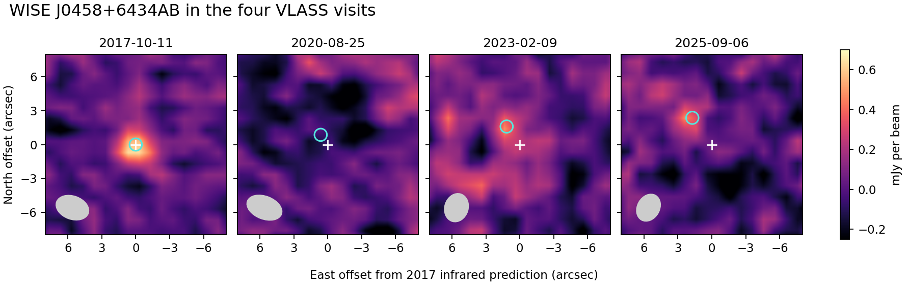

# Radio emission along the path of WISE J0458+6434AB

Three Very Large Array Sky Survey (VLASS) visits show a compact 2–4 GHz source close to the predicted position of the known T8.5 + T9.5 binary WISE J0458+6434AB. The free radio centroids in 2017, 2023 and 2025 fall **0.36″, 0.33″ and 0.36″** from the predicted infrared positions. From 2017 to 2025 the radio centroid moved **3.28″ northeast**, compared with **2.93″** expected from infrared proper motion. The 2020 image gives a nondetection. We classify the result as a **candidate radio counterpart to the binary**. The 2–3″ synthesized beam includes both components. Resolved Keck near-infrared spectra established the component classifications. [Burgasser et al. 2012](https://doi.org/10.1088/0004-637X/745/1/26)

The LOFAR Two-metre Sky Survey independently catalogued ILTJ045854.31+643455.8 at 144 MHz. Its 0.903 ± 0.086 mJy/beam catalog peak lies 0.22″ from the 2023 VLASS radio centroid. The 6″ LOFAR beam and the multi-date mosaic limit its ability to separate a background contributor or either binary component. The 144 MHz source was already catalogued. The proposed association with the brown-dwarf system is the new finding. [Independent LOFAR image, catalog and checks](independent-radio/README.md)



The panels have the same tangent-plane coordinates and intensity scale. The white cross marks the predicted 2017 position. Cyan circles follow the infrared proper motion, and the gray ellipse in each panel shows the restoring beam.

| VLASS date | Forced amplitude (mJy/beam) | Nearby fit scatter, MAD (mJy/beam) | Free-centroid offset | 10′-field control tracks at least as bright, out of 8,260 |
|---|---:|---:|---:|---:|
| 2017 Oct 11 | +0.736 | 0.114 | 0.36″ | 0 |
| 2020 Aug 25 | −0.150 | 0.148 | — | 6,931 |
| 2023 Feb 9 | +0.445 | 0.113 | 0.33″ | 5 |
| 2025 Sep 6 | +0.487 | 0.155 | 0.36″ | 6 |

The 2025 visit prompted the follow-up during the [1,526-position ultracool-dwarf survey](../vlass4-ultracool-dwarfs/README.md). All three available earlier visits were then measured at coordinates propagated from the infrared catalog. Their inverse-variance weighted amplitude is **0.391 mJy/beam** using noise estimated across the 10′ field. The corresponding translated tracks have a scaled median absolute deviation of **0.077 mJy/beam**. One of 8,260 has an equal or larger value. Some tracks overlap in beam tails or include real radio sources. These field ranks describe the local data. The survey discovery process inspected many targets and the 2025 source was selected after inspection. A survey-wide false-alarm probability requires accounting for that selection. [All epochs](epochs.csv) · [Wide-field controls](field-ranks.csv) · [Translated tracks](translated-tracks.csv.gz)

## Position and image checks

- Forcing the 2017 beam at the 2025 sky coordinate reduces its fitted amplitude from 0.736 to 0.160 mJy/beam. In 2025, forcing the beam at the 2017 coordinate reduces the amplitude from 0.487 to 0.070. The 2023 position is between them. Its amplitude also peaks closer to the expected 2023 position than at either endpoint.
- The target centroid moved +2.04″ east and +2.57″ north. Two field peaks detected above six times the pixel MAD in both endpoint maps moved only (+0.01″, −0.21″) and (+0.14″, +0.13″), respectively. The local maps therefore do not show a common shift of the required size. Position offsets of a few tenths of an arcsecond are compatible with catalog rounding, parallax (~0.108″), unresolved component motion, and quick-look radio astrometric systematics. [Field registration](field-registration.csv) · [NRAO quick-look image guidance](https://science.nrao.edu/vlass/data-access/vlass-epoch-1-quick-look-users-guide)
- Each visit uses its actual FITS observing date. The published 2025 July 3 position is (74.7268°, +64.5825°), with proper motion (+218, +300) mas/yr in (α cos δ, δ). At each fixed position, fit the FITS restoring beam by ordinary least squares together with a background plane. Repeat on 100 controls in a 7–35″ annulus at six-pixel spacing, then on 8,260 positions translated along the same sky track across a 10′ image. Noise estimates come from the fits to controls, which preserve beam-scale noise correlations. The free centroids use a separate local Gaussian-beam fit with floating amplitude and position. [Catalog and data URLs](sources.json) · [Local control amplitudes](controls.csv)
- The available images measure visit-integrated Stokes I. The evidence constrains a moving source near WISE J0458+6434AB. Component assignment, emission mechanism, polarization, burst profile and duty cycle require additional data. In particular, the 2020 nondetection alone cannot establish a variability period.

## A stationary-source test

We also let a single stationary radio source choose its best position and vary its flux freely between visits. A fit using the catalog motion and one shared position offset returned 0.757, −0.157, 0.466 and 0.470 mJy/beam in chronological order. The best stationary fit returned 0.755, −0.147, 0.357 and 0.066 mJy/beam. The 2025 image provides most of the discrimination. Removing the 2020 visit, widening the search in position, or changing the local background window preserved the preference for motion. The score difference of 14.44 compares fitted amplitudes in units of empirical noise. It has no calibrated chi-squared interpretation. A blend of individually variable sources is still possible. The relative orbit, parallax and astrometric calibration limit sub-arcsecond interpretation. [Fit and local controls](track-fit.json) · [Reproduce the position fit](track_fit.py)

The separately processed 2023 Single Epoch continuum image of the same visit gives 0.334 mJy/beam at the predicted position, with 0.131 mJy/beam local scatter. Its free centroid is 0.39″ away. This processing check uses the same observation as the 2023 Quick Look measurement. Run `python continuum.py inputs/continuum-2023.fits` to reproduce it. [Measurement and original image URL](continuum.json)

## Prior reports

A search for WISE J0458+6434, WISEPA J045853.89+643452.9, WISEP J045853.90+643452.6 and corresponding coordinate abbreviations with “radio”, “VLA” and “VLASS” located the infrared binary and variability literature. A 2026 radio census enumerated seven confirmed radio T-dwarf systems, including the T8 WISE J0623−0456. It did not list WISE J0458+6434AB. A separate VLASS investigation reported no associated radio emission for its brown-dwarf sample. Searches and catalog comparisons cannot establish unconditional priority. [2026 radio census](https://academic.oup.com/mnras/article/546/4/stag085/8431331) · [2025 VLASS survey](https://doi.org/10.1051/0004-6361/202555032)

## Reproduce

The four frozen science cutouts hold the source data in Jy/beam. Their original public URLs and derived cutout hashes are in the receipt. The 2017, 2020 and 2023 cutouts retain original survey pixels and adjust the WCS reference pixel to the crop. For 2025 the CADC cutout pixels agree bit-for-bit with the same crop reconstructed from the original full image. Archive access, photometry and control replays require Python, Astropy, SciPy and NumPy. The map additionally uses Matplotlib.

```sh
python replay.py
python figure.py
python check.py
python acquire.py /tmp/wise0458-wide --side 601
python field_controls.py /tmp/wise0458-wide .
python registration.py /tmp/wise0458-wide field-registration.csv
```

The archived files permit the four-epoch replay offline. The last three commands retrieve the larger original fields and regenerate the 8,260 translated control tracks. A reader can check the flags and synthesis beam directly in each FITS header. [Input receipts](sources.json) · [NRAO VLASS data](https://science.nrao.edu/vlass/)
