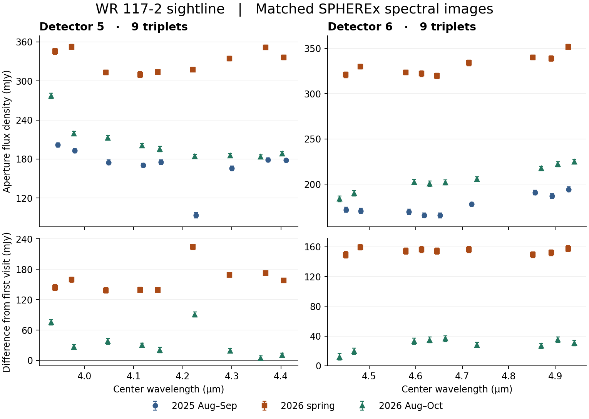

# A repeating infrared signal toward WR 117-2

The source at the position of WR 117-2 (KSF 1457−673, 2MASS J18310665−0948014) varied by a factor of **3.55 at 3.4 μm and 2.83 at 4.6 μm** during the NEOWISE mission. SPHEREx subsequently imaged the source on three visits. At matched wavelengths between 4.50 and 4.95 μm it brightened by **86%**, then faded back to **16% above its first level**. The result is a large repeating infrared variation toward a catalogued dusty Wolf–Rayet star. Its period and physical cause remain open. A [six-detector extraction](#six-detector-spectral-comparison) now confirms the brightening at 3.93–4.41 μm and provides all 382 image measurements and quality flags.

| SPHEREx detector-6 coverage | Median aperture flux (Jy) | Median matched-channel flux relative to first visit |
| --- | ---: | ---: |
| 2025 Aug 27–Sep 7 | 0.179 | 1.000 |
| 2026 Mar 31–May 12 | 0.331 | 1.860 |
| 2026 Aug 26–Sep 6 | 0.206 | 1.159 |

The first column gives the full range of available detector-6 frames in each group. The other columns use matched images. Absolute fluxes depend on aperture losses and diffuse background. Ratios use the same aperture, detector and nearly the same wavelengths in all visits. [Measurements](spherex-photometry.csv) · [Matched exposures](matched-images.csv) · [Primary-image URLs and hashes](spherex-manifest.csv)

## Selection and timing

The September 2026 Galactic Wolf–Rayet Catalogue contains 718 entries. Requiring a parseable coordinate and a numeric K magnitude between 6 and 15 inclusive left 668. Three-arcsecond IRSA queries used the centers in the released table. An initial pass used the Williams (2019) star list and then the larger Galactic catalogue. Centers were reused where the coordinates agreed to within 0.00025 degree on each axis. Cuts on offset (≤2 arcsec), frame quality (≥5), both bands' uncertainty (≤0.15 mag), Moon flags (00) and contamination flags (00 in W1/W2) preceded temporal grouping. A gap of more than 20 days starts a visit. At least four exposures define a visit and eight visits qualify for ranking. For each band the score is the median visit magnitude minus the second brightest visit magnitude. The smaller of the two band scores ranks the objects. WR 117-2 placed third of 288, after WR 125 and WR 137, both known variable dust makers. The released table retains the other 380 sightlines and their usable visit counts. Input hashes refer to the original query replies including transient IRSA query metadata. [Screen](screen.csv) · [Galactic Wolf–Rayet Catalogue](https://pacrowther.staff.shef.ac.uk/WRcat/) · [Williams 2019](https://doi.org/10.1093/mnras/stz1784)

The target had 285 NEOWISE records. Allowing lowercase contamination warnings while continuing to exclude uppercase artifact flags yielded 242 measurements in 21 visits. The W1 and W2 visit medians correlate at 0.965. Restricting to both bands unflagged leaves ten visits and peak-to-peak amplitudes of 1.246 and 1.053 mag. Eight AllWISE controls within four arcminutes gave full-visit ranges of at most 0.513 and 0.235 mag. These controls use the eight nearest matches in W1 and W2 magnitude to (8, 7) among field sources with unflagged W1/W2, W1 > 7, W2 > 6 and separation >25 arcsec. W1 reaches mild saturation when this target brightens. The independent SPHEREx test and the signal in W2 help constrain that systematic. [NEOWISE visit medians](visits.csv) · [IRSA final release](https://irsa.ipac.caltech.edu/data/WISE/docs/release/NEOWISE/)

Sinusoidal regressions over 12,000 frequencies from 1/2,000 to 1/50 cycles per day gave mean bandwise R² of 0.909 at 472.36 days and 0.902 at 296.88 days. The two frequencies sum to approximately one cycle per 182.3 days, close to the interval between NEOWISE visits. Both models reproduce the direction of change in two original 2010 WISE visits held out from the fits. Shorter aliases also fit. None of 4,096 whole-visit shuffles preserving the W1–W2 pairing reached the measured maximum over the same frequency grid. This tests whether exchanging whole visits could produce the signal at this target. A long-memory noise model and a survey-wide false-alarm rate would require separate tests. [All five leading aliases, early predictions and controls](result.json)

## Independent images

For the published J2000 position (277.77770833°, −9.80038889°), IRSA SIA2 returned 42 SPHEREx DR1 and 17 QR3 wide-survey detector-6 frames. Each input has an archive URL and a digest of the bundled cropped FITS product. The crop preserves the primary header, flux, variance, flags and wavelength transform. The coordinate transform places an aperture on the catalogued position. An annulus with radii 4–7 pixels estimates the local background. Fluxes use a nominal 6.15 arcsec pixel and 2.5 pixel aperture radius. The third group defines wavelength matches in the first two groups, with an offset of at most 0.025 μm in each. Images with a central-pixel flag other than the survey's source flag are excluded from the matched sample, and measured aperture fluxes must be finite. Binning the 13 triplets in nine 0.05 μm intervals gives equal weight to each interval. All nine intervals brighten in the middle visit and fade afterward. Using radii of 2 and 3 pixels gives middle/first ratios of 1.853 and 1.864 and late/first ratios of 1.162 and 1.162. [SPHEREx DR1](https://doi.org/10.26131/IRSA678) · [SPHEREx QR3](https://doi.org/10.26131/IRSA662)

Spitzer/GLIMPSE records a bright mid-infrared counterpart 0.29 arcsec from the WR position. Its nearest catalogued mid-infrared neighbor is 8.76 arcsec away and 4.34 mag fainter at 3.6 μm. NEOWISE median positions stay within 0.16 arcsec of the WR coordinates. The 2MASS catalog also contains a J-only detection 0.82 arcsec from the position. Neither space telescope resolves that separation. Palomar Gattini-IR has 473 exposures at the target's 2MASS position, but its deepest reported J limit is 11.82 mag here and all finite source measurements fall below the local limits. There is no ground-based period confirmation from that light curve. [GLIMPSE](https://irsa.ipac.caltech.edu/data/SPITZER/GLIMPSE/) · [PGIR DR1](https://datalab.noirlab.edu/data/pgir)

## Six-detector spectral comparison

A second extraction adds **323 spectral images from the other five detectors** to the original 59 detector-6 images. The unresolved source brightened and faded in every matched triplet on detector 5, extending the measured variation blueward to **3.93 μm**. On detector 5 the middle visit was **82.7% brighter** than the first and the last was **13.7% brighter**. The corresponding differences on detector 6 were **87.8%** and **15.8%** under the same rules. The two detectors probe separate wavelength ranges and image sets but share the telescope and calibration pipeline.

| Detector | Frames | Clean apertures, visits 1 / 2 / 3 | Disjoint triplets | Matched span (μm) | Middle brighter than first / late | Median middle − first (mJy) |
| --- | ---: | ---: | ---: | ---: | ---: | ---: |
| 1 | 54 | 15 / 11 / 15 | 8 | 0.742–1.054 | 6 / 7 | +0.38 |
| 2 | 79 | 9 / 14 / 22 | 5 | 1.196–1.449 | 3 / 3 | +1.77 |
| 3 | 59 | 12 / 5 / 8 | 1 | 1.652–1.670 | 1 / 1 | +31.28 |
| 4 | 54 | 8 / 0 / 8 | 0 | — | — | — |
| 5 | 77 | 16 / 17 / 29 | 9 | 3.932–4.410 | 9 / 9 | +158.18 |
| 6 | 59 | 14 / 18 / 16 | 9 | 4.436–4.941 | 9 / 9 | +154.21 |

The difference is resolved most clearly in the two long-wavelength detectors. Middle-minus-first changes span **+138 to +224 mJy** in detector 5 and **+149 to +160 mJy** in detector 6. Their median formal single-triplet difference errors are 5.0 and 3.9 mJy. The four fixed comparison positions, 33.8 arcsec north, south, east and west of the target, gave detector-5 median changes of +4.8, +54.5, +4.0 and +1.3 mJy from 2, 2, 3 and 6 usable pairs. The large southern value and its sparse coverage limit the background check there. The corresponding detector-6 changes are −0.6, −0.1, −2.7 and +0.3 mJy. Each control uses the target annulus as its common background reference. These positions test variation across the local field and may contain field sources.

One detector-5 triplet at 4.23 μm gives a middle/first ratio of 3.40. In its first exposure, `2025W37_1A_0618_1`, the 2-pixel aperture measures 4.6 mJy and the 2.5-pixel aperture measures 93.3 mJy. That sensitivity to the aperture precludes a secure spectral-feature identification. Requiring the 2- and 2.5-pixel fluxes to agree within 25% in all three exposures retains eight detector-5 triplets. Their median middle/first and late/first ratios are 1.823 and 1.127. All nine detector-6 triplets pass the same test.

The first-visit median flux in the matched sample is at or below zero on detectors 1–3 after sky subtraction. Their source flux ratios are ill-conditioned. Detector 3 has one surviving triplet. Detector 4 has no clean middle-visit target aperture, including 14 of 17 exposures with overflow and 12 with persistence somewhere in the aperture. Even with a 1.5-pixel core, only one middle-visit frame passes and no three-way wavelength match survives. The short-wavelength measurements cannot establish a changing line, a dust temperature, or a wavelength where the signal turns on.

**Measurement and matching.** IRSA SIA2 returned 238 DR1 and 144 QR3 wide-survey frames for a 0.0001° cone at the published coordinates. The [frozen manifest](spectral-inputs.csv) records the product URLs and cropped FITS digests for all 382 exposures, plus the SHA-256 of every new full frame. The five new per-detector archives contain up to 22 × 22 original pixels from the image, variance and flags planes and the spectral WCS table. Pixel positions use the celestial WCS and the target's center wavelength and bandwidth use its separate spectral WCS. [IRSA archive and SIA2 documentation](https://caltech-ipac.github.io/spherex-archive-documentation/spherex-data-access/) · [Level 2 products](https://caltech-ipac.github.io/spherex-archive-documentation/spherex-data-products/)

The nominal 2.5-pixel target aperture and the 4–7-pixel sky annulus use the original angular scale. Every target pixel must be present and finite with positive variance and a nominal flag (zero or the source-mask bit). At least 40 good sky pixels must remain. A total of 237 target fluxes pass. The [exposure table](six-detector-flux.csv) also reports clean 1.5-, 2- and 3-pixel fluxes, local controls, bandwidths, and the number of flagged or unusable aperture pixels. A blank flux is a failed extraction. Negative finite fluxes are retained. Formal errors propagate the FITS variances and an approximate median-sky error from the annulus scatter (1.4826 × MAD). Calibration, crowding, aperture loss, correlations between pixels and diffuse structure can exceed these formal errors.

Within each detector the algorithm maximizes the number of ordered three-visit matches with no exposure reuse. All three pairwise center separations must fall within half the narrower measured bandwidth. Equal-count solutions minimize the sum of the triplets' maximum normalized separations. Ratios are medians of per-triplet flux ratios. Tightening the separation to a quarter-bandwidth leaves seven detector-5 triplets, all of which rise and fade, with a median middle/first ratio of 1.827. Detector 6 has zero triplets at that tolerance. With the smaller 1.5-pixel core, all 11 detector-5 and 12 detector-6 triplets rise and fade. Consecutive spectral samples can overlap in wavelength and systematic errors. Observations within each visit span days or weeks. The match counts do not give a false-alarm probability or a simultaneous color spectrum. [Matched measurements](six-detector-matches.csv) · [Coverage and sensitivity to aperture and matching tolerance](six-detector-summary.csv)

### Testing the NEOWISE periods at the SPHEREx dates

We evaluated all five period solutions already released from the 21 earlier NEOWISE visits at the exact times of the 18 matched detector-5 and detector-6 triplets. Each model uses its W2 sinusoid to predict the two flux ratios within each triplet. The table gives medians over the nine detector-6 triplets. SPHEREx contributed no data to the NEOWISE fits. This retrospective external comparison uses the actual dates of the good exposures in each band.

| NEOWISE period | Predicted D6 middle / first | Predicted D6 late / first |
| --- | ---: | ---: |
| **SPHEREx measured** | **1.878** | **1.158** |
| 472.36 d | 2.355 | 1.348 |
| 296.88 d | 1.902 | 0.975 |
| 131.46 d | 2.065 | 1.642 |
| 112.97 d | 1.203 | 0.708 |
| 76.34 d | 1.404 | 1.586 |

The 296.88-day model comes closest to the measured detector-6 spring brightening. By the late visit it predicts a return to the first level, while the observed median remains 15.8% above it. The 472.36-day model predicts too much brightening on both visits. The shortest alias predicts a brighter late than middle visit on detector 6, opposite to all nine matched triplets. Detector 5 was sampled on different dates. For example the 76.34-day model nearly reproduces its middle ratio (1.852 predicted, 1.827 observed) but misses its late ratio (1.694 predicted, 1.137 observed). The data constrain extrapolations of the W2 sinusoids while leaving the physical recurrence period unresolved.

As a sensitivity check we omitted one NEOWISE visit at a time, reselected the period within half an inverse time-baseline in frequency of each original peak on the original frequency grid, and refit both bands. The 21 resulting 296.88-day-family predictions at the detector-6 dates span 1.868–1.957 for the middle comparison and 0.909–1.038 for the late comparison. These deletion ranges measure sensitivity to individual training visits. Cross-instrument color response, correlated errors, non-sinusoidal cycles and long-term phase or amplitude changes remain outside that calculation. In particular, the broad W2 passband and individual SPHEREx channels weight the source spectrum differently. Run `python alias_extrapolation.py` for all five models, both detectors and both visits. [Predictions and leave-one-visit-out ranges](alias-extrapolation.csv)

### Published spectroscopy of the same sightline

Kanarek et al. recorded a K-band spectrum of 1457−673 at the MDM 2.4 m with TIFKAM (their MDM12 campaign). Their Gaussian fits provide three historical line measurements. The C III entry appears in the table footnote. [Observing identification](https://academic.oup.com/view-large/78666305) · [Table 10](https://academic.oup.com/view-large/78666313) · [Table 11 and footnote](https://academic.oup.com/view-large/78666314) · [Catalog units](https://cdsarc.cds.unistra.fr/viz-bin/ReadMe/J/MNRAS/452/2858?format=html)

| Published identification | Fitted center (μm) | Emission equivalent width (Å) |
| --- | ---: | ---: |
| He I near 2.059 μm | 2.0536 | 21.86 |
| C III near 2.122 μm | 2.1264 | 4.18 |
| He I / He II complex near 2.162–2.165 μm | 2.1625 | 21.57 |

Endo's June 2020 Subaru/COMICS spectrum also covered this sightline. The continuum-subtracted 7.7–8.4 μm integral failed the author's 3σ feature test both before and after the slope correction. Endo noted a small bump before extinction correction and possible overcorrection toward this heavily reddened target. This leaves the 8 μm feature inconclusive. The K-band line fits and the Subaru observation predate the SPHEREx visits. They give spectral context for the WC9d classification, while attribution of the variation within the unresolved 0.82-arcsec pair remains open. [Endo, chapter 4, Figure 4.2 and Table 4.3](https://repository.dl.itc.u-tokyo.ac.jp/record/2011292/files/A40120.pdf)

### Replay of the six-detector analysis

Run `python spectrophotometry.py` in this directory with NumPy and Astropy. It verifies every cutout hash, re-extracts all measurements, and rewrites the three `six-detector-*.csv` tables. Run `python plot_spectral_variability.py` with Matplotlib to redraw the figure. To check one new stamp directly against its full archive exposure, run `python restore_spectral_frame.py 3 2025W35_1A_0409_1 /tmp/wr117-d3.fits`. The verifier checks both hashes. Astropy 7.2.3 was used for byte-exact FITS serialization.

## Prior work and scope

Kanarek et al. classified this heavily reddened object WC9d from a near-infrared spectrum. Izumi Endo included WR 117-2 in a Subaru/COMICS survey of dusty stars. The Galactic Wolf–Rayet Catalogue lists its spectral type as WC9d. Position searches found zero VarWISE Extended entries within 15 arcsec and no VSX or PGIR LPV catalogue entries within 8 arcsec. Searches for WR 117-2, 1457-673, the coordinate and 2MASS identifiers did not locate a prior published recurrence measurement. Catalog and literature coverage is incomplete. The present evidence establishes variability of the unresolved infrared source. Dust production in a binary, stellar pulsation and an unresolved variable neighbor remain possible interpretations. Time-resolved spectroscopy plus photometry at intervals shorter than six months would test both the physical origin and the aliases. [Classification paper](https://doi.org/10.1093/mnras/stv1342) · [Dissertation](https://repository.dl.itc.u-tokyo.ac.jp/record/2011292/files/A40120.pdf) · [VarWISE](https://doi.org/10.26131/IRSA657)

## Replay

From this directory run `OPENBLAS_NUM_THREADS=1 python replay.py` in an environment with NumPy and Astropy. It reads both bundled ZIP files, checks all 59 cropped-image digests and rewrites the two image tables, visit table and result JSON. To retrieve a full source frame, use its archive URL. IRSA also accepts a square cutout with `?center=277.777708,-9.800389&size=0.03` appended to the URL. A small number of frame requests used size 0.031 degree on retry. EPSF and zodiacal-background extensions were omitted from the archived cutouts. To repeat the population query, use IRSA Gator's `neowiser_p1bs_psd` table, a three-arcsecond cone at each released query center, and the cuts above.

This publication makes use of data products from the Spectro-Photometer for the History of the Universe, Epoch of Reionization and Ices Explorer (SPHEREx), which is a joint project of the Jet Propulsion Laboratory and the California Institute of Technology, and is funded by the National Aeronautics and Space Administration. This work uses WISE, NEOWISE, GLIMPSE, 2MASS, Galactic Wolf–Rayet Catalogue and PGIR public data.
