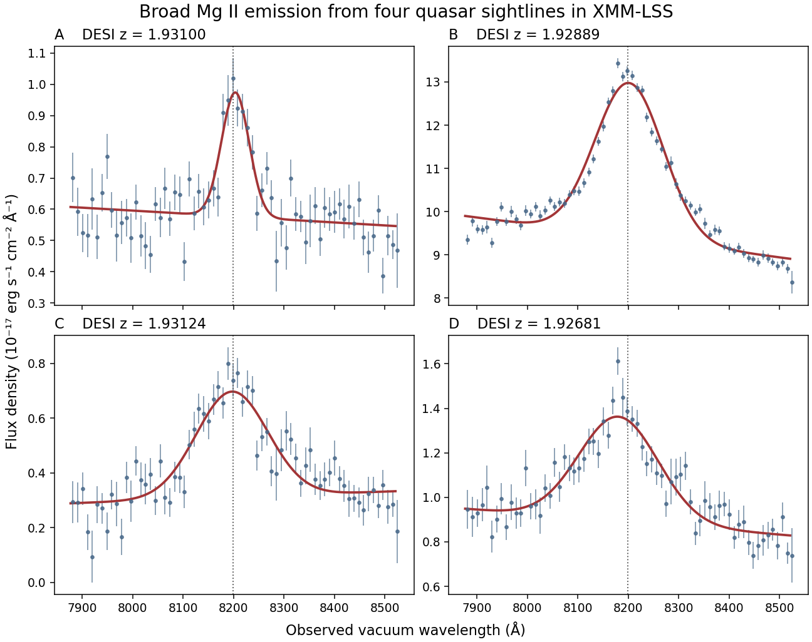

# Four spectroscopic quasars within 0.97 proper Mpc in XMM-LSS

Four separate DESI targets centered on **RA 36.31513°, Dec −4.78245°** have quasar spectra near **z = 1.9295**. All six pairwise projected separations lie between **357 and 966.5 proper kpc**. The maximum rest-frame velocity difference calculated from the four DESI catalog redshifts is **453 km/s**. This was the most compact of 13 qualifying quartets in a survey-wide search of 1,372,972 quality-screened targets. Earlier catalogs list all four quasars individually. The archival finding is their four-member configuration. Whether the four nuclei occupy a single halo remains open.

| Member | DESI target ID | DESI z | Milliquas v8 z | Mg II fit z | Mg II FWHM (km/s) | 4XMM offset (arcsec) | XMM-SERVS full-band net counts |
|---|---|---:|---:|---:|---:|---:|---:|
| A | 39627670652198326 | 1.93100 | 1.928 | 1.93107 | 2,349 | 1.53 | — |
| B | 39627670652198407 | 1.92889 | 1.924 | 1.93055 | 5,817 | 0.41 | 902 |
| C | 39627670652198494 | 1.93124 | 1.930 | 1.92872 | 6,129 | 0.98 | 380 |
| D | 39627670652199228 | 1.92681 | 1.926 | 1.92296 | 6,787 | 0.44 | 442 |

[Member positions and identifiers](members.csv) · [All 13 quartets](survey-quartets.csv) · [DESI DR1](https://data.desi.lbl.gov/doc/releases/dr1/) · [Milliquas v8](https://www.quasars.org/MQv8.pdf)

Points show inverse-variance weighted 9.6 Å bins, with one-standard-error bars. Red curves fit native unmasked pixels with a linear continuum and one Gaussian using a robust soft-L1 loss. Dotted lines mark the Mg II blend at 2798.75 Å redshifted to z = 1.9295. These are descriptive broad-line fits. Fe II, asymmetry and partial absorption can shift the centroids. Their full redshift span corresponds to roughly **830 km/s**, illustrating why the 453 km/s whole-spectrum result alone cannot establish the velocity dispersion of a bound halo.

## Evidence across archives

The four target positions are separated by 42.51–115.05 arcseconds. All four have broad C IV and Mg II in the archived main-survey spectra. A's fitted Mg II line is substantially narrower than B, C and D. The catalog used a survey-validation observation for D. A separate main-survey observation gives z = 1.92670, within 12 km/s of the earlier observation. The other three catalog rows and their extracted pixels come from the same survey. Three targets had spectroscopic redshifts from before DESI in Milliquas. The catalog attributes D's redshift to DESI EDR. Milliquas cites earlier source names for all four. [DESI catalog observations](catalogs/desi-zpix.csv) · [Milliquas field](catalogs/milliquas.tsv)

All four positions fall within 1.53 arcseconds of separate 4XMM-DR13 sources. A's entry is marginal, with detection likelihood 8.02, one detection and a flux uncertainty 74% of the measured flux. A also has no XMM-SERVS match within 41 arcseconds. The other three have 4XMM detection likelihoods of 174–790 and are recovered in the deep XMM-SERVS analysis at 380–902 net counts each. Those two catalogs use overlapping XMM exposures. Optical spectroscopy and X-ray detection provide independent kinds of evidence. [4XMM field](catalogs/4xmm-dr13.tsv) · [XMM-SERVS field](catalogs/xmm-servs.tsv) · [Chen et al. 2018](https://doi.org/10.1093/mnras/sty1036)

## Search and controls

We searched DESI's tile-cumulative DR1 quasar catalog at 0.6 < z < 4.4, keeping valid fibers, ZWARN = 0, SPECTYPE = QSO, and at least two of six QuasarNet line confidences above 0.8. We required |Z_RR − Z_QN| / (1 + Z) < 0.015. For repeat TARGETIDs we kept the highest TSNR2_QSO eligible row. We enumerated four-member groups with each of the six separations greater than 8 arcseconds, at most 1.8 proper Mpc, and each pair's |Δln(1+z)| less than 1400 km/s divided by c. The angular chord is converted with a flat cosmology with H₀ = 70 km/s/Mpc and Ωₘ = 0.3. We ranked by maximum projected separation. All 13 groups and their members are released, including 12 wider systems for which priority was not assessed. An earlier exploratory pass checked triplets up to 700 kpc / 1200 km/s. The numerical control thresholds below were chosen after inspecting the ranked quartet list.

- **Survey-wide shuffle.** At the rounded envelope of 1.0 proper Mpc and 500 km/s, one quartet passed among 7,439 geometrically possible quartets. We shuffled measured redshifts at fixed positions within 3° RA × 0.035 sin(dec) cells. None of 500 full-survey realizations produced a qualifying quartet. This null removes real clustering along with chance associations.
- **Preserve real triples.** For each geometrically suitable quartet we retained any coherent triple and resampled the possible fourth target's redshift within its own sky cell. We found eleven such choices in eight four-point geometries. Across 10,000 realizations, 9,191 had no qualifying quartet, 776 had one and 33 had two. Real triples plus an interloper therefore produced a qualifying configuration somewhere in the survey in **8.09%** of trials. This is a conditional frequency under a specified scrambling procedure. It is neither a posterior probability for this source nor a blind discovery significance. Real quasar clustering, correlated selection and broad-line offsets limit physical membership inferences.

## Two further checks

Three quasars in the J1013−0148 field form a triangle only 220 proper kpc across. Their redshifts agree across multiple emission lines, while their Mg II widths differ substantially. The wider fourth target has an ambiguous redshift. [Spectra, redshift alternatives and controls for the compact triplet](j1013-triplet/README.md)

For the XMM-LSS quartet, 19 of 355 catalog galaxies within 2 arcmin have photometric redshifts near the four quasars, compared with a median of 2.84% in nearby fields of comparable source count. Of 555 comparison apertures, 46 reached at least this fraction. The imaging data give limited support for a surrounding galaxy overdensity. [Galaxy counts and all nine aperture tests](environment/README.md)

## Prior reports

Garcet et al. tabulated B and D individually as X-ray AGN in 2007. XMM-SERVS tabulated B, C and D in 2018, and Milliquas v8 included all four individually by 2023. The 2026 GraL catalog of 364 confirmed lenses has no listed component in a 10-arcmin cone around the quartet. The nearest component in Jing et al.'s published 1,842-row DESI pair table is 38.96 arcmin away. Their 110-kpc limit excludes all six internal edges by construction. The nearest component with parseable coordinates in the Big MAC DR1 main, triple, quadruple and quintuple tables lies 1.78°, 6.64°, 96.26° and 113.89° away, respectively. These catalogs emphasize tight, interacting systems. Searches under the known aliases, sky position, XMM-LSS, XXL, quartet and protocluster terms did not locate an earlier report identifying these four specifically as one configuration. An unindexed prior identification is possible. No halo mass or evidence of synchronized accretion is inferred. [Garcet et al.](https://arxiv.org/abs/0709.2077) · [GraL catalog query](catalogs/gral.tsv) · [Jing et al.](https://doi.org/10.3847/1538-4357/ae517a) · [Pfeifle et al.](https://arxiv.org/abs/2411.12799)

## Reproduce

With Python, NumPy, SciPy and Matplotlib, run `python measure.py --plot` from this directory. This regenerates the geometry, fits for twelve line regions and the figure from the supplied spectral pixels. With Astropy installed, add `--extract coadd-main-dark-17689.fits` to regenerate the input pixels. Both catalogs below are public primary data products. The catalog SHA-256 is `a65604303cc29af8865db9193a23934b2540591b16c5afd2a4bea2d61464aef4`. The coadd SHA-256 is `8c438314540343e1110d3b8b288e6970964017042e755eef197a5975ec7b77cf`. [Original quasar catalog, 816 MB](https://data.desi.lbl.gov/public/dr1/survey/catalogs/dr1/QSO/iron/QSO_cat_iron_cumulative_v0.fits) · [Original spectral coadd, 782 MB](https://data.desi.lbl.gov/public/dr1/spectro/redux/iron/healpix/main/dark/176/17689/coadd-main-dark-17689.fits)

Run `python survey.py QSO_cat_iron_cumulative_v0.fits` for the parent selection, all 13 ranked groups and both seeded randomization controls. Run `python prior_art.py` with network access to repeat the machine-readable Jing and Big MAC comparisons. The VizieR response headers in the archived field queries identify the source table and cone.
