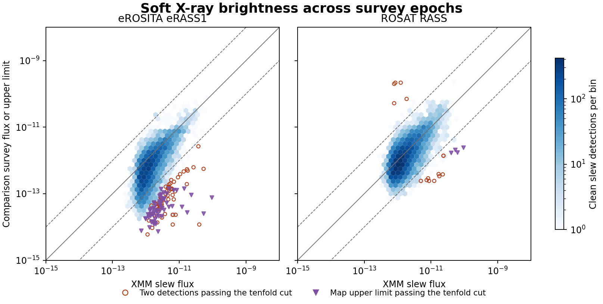

# A candidate 63-fold soft X-ray decline in KUG 1256+241

**The known Seyfert 1 galaxy KUG 1256+241 (2MASX J12585149+2355268) is a candidate for a previously unreported 63.2-fold decline between ROSAT and eROSITA.** At ICRS **194.714898°, +23.923199°**, the observed 0.2–2.0 keV flux fell from **(4.65 ± 0.33) × 10⁻¹²** in RASS to **(7.36 ± 2.39) × 10⁻¹⁴ erg cm⁻² s⁻¹** in eRASS1. An intervening XMM slew measured **(6.77 ± 3.18) × 10⁻¹³** in 2014. The RASS/eRASS1 ratio is 33.3 after guarding both statistical errors. Ten spectra consistent with the measured ROSAT colours leave it at **17.8 or greater** at fixed eROSITA calibration. The ROSAT beam cannot separate all optical components. Ordinary recurrent AGN variability is plausible, and a later eROSITA detection establishes continued emission. Two survey endpoints do not time the decline or establish its physical cause. [Candidate record](outputs/candidates.csv) · [Native ROSAT measurements](outputs/rass_hardness/source_diagnostics.csv) · [Optical and X-ray associations](outputs/host_adjudication_alternatives.csv)

**What is potentially new is the measured RASS-to-eRASS1 change.** The 2001 ROSAT Seyfert study identifies this galaxy, and later electronic tables link its eROSITA, ROSAT and Chandra detections. None of the reviewed records explicitly reports this amplitude between these two epochs. The complete Li et al. slew-variability catalogue excludes this source. In a 35-arcsec field, ANTARES returned two optical alert locations. The near-nuclear location is 3.77 arcsec from the refined X-ray position and has 254 alerts spanning June 2018 to January 2026. Neither location carries a TNS association. The broker recovered two of four named controls. Its alert coverage does not extend back to the ROSAT epoch, and direct access to a complete public TNS census failed. **Novelty remains provisional.** [Primary ROSAT study](https://doi.org/10.1046/j.1365-8711.2001.04763.x) · [Published later association](outputs/paper_context/dr2hc.json) · [Source-specific bibliography](outputs/seyfert_literature.json) · [Broker cross-check](outputs/broker_cones.json)

Across the three surveys, **176 guarded tenfold comparisons** traced to **161 slew detections at 135 distinct designations**. The final source review retained **one candidate**. Nine detections were at five previously reported flare sources, 38 more were named slew variables in Li et al., and 34 were identified as known or stellar. **Seventy-nine detections at 60 designations remain inconclusive.** The search establishes no new TDE, binary or permanent AGN switch-off. The release-name, stellar and host checks preserve the distinction between a published source, a published flare, and a new comparison using a later epoch. [Final counts](outputs/final_summary.json) · [Fluxes, limits, positions, hosts and decisions for every lead](outputs/final_source_register.csv)

All 161 detections received usable Legacy, Gaia, WISE, SIMBAD, NED, VSX and published-list checks. The complete Li et al. electronic table accounts for 56 of the 135 designations (63 detections). The initial uniform screen produced zero candidates because it required a complete TNS census and treated several nearby optical components as ambiguous. Individual review promoted KUG 1256+241 after the bright-state localization, independent host identification, ROSAT spectrum, source-specific publications and local alert records were available. No Gaia astrometric/variable star or extra eRASS1 Main source appeared inside the approximate bright-state 95% region. The public evidence supports a candidate for this brightness change while leaving the population incidence unconstrained. [Original screening](outputs/review_register.csv.gz) · [Li matches](outputs/paper_context/li_overlap.csv) · [Individual adjudication](source_decisions.csv)
## Galaxy-field photometry

Fluxes here are observed 0.2–2.0 keV in erg cm⁻² s⁻¹. Errors are the catalogue one-sigma statistical uncertainties. Positions are the refined X-ray coordinates in ICRS degrees. The nominal ratio uses central fluxes. The guarded ratio uses the low end of the bright flux and the high end of the faint flux.

| XMMSL2 source and proposed optical/IR host | RA, Dec | ROSAT RASS | XMM slew | eRASS1 | Nominal / guarded / original spectral floor |
|---|---|---|---|---|---|
| J052443.6−613005 · WISEA J052443.74−613006.6 | 81.183915, −61.500695 | <2.88 × 10⁻¹² | (1.54 ± 0.56) × 10⁻¹² | (9.36 ± 2.90) × 10⁻¹⁵ | 165 / 30.2 / 28.4, XMM over eRASS1 |
| J125851.2+235522 · 2MASX J12585149+2355268 | 194.714898, +23.923199 | (4.65 ± 0.33) × 10⁻¹² | (6.77 ± 3.18) × 10⁻¹³ | (7.36 ± 2.39) × 10⁻¹⁴ | 63.2 / 33.3 / 12.6, RASS over eRASS1 |

**J052443.6−613005.** The 9 December 2004 slew recorded 7.92 net soft counts in 7.36 s, with detection likelihood 35.6. The eROSITA and XMM positions differ by 4.12 arcsec. The primary Legacy galaxy has relative counterpart probability 0.997 and overall association probability 0.839 in the published eROSITA match. Its local probability of finding a galaxy at least this close and bright is 0.00074. One Gaia astrometric or variable source lies within the bright-state positional region. Most importantly, the complete Li et al. electronic table names this exact XMMSL2 source among previously reported highly variable sources. The original table gives a slew/RASS lower bound of about 20. The casebook's title and landing-page searches missed that association. [Source dossier](outputs/casework/XMMSL2_J052443_6-613005.json) · [Published counterpart catalogue matches](outputs/published_hosts/LS10.csv.gz) · [Li et al. variability sample](https://doi.org/10.1093/mnras/stac714)

**J125851.2+235522.** The host is a previously identified Seyfert 1 galaxy, KUG 1256+241, also known as RX J1258.8+2355. The bright ROSAT detection appears in a published 0.25-keV-selected Seyfert sample. The older ROSAT Bright Source Catalogue gives 0.430 ± 0.032 counts s⁻¹ and 2RXS gives 0.462 ± 0.033 counts s⁻¹ from the same survey. The XMM measurement on 18 July 2014 lies between the two epochs and is 9.20 times the eROSITA flux. The published eROSITA match has relative counterpart probability 0.9994 and overall association probability 0.9987. There are three Legacy extended components in the refined region. The independent search found no Gaia astrometric or variable rival and no extra eRASS1 Main source in the approximate bright-state 95% circle. Swift also detected 2SXPS J125851.4+235529 within 6.47 arcsec of the refined position. [Primary ROSAT study](https://doi.org/10.1046/j.1365-8711.2001.04763.x) · [Source dossier](outputs/casework/XMMSL2_J125851_2+235522.json)

**A galaxy field with ambiguous ownership.** XMMSL2 J200453.7−745359 had an XMM flux of 2.55 × 10⁻¹², an eRASS1 limit of 6.02 × 10⁻¹⁴ and a ROSAT limit of 3.71 × 10⁻¹². The XMM/eROSITA contrast was 42.4 nominally and 12.3 with the uncertainty cut. The extended spectral grid gives a floor of 11.4. Two independently identified bright galaxies fall within the approximate 21.2-arcsec bright-state 95% circle, WISEA J200453.49−745406.2 (7.68 arcsec) and WISEA J200457.41−745350.2 (16.58 arcsec). Their local chance probabilities are 0.0041 and 0.0065. The 7.88 net slew counts and the absence of a unique host leave the physical identification unresolved. [Alternative hosts](outputs/host_adjudication_alternatives.csv) · [Slew-image follow-up](outputs/slew_image_followup.json)

### Spectral and historical checks on the Seyfert

2RXS measured 0.4618 ± 0.0326 counts s⁻¹ in 483 s with detection likelihood 495. Its hardness ratios were HR1 = −0.324 ± 0.053 and HR2 = +0.047 ± 0.095. Ten grid spectra agreed with these two colours within three marginal errors. Even the smallest of their ROSAT conversion factors left a guarded decline of 17.80 with the eROSITA conversion fixed. The absorbed-power-law fit in the native catalogue gave χ² = 14.96 for 15 degrees of freedom. Two colours cannot determine a unique spectrum. [Native 2RXS measurements](outputs/rass_hardness/rass2rxs_native.csv) · [PSPC response and colour grid](outputs/rass_hardness/pspc_colour_grid.csv)

Swift measured a mean observed **0.3–10 keV** flux of (4.49 ± 1.74) × 10⁻¹³ over 1,385 s of exposure spanning 2008–2017. Its two catalogue records gave a constant-rate probability of 0.190 in the total band. The later 3eRASS catalogue links the source to the same 2RXS detection and publishes a 0.2–2.3 keV flux of 4.65 × 10⁻¹³. The three recovered hard-catalogue rows repeat one detection at 7.58 × 10⁻¹³ over 0.2–5 keV. Those rows establish source association and later emission. They contain no explicit earlier ROSAT-to-eRASS1 amplitude. The 2001 Seyfert study establishes prior identification of the bright state. [Swift record and band definitions](outputs/rass_hardness/swift2sxps_review.json) · [Later main-band row](outputs/paper_context/dr2mc.json) · [Later hard-catalogue row](outputs/paper_context/dr2hc.json)
## Larger amplitudes with known or ambiguous sources

- **XMMSL2 J063045.7−603110** had an XMM flux 2,107 times the later eROSITA upper limit, or 1,835 times after accounting for the XMM uncertainty. The 1 December 2011 XMM high state was announced contemporaneously as XMMSL1 J063045.9−603110 in ATel 3811. ATel 3821 reported Swift follow-up and a later paper investigated a TDE interpretation. This is a direct recovery of a published event. [Original telegram](https://ui.adsabs.harvard.edu/abs/2011ATel.3811....1R) · [Peer-reviewed interpretation](https://doi.org/10.1051/0004-6361/201628737)
- **XMMSL2 J090822.4−643751** was 298 times its eROSITA limit, or 234 times after the uncertainty cut. Both a WISE galaxy (0.96 arcsec) and a catalogued low-mass star (0.70 arcsec) fit the slew position. Two Gaia objects show significant stellar astrometry within the association region. Li et al. included this source in their published variability table. The measurement does not identify which object brightened. [Positional alternatives](outputs/vetting/counterpart_evidence.jsonl.gz) · [Source dossier](outputs/casework/XMMSL2_J090822_4-643751.json)
- **XMMSL2 J060636.5−694932** reached the largest nominal contrast, 3,366 times. XMMSL2 already identified the source as a candidate nova under its XMMSL1 name; SIMBAD and VSX returned the nova association in this field. It is also named in Li et al. A second 2006 slew produced a smaller contrast. V598 Pup (XMMSL2 J070542.7−381442), another large contrast, appears in both Li et al. and VSX. [Per-observation fluxes and identifications](outputs/final_source_register.csv)

Native EPIC-pn products matter for this check. The release-named image tiles did not cover the catalogue positions in the reprocessed archive. Checking the sky footprint, observation identifier and crossing time of every segment recovered one compatible image/event pair for each of three targets. Within 30 arcsec, the 0.2–2.0 keV event lists contained **7 photons at J200453.7−745359, 7 at J052443.6−613005 and 128 at J141922.0−263842**. The event positions came from one compatible segment per observation. These are aperture counts, while XMMSL2 reports fitted net counts. The seven photons at J200453 establish local emission with sparse positional information. Both galaxy alternatives are retained. J141922 is the previously studied active galaxy ESO 511−G030. [Native products, checksums and per-photon checks](outputs/slew_image_followup.json) · [Published ESO 511−G030 variability study](https://doi.org/10.3847/2515-5172/abe857)
## What the searches recovered

| Measurement | Result |
|---|---:|
| XMMSL2 full detections / unique release designations | 72,352 / 64,487 |
| XMMSL2 clean detections | 29,393 |
| eRASS1 Main / Supplementary rows | 930,203 / 347,274 |
| 2RXS entries | 135,118 |
| Comparable bright-to-faint mission pairs | 50,370 |
| Slew detections with a quality-qualified comparison | 17,225 |
| Slew detections with any nominal tenfold contrast | 3,996 |
| Slew detections with a quality-qualified nominal tenfold contrast | 1,306 |
| Qualifying comparisons after accounting for statistical errors | 176 |
| Corresponding slew detections / distinct XMMSL2 designations | 161 / 135 |
| Detections with a tenfold contrast across the original spectral grid | 124 |

Of the 176 qualifying comparisons, 63 have XMM above an eROSITA map limit, 58 have XMM brighter than an eROSITA detection, and 4 have XMM above a ROSAT map limit. Another 15 compare detections in XMM and ROSAT. The remaining 36 compare ROSAT and eROSITA at a slew-source position. The registers retain repeated XMM visits. Reusing the same ROSAT or eROSITA measurement can reproduce a comparison across multiple visits. [Complete pair ledger](outputs/comparisons.csv.gz) · [Machine-readable totals](outputs/summary.json)

The eROSITA service supplied 16,396 usable source-position limits, with median exposure 145 s and median limit 6.50 × 10⁻¹⁴ erg cm⁻² s⁻¹. Another 33,017 slew positions fell outside the public footprint, 2,770 were too close to a detected source, and 20,169 had a catalogue neighbour. ROSAT supplied 49,348 limits, with median exposure 397 s and median limit 2.41 × 10⁻¹² erg cm⁻² s⁻¹. There were 178 masked or unexposed positions, 18 archive failures and 22,808 catalogue neighbours. Counts here refer to slew rows. All 16,396 eROSITA limits agreed between reductions. Reviewing the edges of overlapping ROSAT fields added three valid limits and changed 88 of the 49,345 shared values by more than 1%. [Coverage and repeatability](outputs/limits_qa.json) · [Status counts](outputs/limits_summary.json)

The eight 20-arcmin shifted skies gave **12.125 chance pairs per shift against 58 real XMM–eROSITA detection pairs** after the photometric cuts (individual shifts 2–21), and **3.5 against 15 XMM–ROSAT pairs** (1–9). These correspond to estimated false-association fractions of **20.9% and 23.3%** for those detection-pair selections. Across all positional matches before the cuts the estimates were 4.88% and 1.77%. The estimates apply to those samples. Map-limit and ROSAT–eROSITA pairs have different selection functions. [Shift definitions, counts and individual directions](outputs/shifted_controls.json)

Chance optical neighbours are common. In four shifted circles per input, 330/644 contained Gaia sources, 335/644 contained WISE sources, and 294/644 contained a Legacy extended source. The corresponding actual fields contained 143/161, 149/161 and 78/161. Host-specific checks also compared each prospective galaxy with 120 local shifted positions and with the probability of a field galaxy at least as bright and as close. [Four-shift controls](outputs/vetting/host_shifted_controls.csv) · [Field-specific galaxy scores](outputs/published_hosts/local_galaxies.csv)

Four of five published slew flares passed the tenfold screen, including NGC 3599, SDSS J120136.02+300305.5, 2MASX J06192755−6553079 and XMMSL1 J074008.2−853927. The fifth, SDSS J132341.97+482701.3, illustrates limited sensitivity. Its local ROSAT comparison gave 1.33× nominally and 0.72× after accounting for errors. A missed flare is possible even at a known source. [Positive-control fluxes and discovery papers](outputs/positive_controls.csv)

Among the 42,959 full-only slew rows, 13,183 had positive soft-band photometry, and 904 had a positive measurement in another slew. Two rows met the point-source, instrument, count (at least five net) and flux-precision (at least three times its error) cuts together. Neither had an equally strong independent slew or sufficiently close, high-likelihood matches to both later/earlier catalogues. Neither of those two rows reached even a nominal factor of ten in an admissible comparison. The separate dossiers identify XMMSL2 J171731.9−665703 (HD 155555C) and XMMSL2 J051937.2−323911, with 29.26 and 14.91 net soft counts. [Full-only audit](outputs/full_only_review.csv) · [Individual source and image checks](outputs/full_only_review.json)

The original ROSAT Bright and Faint Source Catalogues supplied plausible historical neighbours for 63 leads. None affected a qualifying comparison that used a new ROSAT map limit. Their observations sample the same RASS epoch as 2RXS. [All 1RXS alternatives](outputs/rass_legacy.csv) · [Completeness and provenance](outputs/rass_legacy_status.json)

A second spectral check tested blackbodies at 0.05, 0.08 and 0.12 keV and harder power laws behind columns up to 10²² cm⁻². Of the 161 detections, 117 kept at least one guarded tenfold comparison, both when the epochs shared a model and when the model could vary by epoch. The test refolded the ROSAT response, kept the released XMM count-to-flux conversion and varied the eROSITA band ratio at fixed native conversion. It is a finite model test. [Per-detection floors](outputs/spectral_stress_leads.csv) · [Response, models and assumptions](outputs/spectral_stress.json)


## Sample and epochs

The observing unit is a slew detection. Overlapping slews can record the same source on different dates. The search begins with the complete XMMSL2 release, identifies the clean subset by observation and position, and retains unqualified full-catalogue rows in the comparison file. The 2,114 constituent slews span 26 August 2001 to 31 December 2014. The ROSAT epoch is its 1990–91 all-sky survey. The eROSITA epoch is the first six-month scan in 2019–20, restricted to the public German half-sky. A limit measures the average over the contributing scans. A shorter flare can be diluted. [XMMSL2 release guide](https://www.cosmos.esa.int/web/xmm-newton/xmmsl2-ug) · [2RXS catalogue](https://heasarc.gsfc.nasa.gov/W3Browse/rosat/rass2rxs.html) · [eROSITA-DE DR1](https://erosita.mpe.mpg.de/dr1/)

HEASARC now assigns its rolling `xmmslewcln` and `xmmslewful` names to XMMSL3.1. The two versioned HEASARC FITS files below preserve XMMSL2. The eROSITA soft-band lookup includes the DR1 Main v1.2 and Supplementary releases. A low-likelihood or ambiguous catalogue match prevents treating that direction as a nondetection. The hard-band file supplies a separate check on emission at 2.3–5 keV. The ROSAT Bright and Faint Source Catalogues supply older measurements of the same survey epoch. [HEASARC slew release directory](https://heasarc.gsfc.nasa.gov/FTP/xmm/data/catalogues/) · [eROSITA DR1 catalogues and data models](https://erosita.mpe.mpg.de/dr1/AllSkySurveyData_dr1/Catalogues_dr1/)

Both catalogue matching and the controls use a radius of 3.44 times the quadrature positional uncertainty, capped at 40 arcsec for eROSITA and 75 arcsec for ROSAT. The 2RXS projection has no individual positional errors, so it uses 20 arcsec in quadrature with 6 arcsec. Multiple viable counterparts or distinct slew sources sharing a comparison detection disqualify that pair. Candidate point sources require a soft-band detection likelihood of at least 10, usable uncertainties and mission-specific masks for extension, optical loading, neighbours and instrumental artefacts. A low-quality detection can block an upper limit. [Release columns and quality flags](outputs/catalog_schema.json) · [Selection and matching](catalogs.py)

## Fluxes and limits

All comparisons use **observed 0.2–2.0 keV energy flux** in erg cm⁻² s⁻¹. XMMSL2 gives this quantity in band 6, in units of 10⁻¹² erg cm⁻² s⁻¹. Its native point-source calibration assumes a power-law photon index of 1.7 and a hydrogen column of 3 × 10²⁰ cm⁻². One band-6 count s⁻¹ corresponds to 1.436 × 10⁻¹² erg cm⁻² s⁻¹. The reader tests the unit scaling against the independent band-6 count rate. For eROSITA the native 0.2–2.3 keV catalogue flux and its uncertainty are multiplied by 0.923744. For ROSAT each PSPC count s⁻¹ gives 1.00746 × 10⁻¹¹ erg cm⁻² s⁻¹ in the comparison band. The analysis folds an absorbed power law with photon index 2 and hydrogen column 3 × 10²⁰ cm⁻² through the PSPC-C gain-1 response over channels 11–235. The eROSITA factor is the ratio of absorbed energy integrals. The model grid spans photon indices 1.5, 2, 2.5 and 3 and columns 10²⁰, 3 × 10²⁰ and 10²¹ cm⁻². The eROSITA calculation varies the band integral at fixed release calibration. XMMSL2 retains its released band calibration. Supersoft thermal sources, changing absorption and spectra outside the grid can give different amplitudes. [Numerical model](outputs/spectral_model.json) · [Count-rate conversion code](catalogs.py)

For eROSITA, the DR1 aperture-photometry service returned the local counts, exposure, source-neighbour flag and 99.87% `UL_B` in band 024. The search excludes flagged positions and records directions outside the release. For ROSAT, the search summed native broad-band photon counts within a 3-arcmin aperture including its boundary pixels. It used the minimum valid exposure inside the aperture, attributed all counts to the source and assumed at least half the point-source photons fall inside. The upper Poisson mean is the 99.865th percentile of a gamma distribution with shape (N+1) and unit scale. The construction deliberately loses sensitivity on bright diffuse backgrounds. The per-position record identifies the maps, exposure and method. [eROSITA upper-limit products](https://erosita.mpe.mpg.de/dr1/AllSkySurveyData_dr1/UpperLimitServer_dr1/) · [ROSAT map inventory](outputs/limits_inputs.csv) · [Per-position measurements](outputs/limits.csv)

For a measured high and low epoch the guarded amplitude is $(F_h-1.96\sigma_h)/(F_l+1.96\sigma_l)$, with the numerator floored at zero. For a faint-epoch upper limit the denominator is that limit. These are screening cuts using catalogue errors and point-source calibrations. They do not give a global false-alarm probability across the survey. All nominal ratios and comparisons falling below the cuts remain in the ledger. The independently minimized high-epoch band factor and maximized low-epoch factor give the spectral stress test. Two or three survey snapshots can establish a soft-flux change. A TDE, an accretion-state change and a stellar flare require different evidence for physical classification. [Pair ledger](outputs/comparisons.csv.gz) · [Comparison rules](prepare.py)

## Optical identifications and prior reports

The vetting register keeps the optical/IR position, separation, alternate associations, published names and individual service outcomes. For each usable eROSITA detection the analysis uses its more precise localization when available. It queries Legacy Surveys DR10, Gaia DR3, AllWISE, SIMBAD, NED and the AAVSO variable-star catalogue, and checks eROSITA counterpart releases, TNS, published TDE and slew-variability samples. The source casebook searches instrument names and host aliases for contemporaneous notices and published descriptions. A host galaxy or an X-ray binary name may be known even if a particular brightness change has yet to be reported. TNS covers only part of the historical period. Query failures and possible foreground stars can leave the event unresolved. [Host decisions](outputs/vetting/vetting.csv) · [Alternative counterparts and bibliography](outputs/vetting/counterpart_evidence.jsonl.gz) · [Published optical/IR identifications](outputs/published_hosts/manifest.json) · [Source case index](outputs/casework/case_index.csv) · [Earlier ROSAT catalogue checks](outputs/rass_legacy.csv)


The positional comparison includes all 265 entries of Li et al., published TDE and slew samples, and 546 coordinates from the archived Open TDE Catalog and OTTER search. The source casebook contains 93 dossiers. The historical search covered 33,649 GCN entries and 16,034 SIMBAD-indexed Astronomer’s Telegram records. The latter recovered the original XMMSL1 J063045.9−603110 notice. A bibliographic association may describe the host, another band or a different epoch. The register distinguishes those from a publication that identifies the high state. Publisher landing pages and timeouts limit some individual full-text checks. [Catalogue inventory](outputs/vetting/publication_coverage.json) · [Primary-source casebook](outputs/casework/historical_casebook.jsonl) · [TDE inputs](outputs/event_history/tde_inputs.json)
## Input receipts

The hashes below cover the downloaded release bytes. The 2RXS hashes cover the two complete query responses before filtering. The receipts include the exact TAP column projection and row counts. Map and ancillary-catalogue products have separate receipts because each measurement can draw on a different sky tile.

| Input | SHA-256 |
|---|---|
| XMMSL2 clean FITS, gzip | `2f015371362ce588d73ea149f8905859092e8adf008f1f5758995f0a812123ec` |
| XMMSL2 full FITS, gzip | `9e82e23a9e4ae6f79e33e2314f5ec5c787a42bfbbc68c8cce1b0920ea963d819` |
| eRASS1 Main v1.2 FITS archive | `a4af6173c93bd4367d8a37465bdf5061b6092f02b8f522fc68074afff0e59131` |
| eRASS1 Supplementary FITS archive | `c320ae2311e76e54ac44e10992d29f562238819a01df068534e2b3a29cfa8e9a` |
| 2RXS, right ascension 0° to <180° | `b351bcc5d9222699c0b8b2bcef52f7e1e3ab4f72044ef4e8605d4ff6fead0b69` |
| 2RXS, right ascension 180° to <360° | `926babf19d2c4e17061191352030d51c978099ad8d62db934732c172cd4e891d` |
| ROSAT PSPC-C gain-1 response | `b421bbad8eaf93a0bedf6704c18ff2cdf3e77781382888245219cf609c33b1bd` |

The 265-row Li et al. electronic table has projection SHA-256 `ec4c78cc148d526eafaa5f86ec034d70c1fa4d93f52a1cc23bf96b6b3dacd725`. [Published-list coverage](outputs/vetting/publication_coverage.json)

[Archive URLs, queries, byte counts and SHA-256](outputs/catalog_inputs.json) · [Map receipts](outputs/limits_inputs.csv) · [eROSITA per-cone response receipts](outputs/ero_ul_queries.jsonl.gz) · [Counterpart and literature query log](outputs/vetting/vetting_provenance.jsonl.gz)

## Reproduce on GitHub Actions

The [study workflow](../../.github/workflows/xmmsl2-erass1-rass.yml) contains the pinned science dependencies, catalogue matching, positional controls, map photometry, source vetting and final repository checks. The [catalogue, map and source review](https://github.com/dovvnloading/Open-Space/actions/runs/44994265088) and [native spectral and publication adjudication](https://github.com/dovvnloading/Open-Space/actions/runs/44998747972) produced the archived inputs to the [native-segment audit](https://github.com/dovvnloading/Open-Space/actions/runs/45000028556). The job checks Git objects before reusing these products. From a checkout with GitHub CLI access, replay the latest successful research-branch run with the following commands.

```sh
study_run=$(gh run list --repo dovvnloading/Open-Space --branch survey/xmmsl2-erass1-rass \
  --status success --limit 100 --json databaseId,workflowName \
  --jq '[.[] | select(.workflowName == "XMM slew transients across three surveys")][0].databaseId')
gh run rerun "$study_run" --repo dovvnloading/Open-Space
gh run watch "$study_run" --repo dovvnloading/Open-Space --exit-status
```

For a fresh run on the research branch after the workflow is registered on the default branch, use:

```sh
gh workflow run xmmsl2-erass1-rass.yml --repo dovvnloading/Open-Space \
  --ref survey/xmmsl2-erass1-rass -f refresh=true
```

A push changing the workflow file on the research branch also starts a run. The final job writes the results into this folder and runs `python -m open_space.verify` and `python -m unittest discover -s tests`. Live services and bibliographic catalogues can change. The committed records preserve the measurements and service coverage used here.
