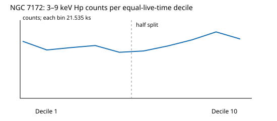

# NGC 7172: a within-visit iron-band count comparison

The predeclared test found no significant change in the ratio of iron-band to nearby sideband counts between the two chronological halves of XRISM/Resolve observation 202074010. The ratios are 708/481 and 789/508; their ratio is 1.055 (approximate 95% interval 0.898–1.239), and the two-sided conditional Fisher test gives p=0.5384. These are observed counts, not calibrated astrophysical line fluxes. A non-significant test does not establish a constant line: the interval permits substantial changes, and the comparison is conditional on stable local continuum shape and background. The two halves are from the same visit and instrument.

The split and bands were committed in [PROTOCOL.md](PROTOCOL.md) before reading event energies or counts (commit c572662). The line band is observed 6.31–6.38 keV; sides are 6.20–6.27 and 6.42–6.49 keV. Fe Kα has a doublet, intrinsic line shape and a Compton shoulder. This broad-band statistic does not measure a centroid, intrinsic width, velocity, or doublet profile. The continuum-subtracted excesses are 467.5 and 535 counts under a flat local continuum assumption; no background is subtracted, and no claim is made that these are flux measurements.

The input is the HEASARC cleaned Resolve `p0px1000` event file for ObsID 202074010 (2025-10-21 through 27); SHA-256 74230a4c915f9fa7d7ff54bb1d09e242766e1dd1f5af67db3b6d0bf0ad26224c, from https://heasarc.gsfc.nasa.gov/FTP/xrism/data/obs/2/202074010/resolve/event_cl/xa202074010rsl_p0px1000_cl.evt.gz . The screen selects high-resolution primary events (ITYPE=0), excludes calibration pixel 12 and gain-troubled pixel 27, and intersects each event with its pixel-specific GTI from https://heasarc.gsfc.nasa.gov/FTP/xrism/data/obs/2/202074010/resolve/event_uf/xa202074010rsl_px1000_exp.gti.gz (SHA-256 6cf9aedbb903fb8ff2289f835f70a1dfcdd45d2ed0a825f19f82547d44b23d81). Of 37037 grade/pixel-eligible events, zero fail that GTI check. Every retained pixel has 107673.5145 seconds of exposure in each half. The chronological cut is mission elapsed time 215005851.63235 s, TT; the reference epoch is MJD 58484.000800740740741 TT. It splits the total 215347.0290 s global GTI exposure, not the event distribution. Pipeline version 03.03.015.012 and CALDB identifiers gen20241115_xtd20250915_rsl20250915 are recorded in the input header; newer CALDB exists and no reprocessing was performed.

The [mission energy-scale report](https://heasarc.gsfc.nasa.gov/FTP/xrism/postlaunch/gainreports/2/202074010_resolve_energy_scale_report.pdf) (SHA-256 dbfc454c9dabcb38be014568fb16c830ef8ce229e5c57573dd6db73e8e9a1cb6) describes full-array Hp filter-wheel Mn Kα fits at 5.9 keV: FWHM 4.527 ± 0.022 eV and shift 0.0106 ± 0.0088 eV, with zero failed filter-wheel and calibration-pixel gain solutions. These calibration measurements are not a line-spread model at 6.35 keV, and no per-half gain comparison has been made. The pipeline product directory did not provide a usable matching RMF/ARF; HEASoft and a custom response for the selected pixel/grade set were unavailable. The mission notes pixel-dependent grade fractions and recommends appropriate responses. A non-X-ray background spectrum has not been generated. The exploratory continuum and gain-boundary controls below do not remove this uncertainty. Consequently this is a screening result, not a calibrated physical variability constraint. Generate a matched response and night-Earth background, and perform per-half gain calibration, before physical interpretation. See [Resolve analysis guide](https://heasarc.gsfc.nasa.gov/docs/xrism/analysis/abc_guide/Resolve_Data_Analysis.html) and [instrument caveats](https://heasarc.gsfc.nasa.gov/docs/xrism/analysis/ttwof/).

Earlier BeppoSAX work [Dadina et al. 2001](https://arxiv.org/abs/astro-ph/0101324) found line intensity consistent with constant within large uncertainties; [Vasylenko 2018](https://arxiv.org/abs/1808.08457) discussed line behavior and a distant torus interpretation using NuSTAR and prior X-ray observations. This new epoch does not establish the first detection of the line or its variability. Literature checks were bounded to exact source names and ObsID, XRISM, Fe Kα and prior BeppoSAX/NuSTAR studies on 2026-11-17; ADS-specific exhaustive searching remains pending.

Reproduce from the exact two upstream files with Python, NumPy and Astropy. `result.json` contains the primary counts, exact test and per-pixel live times. The script verifies both SHA-256 digests before reading.

```sh
python results/xrism-ngc7172/measure.py INPUT_DIRECTORY result.json
```

## Exploratory controls and offline evidence

After the primary test, but before inspecting the control counts, [the diagnostic plan](PROTOCOL.md) was frozen in commit 2dcb7f9. Left/right sideband counts were 264/217 and 263/245 in the two halves (exploratory Fisher p=0.339). Broad 3–5/7–9 keV counts were 1716/3046 and 1920/3479 (p=0.633). These controls show no strong evidence of a shape change at their sensitivities; they do not prove shape stability. The central 2×2 pixels contributed 398/291 and 444/310 line/side counts; the remaining pixels contributed 310/190 and 345/198. Hp/Mp counts were 8334/20 versus 9603/24 in the center, and 9079/5 versus 10021/13 outside. Grade fractions and spectral response can still depend on energy and pixel.

Moving all fixed band boundaries by −5 eV yielded counts 699/495 and 794/514 (p=0.289); +5 eV gave 697/484 and 788/509 (p=0.389). This stress test was fixed before seeing its counts; 5 eV is conservative relative to the full-array Mn Kα shift reported at 5.9 keV but is not a measured per-half gain error. The gain report's gain history shows zero failed solutions; its graphs and global calibration do not supply a numerical bound on differential half drift. There is no fitted per-half gain drift estimate here. The broad count rate varies across deciles, as shown below; the diagnostics are exploratory and their p-values are not corrected for multiple comparisons.



The compressed [event subset](events.csv.gz) retains TIME, PIXEL, ITYPE, PI, DETX and DETY for all 48074 cleaned events; [GTIs](gti.json) retain the global and pixel intervals. The complete source bytes remain independently identified by hash above. Offline standard-library replay verifies the primary counts and p-value from the subset:

```sh
python results/xrism-ngc7172/replay.py
```

[Diagnostics and their counts](diagnostics.json) are reproducible from the original FITS input with `diagnostics.py`; [search and release receipts](RECEIPTS.md) include the primary archive and public-date query, response listing, and background recipe. The night-Earth database exists but matching CORTIME and background were not measured. The inference therefore remains a conditional observed-count comparison, inconclusive for intrinsic line physics.
