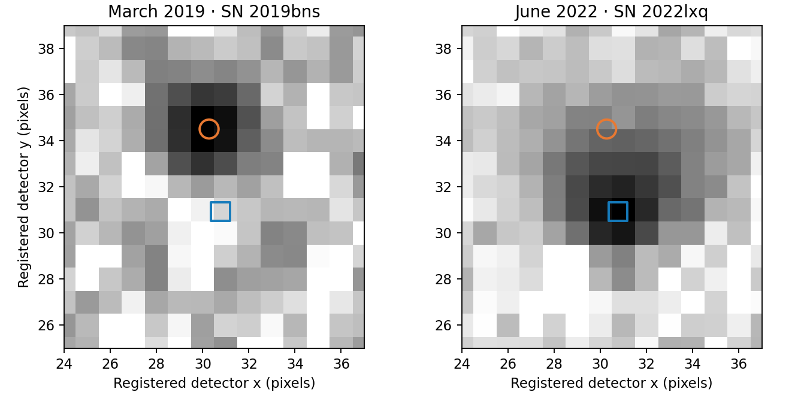

# The second explosion in the light curve of SN 2019bns

The ZTF cosmology release contains a second rise in flux measured at the position of SN 2019bns. It peaks about 1,206 days after the original Type Ia supernova. Registered images show that the second explosion is **SN 2022lxq, 3.6 arcseconds away**. The two supernovae have very different spectroscopic redshifts. An automated host catalog assigns them the same galaxy, and the nearer explosion landed closest to its apparent center. This makes the pair a test case for both late-time transient searches and galaxy assignment. [ZTF SN Ia DR2](https://doi.org/10.1051/0004-6361/202450388) · [Blast 2019bns](https://blast.scimma.org/transients/2019bns/) · [Blast 2022lxq](https://blast.scimma.org/transients/2022lxq/)



Both panels show original, background-subtracted ZTF images on the same detector grid. Each has its own intensity scale. The circle marks SN 2019bns and the square marks SN 2022lxq. The 2019 source is bright at the circle, and the 2022 source is bright at the square. Static reference images from the two alert packets determine the coordinate transformation independently of the two transient centroids.

## Why this pair stood out

We searched the frozen 10,988-row ZTF Bright Transient Survey export for closely separated named supernovae. We used the 10,692 rows with a numerical redshift, a name and a classification string beginning with `SN`. These represent 10,672 distinct names. We joined positions on the unit sphere, removed pairs with the same IAU name, and retained each distinct name pair once. The classification rule excludes rows beginning with `SLSN`. This is a brightness-selected survey snapshot. The counts describe this catalog and selection. [BTS Explorer](https://sites.astro.caltech.edu/ztf/bts/explorer.php?f=s&format=csv)

| Search radius | Distinct name pairs | Largest redshift difference | Next largest |
|---|---:|---:|---:|
| 4″ | 14 | 0.094 | 0.003 |
| 10″ | 55 | 0.094 | 0.017 |
| 30″ | 93 | 0.094 | 0.017 |
| 60″ | 112 | 0.094 | 0.017 |
| 100″ | 124 | 0.094 | 0.062 |

SN 2019bns and SN 2022lxq rank first at each radius. Their BTS separation is 3.6440″ and their reported peak epochs differ by 1,205.77 observer-frame days. This exploratory rank is descriptive. Physical clustering within galaxies and survey selection affect the comparison population.

## Where the light came from

We compared the public P48 red-filter alert images from MJD 58547.470 and 59751.266. The alert cutouts lack absolute world-coordinate headers. We used a reference-to-reference cross-correlation to initialize a translation, then fitted translation, gain and background on the static reference images. We fitted a circular Gaussian and constant background to each difference image. The centroids differ by 3.612 pixels, or about 3.65″ at the nominal ZTF scale of 1.01″ per pixel. Repeating the measurement with three reference-image borders and three centroid windows gives 3.604–3.619 pixels. This interval measures sensitivity to the fitting windows. ZTF alert-coordinate medians independently of this image registration give 3.601″ using three and 26 distinct quality-selected exposures, respectively. Both measurements use ZTF data. [ALeRCE 2019 alerts](https://alerce.online/object/ZTF19aakrnqh) · [ALeRCE 2022 alerts](https://alerce.online/object/ZTF22aamtomc) · [ZTF detector scale](https://doi.org/10.1051/0004-6361/202450388)

At the old position we used all `flag == 0` forced measurements in the windows below. Values are median fluxes in the release's zero-point-30 units. In the peak window, all 12 individual fluxes are positive and range from 1.63 to 3.75 times their individual reported errors. The catalog assigns the release's 99 magnitude sentinel to these rows. We use the flux and its uncertainty directly. [Original DR2 light curve](https://ztfcosmo.in2p3.fr/download/lightcurves__ZTF19aakrnqh_lc.csv)

| Band | Before the 2022 event, MJD 59660–59725 | Near its peak, MJD 59743–59765 |
|---|---:|---:|
| g | −563 (26 measurements) | 44,849 (7) |
| r | 416 (25) | 36,038 (3) |
| i | −278 (5) | 24,133 (2) |

Comparing the two positions on the same exposures gives a more direct test. Across MJD 59733–59785 the old-position DR2 flux is a median **12.5% of the 2022 alert flux in g** over ten matches and **9.7% in r** over six. Their within-band Spearman rank correlations are 0.830 and 0.943. These fractions describe the observed exposures and depend on the point-spread function and extraction. Independent Gaia photometry of Gaia22cvp records the new event at G = 19.04 on June 5, 2022, 16.72 on July 8, and 20.07 on October 26. [Gaia light curve](https://gsaweb.ast.cam.ac.uk/alerts/alert/Gaia22cvp/lightcurve.csv)

## Two spectroscopic distances

| Evidence | SN 2019bns | SN 2022lxq |
|---|---:|---:|
| BTS classification | SN Ia | SN Ia |
| BTS redshift | 0.111 | 0.017 |
| Independent analysis of the 2019 spectrum in ZTF DR2 | SNID 0.10812 ± 0.00297 | — |
| Brightest usable ZTF alert in the same r band | 18.942 mag | 15.839 mag |
| Angular offset from ZTF DR2's proposed 2019 host | 3.806″ | 0.374″ |

We also fitted the **original 2019 Palomar 60-inch SEDM spectrum** against the Hsiao normal Type Ia sequence. The fitted spectral redshift is **0.109** over 4300–8200 Å. Fitting two disjoint windows gives 0.112 in each. Across the full window the best low-redshift fit (0.006–0.036) had 1.546 times the weighted squared residual of the best fit. The two disjoint windows give ratios of 1.317 and 1.616. These are relative goodness-of-fit measurements, with no formal single-object significance attached. The spectrum was obtained 9.6 observer-frame days after the DR2 light-curve maximum. We scanned template phases +3 to +14 days and redshifts 0.000–0.180 in steps of 0.001, allowing a quadratic multiplicative color correction and a linear additive continuum. We excluded the terrestrial B and A absorption bands and non-positive flux or variance. Spectral diversity and supernova ejecta velocities limit the precision of broad-feature redshifts. [DR2 spectrum](https://ztfcosmo.in2p3.fr/download/spectra__ZTF19aakrnqh_20190314_SEDm_0.ascii) · [Hsiao et al. templates](https://doi.org/10.1086/518232)

The 2022 value comes from the SEDM team's June 6 spectrum and SNIascore classification report 12603. We used their reported result. We could not retrieve the 2022 spectral pixels for refitting. Its r-band alert was 3.10 mag brighter than the sampled 2019 r-band maximum, and its BTS peak was g = 15.65. The brightest peak in the 874 named normal Type Ia control objects with catalog redshifts 0.09–0.13 was 17.45 mag. These comparisons support a foreground explosion and leave room for unusual intrinsic luminosity, extinction and sampling. [TNS observations and classification](https://www.wis-tns.org/object/2022lxq/)

## Which galaxy hosted each explosion?

Blast's public event records both give the host center as 13h26m53.32s, +57°27′53.29″. ZTF DR2 assigned SN 2019bns to the same source. Legacy Surveys DR9 gives this galaxy a photometric redshift of **0.1175**, with a reported 68% interval of 0.0570–0.1647. That favors the more distant supernova despite the nearer one's much smaller angular offset. Blast gives a photometric estimate of 0.183. Neither product has a spectroscopic redshift for this object. SDSS DR17 lists a galaxy at z = 0.11584 roughly 104″ away. Our DESI DR1 query found no spectrum at the projected host. Field redshifts and photometric estimates cannot assign either supernova to this galaxy conclusively. The galaxies of origin could be superposed or too faint to separate in these surveys. A quiescent spatially resolved spectrum around the two positions could distinguish them. [Legacy and DESI query receipts](provenance.json) · [DR2 host catalog](https://ztfcosmo.in2p3.fr/download/tables__globalhost_data.csv)

The discovery teams reported both explosions, their classifications and coordinates. Automated nearest-neighbor displays already place the two names next to each other. Our contribution is the catalog-wide ranking, conflicting host association, image-registered separation, spectral fit and measurement of light from SN 2022lxq in the DR2 light curve of SN 2019bns. Exact-name and ZTF-ID pair searches and a check of the published BTS sibling study did not locate a prior analysis of this contamination. Priority remains open. The release's cosmology fit for SN 2019bns used the original explosion's epoch. This analysis does not measure a bias in that fit. [Earlier BTS sibling study](https://doi.org/10.1093/mnras/stab3802) · [Pair displayed by the transient catalog](https://sne.space/sne/SN2022lxq)

## Reproduce

Run from the repository root with Python, NumPy, pandas and SciPy installed. The verifier checks the saved input hashes before rebuilding the all-sky screen, matched-flux measurements, image registration and template fits. It uses the saved public archive products without network access. Matplotlib is required only to redraw the figure.

```sh
python results/ztf-supernova-projection/verify.py
python results/ztf-supernova-projection/pixels.py --figure
```

[Input endpoints, raw SHA-256 hashes and extraction details](provenance.json) · [Frozen input data](inputs/) · [Analysis](verify.py) · [Pixel localization](pixels.py)

The archive products are credited to the Zwicky Transient Facility, BTS, the ZTF Cosmology Science Working Group, the SEDM team, ALeRCE, Gaia Science Alerts, the scientists reporting to the Transient Name Server, Blast, Legacy Surveys, SDSS, DESI and NOIRLab Astro Data Lab. The normal Type Ia template is by Hsiao et al.
